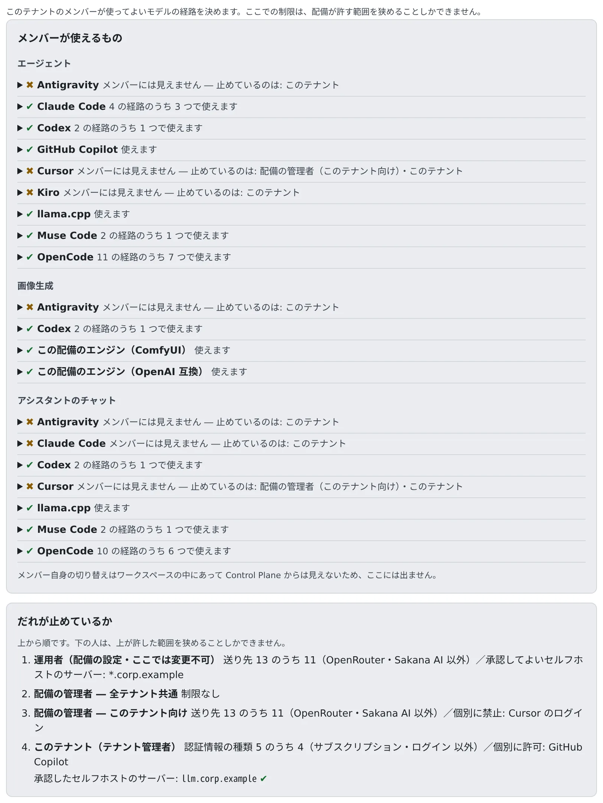
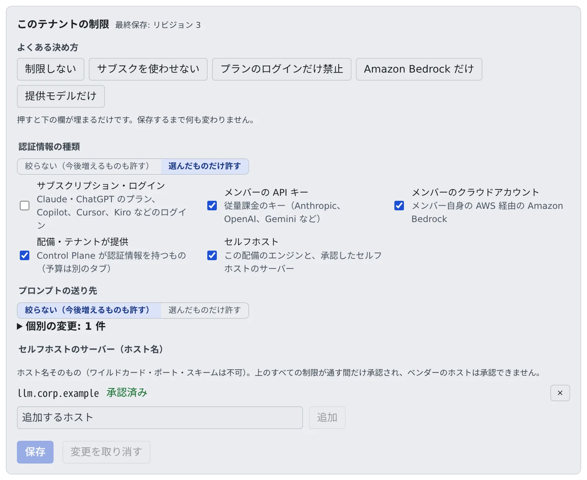
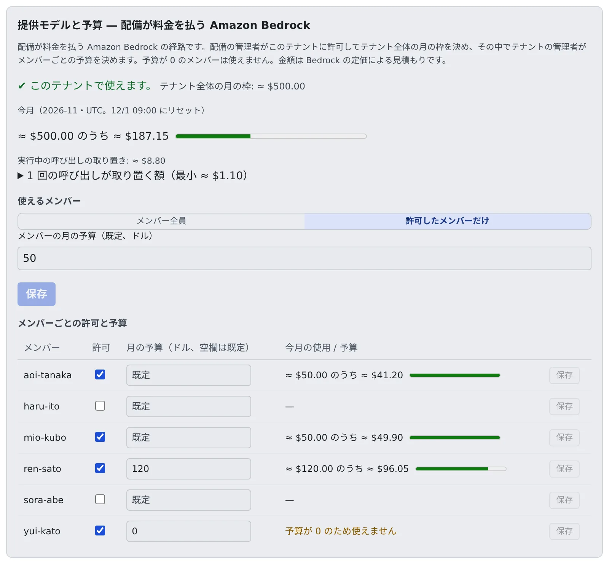
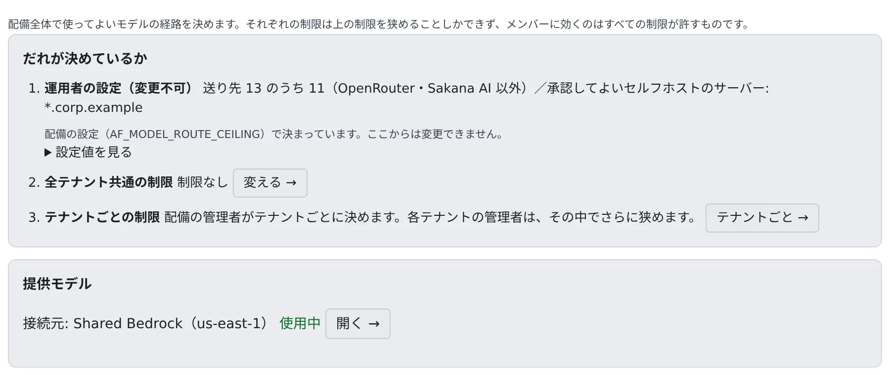
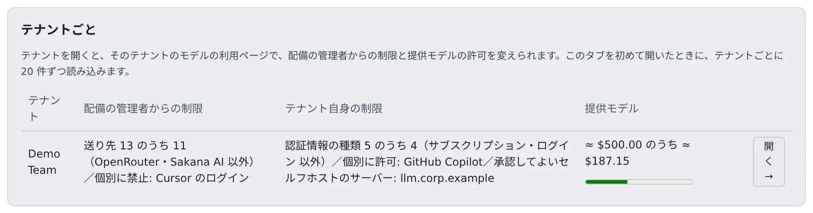

# メンバーが使えるモデルを決める

[English](model-access.md) | 日本語

メンバーが使ってよいモデルの経路を決めます。たとえば「サブスクリプションは使わせない」「Amazon Bedrock だけ」「従量課金のキーは 1 社を除いてすべて」といった決め方です。
禁じたものは、メンバーの画面（起動ダイアログ、エージェントと認証情報のページ、画像生成、アシスタント）から消えます。

## しくみ

**経路**は、エージェントのモデル呼び出しがどこへ、どの認証情報で行くかです。Claude のサブスクリプション、Anthropic の API キー、メンバーの AWS プロファイル経由の Amazon Bedrock などがあります。
経路にはそれぞれ**認証情報の種類**と**プロンプトの送り先**があり、制限はこの 2 つで書きます。

| 認証情報の種類 | 意味 |
|---|---|
| サブスクリプション・ログイン | プランやアカウントのログイン（Claude や ChatGPT のサブスクリプション、Copilot、Cursor、Kiro、opencode.ai のアカウント） |
| メンバーの API キー | メンバーが保存した従量課金のキー（Anthropic、OpenAI、Gemini、OpenRouter など） |
| メンバーのクラウドアカウント | メンバー自身の AWS プロファイル経由の Amazon Bedrock |
| 配備・テナントが提供 | Control Plane が認証情報を持っている経路 |
| セルフホスト | この配備のエンジンと、承認したセルフホストのサーバー |

送り先は、プロンプトを受け取る相手です。Anthropic、OpenAI、Google、Amazon Bedrock、この配備のエンジン、承認済みのセルフホスト、その他のベンダーがあります。

制限は何人かが順に決めていて、**どの制限も上の制限を狭めることしかできません**。

| 画面での名前 | 決める人 |
|---|---|
| 運用者の設定（変更不可） | 運用者が配備の設定で決めます。画面では読むだけです |
| 全テナント共通の制限 | 配備の管理者が、すべてのテナントに対して決めます |
| 配備の管理者からこのテナントへの制限 | 配備の管理者が、テナントごとに決めます |
| このテナントの制限 | テナント管理者のあなたが決めます |
| メンバー自身の切り替え | メンバーが自分の分を決めます |

経路が使えるのは、そのすべてが許すときだけです。あなたが許しても、上の制限が禁じたものは戻りません。

## ページのつくり

**テナント設定 → 運用 → モデルの利用**を開きます。ページは、持ってくる問いごとのタブに分かれています。

| タブ | 答えること |
|---|---|
| **概要** | メンバーは何を使えて、残りはだれが止めているか |
| **制限** | 使ってよいものをどう絞るか |
| **提供モデルと予算** | 配備が料金を払う Amazon Bedrock に、いくらまで使わせるか。配備が出している場合だけ |

変更が効くまでの文はタブの上に常に出ます。タブを切り替えても保存していない編集は残り、未保存の変更があるタブには ● が付きます。

## メンバーが使えるものと、使えない理由を見る

**メンバーが使えるもの**に、エージェント・画像生成・アシスタントのチャットが 1 行ずつ並びます。少なくとも 1 つの経路で使えるものは ✔、使える経路が 1 つも残らずメンバーから見えなくなっているものは ✖ です。
行を開くと経路が並び、それぞれに ✔ か ✖ と、使えない経路にはだれが止めているかが出ます。エージェントは、経路ごとに別の人に禁じられて、2 人に止められることもあります。経路の名前にマウスを載せると、Control Plane の拒否が使う ID が出ます。

| 一覧の表示 | 意味 |
|---|---|
| ✔ と「4 の経路のうち 3 つで使えます」 | メンバーには、残った経路だけで見えています |
| ✖ と止めている人 | テナントのすべてのメンバーから隠れています。戻すには、少なくとも 1 つの経路について、挙がっている人のすべてが許す必要があります |
| メンバー自身の llama.cpp やカスタムのエンドポイントに「承認したセルフホストのサーバーがありません」 | すべての制限が承認したホストでなら許していますが、承認したホストがありません。**制限**でホストを承認してください。制限は変えなくてかまいません |
| 隠れているものだけと、その旨の 1 行 | Control Plane が古く、各エージェントが何を使えるかを返しません |
| 一覧を読めなかったという表示 | Control Plane が一覧を返しませんでした。「すべて使える」とは違います |

メンバー自身の切り替え（メンバーが自分で切ったエージェント）は、メンバーのワークスペースの中にあって Control Plane から見えないため、この一覧には出ません。

**だれが止めているか**には、制限が上から 1 行ずつ並びます。運用者、配備の管理者の全テナント共通の制限とこのテナント向けの制限、最後にあなた自身の制限で、「送り先 13 のうち 11（OpenRouter・Sakana AI 以外）」のように言葉で出ます。あなた自身の行には、入力したセルフホストのサーバーが ✔ か ✖ で並び、承認されていないものはだれが止めているかが出ます。

## 使ってよいものを絞る

1. **制限**の**このテナントの制限**で、合うものがあれば**よくある決め方**（**制限しない**・**サブスクを使わせない**・**プランのログインだけ禁止**・**Amazon Bedrock だけ**・**提供モデルだけ**）から始めます。押すと下の欄が埋まるだけで、欄がその内容のままの間は ✓ が付きます。サーバーはそのまま残ります
2. そのうえで次を決めます
   - **認証情報の種類**: **絞らない**（今後増えるものも許す）か、**選んだものだけ許す**にして許す種類を選びます。種類ごとに何が含まれるかが 1 行で出ます
   - **プロンプトの送り先**: **絞らない**（今後増えるものも許す）か、**選んだものだけ許す**にして許す送り先を選びます
   - **個別の変更**（開くまで閉じています）の**個別に許可**: 種類や送り先では禁じられるけれど、それでも許す経路です。「サブスクリプションは使わせない、ただし Copilot は使う」は、種類の制限にここで Copilot を足した形です
   - **個別の変更**の**個別に禁止**: 種類や送り先では許されるけれど、それでも禁じる経路です。両方に入れた経路は禁じられます
3. **保存**を押します

**選んだものだけ許す**で何も選ばないと、何も許しません。**絞らない**とは違います。
⚠ の付いた選択肢は、あなたより上の制限が止めています。選んでもメンバーは使えません。印にマウスを載せると、だれが止めているかが出ます。
経路は名前で出ます。マウスを載せると、Control Plane の拒否が使う ID が出ます。
Control Plane が制限を受け付けなかったときは、理由がボタンの上に出て、編集した内容はそのまま残ります。その値だけを直せます。
保存はすべて、変更前と変更後の制限つきで監査ログに残ります（[監査ログを読む](../audit.ja.md)）。

ページを開いた後にほかの人が同じ制限を保存していた場合、あなたの保存は「読み込んだ後に、ほかの人がこの規則を更新しています」と断られ、何も保存されません。編集した内容は画面に残ります。ページを開き直して相手の内容を確認し、変更をやり直してください。

## 自分たちのサーバーを使わせる

メンバー自身の llama.cpp など、メンバーが入力したサーバーは Agent Fleet が保証できません。何かを制限している間は、ホストを承認しない限り使えません。

1. **制限**の**セルフホストのサーバー（ホスト名）**で、ホスト名（ワイルドカード、ポート、スキームは書きません）を入力して**追加**を押します。ホストは 1 行ずつ並び、状態と、外すための × が付きます
2. **保存**を押します

ホストが承認されるのは、上のすべての制限が通している間だけです。ベンダーのホストは承認できません。リンクローカルアドレス（`169.254.0.0/16`、`fe80::/10`）や `fd00:ec2::254` のようなインスタンスメタデータのアドレスも承認できません。入力時に断られ、以前に保存されていたものは**承認されません**と表示され、削除するまで Workspace には送られません。ループバック（`127.0.0.1`、`::1`）は承認できますが、上の制限がエンドポイントを挙げていて、そこに含まれていない場合は承認できません。
承認したサーバーをメンバーが使うには、種類と送り先の両方で**セルフホスト**を許してください。

## チームに予算つきで Amazon Bedrock を渡す

配備によっては、Amazon Bedrock の料金を配備が払い、**提供する経路**としてテナントに出しています。そうでない配備では、**提供モデルと予算**のタブはページに出ません。

配備の管理者が、**テナント全体の月の枠**つきでこのテナントに許可します。その中で、使える人と金額をあなたが決めます。タブの上に、いまの状態が出ます。

- **このテナントで使えます**と月の枠、または、許可されていないので**まだ使えません**という帯。どちらでも下の予算は編集できます。先に決めておくと、許可されたときから効きます
- 配備の Bedrock ソースが**停止**されている、または**まだ登録されていない**ときの帯。上の状態表示の代わりに出て、使えるモデルとしては並べません。テナント側でできることはなく、配備の管理者がソースを有効にする必要があります。許可と予算は残り、有効になったときから効きます（テナントが未許可なら、許可も必要です）。この状態を読めないとき（古い Control Plane、または読み込みの失敗）は、この帯は出ません
- 今月（UTC）と、リセットされる日時（あなたの現地時刻）、月の枠に対して使った額と実行中の呼び出しの取り置きの棒
- 制限で「Amazon Bedrock（この配備）」が止まっているときは、止めている人を挙げた帯（**制限を見る →**で制限のタブに移ります）。制限が許すまで、予算があってもメンバーは使えません

1. **使えるメンバー**で、**メンバー全員**か**許可したメンバーだけ**を選びます
2. **メンバーの月の予算（既定、ドル）**を入力して**保存**を押します
3. **メンバーごとの許可と予算**で、メンバーにチェックを入れて許可するか、その人だけの予算を入力して（空欄なら既定）、その行の**保存**を押します

予算が 0 のメンバーは使えず、その行にそう出ます。既定が 0 なら、自分の予算があるメンバーだけが使えます。メンバーの行には、今月の使用と予算が並びます。金額は Bedrock の定価による見積もりで、毎月の初め（UTC）に戻ります。
1 回の呼び出しも収まらないほど小さい予算は受け付けられず、理由がボタンの横に出ます。出力が小さい呼び出しだけが収まる予算は、注意つきで保存されます（[予算と予約](../../ref/bedrock-route.ja.md#予算と予約配備が提供する-bedrock-ルート)）。

## 変更が効くまで

- 変更は、メンバーの新しい起動には 30 秒以内に効きます
- 禁じられた経路で実行中のセッションは、30 秒と調停の 1 周期のうちに止まります
- ワークスペースが Control Plane に届かない間、変更は次に届いたときに反映されるので、遅れは届かない時間そのものです。メンバーにすでに制限があるか配備の上限がある場合は、15 分届かないと新しい起動を断ります。実行中のセッションはそのままです
- すべての経路が禁じられた認証情報は、削除されずに残り、メンバーからは見えなくなります。制限を緩めると、サインインし直さずにまた使えます

## これで止められないもの

メンバーがワークスペースの端末から手作業でモデルにサインインすることは止められません。
この規則が縛るのは Agent Fleet 自身の起動で、メンバーが手で実行するものではありません。

## 配備の管理者へ

管理画面の**配備全体 → モデルの利用**に、テナントより上で決めることが 4 つのタブに分かれてあります。

| タブ | 答えること |
|---|---|
| **概要** | 配備全体で、だれが何を決めているか |
| **全テナント共通の制限** | すべてのテナントを一度に絞るには |
| **テナントごと** | 各テナントはどう絞られていて、1 つを変えるにはどこへ行くか |
| **提供モデル** | 配備が料金を払う Bedrock の接続元。提供する経路を出している場合だけ |

### 運用者の設定が許していること

**概要**の**だれが決めているか**に、上から 1 行ずつ出ます。**運用者の設定（変更不可）**（**設定値を見る**を開くと、配備が起動したときの値が出ます）、**全テナント共通の制限**、**テナントごとの制限**で、それぞれに変えるタブへのボタンがあります。その下に、Bedrock の料金を配備が払う場合は、接続元の名前とリージョン、使用中かどうかが出ます。
運用者の設定はここでは変えられません。配備の設定です。

### すべてのテナントを絞る

**全テナント共通の制限**は、テナントのものと同じエディタで、同じ**よくある決め方**があります。すべてのテナントに効きます。

運用者の設定が禁じているものには 🔒 が付きます。それを 1 つでも許す内容は保存できず、**保存**を押す前に、何を許してしまうかを示して警告が出ます。**運用者の設定に合わせる**を押すと、欄が運用者の設定の許す範囲まで狭まり、保存できる形になります。たとえば Cursor のログインだけを禁じた制限には、運用者の設定の送り先も入ります。広げることも、保存することもしません。
**承認してよいセルフホストのサーバー**には、テナントが承認してよいホストのパターン（ホスト名そのもの、`*.example.com`、または `10.20.0.0/16` や `fd12:3456::/32` のようなプライベート IP の範囲）を 1 行ずつ追加します。範囲は IP アドレスにだけ一致し、範囲内に名前解決されるホスト名にも一致しません。プライベートアドレス空間に収まる必要があり（`fd00::/8` のようにクラウドのメタデータのアドレスを含む範囲は断られます）、ホストビットは 0 にします（`10.20.5.7/16` は断られるので `10.20.0.0/16` と書きます）。テナントは引き続き正確なホストを 1 つずつ承認します。**絞らない**は上の制限に任せます。**選んだものだけ許す**でパターンを 1 つも追加しないと、どのホストも承認できません。

### 1 つのテナントをさらに絞る、Amazon Bedrock を許可する

**テナントごと**はテナントの一覧です。各テナントの**配備の管理者からの制限**と**テナント自身の制限**、Bedrock の料金を配備が払う場合は提供モデルの許可と今月の使用が並びます。タブを初めて開いたときに 20 テナントずつ読み込みます。行の**開く →**で、**管理 → テナント → ［テナント］→ モデルの利用**（そのテナントのページ）を開きます。このページに保存していない変更があるときは、先に確かめます。

そのテナントだけのことは、テナントのページで変えます。そこには、テナントの管理者には見えないカードが 2 つ出ます。

- **制限**の、テナント自身の制限の上に、**配備の管理者からこのテナントへの制限**。全テナント共通の制限と同じく、🔒 と**運用者の設定に合わせる**があり、全テナント共通の制限がすでに止めているものに ⚠ が付きます
- **提供モデルと予算**の**このテナントへの許可と月の枠**: **このテナントに許可する**と**テナント全体の月の枠（ドル）**。許可するには 0 より大きい枠が要ります。配備の接続元は先に登録してください。登録しないまま許可しても保存はされますが、登録するまで呼び出しは通りません

テナントのメンバーに何かが見えない理由は、そのテナントを開いて**概要**で調べます（上と同じです）。

### 配備の Bedrock の接続元を登録する

**提供モデル**（Bedrock の料金を配備が払う場合）に、**接続元**（Amazon Bedrock を呼ぶ IAM ロール）があります。スタックが作った IAM ロール、呼び出す 1 つのリージョン、使ってよいモデルを登録し、**この接続元を使う**で使うかどうかを決めます。止めても使用額とセッションの記録は残ります。テナントへの許可は、そのテナントのページで行います。

## 関連

- [監査ログを読む](../audit.ja.md)
- [配備が提供する Bedrock ルートの予算と予約](../../ref/bedrock-route.ja.md#予算と予約配備が提供する-bedrock-ルート)
- [推論エンジンを使える人とモデルを決める](../resources/engines.ja.md)
