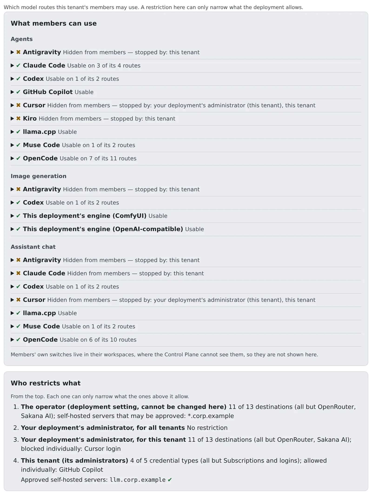
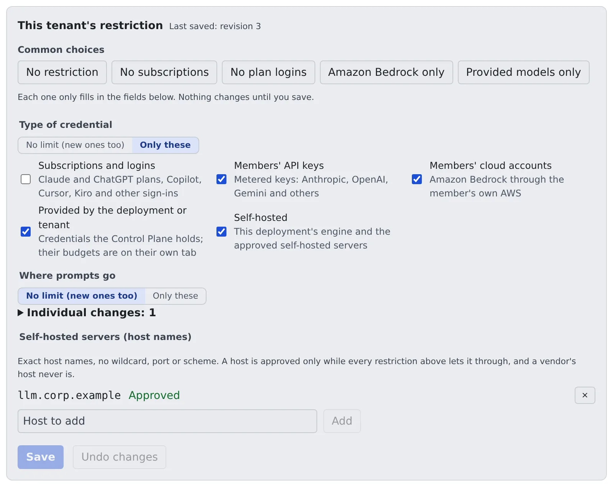
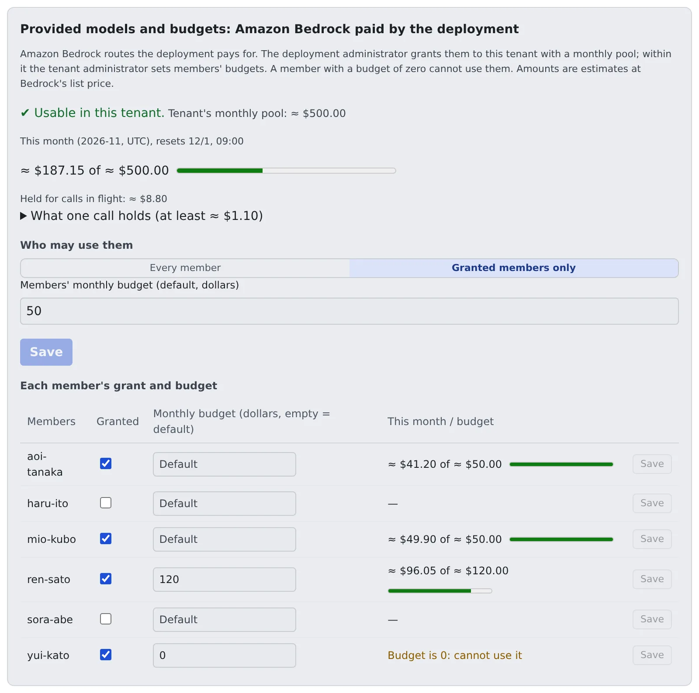
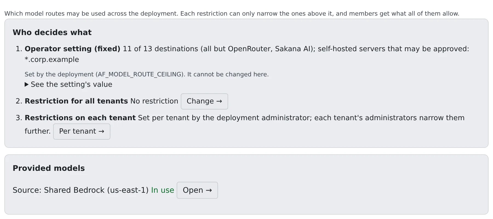
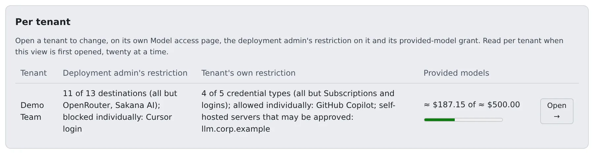

# Choose which models members may use

English | [日本語](model-access.ja.md)

Decide which model routes your members may use: for example no subscriptions, only Amazon Bedrock, or every metered key except one provider.
What you forbid disappears from your members' screens: the launch dialog, the agents and credentials pages, image generation and the assistant.

## How it works

A **route** is where an agent's model calls go and with which credential: a Claude subscription, an Anthropic API key, Amazon Bedrock through the member's AWS profile, and so on.
Every route has a **type of credential** and a **destination** (where its prompts go), and a restriction is written with those two:

| Type of credential | Means |
|---|---|
| Subscriptions and logins | A plan or account login (a Claude or ChatGPT subscription, Copilot, Cursor, Kiro, an opencode.ai account) |
| Members' API keys | A metered key the member stores (Anthropic, OpenAI, Gemini, OpenRouter and so on) |
| Members' cloud accounts | Amazon Bedrock through the member's own AWS profile |
| Provided by the deployment or tenant | A route the Control Plane holds the credential for |
| Self-hosted | This deployment's engine, and self-hosted servers you approved |

The destination is who receives the prompts: Anthropic, OpenAI, Google, Amazon Bedrock, this deployment's engine, an approved self-hosted server, and the other vendors.

Restrictions are set by several people in turn, and **each one can only narrow the ones above it**:

| On screen | Who sets it |
|---|---|
| Operator setting (fixed) | The operator, in the deployment's configuration. Read-only on screen |
| Restriction for all tenants | The deployment administrator, for every tenant |
| Deployment admin's restriction on this tenant | The deployment administrator, for one tenant |
| This tenant's restriction | You, the tenant administrator |
| A member's own switches | Each member, for themselves |

A route is usable only when every one of them allows it. Nothing you allow can reopen what a restriction above forbids.

## The page

Open **Tenant settings → Operations → Model access**. The page has a tab for each question you bring to it:

| Tab | Answers |
|---|---|
| **Overview** | What can my members use, and who stops the rest? |
| **Restrictions** | How do I restrict what they may use? |
| **Provided models & budgets** | How much may they spend on the Amazon Bedrock the deployment pays for? Only where the deployment offers it |

The sentences on when a change applies stay above the tabs. Switching tabs keeps what you have not saved, and a tab with unsaved changes is marked with ●.

## See what members can use, and why not

**What members can use** has one row for each agent, image provider and assistant chat backend: ✔ when members can use it on at least one route, ✖ when it is hidden from them because none of its routes is allowed.
Open a row to see its routes, each with ✔ or ✖ and, for one that is not allowed, who stops it. An agent can be stopped by two people at once, one forbidding each of its routes. Hover a route's name for the id the Control Plane's refusals use.

| What the list shows | Means |
|---|---|
| ✔ with "Usable on 3 of its 4 routes" | Members see it with only the routes left |
| ✖ with who stops it | It is hidden from every member of the tenant. To bring it back, everyone named for at least one of its routes has to allow it |
| "no approved self-hosted server" on a member's own llama.cpp or custom endpoint | Every restriction allows it on an approved host, and none is approved. Approve the host on **Restrictions**; no restriction has to change |
| Only the hidden items, with a line saying so | The Control Plane is older and does not say what each agent can use |
| A line saying the list could not be read | The Control Plane did not answer it. This is not the same as "everything is usable" |

Members' own switches (an agent a member turned off for themselves) are not on this list, because they live in the member's workspace and the Control Plane cannot see them.

**Who restricts what** gives one line for each restriction, top first: the operator, your deployment's administrator for all tenants and for this tenant, then your own, worded plainly ("11 of 13 destinations (all but OpenRouter, Sakana AI)"). Your own line also lists the self-hosted servers you entered, each with ✔ or ✖ and, for one that is not approved, who keeps it out.

## Restrict what members may use

1. On **Restrictions**, under **This tenant's restriction**, start from one of the **Common choices** if one fits: **No restriction**, **No subscriptions**, **No plan logins**, **Amazon Bedrock only**, **Provided models only**. A choice only fills in the fields below and is marked ✓ while the fields match it; your servers are left as they are
2. Then set:
   - **Type of credential**: **No limit (new ones too)**, or **Only these** with the types you allow. Each type says what it covers
   - **Where prompts go**: **No limit (new ones too)**, or **Only these** with the destinations you allow
   - Under **Individual changes** (closed until you open it), **Allowed individually**: a route your types or destinations would forbid, which you still allow. "No subscriptions except Copilot" is the type restriction plus Copilot here
   - Under **Individual changes**, **Blocked individually**: a route your types and destinations would allow, which you still forbid. A route in both lists is blocked
3. Press **Save**

**Only these** with nothing ticked allows nothing; it is not the same as **No limit**.
An option marked ⚠ is stopped by a restriction above yours: ticking it does not let members use it. Hover the mark to see who stops it.
Routes are shown by name; hover one for the id the Control Plane's refusals use.
When the Control Plane refuses a restriction, the reason is shown above the button and your edits stay, so you can correct the one value.
Every save is recorded in the audit log with the restriction before and after ([Read the audit log](../audit.md)).

## Let members use your own servers

A member's own llama.cpp, or another server they type in, cannot be vouched for by Agent Fleet: under any restriction it is refused unless its host is approved.

1. On **Restrictions**, under **Self-hosted servers (host names)**, type an exact host (no wildcard, port or scheme) and press **Add**. Each host is a row: its state, and × to remove it
2. Press **Save**

A host is approved only while every restriction above lets it through, and a vendor's host is never approvable.
Allowing the type of credential and the destination **Self-hosted** is what lets members use an approved server.

## Give the team Amazon Bedrock with budgets

Some deployments pay for Amazon Bedrock themselves and offer it to tenants as a **provided route**. Where the deployment does not, the **Provided models & budgets** tab is not on the page.

The deployment administrator grants it to your tenant with a **tenant's monthly pool**. Within it, you decide who may use it and how much. The top of the tab says where things stand:

- **Usable in this tenant**, with the pool, or a banner saying it is **not usable yet** because it is not granted. The budgets below stay editable either way: set them first, and they apply from the moment it is granted
- A banner saying the deployment's Bedrock source is **switched off** or **not registered yet**, shown in place of the status above and with no models listed as usable. There is nothing to do from the tenant side: the deployment's administrator has to enable the source. The grant and budgets are kept and apply once it is on (a tenant that is not granted also needs the grant). A page that cannot read this state (an older Control Plane, or a failed read) shows no such banner
- This month, in UTC, with when it resets in your local time, and a bar of what is spent and held for calls in flight against the pool
- A banner when your restrictions stop "Amazon Bedrock (this deployment)", naming who, with **See restrictions →**: members cannot use it, whatever their budget, until the restriction allows it

1. Under **Who may use them**, choose **Every member** or **Granted members only**
2. Enter **Members' monthly budget (default, dollars)**, then press **Save**
3. In **Each member's grant and budget**, tick a member to grant them, or enter a budget of their own (leave it empty for the default), then press **Save** on that row

A member whose budget is zero cannot use the route, and their row says so; with a default of zero, only members with a budget of their own can. Each member's row shows this month against their budget. Amounts are estimates at Bedrock's list price and reset at the start of each month (UTC).
A budget so small that no single call fits is refused, with the reason beside the button; one that fits only calls with a small output is saved with a warning ([Budgets and reservations](../../ref/bedrock-route.md#budgets-and-reservations-the-deployments-bedrock-route)).

## When a change applies

- A change reaches members' new launches within 30 seconds
- A running session on a route that became forbidden is stopped within 30 seconds plus one reconciler tick
- While a workspace cannot reach the Control Plane, a change waits for its next successful pull, so the delay is as long as the outage. Where the member was already restricted or the deployment has a ceiling, new launches are refused after 15 minutes without a successful pull; running sessions are left alone
- A stored credential whose every route is forbidden is kept, not deleted, and is hidden from the member. Loosening the restriction makes it usable again without signing in again

## What this cannot stop

A member who signs in to a model by hand from a terminal in their workspace cannot be stopped.
This rule binds Agent Fleet's own launches, not what a member runs by hand.

## For the deployment administrator

The admin modal's **Deployment → Model access** has what is decided above the tenants, on four tabs:

| Tab | Answers |
|---|---|
| **Overview** | Who decides what across the deployment? |
| **Restrictions for all tenants** | How do I restrict every tenant at once? |
| **Per tenant** | How is each tenant restricted, and where do I change one? |
| **Provided models** | Which Bedrock source does the deployment pay for? Only where it offers provided routes |

### What the operator setting allows

**Overview** gives **Who decides what**, one plain line each, top first: the **Operator setting (fixed)** (open **See the setting's value** for the value the deployment was started with), the **Restriction for all tenants** and **Restrictions on each tenant**, each with a button to the tab where it is changed. Below, where the deployment pays for Bedrock, the source's name, Region and whether it is in use.
The operator setting cannot be changed here: it is the deployment's configuration.

### Restrict every tenant

**Restrictions for all tenants** has the same editor as a tenant's, with the same **Common choices**. It applies to every tenant.

What the operator setting forbids is marked 🔒. A restriction that would still allow any of it cannot be saved, and the editor says so before you press **Save**, naming what it would allow. **Match the operator setting** narrows the fields to what the operator setting allows, so it can be saved: for example a restriction that only blocks Cursor's login gets the operator setting's destinations as well. It never widens anything and does not save.
Its **Self-hosted servers that may be approved** name the host patterns a tenant may approve, one row each: an exact host, `*.example.com`, or a private IP range such as `10.20.0.0/16` or `fd12:3456::/32`. A range matches IP addresses only, never host names, even ones that resolve into it; it must lie inside private address space (a range holding a cloud metadata address such as `fd00::/8` is refused), and host bits must be zero (`10.20.5.7/16` is refused, write `10.20.0.0/16`). A tenant still approves exact hosts one by one. **No limit** leaves the restriction above in charge; **Only these** with no pattern lets no host be approved.

### Restrict one tenant further, or grant it Amazon Bedrock

**Per tenant** is a table of the tenants, each with the **Deployment admin's restriction** on it, its **Tenant's own restriction** and, where the deployment pays for Bedrock, its provided-model grant and this month. It is read when you first open the tab, twenty tenants at a time. **Open →** on a row opens **Admin → Tenants → [tenant] → Model access**, the tenant's own page. If you have unsaved changes on this page, you are asked first.

A tenant's own page is where you change what is that tenant's alone. You see two cards there that its administrators do not:

- On **Restrictions**, above the tenant's own restriction, the **Deployment admin's restriction on this tenant**. It has the same 🔒 marks and **Match the operator setting** as the restriction for all tenants, and marks with ⚠ what the restriction for all tenants already stops
- On **Provided models & budgets**, **Grant to this tenant and monthly pool**: **Grant to this tenant** with the **Tenant's monthly pool (dollars)**. A grant needs a pool above zero. Register the deployment's source first: a grant saved without one is kept, but admits no calls until the source is registered

To find out why a tenant's members cannot see something, open the tenant and read its **Overview**, as above.

### Register the deployment's Bedrock source

**Provided models**, where the deployment pays for Bedrock, has the **Source (the IAM role that calls Amazon Bedrock)**: the IAM role the stack created, the one Region it calls, the models it may use, and **Use this source**. Switching it off keeps its spend and sessions on record. Grant it to a tenant from the tenant's own page.

## Related

- [Read the audit log](../audit.md)
- [Budgets and reservations of the deployment's Bedrock route](../../ref/bedrock-route.md#budgets-and-reservations-the-deployments-bedrock-route)
- [Choose who may use the inference engines and which models](../resources/engines.md)
