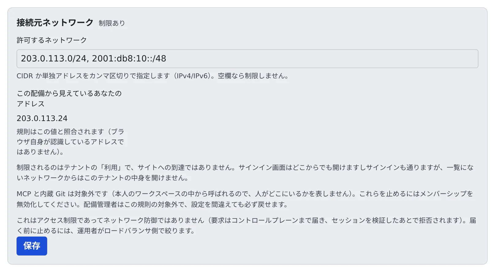

# サインインできるネットワークを絞る

[English](networks.md) | 日本語

テナントを使える接続元を、社内のネットワークなど決まったアドレスの範囲に絞れます。
一覧の外からは、サインインは通っても、このテナントの中身を開けなくなります。

## 全体像

| あなたがやること | Agent Fleet がやること |
|---|---|
| 許可するネットワークを書いて保存する | リクエストごとに、配備から見えた送信元のアドレスを一覧と照合する |
| 自分のアドレスが一覧に入っているか確かめる | 一覧の外からの要求を、セッションを確かめたあとで断る |

- 既定では、配備に届く場所ならどこからでもテナントを使えます
- 絞るのはテナントの「利用」で、サイトへの到達ではありません。サインイン画面はどこからでも開けますし、サインインも通ります

## 絞る

1. **テナント設定 → サインイン → 接続元の制限** を開きます
2. **この配備から見えているあなたのアドレス** を確かめます
3. **許可するネットワーク** に、CIDR か単独のアドレスをカンマ区切りで書きます。IPv4 も IPv6 も使えます
4. いま自分が接続している範囲が入っていることを確かめてから、**保存** を押します

> [!WARNING]
> 自分を締め出すと、この画面からは直せません。保存する前に、画面に出ているあなたのアドレスが一覧に入っていることを確かめてください。
> 配備管理者はこの規則の対象外なので、書き損じたら配備管理者に戻してもらえます。

- 欄を空にして保存すると、制限はなくなります
- 照合に使うのは、画面に出ている「この配備から見えているあなたのアドレス」です。ブラウザ自身が認識しているアドレスではありません

## 対象になるもの・ならないもの

| 対象 | 対象外 |
|---|---|
| このテナントの中身を開くこと | MCP と内蔵 Git |

- MCP と内蔵 Git は、本人のワークスペースの中から呼ばれるので、人がどこにいるかを表しません。止めたいときは、メンバーを外します（[メンバーを外す](../members/remove.ja.md)）
- 効くのはこのテナントだけです。ほかのテナントにも入っている人は、そちらへはそちらの規則で入ります
- これはアクセスの制限で、ネットワークの防御ではありません。要求はコントロールプレーンまで届き、セッションを確かめたあとで断られます。届く前に止めたいときは、配備管理者にロードバランサの側で絞ってもらいます
- 同じ画面の **MCP OAuth** は、外のアプリの接続についての設定です（[MCP の配布と外からのアクセス](../mcp-distribute.ja.md#外のアプリからの-oauth-接続を止める)）

## うまくいかないとき

### あなたのアドレスが「判定できません」と出る

コントロールプレーンが、要求の送信元を特定できていません。このままでは規則を適用できません。
範囲を推測で書かずに、配備管理者に `AF_TRUSTED_PROXY_HOPS` の設定を確かめてもらってください。

### プロキシが申告されていないと出て、保存できない

コントロールプレーンの手前にプロキシがあるのに、配備がそれを申告していません。このままだと全員がプロキシから来ているように見え、絞ったつもりで全員を通してしまうので、保存を止めています。
配備管理者に連絡してください。

## 関連

- [サインインの方法を決める](signin-methods.ja.md)
- [チーム管理者の仕事](../overview.ja.md)
