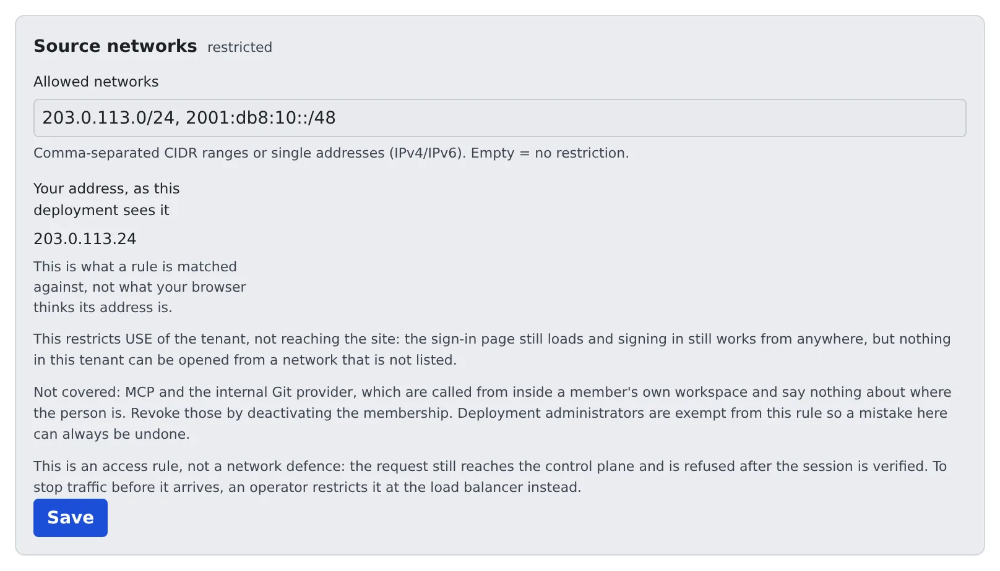

# Limit the networks people sign in from

English | [日本語](networks.ja.md)

You can narrow the places your tenant can be used from to known address ranges, such as the company network.
From outside the list, sign-in still works but the tenant's contents will not open.

## How it works

| What you do | What Agent Fleet does |
|---|---|
| Write the allowed networks and save | Matches every request's source address, as the deployment sees it, against the list |
| Check that your own address is in the list | Refuses requests from outside the list, after checking the session |

- By default the tenant can be used from anywhere the deployment can be reached from
- What is narrowed is the use of the tenant, not reaching the site. The sign-in page opens from anywhere and sign-in goes through

## Narrow it

1. Open **Tenant settings → Sign-in → Allowed networks**
2. Check **Your address, as this deployment sees it**
3. Under **Allowed networks**, write CIDR ranges or single addresses separated by commas. IPv4 and IPv6 both work
4. Make sure the range you are connecting from is in the list, then press **Save**

> [!WARNING]
> Lock yourself out and you cannot fix it from this screen. Before saving, make sure the address shown on the screen is in the list.
> Deployment administrators are exempt from this rule, so a deployment administrator can put a wrong entry right.

- Save with the field empty and the restriction is gone
- The value matched is the "Your address, as this deployment sees it" on the screen, not the address your browser believes it has

## What it covers and what it does not

| Covered | Not covered |
|---|---|
| Opening the tenant's contents | MCP and the built-in Git |

- MCP and the built-in Git are called from inside the member's own workspace, so they say nothing about where the person is. To stop them, remove the member ([Remove a member](../members/remove.md))
- It applies to this tenant only. Someone who also belongs to another tenant reaches that one under its own rules
- This is an access restriction, not network defence: the request reaches the control plane and is refused after the session is checked. To stop requests before they arrive, have the deployment administrator narrow it at the load balancer
- **MCP OAuth** on the same screen is about outside apps connecting ([MCP distribution and outside access](../mcp-distribute.md#stop-outside-apps-from-connecting-with-oauth))

## When it goes wrong

### Your address reads "cannot be determined"

The control plane cannot tell where requests come from, so no rule can be applied.
Do not guess at a range; ask the deployment administrator to check the `AF_TRUSTED_PROXY_HOPS` setting.

### It says a proxy is not declared, and you cannot save

A proxy sits in front of the control plane but the deployment has not declared it. Every request then looks like it comes from the proxy, and a rule meant to narrow would let everyone in, so saving is blocked.
Contact the deployment administrator.

## Related

- [Choose how people sign in](signin-methods.md)
- [What a tenant administrator does](../overview.md)
