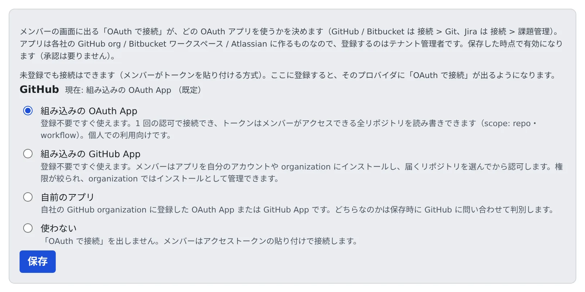

# 連携に使う OAuth アプリを選ぶ

[English](oauth-apps.md) | 日本語

メンバーの接続画面に出る「OAuth で接続」が、どの OAuth アプリを使うかを決めます。
登録しておくと、メンバーはトークンを自分で作らずに、GitHub・Bitbucket・Jira を接続できます。

## 全体像

| あなたがやること | Agent Fleet がやること |
|---|---|
| GitHub で使うアプリを選ぶ。Bitbucket・Jira はアプリを作って登録する | メンバーの接続画面に「OAuth で接続」を出す |
| メンバーに接続してもらう | 認可を受けて、トークンをメンバー本人のワークスペースに入れる |

- 登録しなくても、メンバーはトークンを貼り付けて接続できます
- 保存した時点で有効になります。承認は要りません
- 設定はプロバイダごと・テナントごとです。メンバーがそのプロバイダでできることは広がりません。アプリのスコープと、メンバー本人のそちらでの権限で決まります

## GitHub で使うアプリを選ぶ

**テナント設定 → 連携 → 連携アプリの OAuth** の GitHub のカードで、**メンバーが接続に使う GitHub のアプリ** を選びます。

| 選択肢 | メンバーがすること | 向いている使い方 |
|---|---|---|
| 組み込みの OAuth App | 1 回の認可で接続します。トークンは、メンバーがアクセスできる全リポジトリを読み書きできます（scope: `repo`・`workflow`） | 個人や小さなチーム。配備の最初のテナントでは既定です |
| 組み込みの GitHub App | アプリを自分のアカウントや organization にインストールし、リポジトリを選んでから認可します | リポジトリごとに権限を絞りたいチーム。organization ではオーナーしかインストールできません |
| 自前のアプリ | 自社で登録した OAuth App か GitHub App のとおりに接続します | 自社のアプリを使いたい組織 |
| 使わない | 「OAuth で接続」は出ません。アクセストークンを貼り付けて接続します | |

- 組み込みのアプリは、登録が要りません。GitHub のデバイスフローは secret を使わず、トークンはメンバー本人のワークスペースにだけ入るので、ほかの人がトークンを見ることはできません
- 配備管理者が組み込みのアプリを止めている配備では、カードにそう出ます（`AF_GITHUB_BUILTIN_APPS=off`）
- **既定に戻す** で、選んだものを消せます

### 自前のアプリを使う

1. GitHub の組織にアプリを登録し、**Enable Device Flow** にチェックを入れます。入れないと保存で断られます
2. **自前のアプリ** を選び、client_id を貼ります
3. GitHub App のときは、**インストールページ（GitHub App のみ）** にアプリのページ（`https://github.com/apps/<アプリ名>`）を入れます。OAuth App なら空のままにします
4. **保存** を押します

- OAuth App か GitHub App かは、保存時に GitHub に問い合わせて見分け、「判別結果」に出します。GitHub に届かないときは client_id の形から推定し、最初のメンバーの接続で確定します
- GitHub App は、インストールされたリポジトリにしか届きません。メンバーはインストールページに案内され、どこにもインストールされていなければ接続後に注意が出ます
- GitHub App では **Expire user authorization tokens** をオンのままにできます。Agent Fleet がクライアントシークレットなしでトークンを更新します。認可が取り消されたり、refresh token が約 6 か月使われずに切れたりしたメンバーには、接続し直すよう案内が出ます

## Bitbucket と Jira のアプリを登録する

1. プロバイダの側で、自分の組織に OAuth アプリを作ります。作る場所はカードの「アプリの登録先:」に出ます
2. カードに出ている **コールバック URL** を、そのアプリに設定します。完全に一致していないと、承認のときにプロバイダの分かりにくいエラーで戻ってきます
3. client_id と client_secret をカードに貼ります。Bitbucket では Key と Secret と呼ばれています
4. **保存** を押します

- client_secret は保存時に暗号化され、二度と表示されません。あとで編集するとき、空のままにすれば保存済みの値を使います。変えるときだけ入れてください
- **登録を削除** すると「OAuth で接続」が消えます。トークンで接続しているメンバーには影響しません
- カードに `PUBLIC_BASE_URL` が設定されていないと出たときは、コールバック URL を作れません。配備管理者に設定を頼んでください

### Bitbucket の Permissions

Bitbucket は認可 URL にスコープを載せないので、コンシューマの Permissions がそのまま全メンバーのトークンの権限になります。

| Permissions | 使い道 |
|---|---|
| Account: Read、Repositories: Read と Write | clone と push |
| Pull requests: Read と Write | セッションの `bkt pr create`、コメント、課題管理の一覧 |
| Pipelines: Read | `bkt pipeline` とビルド結果 |
| Pipelines: Write | パイプラインの開始と停止もするとき |

- 足りないと、読み取りは通るのに、それらのコマンドが `403 Forbidden: Your credentials lack one or more required privilege scopes` で失敗します
- あとから足したときは、接続済みのメンバーに Bitbucket を接続し直してもらいます。古い権限がトークンに残っているためです

### Jira のアプリ

Jira は Atlassian の 3LO アプリで、Bitbucket のコンシューマとは別に登録します。

- アプリを作るときの Access type は、Resource-level を勧めます。認可したサイト 1 つだけに権限が絞られます
- Permissions に Jira API を足し、`read:jira-work`・`read:jira-user`・`write:jira-work` を許可します。`offline_access` は Agent Fleet が認可 URL に付けるので、設定は要りません
- **Distribution で Sharing を有効にします。** 有効にするまでアプリは「開発中」で、作った本人しか認可できません

> [!WARNING]
> Sharing を有効にしないと、自分で試すと通るのに、ほかのメンバーは Atlassian の「You don't have access to this app」で止まります。
> この画面は認可より手前なので Agent Fleet には何も返らず、エラーも出ないまま接続されません。

- Sharing の有効化には Vendor name・Contact link・Privacy policy URL が要り、認可するメンバーに見えます。個人名や私用のアドレスではなく、会社名と問い合わせ窓口を入れてください
- Atlassian Marketplace には載りません。メンバーには「Atlassian の審査を受けていない」旨の注意が出ますが、自分で登録したアプリなら正常です

### Jira のボード・スプリント・エピックを使えるようにする

メンバーのセッションの `jira` でボード・スプリント・エピックを扱うには、Jira Software のスコープが要ります。**順番が大事です。**

1. Developer Console で、アプリの **Permissions → Jira API → Configure → Granular scopes → Edit Scopes** を開き、下の 8 つを選びます。クラシックスコープはそのまま残します
2. そのあとで、Jira のカードの「このアプリに Jira Software のスコープ（ボード・スプリント・エピック）も許可済み」にチェックを入れて **保存** を押します
3. 接続済みのメンバーに、Jira を接続し直してもらいます

| 画面での名前 | コード |
|---|---|
| View boards, backlogs, and related items | `read:board-scope:jira-software` |
| View sprints | `read:sprint:jira-software` |
| Update and delete sprints | `write:sprint:jira-software` |
| View epics and related issues | `read:epic:jira-software` |
| Update epics | `write:epic:jira-software` |
| View projects | `read:project:jira` |
| View issue details | `read:issue-details:jira` |
| View JQL | `read:jql:jira` |

- コードの列で確かめてください。View board configuration（`read:board-scope.admin:jira-software`）は 1 行目と似ていますが別のスコープで、要りません
- 先にチェックを入れると、全メンバーが接続できなくなります。アプリにないスコープを求める認可を Atlassian が断り、その画面から Agent Fleet に戻れないためです
- メンバーの Jira のカードに「ボード・スプリント・エピック: 利用できません」と出ていれば、そのメンバーはこれらのスコープなしで接続しています

### Confluence を使えるようにする

メンバーのセッションの `confluence` は、Jira と同じ Atlassian の認可を使います。順番は Jira Software と同じです。

1. Developer Console で、アプリの **Permissions → Confluence API → Configure → Edit Scopes** を開き、下の 10 個を選びます
2. そのあとで、Jira のカードの「このアプリに Confluence のスコープ（confluence CLI 用）も許可済み」にチェックを入れて **保存** を押します
3. 接続済みのメンバーに、Jira を接続し直してもらいます

| 種類 | スコープ |
|---|---|
| クラシック | `read:confluence-content.all`、`read:confluence-content.summary`、`read:confluence-space.summary`、`search:confluence`、`write:confluence-content`、`readonly:content.attachment:confluence`、`write:confluence-file` |
| 細粒度（granular） | `read:page:confluence`、`write:page:confluence`、`read:space:confluence` |

- 細粒度の 3 つは、ページの閲覧・作成・更新に要ります。ないと 401「scope does not match」になります
- クラシックの 7 つだけで設定済みのアプリは、細粒度の 3 つを足すだけで済みます。メンバーが接続し直すまで、カードには「Confluence: 検索とコメントは使えますが…」と出て、ページの操作は 1 行の案内を出します
- チェックを入れないテナントは今までどおり動き、メンバーが `confluence` を使えないだけです
- メンバーの Jira のカードに「Confluence: 利用できません」と出ていれば、そのメンバーはこれらのスコープなしで接続しています

## 関連

- [Git のサービスを接続する](../../user/code/connect-git.ja.md)
- [課題管理サービスを接続する](../../user/integrations/issue-tracker.ja.md)
- [Jira を使う](../../user/integrations/jira.ja.md)
- [Confluence を使う](../../user/integrations/confluence.ja.md)
