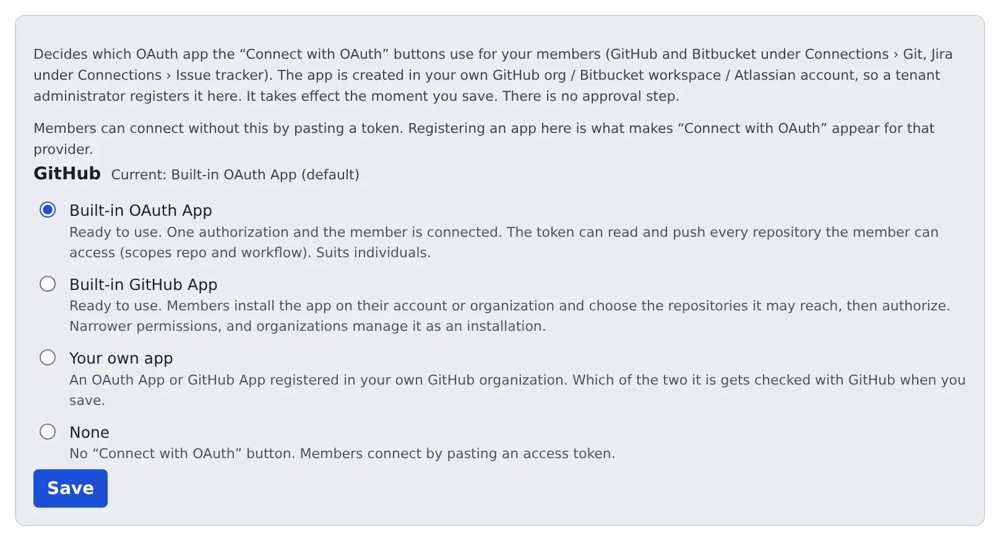

# Choose the OAuth apps for integrations

English | [日本語](oauth-apps.ja.md)

Decide which OAuth app the "Connect with OAuth" button on members' connection screens uses.
With one registered, members connect GitHub, Bitbucket and Jira without minting a token themselves.

## How it works

| What you do | What Agent Fleet does |
|---|---|
| Choose the app for GitHub; create and register an app for Bitbucket and Jira | Shows "Connect with OAuth" on members' connection screens |
| Have members connect | Takes the authorization and puts the token into the member's own workspace |

- Without a registration, members can still connect by pasting a token
- It takes effect the moment you save. No approval is needed
- The setting is per provider and per tenant. It does not widen what members may do at the provider: that is decided by the app's scopes and by each member's own permissions there

## Choose the app for GitHub

On the GitHub card under **Tenant settings → Integrations → Integration OAuth apps**, choose **Which GitHub app members connect through**.

| Choice | What members do | Suits |
|---|---|---|
| Built-in OAuth App | Connect with one authorization. The token can read and write every repository the member can access (scopes `repo` and `workflow`) | Individuals and small teams. The default of a deployment's first tenant |
| Built-in GitHub App | Install the app on their account or organisation, choose the repositories, then authorize | Teams that want permissions narrowed per repository. In an organisation only an owner can install it |
| Your own app | Connect the way your own registered OAuth App or GitHub App works | Organisations that want their own app |
| None | No "Connect with OAuth"; members paste an access token | |

- The built-in apps need no registration. GitHub's device flow uses no secret and the token goes only into the member's own workspace, so nobody else can see it
- On a deployment where the deployment administrator has turned the built-in apps off, the card says so (`AF_GITHUB_BUILTIN_APPS=off`)
- **Reset to default** clears your choice

### Use your own app

1. Register the app in your GitHub organisation and tick **Enable Device Flow**. Without it, saving is refused
2. Choose **Your own app** and paste the client_id
3. For a GitHub App, enter the app's page (`https://github.com/apps/<app name>`) as **Install page (GitHub App only)**. Leave it empty for an OAuth App
4. Press **Save**

- Whether it is an OAuth App or a GitHub App is checked with GitHub on save and shown under "Detected". If GitHub cannot be reached, it is estimated from the client_id's form and confirmed by the first member's connection
- A GitHub App reaches only the repositories it is installed on. Members are sent to the install page, and are warned after connecting if it is installed nowhere
- A GitHub App may keep **Expire user authorization tokens** on. Agent Fleet renews the tokens without a client secret. A member whose authorization was revoked, or whose refresh token expired after about six months unused, is asked to connect again

## Register an app for Bitbucket or Jira

1. Create an OAuth app in your own organisation on the provider's side. Where to create it is shown under "Where to register the app:" on the card
2. Set the **callback URL** shown on the card in that app. It has to match exactly; otherwise approval comes back with an unhelpful error from the provider
3. Paste the client_id and client_secret into the card. Bitbucket calls them Key and Secret
4. Press **Save**

- The client_secret is encrypted on save and never shown again. When you edit later, leave it empty to keep the stored one; enter it only to change it
- **Remove registration** takes "Connect with OAuth" away. Members connected with a token are unaffected
- If the card says `PUBLIC_BASE_URL` is not set, there is no callback URL to register. Ask the deployment administrator to set it

### Bitbucket's Permissions

Bitbucket puts no scopes in the authorization URL, so the consumer's Permissions are exactly what every member's token carries.

| Permissions | Used for |
|---|---|
| Account: Read, Repositories: Read and Write | clone and push |
| Pull requests: Read and Write | `bkt pr create` in sessions, comments, the issue-tracker list |
| Pipelines: Read | `bkt pipeline` and build results |
| Pipelines: Write | Also starting and stopping pipelines |

- Without them, reads still work but those commands fail with `403 Forbidden: Your credentials lack one or more required privilege scopes`
- When you add a permission later, members who are already connected reconnect Bitbucket, because their token keeps the old permissions

### Jira's app

Jira uses an Atlassian 3LO app, registered separately from the Bitbucket consumer.

- When creating the app, Resource-level is the recommended Access type: permissions are limited to the one site that was authorized
- Add the Jira API under Permissions and allow `read:jira-work`, `read:jira-user` and `write:jira-work`. `offline_access` is added to the authorization URL by Agent Fleet, so there is nothing to set
- **Turn Sharing on under Distribution.** Until then the app is "in development" and only the person who created it can authorize it

> [!WARNING]
> Without Sharing, your own test passes but every other member is stopped by Atlassian's "You don't have access to this app".
> That page comes before authorization, so nothing reaches Agent Fleet: no error appears and the member simply stays unconnected.

- Turning Sharing on asks for a Vendor name, Contact link and Privacy policy URL, which members see when they authorize. Put the company name and a support contact there, not a personal name or private address
- The app is not listed on the Atlassian Marketplace. Members see a notice that it has not been reviewed by Atlassian; for an app you registered yourself, that is normal

### Allow Jira boards, sprints and epics

For `jira` in members' sessions to handle boards, sprints and epics, the Jira Software scopes are needed. **The order matters.**

1. In the Developer Console, open the app's **Permissions → Jira API → Configure → Granular scopes → Edit Scopes** and select the eight below. Keep the classic scopes as they are
2. Then tick "The app also grants the Jira Software scopes (boards, sprints, epics)" on the Jira card and press **Save**
3. Have members who are already connected reconnect Jira

| Shown as | Code |
|---|---|
| View boards, backlogs, and related items | `read:board-scope:jira-software` |
| View sprints | `read:sprint:jira-software` |
| Update and delete sprints | `write:sprint:jira-software` |
| View epics and related issues | `read:epic:jira-software` |
| Update epics | `write:epic:jira-software` |
| View projects | `read:project:jira` |
| View issue details | `read:issue-details:jira` |
| View JQL | `read:jql:jira` |

- Check against the code column. View board configuration (`read:board-scope.admin:jira-software`) looks like the first row but is a different scope and is not needed
- Tick the box first and every member stops being able to connect: Atlassian refuses an authorization that asks for a scope the app lacks, and that page has no way back to Agent Fleet
- A member whose Jira card says "Boards, sprints and epics: not available" is connected without these scopes

### Allow Confluence

`confluence` in members' sessions uses the same Atlassian authorization as Jira. The order is the same as for Jira Software.

1. In the Developer Console, open the app's **Permissions → Confluence API → Configure → Edit Scopes** and select the ten below
2. Then tick "The app also grants the Confluence scopes (for the confluence CLI)" on the Jira card and press **Save**
3. Have members who are already connected reconnect Jira

| Kind | Scopes |
|---|---|
| Classic | `read:confluence-content.all`, `read:confluence-content.summary`, `read:confluence-space.summary`, `search:confluence`, `write:confluence-content`, `readonly:content.attachment:confluence`, `write:confluence-file` |
| Granular | `read:page:confluence`, `write:page:confluence`, `read:space:confluence` |

- The three granular scopes are needed to read, create and update pages. Without them the answer is 401 "scope does not match"
- An app set up with the seven classic scopes only needs the three granular ones added. Until members reconnect, their card says "Confluence: search and comments work, but …" and page commands print a one-line pointer
- A tenant that never ticks the box works as before; its members just cannot use `confluence`
- A member whose Jira card says "Confluence: not available" is connected without these scopes

## Related

- [Connect a Git service](../../user/code/connect-git.md)
- [Connect an issue tracker](../../user/integrations/issue-tracker.md)
- [Use Jira](../../user/integrations/jira.md)
- [Use Confluence](../../user/integrations/confluence.md)
