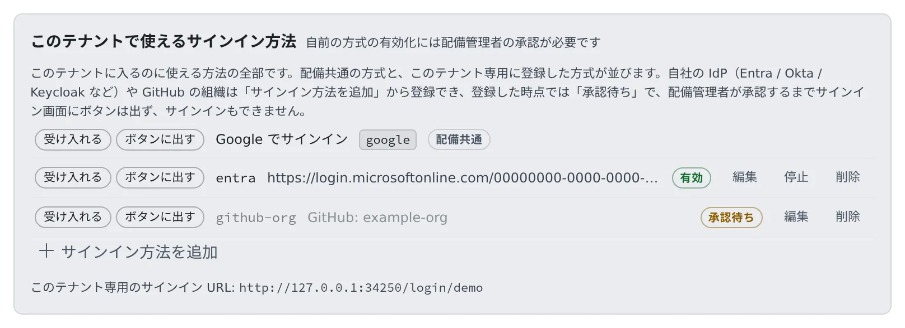

# サインインの方法を決める

[English](signin-methods.md) | 日本語

自社の IdP（Entra・Okta・Keycloak など）や GitHub の組織を、このテナントに入るサインインの方法として登録できます。
登録した方法は、配備管理者が承認すると、テナント専用のサインイン画面にボタンとして出ます。

## 全体像

| あなたがやること | Agent Fleet・配備管理者がやること |
|---|---|
| **サインイン方式** で、自社の IdP か GitHub の組織を登録する | 登録した時点では「承認待ち」にする |
| | 配備管理者が中身を確かめて承認する |
| テナント専用のサインイン URL をメンバーに伝える | 承認された方法のボタンを、その URL のサインイン画面に出す |
| **サインイン規則** で、効いているドメインの規則を読む | 規則に合わない招待や自動参加を止める |

## 2 つの画面

| 画面 | あなたにできること |
|---|---|
| **サインイン → サインイン方式** | 方法の登録・編集・停止・削除。承認は配備管理者 |
| **サインイン → サインイン規則** | 読むだけ。変えるのは配備管理者 |

## サインイン方式を登録する

1. **テナント設定 → サインイン → サインイン方式** を開きます
2. **サインイン方法を追加** を押します
3. **サインインの種類** で「自社の IdP（Entra / Okta / Keycloak など）」か「GitHub の組織」を選び、欄を埋めます
4. **保存** を押します。行は「承認待ち」になります
5. 配備管理者に承認を頼みます

承認されるまで、サインイン画面にボタンは出ず、その方法ではサインインできません。

- 一覧の上の段に「配備共通」と出る行（Google など）は、配備全体で設定されたサインイン方法です。テナント管理者は編集できません
- **サインイン方法を追加** で足せるのは、自社の IdP と GitHub の組織だけです
- 配備共通の方式をこのテナントで受け入れるか、ボタンに出すかを変えたいときは、配備管理者に頼みます

### 自社の IdP の欄

| 欄 | 入れるもの |
|---|---|
| 名前 | テナントの中で使う識別子。英小文字・数字・`-`・`_`（例: `entra`） |
| issuer（発行者 URL） | IdP の issuer URL。Entra は自社テナントの GUID を含む URL |
| client_id・client_secret | IdP に登録したアプリのもの。secret は保存時に暗号化され、画面には出ません |
| email の信頼方法 | Entra は email_verified を返さないので、「issuer が自社テナントに固定されている」を選びます |
| 受け入れるメールドメイン | 必須です。この方法は配備共通の許可リストを使わないので、空だと誰も入れません |
| 許可する tenant id | Entra の tid。issuer が `common` / `organizations` のときは必須です |
| 同一アカウントの見分け方 | 既定は sub。同じ Entra に別のアプリ登録があるときは oid を選ぶと、同じ人として扱われます |
| ボタンの文言（日本語）・（英語） | サインイン画面のボタンに出す文字 |

- IdP 側のアプリには、リダイレクト URI（コールバック URL）として `https://<Console のドメイン>/oauth2/callback` を登録します。この画面には出ませんが、GitHub の組織と同じ URL です

同じドメインを 2 つのテナントが持つことはできません。

### GitHub の組織の欄

| 欄 | 入れるもの |
|---|---|
| 許可する GitHub 組織 | カンマ区切りで必須です。どれかに「アクティブなメンバー」として所属している人だけがサインインできます |
| client_id・client_secret | このテナント用に GitHub で作った OAuth App のもの。コールバック URL は画面に出ます |
| 受け入れるメールドメイン | 必須です。GitHub が渡すのは本人が検証済みのアドレス 1 件だけです |

- プライマリのメールアドレスが会社のドメインでない人は、受け入れるドメインで除外してください。通すと、その人は既存のワークスペースではなく新しいワークスペースに入ります
- 組織がサードパーティの OAuth App を制限していると、組織の管理者がこの OAuth App を承認するまで、全員が拒否されます

## 承認がやり直しになる変更

承認は「この発行元・この組織を、この範囲で信頼してよい」という判断です。次の変更をすると、行は「承認待ち」に戻ります。

- issuer・client_id・email の信頼方法・種類・同一アカウントの見分け方を変える
- 受け入れるドメイン・tenant id・GitHub 組織を足す

## 状態を読む

| 状態 | 意味 |
|---|---|
| 承認待ち | 配備管理者の承認を待っています。まだサインインできません |
| 有効 | 承認済みで、サインインに使えます |
| 停止中 | 止めています。**承認を申請する** で、もう一度承認を頼めます |
| 承認済みだが設定に不備あり | 承認はされていますが、設定が足りず使えません |

各行の「受け入れる」「ボタンに出す」の印は、配備管理者の設定を表示しています。あなたは切り替えられません。

- **ボタンに出す** を外した方法も、受け入れは続きます。その方法ですでに入っている人はそのまま入れて、サインイン画面にボタンが出なくなるだけです
- すべての方法でボタンを消すことはできません。ボタンのないサインイン画面は行き止まりになるためです

## テナント専用のサインイン URL

承認された方法が 1 つでもあると、画面に「このテナント専用のサインイン URL:」が出ます。メンバーにはこの URL を伝えてください。

## 方法を止める・削除する

- **停止** を押すと、その方法ではサインインできなくなります。漏れたおそれがある IdP は、すぐに止めてかまいません
- その方法しか使ったことのない現役メンバーがいると、人数が出て確認を求められます。止めるとその人たちは締め出されます
- 止める前に、その人たちに別のサインインの方法を自分のアカウントに結び付けてもらってください（**設定 → 個人設定 → アカウント**）。止めたあとでは、本人は自分で足せません
- **削除** すると、その方法で入っていた人はサインインできなくなります。ワークスペース・ホームディレクトリ・保存済みの認証情報は残ります

## サインイン規則を読む

**サインイン → サインイン規則** は、効いている規則の表示です。「なぜ招待が弾かれたのか」を誰にも聞かずに読めます。

| 規則 | 意味 |
|---|---|
| 自動参加ドメイン | このドメインのアドレスの人は、初回のサインインでこのテナントに参加します。1 ドメインにつき 1 テナントだけ設定できます |
| 招待できるドメイン | メンバーを追加するときだけ効く制限です。すでにメンバーの人には影響しません |

- 「未設定（制限なし）」は、その規則がないことを表します
- 規則を変えたいときは、配備管理者に頼みます

## うまくいかないとき

### ほかのテナントにも入っている人が切り替えられない

同じアドレスでも、IdP が違えば別のサインインとして扱われます。このテナントがその人の使う方法を受け入れていないと、このテナントに切り替えられません。
配備管理者に、その方法を「受け入れる」のまま「ボタンに出す」だけ外すよう頼んでください。受け入れても、入れる人は増えません。誰が入れるかを決めるのは名簿です。

### 両方のアカウントを持っている人がいる

本人が **設定 → 個人設定 → アカウント** で、2 つ目の方法を自分のアカウントに結び付けられます。あなたがやることはありません。

## 関連

- [メンバーを追加する](../members/add.ja.md)
- [サインインできるネットワークを絞る](networks.ja.md)
- [ロールとできること](../../ref/roles.ja.md)
