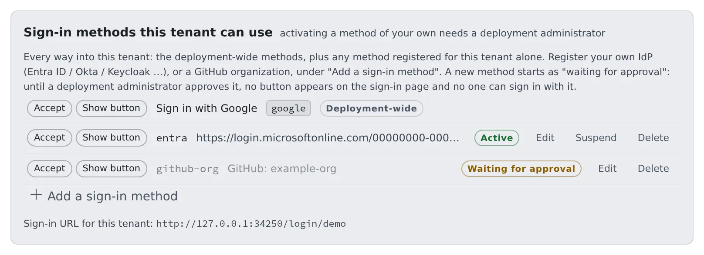

# Choose how people sign in

English | [日本語](signin-methods.ja.md)

You can register your company's IdP (Entra ID, Okta, Keycloak and the like) or a GitHub organisation as a way into this tenant.
Once a deployment administrator approves it, it appears as a button on the tenant's own sign-in page.

## How it works

| What you do | What Agent Fleet and the deployment administrator do |
|---|---|
| Register your IdP or GitHub organisation under **Sign-in methods** | Marks it "Waiting for approval" when you register it |
| | The deployment administrator checks it and approves it |
| Give members the tenant's own sign-in URL | Shows a button for each approved method on that URL's sign-in page |
| Read the domain rules in force under **Sign-in rules** | Stops invitations and auto-joins that break the rules |

## The two screens

| Screen | What you can do |
|---|---|
| **Sign-in → Sign-in methods** | Register, edit, suspend and delete methods. A deployment administrator approves |
| **Sign-in → Sign-in rules** | Read only. A deployment administrator changes them |

## Register a sign-in method

1. Open **Tenant settings → Sign-in → Sign-in methods**
2. Press **Add a sign-in method**
3. Under **Kind of sign-in**, choose "Our own IdP (Entra ID / Okta / Keycloak …)" or "A GitHub organization", and fill in the fields
4. Press **Save**. The row reads "Waiting for approval"
5. Ask a deployment administrator to approve it

Until it is approved, no button appears on the sign-in page and nobody can sign in with it.

- Rows at the top marked "Deployment-wide" (Google and the like) are sign-in methods set up for the whole deployment. A tenant administrator cannot edit them
- **Add a sign-in method** adds only your own IdP or a GitHub organisation
- To change whether this tenant accepts a deployment-wide method or shows its button, ask the deployment administrator

### Fields for your own IdP

| Field | What to enter |
|---|---|
| Name | The identifier used inside the tenant: lowercase letters, digits, `-` and `_` (for example `entra`) |
| Issuer URL | The IdP's issuer URL. For Entra ID, the URL that contains your own tenant's GUID |
| client_id and client_secret | Those of the app registered at the IdP. The secret is encrypted on save and never shown |
| How the email is trusted | Entra ID does not return email_verified, so choose "The issuer is pinned to our own tenant" |
| Email domains to admit | Required. This method does not use the deployment-wide allow list, so with none nobody gets in |
| Allowed tenant ids | Entra's tid. Required when the issuer is `common` or `organizations` |
| How the same account is recognised | sub by default. When the same Entra ID has another app registration, choose oid and the person is treated as the same account |
| Button label (Japanese) and (English) | The text on the sign-in page's button |

- In the IdP's app, register `https://<the Console's domain>/oauth2/callback` as the redirect URI (callback URL). This screen does not show it, but it is the same URL as for a GitHub organisation

Two tenants cannot hold the same domain.

### Fields for a GitHub organisation

| Field | What to enter |
|---|---|
| Allowed GitHub organizations | Required, comma-separated. Only active members of one of them can sign in |
| client_id and client_secret | Those of the OAuth App you made on GitHub for this tenant. The screen shows the callback URL |
| Email domains to admit | Required. GitHub passes a single address the person has verified |

- Exclude, through the domains you admit, anyone whose primary address is not on a company domain. Let them through and they land in a new workspace rather than their existing one
- If the organisation restricts third-party OAuth Apps, everyone is refused until an organisation owner approves this OAuth App

## Changes that need approval again

Approval is given to "this issuer, this organisation, trusted this far". These changes send the row back to "Waiting for approval":

- changing the issuer, client_id, how the email is trusted, the kind, or how the same account is recognised
- adding a domain, a tenant id or a GitHub organisation

## Read the state

| State | What it means |
|---|---|
| Waiting for approval | Waiting for a deployment administrator. Nobody can sign in with it yet |
| Active | Approved and in use for sign-in |
| Suspended | Stopped. **Request approval** asks for approval again |
| Approved, but the settings are incomplete | Approved, but the settings are not complete enough to use |

The "Accept" and "Show button" marks on each row show the deployment administrator's setting. You cannot switch them.

- A method whose **Show button** is off is still accepted. People already using it can still get in; it just has no button on the sign-in page
- A button cannot be hidden on every method: a sign-in page with no buttons is a dead end

## The tenant's own sign-in URL

Once at least one method is approved, the screen shows "Sign-in URL for this tenant:". Give members that URL.

## Suspend or delete a method

- **Suspend** stops sign-in with that method. Stop an IdP that may have leaked straight away
- If some active members have never used any other method, the count is shown and you are asked to confirm. Suspending locks those people out
- Before suspending, have those people link another sign-in method to their account (**Settings → Personal → Account**). Once it is suspended they cannot add one themselves
- **Delete** stops everyone who used that method from signing in. Their workspaces, homes and stored credentials are kept

## Read the sign-in rules

**Sign-in → Sign-in rules** shows the rules in force, so you can see why an invitation was refused without asking anyone.

| Rule | What it means |
|---|---|
| Auto-join domains | People with an address in the domain join this tenant at first sign-in. A domain can belong to one tenant only |
| Invite domains | A guard applied only when a member is added. It does not affect people who are already members |

- "not set (no restriction)" means the rule is absent
- To change a rule, ask a deployment administrator

## When it goes wrong

### Someone in another tenant too cannot switch to yours

The same address at a different IdP counts as a different sign-in. If this tenant does not accept the method that person uses, they cannot switch to it.
Ask the deployment administrator to keep that method on "Accept" and turn only "Show button" off. Accepting it lets in no one new: the roster decides who gets in.

### Someone holds both accounts

They link the second method to their own account under **Settings → Personal → Account**. There is nothing for you to do.

## Related

- [Add a member](../members/add.md)
- [Limit the networks people sign in from](networks.md)
- [Roles and what they may do](../../ref/roles.md)
