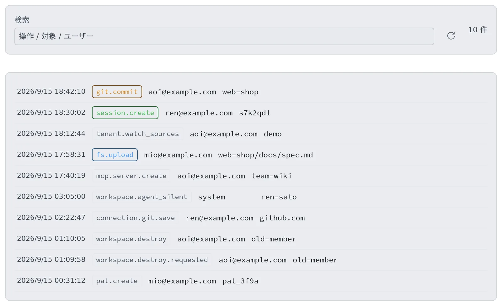

# 監査ログを見る

[English](audit.md) | 日本語

テナントの中で、いつ・誰が・何に対して・どんな変更をしたかを確かめられます。
メンバーの退職処理や、ワークスペースの破棄のような取り消せない操作の跡もここで追えます。

## 全体像

| あなたがやること | 起きること |
|---|---|
| テナント設定の「監査」を開く | テナントの新しい順に、変更操作の記録が並ぶ |
| 検索欄に操作・対象・ユーザーを入れる | 表示中の記録が絞り込まれる |
| 更新ボタンを押す | 最新の記録を読み直す |

見えるのは自分のテナントの記録だけです。ほかのテナントや、配備全体の記録は配備管理者が見ます。

## 監査ログを開く

1. 画面右上のアカウントメニューから **テナント設定** を開きます
2. 左の **運用** の下にある **監査** を選びます

1 行が 1 操作です。

| 列 | 内容 |
|---|---|
| 時刻 | 操作が行われた時刻 |
| 操作 | 何をしたか（`git.commit`、`session.create` など） |
| 実行者 | 誰がしたか。メールアドレスのほか、外部の MCP クライアントや、自動停止などのシステムのこともある |
| 対象 | どのファイル・リポジトリ・セッション・メンバーに対してか |

- 画面に出るのは新しいほうから 200 件です。検索はその 200 件の中で絞り込みます
- 自動では更新されません。最新を見るときは更新ボタンを押します
- 結果の詳細（何を消したか、エラーの内容など）は画面には出ません。テナント管理者として接続した MCP クライアントの `tail_audit` ツールなら、詳細つきで最大 500 件を読めます

## 記録されるもの

記録されるのは、状態を変える操作だけです。

| 操作の頭 | 記録されること |
|---|---|
| `fs.*` | ファイルのアップロード・作成・改名・削除 |
| `git.*` | コミット・チェックアウト・取得など |
| `repo.*` | リポジトリの clone・作成・削除、削除ロックの切り替え（`repo.lock`） |
| `session.*` | セッションの作成・fork・削除・移動・共有、支出上限（`session.spend_cap`）、削除ロック（`session.lock`） |
| `connection.*` | 認証情報の保存・削除・サインイン。サインインは完了させた呼び出しの 1 行だけ |
| `mcp.*` | MCP サーバーの作成・更新・削除・シークレット（個人の登録と、テナントへの配布）、外のアプリの OAuth 接続 |
| `inbox.*` | 受信箱の依頼の送信・引き受け・辞退・完了など。本文は残さない |
| `membership.*`・`member.*` | メンバーの追加・外す・ロール・上限の変更 |
| `tenant.*`・`limit_board.set` | テナント設定の変更（`tenant.external_memory`、`tenant.watch_sources` など） |
| `pat.*` | このテナントで発行したトークンの作成と失効 |
| `workspace.*` | ワークスペースの停止・掃除・破棄、Agent が応答しなくなった・戻った・自動停止で止められた |

- **秘密の値は書きません。** 認証情報の行の対象は、Git のホスト・変数名・MCP サーバー ID だけです
- ワークスペースがエラーを返した書き込みは、行を残しません
- テナント管理者・配備管理者がテナント設定を変えると、そのテナントの行として残ります

## 記録されないもの

- **読み取り。** ファイルを開いて見ただけ、一覧を眺めただけでは残りません
- **ターミナルの入出力。** 画面に流れる文字そのものは保存しません。パスワードやトークンが紛れ込むからです

そのため「メンバーが端末で何をタイプしたか」は追えません。追えるのは、いつ・誰が・何に対して・どんな種類の変更をしたかです。

## 取り消せない操作は 2 行残る

次の操作は、実行する前に `<操作>.requested`（例: `workspace.destroy.requested`）の行が残り、終わったときに `<操作>` の行がもう一度残ります。

- ホームの掃除、ホームのバックアップの削除、ワークスペースの破棄
- メンバーを外す、メンバーの完全削除、テナントの削除
- プールのスロットの終了、推論エンジンのモデルのファイル削除
- テナントのサインイン方法の削除、内蔵リポジトリの削除と改名

| 見えるもの | 意味 |
|---|---|
| `.requested` のあとに結果の行がある | 操作が終わった。何をしたか・何を消せなかったかは結果の行の詳細にある |
| `.requested` だけで結果の行がない | 結果の記録が失われた。何も起きなかったとは限らないので、対象を確かめる |
| 操作が「誰が依頼したかを監査ログに記録できなかった」で断られた | 何もしていない。データベースが戻ってから、やり直す |

## よくある質問

**Q. ほかのテナントの記録も見えますか？**
見えません。メンバー・セッション・監査・稼働時間は、どれも自分のテナントの範囲だけです。配備全体を見られるのは配備管理者だけです。

**Q. メンバーがターミナルで打ったコマンドの中身まで見られますか？**
見られません。ターミナルの入出力は保存しません。追えるのは、ファイル・Git・セッションなどの変更の種類・実行者・対象・時刻です。

## 関連

- [稼働時間とクラウド費用を見る](usage.ja.md)：誰がどれだけワークスペースを使ったか
- [ロール — 誰が何をできるか](../ref/roles.ja.md)：テナント管理者と配備管理者にできること
