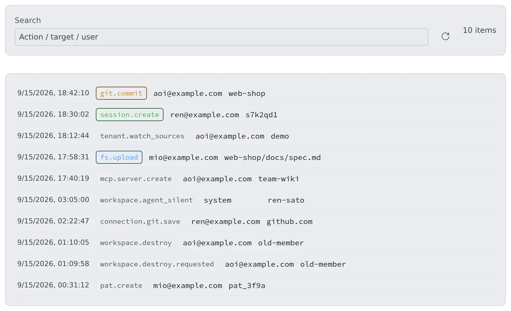

# Read the audit log

English | [日本語](audit.ja.md)

See when, who, against what and what kind of change was made inside your tenant.
The trail of operations that cannot be undone, such as offboarding a member or destroying a workspace, is here too.

## How it works

| What you do | What happens |
|---|---|
| Open "Audit" in Tenant settings | The tenant's change records are listed, newest first |
| Type an action, target or user into the search box | The rows shown are filtered |
| Press the refresh button | The latest records are read again |

You see your own tenant's records only. Other tenants and the deployment as a whole are the deployment administrator's to read.

## Open the audit log

1. Open **Tenant settings** from the account menu at the top right
2. Under **Operations** on the left, choose **Audit**

One row is one operation.

| Column | Contents |
|---|---|
| Time | When the operation happened |
| Action | What was done (`git.commit`, `session.create` and so on) |
| Actor | Who did it. An email address, or an outside MCP client, or the system itself (auto-stop and the like) |
| Target | Which file, repository, session or member it was done to |

- The screen shows the newest 200 rows. The search filters within those 200
- It does not refresh by itself. Press the refresh button to see the latest
- The detail of a result (what was removed, the error) is not on the screen. The `tail_audit` tool, from an MCP client connected as a tenant administrator, reads up to 500 rows with their details

## What is recorded

Only operations that change state are recorded.

| Action prefix | What is recorded |
|---|---|
| `fs.*` | File uploads, creation, renames and deletes |
| `git.*` | Commits, checkouts, fetches and so on |
| `repo.*` | Repository clones, creation and deletes, and the delete lock (`repo.lock`) |
| `session.*` | Session creation, fork, delete, move and sharing, the spend cap (`session.spend_cap`) and the delete lock (`session.lock`) |
| `connection.*` | Credentials saved, deleted and signed in. A sign-in is one row, from the call that completed it |
| `mcp.*` | MCP servers created, updated, deleted, and their secrets (personal registrations and tenant distributions), and outside apps' OAuth connections |
| `inbox.*` | Inbox requests sent, taken, declined, done and so on. The body is not kept |
| `membership.*`, `member.*` | Members added and removed, roles, limits |
| `tenant.*`, `limit_board.set` | Tenant settings changes (`tenant.external_memory`, `tenant.watch_sources` and so on) |
| `pat.*` | Tokens issued in this tenant, created and revoked |
| `workspace.*` | Workspaces stopped, cleaned and destroyed; an Agent that stopped answering, came back, or was stopped by the auto-stop |

- **No secret value is written.** A credential row's target is only the Git host, the variable name or the MCP server ID
- A write the workspace answered with an error leaves no row
- When a tenant or deployment administrator changes tenant settings, the row lands under that tenant

## What is not recorded

- **Reads.** Opening a file to look at it, or browsing a list, leaves nothing
- **Terminal input and output.** The characters that scroll past are not stored, because passwords and tokens end up in them

So you cannot trace what a member typed in a terminal. You can trace when, who, against what and what kind of change.

## Operations that cannot be undone leave two rows

For the operations below, a `<action>.requested` row (for example `workspace.destroy.requested`) is written before the operation runs, and a second `<action>` row when it ends.

- Cleaning a home, deleting a home's backups, destroying a workspace
- Removing a member, deleting a member for good, deleting a tenant
- Terminating a pool slot, purging an inference engine model's files
- Deleting a tenant sign-in method, deleting and renaming a built-in repository

| What you see | What it means |
|---|---|
| A result row after `.requested` | The operation ended. What it did and what it could not remove is in the result row's detail |
| `.requested` with no result row | The record of the result was lost. That does not mean nothing happened: check the target |
| The operation was refused with "the audit log could not record who asked for it" | Nothing was done. Try again once the database is back |

## FAQ

**Q. Can I see other tenants' records?**
No. Members, sessions, audit and running time are all limited to your own tenant. Only the deployment administrator sees the whole deployment.

**Q. Can I see the commands a member typed in a terminal?**
No. Terminal input and output is not stored. What you can trace is the kind, actor, target and time of changes to files, Git, sessions and the like.

## Related

- [Read running time and cloud cost](usage.md): who used how much workspace time
- [Roles — who may do what](../ref/roles.md): what tenant and deployment administrators can do
