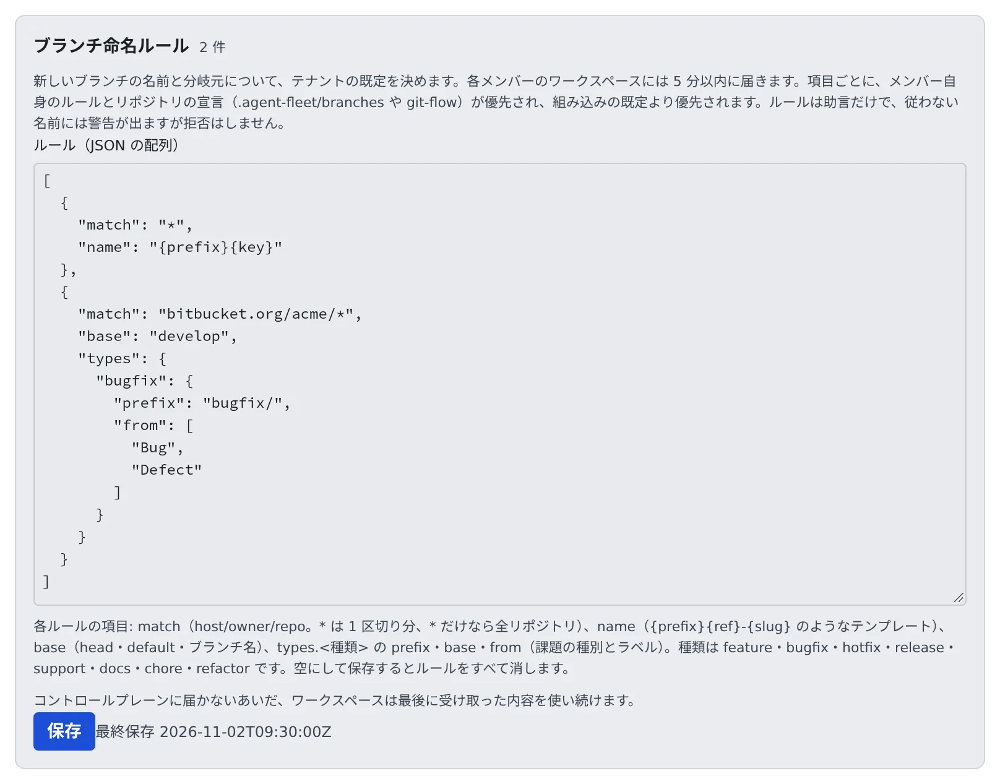

# ブランチ名の規則を決める

[English](branch-rules.md) | 日本語

メンバーが課題から作業を始めるときに、起動ダイアログが提案するブランチ名と分岐元を、チームの既定として決められます。
規則は提案するだけで、従わない名前を断ることはありません。

## 全体像

| あなたがやること | Agent Fleet がやること |
|---|---|
| **ブランチ命名ルール** に JSON で規則を書いて保存する | 各メンバーのワークスペースに 5 分以内に届ける |
| | 起動ダイアログで、規則どおりのブランチ名と分岐元を入れる |
| | 規則に合わない名前には、起動・改名のダイアログで注意を出す |

## どの規則が使われるか

規則は 4 つの層からなり、上の層ほど強く効きます。

| 層 | 規則の出どころ |
|---|---|
| 1. リポジトリ | リポジトリ自身の宣言（`.agent-fleet/branches`、git-flow、Bitbucket のブランチ設定） |
| 2. メンバー | 本人の作業項目の設定にあるテンプレートと、本人の規則 |
| 3. テナント | この画面の規則 |
| 4. 組み込みの既定 | 現在のブランチから `{prefix}{ref}-{slug}`（例: `feature/45-empty-list`） |

層は **項目ごと** に重なります。

- 分岐元だけを宣言しているリポジトリでは、名前はテナントの規則のままです
- テンプレートだけを決めているメンバーでは、分岐元はテナントの規則のままです

テナントの規則はチームの既定で、リポジトリやメンバーが自分で決めたものが優先されます。

## 規則を書く

1. **テナント設定 → 運用 → ブランチ命名ルール** を開きます
2. 「ルール（JSON の配列）」に規則を書きます
3. **保存** を押します



```json
[
  { "match": "*", "name": "{prefix}{key}" },
  {
    "match": "bitbucket.org/acme/*",
    "base": "develop",
    "types": { "bugfix": { "prefix": "bugfix/", "from": ["Bug", "Defect"] } }
  }
]
```

各規則の項目は次のとおりです。`match` 以外は省けます。

| 項目 | 意味 |
|---|---|
| `match` | 対象のリポジトリ。`origin` の `host/owner/repo` で、`*` はパスの 1 区切り分、`*` だけなら全リポジトリ。より具体的な `match` が優先されます |
| `name` | 名前のテンプレート（例: `{prefix}{key}`、`{prefix}{ref}-{slug}`） |
| `base` | 分岐元。`head`（現在のブランチ）、`default`（`origin/HEAD`）、または `develop` のようなブランチ名 |
| `types.<種類>` | 種類ごとの `prefix`・`base`・`from`（その種類にする課題の種別とラベル） |

種類は `feature`・`bugfix`・`hotfix`・`release`・`support`・`docs`・`chore`・`refactor` です。

- 保存すると、メンバーのワークスペースと同じ検査がすべての規則にかかります
- 知らない種類、git がブランチ名として受け付けない `base` や `prefix`、綴りの違う項目があると、規則の番号と理由が出て、何も保存されません
- 空にして保存すると、規則はすべて消えます
- 保存は監査ログに `tenant.branch_rules` として残ります

## メンバーに届くまで

- 各メンバーのワークスペースは、起動時とその後 5 分ごとに規則を取りに来ます。動いているワークスペースにも 5 分以内に届きます
- Control Plane に届かないあいだは、組み込みの名前に戻らず、最後に受け取った規則を使い続けます
- 起動ダイアログでは、テナントの規則から来た項目の出どころが `tenant: <match>` と出ます

規則を守らせる設定はありません。従わない名前には、起動と改名のダイアログで注意が出るだけです。

## 関連

- [Issue やチケットから始める](../../user/sessions/from-issues.ja.md)
- [Git Flow を初期化する](../../user/code/git-flow.ja.md)
- [メンバーの既定値を決める](members.ja.md)
