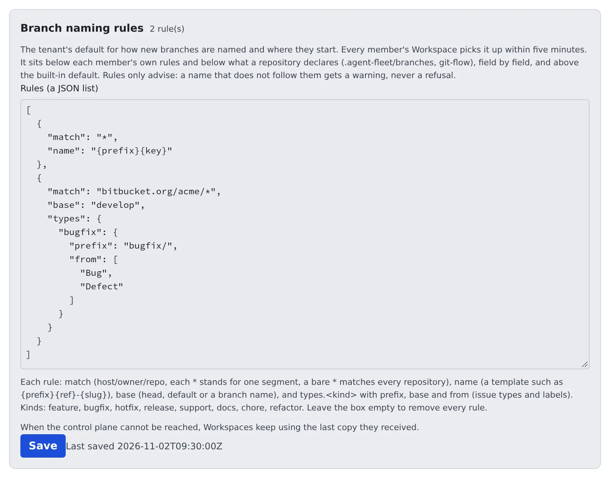

# Set the branch naming rules

English | [日本語](branch-rules.ja.md)

Set, as the team's default, the branch name and starting branch the launch dialog proposes when a member starts work from an issue.
The rules only propose: a name that does not follow them is never refused.

## How it works

| What you do | What Agent Fleet does |
|---|---|
| Write the rules as JSON under **Branch naming rules** and save | Delivers them to every member's workspace within five minutes |
| | Fills the launch dialog with the branch name and starting branch the rules give |
| | Shows a note in the launch and rename dialogs for a name that does not fit |

## Which rule is used

The rules come in four layers; the higher the layer, the stronger it is.

| Layer | Where the rule comes from |
|---|---|
| 1. Repository | What the repository declares itself (`.agent-fleet/branches`, git-flow, a Bitbucket branching model) |
| 2. Member | The template in the member's own work-items settings, and their own rules |
| 3. Tenant | The rules on this screen |
| 4. Built-in default | `{prefix}{ref}-{slug}` off the current branch (for example `feature/45-empty-list`) |

The layers merge **field by field**.

- A repository that declares only where branches start keeps the name from the tenant's rule
- A member who sets only a template keeps the starting branch from the tenant's rule

The tenant's rules are the team's default; whatever a repository or a member decides for itself wins.

## Write the rules

1. Open **Tenant settings → Operations → Branch naming rules**
2. Write the rules in "Rules (a JSON list)"
3. Press **Save**



```json
[
  { "match": "*", "name": "{prefix}{key}" },
  {
    "match": "bitbucket.org/acme/*",
    "base": "develop",
    "types": { "bugfix": { "prefix": "bugfix/", "from": ["Bug", "Defect"] } }
  }
]
```

Each rule has these fields. All except `match` may be left out.

| Field | Meaning |
|---|---|
| `match` | Which repositories: `host/owner/repo` from `origin`, where each `*` is one segment and a bare `*` is every repository. A more specific `match` wins |
| `name` | The name template (for example `{prefix}{key}` or `{prefix}{ref}-{slug}`) |
| `base` | Where branches start: `head` (the current branch), `default` (`origin/HEAD`) or a branch name such as `develop` |
| `types.<kind>` | Per-kind `prefix`, `base` and `from` (the issue types and labels that pick this kind) |

The kinds are `feature`, `bugfix`, `hotfix`, `release`, `support`, `docs`, `chore` and `refactor`.

- Saving checks every rule the way a member's workspace will
- An unknown kind, a `base` or `prefix` git would not accept as a branch name, or a misspelt field is reported with the rule's number and the reason, and nothing is saved
- Saving an empty box removes every rule
- Each save is recorded in the audit log as `tenant.branch_rules`

## When members get them

- Each member's workspace asks for the rules when it starts and every five minutes after that, so running workspaces get a change within five minutes
- While the control plane cannot be reached, a workspace keeps using the last rules it received rather than going back to the built-in names
- In the launch dialog, a field that came from the tenant's rules shows its source as `tenant: <match>`

There is no setting that makes the rules binding. A name that does not follow them gets a note in the launch and rename dialogs, nothing more.

## Related

- [Start from an issue or a ticket](../../user/sessions/from-issues.md)
- [Initialize Git Flow](../../user/code/git-flow.md)
- [Set member defaults](members.md)
