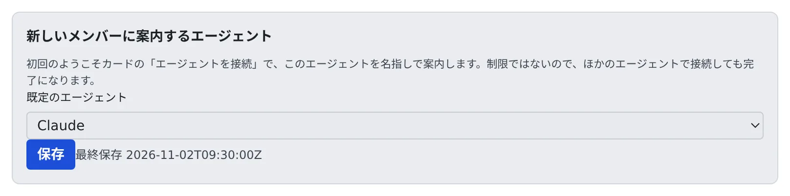

# メンバーの既定値を決める

[English](members.md) | 日本語

チームで使っているエージェントを決めておくと、新しいメンバーの最初の画面で、そのエージェントを名指しで案内できます。
案内するだけで、ほかのエージェントを使えなくすることはありません。

## 全体像

| あなたがやること | Agent Fleet がやること |
|---|---|
| **メンバーの既定** で既定のエージェントを選ぶ | 新しいメンバーのようこそカードで、そのエージェントを案内する |
| | ほかのエージェントで接続しても、手順を完了にする |

新しいメンバーの最初の画面はホームで、いちばん上にようこそカードが出ます。カードの 2 つ目の手順は **エージェントを接続** です。
Agent Fleet は複数のエージェントに対応していて、新しいメンバーにはチームがどれを契約しているかが分からないのが普通です。
ここで選んでおくと、この手順に「このチームの既定は Claude です（ほかのエージェントでも構いません）」のように出ます。

## 既定のエージェントを選ぶ

1. **テナント設定 → 運用 → メンバーの既定** を開きます
2. **既定のエージェント** で、Claude・Codex・Cursor・Copilot・Kiro・opencode・Muse のどれか、または **指定しない** を選びます
3. **保存** を押します

- **指定しない** にすると、選択肢を並べたふつうの文言に戻ります
- メンバー自身のアカウントが要らないものは選べません。シェル、SSM、配備の推論エンジンです。推論エンジンを使えるメンバーは [資源の上限とセッション](../resources/engines.ja.md#使えるメンバーを決める) で決めます
- 保存は監査ログに `tenant.member_defaults` として、選んだエージェントと一緒に残ります

## メンバーに見えるまで

- メンバーは、Console を読み込むたびに既定を読みます。ワークスペースが止まっていても読めます
- 画面を開いたままのメンバーには、読み込み直したあとに出ます
- ようこそカードは、最初のセッションを作るか最初のチャットを始めるまでしか出ません。効くのは、まだ始めていないメンバーです

メンバーがどのエージェントを使えるかは、メンバー自身のアカウントと配備で決まります。この画面では決まりません。

## 関連

- [最初のセッションを始める](../../user/start/quickstart.ja.md)
- [ブランチ名の規則を決める](branch-rules.ja.md)
