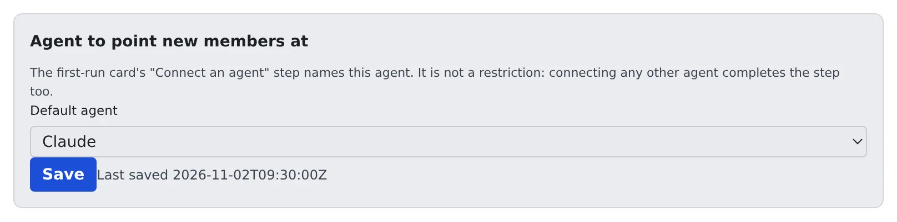

# Set member defaults

English | [日本語](members.ja.md)

Name the agent your team uses, and a new member's first screen points them at it by name.
It only points the way; no other agent is made unavailable.

## How it works

| What you do | What Agent Fleet does |
|---|---|
| Choose the default agent under **Member defaults** | Names that agent on a new member's welcome card |
| | Completes the step whichever agent the member connects |

A new member's first screen is Home, with a welcome card at the top. The card's second step is **Connect an agent**.
Agent Fleet supports several agents, and a new member usually cannot tell which one the team pays for.
Choose one here and the step then reads, for example, "Your team's default is Claude (any other agent works too)".

## Choose the default agent

1. Open **Tenant settings → Operations → Member defaults**
2. Under **Default agent**, choose one of Claude, Codex, Cursor, Copilot, Kiro, opencode and Muse, or **None**
3. Press **Save**

- **None** brings back the ordinary wording that lists the choices
- Agents that need no account of the member's own are not offered: the shell, SSM and the deployment's inference engines. Who may use the inference engines is set under [Resource limits and sessions](../resources/engines.md#choose-the-members-who-may-use-them)
- Each save is recorded in the audit log as `tenant.member_defaults`, with the agent chosen

## Set launch defaults, team repositories and operations settings

Under the agent, the same screen has three more groups. Press **Save** once after changing any of them.

| Group | What members get |
|---|---|
| **Launch defaults** (model, driver, permission prompts, budget) | The start-work dialog opens with these values filled in, on the agent chosen above |
| **Team repositories** (one `owner/name` per line, up to 20) | **Start** lists these repositories first, marked "Team" |
| **Operations settings** (Grafana URL, AWS SSO start URL, AWS account ID, AWS role name) | Stored for the operations views to read. Nothing in the Console uses them yet |

- Launch defaults only fill in the dialog. They never change a member's Settings or the agent's own settings, and a member's own choices win: their saved default, the last choice in that repository, and the values they set under Settings › Agents
- Operations settings are links and identifiers only. A URL must be `https` with no user name, query or fragment, so a token cannot be saved there. Secrets stay with each member
- A group you leave empty is simply not applied. Saving clears the groups you emptied
- The audit entry `tenant.member_defaults` lists every value saved

## When members see it

- Members read the default each time the Console loads, even while their workspace is stopped
- A member who already has the page open sees it after a reload
- The welcome card shows only until a member creates a first session or starts a first chat, so it matters for members who have not started yet

Which agents a member may use is decided by the member's own accounts and by the deployment, not on this screen.

## Related

- [Start your first session](../../user/start/quickstart.md)
- [Set the branch naming rules](branch-rules.md)
