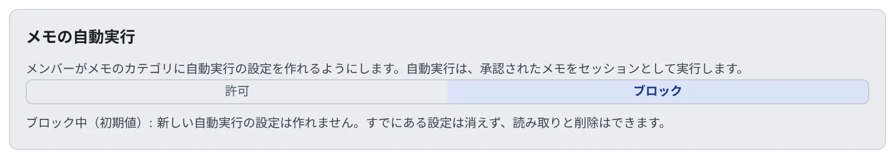

# メモの自動実行を許可する

[English](memo-auto-run.md) | 日本語

メンバーが、自分のメモのカテゴリに自動実行の設定を作り、たまったメモをセッションとして実行させてよいかを、テナント全体で決めます。
初期状態はブロックです。下の条件がそろってから、許可にしてください。

## 全体像

| あなたがやること | メンバーの側で起きること |
|---|---|
| 「ブロック」のままにする（初期状態） | 新しい自動実行の設定を作れません。画面に、管理者の許可が必要だと出ます |
| 「許可」にする | メンバーが、自分のメモのカテゴリに自動実行の設定を作れます（[メモを自動で実行する](../../user/chat/memo-auto-run.ja.md)） |
| 「ブロック」に戻す | 新しい設定は作れず、何も始まりません。すでにある設定は残り、読み取りと削除はできます |

## 許可にする前に

次のすべてがそろってから許可にします。

1. 配備のすべての Control Plane が、メモの自動実行に対応したバージョンで動いていること。古い Control Plane が残っていると、自動実行のカテゴリのメモが、必要な承認を通らずにワークスペースの中から送信・削除・名前の変更をされるおそれがあります
2. Console も同じバージョンに更新されていること
3. 配備のスケジュールの確認が動いていること。自動実行はスケジュールと同じ確認で始まるので、スケジュールが無効な配備では、「今すぐ実行」を含めて何も始まりません。配備管理者に確認してください

ワークスペースにも、更新された Agent が必要です。ワークスペースは、再起動すると更新されます。

- メンバーのワークスペースを再起動するまで、そこでは自動で実行が始まりません。カテゴリに通知が出ます。「今すぐ実行」は使えます
- ワークスペースの再起動は、メンバーが Console から行います。自動実行を使うメンバーに、再起動を依頼してください

## 切り替える

1. テナント設定の **運用** →「**メモの自動実行**」を開きます
2. 「**許可**」か「**ブロック**」を押します。押した時点で保存されます

切り替えのたびに、監査ログへ `tenant.memo_queues` として、`enabled=true` か `enabled=false` が記録されます（[監査ログを見る](../audit.ja.md)）。
切り替えられるのは、テナント管理者と配備管理者だけです。

## ブロック中のようす

- メンバーは、新しい自動実行の設定を作れず、すでにある設定も変更できません。画面には「この組織では自動実行の設定の変更が許可されていません。設定を外すことはできます。」と出ます
- 何も始まりません。自動では始まらず、「今すぐ実行」も「この組織では、自動実行の設定がまだ許可されていません。組織の管理者に依頼してください。」と断られます
- すでに始まっている実行は、この切り替えでは止まりません
- 既存の設定とメモは残ります。「許可」に戻せば、また使えます

## 自動実行が使うもの

- 実行は、メンバー自身のワークスペースで動くセッションです。メンバーのセッション数の上限に数えられます（[セッション数の上限を決める](../resources/session-limits.ja.md)）。上限を超える実行は送信されず、メモは実行待ちに戻ります
- 実行ごとの費用の上限は、メンバーがカテゴリの設定で決めます。0 は上限なしです
- すべてのカテゴリを合わせた上限は、既定でメンバーごとに 4 件です。[自動実行の上限を決める](../resources/session-limits.ja.md#自動実行の上限を決める)と[制限と既定値](../../ref/limits.ja.md#メモの自動実行)を参照してください
- 自動実行のカテゴリにセッションが追加したメモは、必ずメンバーの承認を待ちます。管理者がメンバーの代わりに承認することはできません

## 関連

- [メモを自動で実行する](../../user/chat/memo-auto-run.ja.md): メンバーに見える画面
- [セッション数の上限を決める](../resources/session-limits.ja.md)
- [監査ログを見る](../audit.ja.md)
