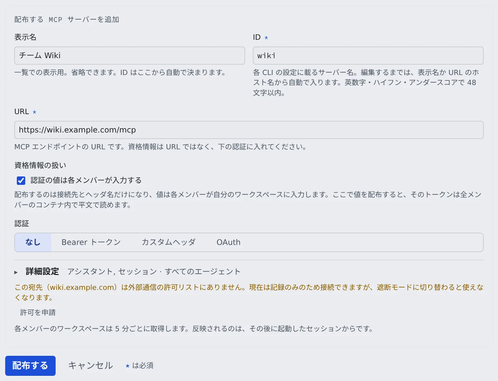

# MCP サーバーを全員に配る

[English](mcp-distribute.md) | 日本語

チームで使う MCP サーバーを一度登録すると、テナントの全メンバーのセッションとアシスタントから使えるようになります。
トークンを全員で共有するか、各メンバーが自分の値を入れるか、各自でサインインするかを選べます。

## 全体像

| あなたがやること | メンバーの側で起きること |
|---|---|
| テナント設定の「MCP 配布」でサーバーを追加する | 5 分以内に、各メンバーの MCP サーバーの一覧に「テナント」のラベル付きで並ぶ |
| 資格情報の扱いを選ぶ | 値を配ればそのまま使える。各自入力なら「値を入力」、OAuth なら「サインイン」が出る |
| 無効にする・削除する | 次の取得から、メンバーに渡らなくなる |

反映されるのは、取得のあとに起動したセッションからです。すでに動いているセッションは変わりません。

## 始める前に

- **配れるのはリモート（Streamable HTTP）のサーバーだけです。** ワークスペースの中でコマンドを起動する stdio は配れません。配れるようにすると、管理者が全員のコンテナで任意のコマンドを動かせてしまうからです。stdio が要るメンバーには、自分の設定に登録してもらいます
- **まず自分のワークスペースで試します。** 自分の設定に個人として登録し、接続テストが通る構成を確かめてから配ると確実です（[セッションに MCP サーバーを追加する](../user/integrations/mcp-servers.ja.md)）
- **外向きの通信が制限された配備では、接続先のホストが許可されている必要があります。** [下](#接続先のホストが許可されていない)を見てください

## サーバーを配る

1. テナント設定の **運用** →「**MCP 配布**」を開き、「**配布する MCP サーバーを追加**」を押します
2. 「**表示名**」と「URL」を入れます。「**ID**」は、編集するまで表示名から自動で入ります
3. 「**資格情報の扱い**」と「**認証**」を選びます（[次の節](#資格情報の扱いを決める)）
4. 必要なら「**詳細設定**」で「**利用先**」「**対象エージェント**」「**有効**」を変えます。閉じた見出しに今の値が出ます
5. 「**配布する**」を押します

配ったサーバーは、メンバーの **⚙設定 → 接続 →「MCP サーバー（セッションで使う）」** に「テナント」のラベル付きで並びます。
メンバーは接続テストと自分のワークスペースでの無効化だけができ、編集と削除はできません。

## 資格情報の扱いを決める

配布でいちばん大事な判断です。

| 選び方 | 配られるもの | 向いているもの |
|---|---|---|
| 「**認証の値は各メンバーが入力する**」を外す | ヘッダーの値ごと。暗号化して保存され、サーバーの起動時にだけ渡る | 全員が同じ権限で読む、共有の読み取り専用トークン |
| 「**認証の値は各メンバーが入力する**」を選ぶ | 接続先とヘッダー名だけ。値は各メンバーが自分のワークスペースで入れる | 個人ごとのトークン、監査で人を見分けたいもの |
| 「**認証**」で「**OAuth**」を選ぶ | 接続先だけ。各メンバーが自分のアカウントでサインインする | OAuth のサインインしか受け付けないホスト型のサーバー |

**値を配ると、そのトークンは全メンバーのコンテナの中で平文で読めます。** 権限の強いトークンや、人を見分けたいものは「各メンバーが入力する」にしてください。

- 「**認証**」は「**なし**」「**Bearer トークン**」「**カスタムヘッダ**」「**OAuth**」から選びます
- 各メンバーが入力する形で「Bearer トークン」を選ぶと、`Authorization` のヘッダー名だけが配られ、メンバーにはトークンだけの入力欄が出ます。メンバーが入れるまで、そのサーバーは使われません
- 値を配る形では、保存したトークンが `Bearer ***` と表示されます
- URL を別のホストに変えると、保存済みのヘッダーの値は消えます。新しいホスト向けの値を入れ直します

### OAuth のサーバーを配る

OAuth では認証情報をまったく配らないので、「資格情報の扱い」は出ず、ヘッダーも足せません。
各メンバーの行に「**サインイン**」が出て、許可はそのメンバーのワークスペースにだけ残ります。サーバーが渡るのは、サインインしたメンバーのセッションだけです。

MCP サーバーの認可サーバーに Agent Fleet 用のクライアントを登録してあるときは、次を入れます。メンバーのサインインは、それぞれクライアントを登録する代わりにこれを使います。

| 欄 | 入れるもの |
|---|---|
| 「**テナントが登録したクライアント ID**」 | 登録したクライアントの ID。空なら、各メンバーのサインインがそれぞれクライアントを登録する |
| 「**認可サーバー（issuer）**」 | クライアントを登録した認可サーバーの issuer。https の URL |
| 「**クライアントシークレット**」 | confidential クライアントのときだけ。public クライアントなら空のまま |

- シークレットは暗号化して保存され、ワークスペースには送られません。トークンのリクエストは Control Plane が行うので、Control Plane からその認可サーバーに届くことを配備管理者に確かめてください
- issuer かクライアント ID を変えると、シークレットを入れ直すよう求められます

次の変更をすると、各メンバーのサインインは切れ、メンバーはサインインし直します。

- URL を変える、OAuth をやめる、配布を削除する（次の取得のとき）
- クライアントを変える・削除する（confidential クライアントだったときは、それまでのトークンはもう失効させられず、古い認可サーバーで期限が切れるまで有効なままです）
- 値を配っていたサーバーを OAuth に切り替えると、保存していたヘッダーの値は消えます

## 変更が届くまで

| すること | メンバーの側 |
|---|---|
| 追加・変更 | 各ワークスペースが 5 分ごとに取得し、そのあとに起動したセッションから使われる |
| 「**有効**」を外す | 定義は残したまま、誰にも配られなくなる |
| 削除 | 次の取得のときに、各ワークスペースから消える |

- メンバーが配布と**同じ名前**で個人の登録をしていると、配布のほうが使われ、メンバーの画面にそう出ます。名前は重なりにくいものにしてください
- メンバーは「**テナント配布を取得**」を押せば、5 分を待たずに取り込めます

## トークンを入れ替える

配ったトークンを失効させるときは、**先に配布の値を新しいトークンに差し替えてから**、古いトークンを無効にします。
順番を逆にすると、次の取得までメンバー全員のツールが失敗します。

## 外部のアプリからの OAuth 接続を止める

claude.ai などの外のアプリは、MCP OAuth でこのテナントに接続できます。テナント設定の **サインイン** →「**接続元の制限**」の **MCP OAuth** 欄で止められます。
この欄は、配備が MCP OAuth を提供しているときだけ出ます。既定では許可されています。

1. 「**MCP OAuth によるアプリの接続を許可する**」を外して「**保存**」を押します
2. 確認のダイアログで「**保存**」を押します

止めると、次のようになります。

- このテナントの OAuth 接続はすぐにすべて取り消され、監査ログに残ります
- このテナントは同意画面の選択肢から外れ、コードの交換もトークンの更新も断られます
- ほかのテナントと、個人のトークン（PAT）には影響しません

許可に戻しても、取り消した接続は戻りません。メンバーがアプリから接続し直します。
1 つの接続だけを取り消すなら、メンバーが **⚙設定 → 外部からのアクセス →「MCP トークン・接続アプリ」** の「接続済みアプリ」で失効させます。

## 困ったとき

### 接続先のホストが許可されていない

ワークスペースがどこへ接続できるかは、配備管理者が決めます。その画面はテナント設定にはありません。
配ったサーバーもメンバー自身の登録も、接続先のホストが許可されていなければ失敗します。

フォームと一覧に「この宛先（…）は外部通信の許可リストにないため、ワークスペースから接続できません。」と出たら、「**許可を申請**」を押し、理由を書いて「**申請する**」を押します。
配備管理者が承認するまで「管理者の承認待ち」と出ます。

### 配備管理者に頼むとき

テナント管理者の権限で終わらないことは、配備管理者に頼みます。次の 3 つを添えると、そのまま作業してもらえます。

- **何を**：許可したいホスト名（`api.example.com` か `.example.com`）
- **なぜ**：どの MCP サーバーの、どの業務で使うか
- **いつまで**：ずっとか、期限付きか

配備管理者の側の手順は [外向きの通信を制御する](../operate/secure/egress.ja.md#メンバーの申請を承認する) にあります。

## 関連

- [セッションに MCP サーバーを追加する](../user/integrations/mcp-servers.ja.md#登録元ごとにできること)：メンバーの側の見え方
- [外部からのメモリの利用を許可する](memory-outside.ja.md)：外のエージェントがメモリを使えるか
- [MCP サーバーをウォッチのソースに許可する](watch-sources.ja.md)：メンバーの MCP サーバーをウォッチに使えるか
