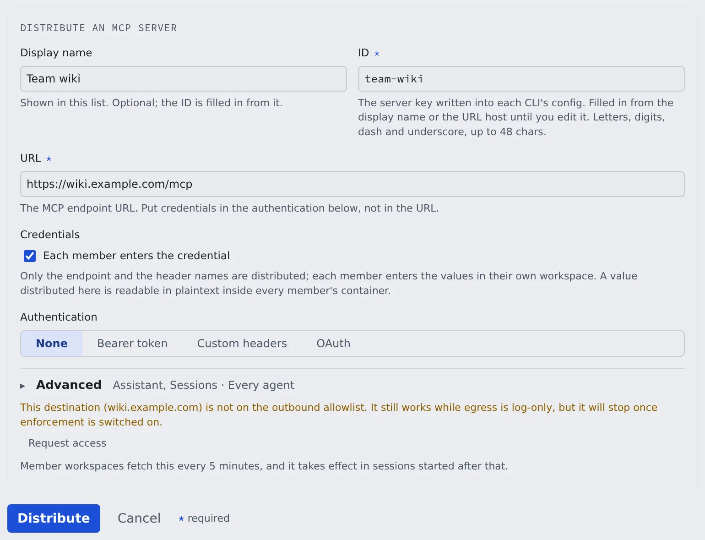

# Distribute an MCP server to everyone

English | [日本語](mcp-distribute.ja.md)

Register an MCP server the team uses once, and every member of the tenant can use it from their sessions and the assistant.
Choose whether everyone shares one token, each member enters their own value, or each member signs in.

## How it works

| What you do | What happens on the members' side |
|---|---|
| Add a server under "MCP distribution" in Tenant settings | Within five minutes it appears in each member's MCP server list, labelled "Tenant" |
| Choose how credentials are handled | With the value distributed it just works; per-member values show "Enter values", OAuth shows "Sign in" |
| Disable or delete it | From the next fetch, it is no longer handed to members |

It takes effect in sessions started after the fetch. Sessions already running do not change.

## Before you start

- **Only remote (Streamable HTTP) servers can be distributed.** stdio, which starts a command inside the workspace, cannot: distributing it would let an administrator run any command in everyone's container. Members who need stdio register it in their own settings
- **Try it in your own workspace first.** Register it for yourself and get a passing connection test before you distribute it ([Add an MCP server to your sessions](../user/integrations/mcp-servers.md))
- **On a deployment that restricts outbound traffic, the destination host has to be allowed.** See [below](#the-destination-host-is-not-allowed)

## Distribute a server

1. Open **Operations** → "**MCP distribution**" in Tenant settings and press "**Distribute an MCP server**"
2. Enter the "**Display name**" and the URL. The "**ID**" is filled in from the display name until you edit it
3. Choose "**Credentials**" and "**Authentication**" ([next section](#decide-how-credentials-are-handled))
4. If needed, change "**Used by**", "**Agents**" and "**Enabled**" under "**Advanced**". The closed heading shows the current values
5. Press "**Distribute**"

Distributed servers appear in members' **⚙ Settings → Connections → "MCP servers (used by sessions)"**, labelled "Tenant".
Members can only run the connection test and disable it in their own workspace; they cannot edit or delete it.

## Decide how credentials are handled

This is the most important decision in a distribution.

| Choice | What is distributed | Suited to |
|---|---|---|
| "**Each member enters the credential**" off | The header values too. Stored encrypted, and handed over only when the server starts | A shared read-only token everyone reads with the same rights |
| "**Each member enters the credential**" on | The destination and the header names only. Each member enters the value in their own workspace | Per-person tokens, or anything you want to tell people apart by in an audit |
| "**OAuth**" under "**Authentication**" | The destination only. Each member signs in with their own account | Hosted servers that accept only an OAuth sign-in |

**A distributed value can be read in plain text inside every member's container.** For a powerful token, or one you want to tell people apart by, have each member enter it.

- "**Authentication**" is one of "**None**", "**Bearer token**", "**Custom headers**" and "**OAuth**"
- With per-member values and "Bearer token", only the `Authorization` header name is distributed and members get a field for the token alone. Until a member enters it, the server is not used
- With the value distributed, the saved token is shown as `Bearer ***`
- Changing the URL to another host clears the saved header values. Enter values for the new host again

### Distribute an OAuth server

OAuth distributes no credential at all, so "Credentials" does not appear and no header can be added.
Each member's row shows "**Sign in**", and the grant stays in that member's workspace only. The server reaches only the sessions of members who signed in.

If you registered a client for Agent Fleet at the server's authorization server, enter it below. Members' sign-ins use it instead of each registering a client.

| Field | What to enter |
|---|---|
| "**Client ID registered by the tenant**" | The registered client's ID. Empty means each member's sign-in registers its own client |
| "**Authorization server (issuer)**" | The issuer of the authorization server the client is registered at. An https URL |
| "**Client secret**" | Only for a confidential client. Leave it empty for a public client |

- The secret is stored encrypted and is never sent to a workspace. The Control Plane makes the token requests, so check with the deployment administrator that the Control Plane can reach that authorization server
- Changing the issuer or the client ID asks for the secret again

"**Scopes**" is optional: the scopes each member's sign-in requests, separated by spaces or new lines. Left empty, the sign-in requests the scopes the server's refusal names, and when there is no such refusal, every scope its protected resource metadata lists (`scopes_supported`). A server whose tool list anyone can read refuses nothing, so the sign-in then requests that whole list, which can include full control of the account. Enter the narrowest scopes the members need.

- Each scope is one word without quotes, backslashes or commas. Joined with single spaces, and with ` offline_access` added unless you listed it, they must fit in 1024 bytes
- Members already signed in keep the scopes they granted until they sign in again. A scope you add shows "**More permission needed**" on their row, and the server keeps working with what was granted. Signing in again requests this list together with what was granted and what the server asked for

Under **Tool confirmations**, select **Show confirmation cards in the Console** if the server uses
MCP confirmation forms with a fixed list of choices for every field. This setting is off by default.
A form that asks for typed text ends the call with an error. See [Answer an MCP confirmation card](../user/integrations/mcp-servers.md#answer-an-mcp-confirmation-card).

#### One sign-in for several servers

Distributions that carry the same client ID at the same authorization server, both public or both confidential, share one sign-in per member. Signing in to any of them requests the URL and scopes of every one the member has switched on, and connects all of them. Each row names the others it shares with, and "**Disconnect**" on any of them ends the sign-in for all.

- Adding a distribution with that client, or moving one to another URL, shows "**More permission needed**" on that row; it reaches no session until the member signs in again. The other rows keep working
- Give every distribution of the group its "**Scopes**". A row without them gets what the others ask for (plus its own server's request when the member signs in from that row), and asks for more permission when its server refuses
- Only https URLs share the sign-in. An http distribution signs in on its own
- The URLs and scopes all go into one authorization request. When there are more than 32 servers, their URLs together exceed 4 KiB, or their joined scopes exceed the 1024-byte limit above, each server signs in on its own instead. So does every server of the group when its authorization server refuses one sign-in for several servers: the first sign-in that finds this fails once, and when only the renewal is refused, each server keeps working until its token expires and then asks to be signed in on its own

These changes cut every member's sign-in, and members sign in again.

- Changing the URL, leaving OAuth, deleting the distribution (at the next fetch). For a distribution that shares a sign-in, only this row is cut, as above; deleting the last one ends the sign-in
- Changing or removing the client. A shared sign-in ends when no distribution keeps that client. With a confidential client, earlier tokens can no longer be revoked and stay valid at the old authorization server until they expire
- Switching a distribution that carried values to OAuth deletes the stored header values

### Distribute Google Workspace

1. In your Google Cloud project, enable the APIs and MCP services for the products you plan to distribute. Configure the consent screen and add the scopes shown in Agent Fleet's preset under Google Auth Platform → **Data Access**. [Google Workspace MCP setup](https://developers.google.com/workspace/guides/configure-mcp-servers)
2. Under Google Auth Platform → **Clients**, create a **Web application** OAuth client and select **Use this client for an AI-powered agent**. Add `{PUBLIC_BASE_URL}/oauth2/mcp/callback` under **Authorized redirect URIs**, replacing `{PUBLIC_BASE_URL}` with your Agent Fleet deployment's public URL. The preset displays the redirect URI when the deployment has configured its public URL.
3. Open Tenant settings → **Operations** → **MCP distribution** → **Google Workspace preset**. Enter the client ID and secret, choose the services, and review the requested scopes. **Read-only** is the default. **Standard** adds selected write scopes for Gmail drafts, Drive files, Docs, Sheets, Slides, Calendar events, and Chat messages. Google limits available tools on the endpoints used by the preset.
4. Use **Test connection** on a selected service to check it from your current workspace. If Google publishes both a public tool list and OAuth metadata, the test shows **Connected** and **OAuth metadata found** together.
5. Press **Distribute**. The preset creates one ordinary OAuth definition per selected service. Members use one Google sign-in for the group when Google accepts the shared request. You can open each server's row later to edit it individually.

The preset uses `/mcp/v1self` for services that offer it. People API and Google Classroom use `/mcp/v1` with read-only scopes in both bundles. People API, Google Classroom, and Universal Search require Google's Developer Preview access. [Supported products and endpoints](https://developers.google.com/workspace/guides/configure-mcp-servers#supported-products)

If outbound traffic is restricted, allow the exact service hostnames shown in the form and `accounts.google.com` for OAuth discovery. The Control Plane uses `oauth2.googleapis.com` for token requests. For example, Gmail uses `gmailmcp.googleapis.com` and People uses `people.googleapis.com`.

## When changes arrive

| What you do | On the members' side |
|---|---|
| Add or change | Each workspace fetches every five minutes; sessions started after that use it |
| Turn "**Enabled**" off | The definition stays, but it is distributed to no one |
| Delete | It disappears from each workspace at the next fetch |

- If a member has a personal registration with the **same name**, the distribution wins and the member's screen says so. Pick names that are unlikely to collide
- Members can press "**Fetch tenant set**" to take it in without waiting five minutes

## Rotate a token

When you retire a distributed token, **replace the distributed value with the new token first**, then disable the old one.
In the other order, every member's tools fail until the next fetch.

## Stop outside apps from connecting with OAuth

Outside apps such as claude.ai can connect to this tenant through MCP OAuth. Stop that in the **MCP OAuth** box under **Sign-in** → "**Allowed networks**" in Tenant settings.
The box appears only when the deployment offers MCP OAuth. It is allowed by default.

1. Clear "**Allow apps to connect through MCP OAuth**" and press "**Save**"
2. Press "**Save**" in the confirmation dialog

Once it is off:

- Every OAuth connection of this tenant is revoked at once, and the audit log records it
- The tenant leaves the choices on the consent screen, and code exchange and token refresh are refused
- Other tenants and personal access tokens (PATs) are not affected

Allowing it again does not restore the revoked connections. Members reconnect from their apps.
To revoke one connection only, the member revokes it under "Connected apps" in **⚙ Settings → Outside access → "MCP tokens & apps"**.

## When it goes wrong

### The destination host is not allowed

Where workspaces may connect is the deployment administrator's decision. That screen is not in Tenant settings.
A distributed server and a member's own registration both fail when the destination host is not allowed.

When the form or the list says "This destination (…) is not on the outbound allowlist, so the workspace cannot reach it.", press "**Request access**", write the reason and press "**Send request**".
Until the deployment administrator approves it, it shows as awaiting an administrator's approval.

### Asking the deployment administrator

What a tenant administrator cannot finish goes to the deployment administrator. Include these three, and they can act on it as is.

- **What**: the host name to allow (`api.example.com` or `.example.com`)
- **Why**: which MCP server, for what work
- **Until when**: for good, or for a period

The deployment administrator's side is in [Control outbound traffic](../operate/secure/egress.md#approve-members-requests).

## Related

- [Add an MCP server to your sessions](../user/integrations/mcp-servers.md#what-you-can-change-by-origin): what members see
- [Allow memory use from outside](memory-outside.md): whether outside agents may use memory
- [Allow MCP servers as watch sources](watch-sources.md): whether members' MCP servers may feed watches
