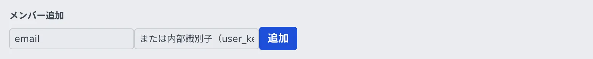

# メンバーを追加する

[English](add.md) | 日本語

メールアドレスを名簿に足すと、その人がサインインしたときにこのテナントのメンバーになり、ワークスペースが用意されます。
まだ一度もサインインしていない人も、先に追加しておけます。

## 全体像

| あなたがやること | Agent Fleet がやること |
|---|---|
| メールアドレスを名簿に足す | アドレスからユーザーキーを作り、名簿に載せる |
| 本人にサインインしてもらう | 初回のサインインで、名簿をもとにワークスペースを用意する |

## 名簿に足す

1. **テナント設定 → 運用 → メンバー** を開き、名簿のいちばん下の **メンバー追加** まで進みます
2. 「email」欄に、その人がサインインに使うメールアドレスを入れます
3. **追加** を押します

- 追加できるのは一般メンバー（`member`）だけです。管理者を増やすのは配備管理者です（[ロールとできること](../../ref/roles.ja.md#管理者を増やす)）
- 追加した人には、[やりたいことから探す](../../user/README.ja.md) を案内してください
- サインイン規則に **招待できるドメイン** があるときは、そのドメインのアドレスしか追加できません。断られたときのメッセージに、許されたドメインが出ます

## メールアドレスとユーザーキー

メンバーは、内部では **ユーザーキー**（`user_key`）で識別します。メールアドレスを入れれば自動で作られるので、ふだんは気にしなくてかまいません。

- 名簿のカード、監査ログ、セッションの一覧には、ユーザーキーが出ます。「このキーはこの人」と分かっていると読みやすくなります
- 同じ人でも、テナントが違えば所属もワークスペースも別です
- 「または内部識別子（user_key）」欄に、キーを直接入れることもできます。キーはホームディレクトリの名前になるので、英小文字と数字を 1 つのハイフンでつないだ 40 文字以内の形だけを受け付けます
- サーバーが自動で作ったキー（カードに出ているもの）は、40 文字を超えていても受け付けます

## 招待制と自動参加

新しい人がこのテナントに入るしくみは、配備の設定とサインイン規則で決まります。

| しくみ | 入れる人 | 決める人 |
|---|---|---|
| 招待制（`AF_PROVISION=invite`。新しく導入した配備の既定） | 名簿に追加された人だけ | 配備管理者 |
| 自動参加（`AF_PROVISION=auto`） | サインインを許された人は全員、初回のサインインで既定のテナントに入る | 配備管理者 |
| 自動参加ドメイン（サインイン規則） | そのドメインのアドレスの人は、初回のサインインでこのテナントに入る | 配備管理者 |

- すでに名簿に載っている人は、どのしくみでも名簿のとおりに入ります
- 招待制では、追加されていない人もサインインまでは通り、「まだ招待されていません」の画面が出ます。その画面に本人のサインイン済みアドレスが出るので、追加を頼まれたらそのアドレスを使ってください。表示名やいつも使うアドレスとは限りません
- どのしくみかは **テナント設定 → サインイン → サインイン規則** で読めます。あなたには読み取り専用です
- そもそもサインインできるアドレスの範囲を決めるのも配備管理者です。範囲の外の人は、名簿に追加してもサインインできません

## うまくいかないとき

### 追加すると 409 で断られる

| 状況 | 対処 |
|---|---|
| 別のテナント専用のサインイン方式で入っている人（`identity_bound_to_other_tenant`） | このテナントには追加できません |
| ユーザーキーがほかのテナントの人のもので、メールアドレスも入れた（`identity_in_other_tenant`） | メールアドレスを空にして、ユーザーキーだけで追加します |

すでにいる人のメールアドレスが、追加によって書き換わることはありません。アドレスが結び付くのは、新しい人だけです。

### このテナントの方式でサインインできない

ほかのテナントがまだその人を名簿に載せていると、このテナント専用のサインイン方式では入れないことがあります。
そのテナントに先に外してもらい（外したメンバーは数えません）、本人にもう一度サインインしてもらいます。

### 外した人を戻したい

同じメールアドレスでもう一度追加すると戻ります。ワークスペースと home は残っています。

- 管理者だった人は、一般メンバーとして戻ります
- 外しているあいだ止まっていた定時実行は、戻すと再開します

## 関連

- [メンバーの状況を見る](roster.ja.md)
- [メンバーを外す](remove.ja.md)
- [サインインの方法を決める](../access/signin-methods.ja.md)
