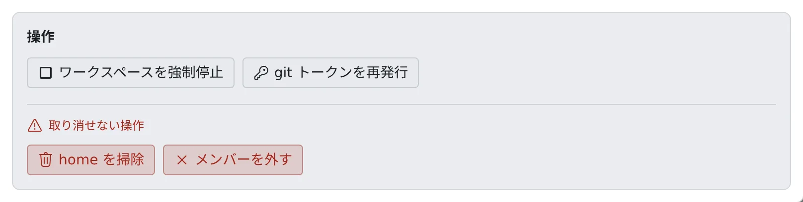

# メンバーを外す

[English](remove.md) | 日本語

退職や異動の手続きは、テナント管理者の権限だけで最後まで終わります。
名簿から外してアクセスを止め、home とバックアップを消し、最後に名簿の行そのものを消します。

## 全体像

| あなたがやること | Agent Fleet がやること |
|---|---|
| メンバーを外す | 次のリクエストからアクセスを止め、開いている接続を閉じ、ワークスペースを止める |
| home を掃除し、バックアップを削除する | ログインと接続を残して home を消し、バックアップを消す |
| ワークスペースを破棄し、メンバーを完全に削除する | home と接続を消し、名簿から行を消す。監査ログと費用の記録は残す |

## 外す手順

メンバー詳細の **操作** から、この順に進めます。3 と 4 のボタンは「取り消せない操作」の枠にあります。

1. **メンバーを外す** を押します。名簿から外れ、次のリクエストからアクセスできなくなります。いちばん先にやります
2. カードがまだ稼働中か起動中なら、**ワークスペースを強制停止** を押します
3. **home を掃除** を押します。**取り消せません**
4. **バックアップを削除** が出ていれば押します。**取り消せません**

外すと、動いているワークスペースも止まります。止まりきらなかったときのために、2 があります。

### 1. メンバーを外す

- 署名済みのサインイン Cookie は 1 人ずつ取り消せないので、この操作が実際にアクセスを止めます
- ワークスペース・home・保存済みの認証情報は残ります。間違えたら、同じメールアドレスでもう一度追加すれば戻ります（[メンバーを追加する](add.ja.md#外した人を戻したい)）
- 外したメンバーの定時実行は止まり、戻すと再開します
- 確認のダイアログで「ワークスペースと home も破棄する（取り消せません）」に印を付けると、外すのと同時にワークスペースと home を破棄します

### 3. home を掃除する

home の中身を、ログインと接続を除いてすべて消します。

| 残るもの | 消えるもの |
|---|---|
| 接続情報、git の認証情報、SSH 鍵、Claude と Codex のログイン | `~/repos`（コミットしていない変更も）、キャッシュ、そのほか home の中のもの |

- ログインと接続まで消えるのは、ワークスペースを破棄したときだけです
- **home を掃除** がない配備もあります。そのときは、外したあとに出る **ワークスペースを破棄** で home を消します。消せなかったものがあれば一覧で出ます

### 4. バックアップを削除する

- 配備が home のバックアップを取っていて、この人のバックアップがあるときだけ出ます
- home の掃除ではバックアップは消えません。どのバックアップにも、取った時点の home が残っています
- home の掃除のあとで行います。home が残っているあいだは、テナントのバックアップの予定どおりに新しいコピーが取られ続けます

### 時間がかかる配備

| 配備 | 動き |
|---|---|
| Fargate（`ecs`） | home の掃除と破棄は、数分かかるタスクとして動きます |
| EC2 スロットプール（`ecs-ec2`） | 破棄は、EFS に残ったものを消すために同じタスクを動かします |

- ボタンはすぐに戻り、結果は終わった時点で監査ログに残ります
- その間に Control Plane が再起動すると、結果は残りません。どう終わったかの確かめ方は [配備先ごとの違い](../../ref/deploy-targets.ja.md) にあります

## 名簿から完全に削除する

外したメンバーは、名簿に「外れています（名簿から削除済み）」として残ります。2〜4 をあとからでも行えるようにするためです。

1. 外したメンバーの **操作** で **ワークスペースを破棄** を押します。home と、この人のワークスペースのために作られたものが消えます。**取り消せません**
2. 破棄し終えると、同じ場所に **メンバーを完全に削除** が出るので押します

ワークスペースが残っているうちは、**メンバーを完全に削除** は出ません。home とクラウドのリソースを指すものがなくなってしまうからです。

| 消えるもの | 残るもの |
|---|---|
| 上限設定、アクセストークン、SSM の設定、定時実行、メモ、通知、セッション共有 | 監査ログ、クラウド費用、稼働時間 |

- 取り消せません。同じ人をもう一度招待すると、まっさらな新しいメンバーとして始まります
- 監査ログと費用が残るのは、退職の手続きで記録そのものを消せないようにし、過去の月の費用が後から変わらないようにするためです

## うまくいかないとき

### 外したのにカードが稼働中のまま

ワークスペースが止まりきっていません。メンバー詳細から **ワークスペースを強制停止** を押します。

### 古い git トークンが出回っているかもしれない

外したメンバーのトークンも入れ替えられます。もう一度招待する前に行ってください（[メンバーの Git トークンを入れ替える](git-token.ja.md)）。

## 関連

- [メンバーの状況を見る](roster.ja.md)
- [メンバーを追加する](add.ja.md)
- [リソースの使われかたを見る](../resources/overview.ja.md)
