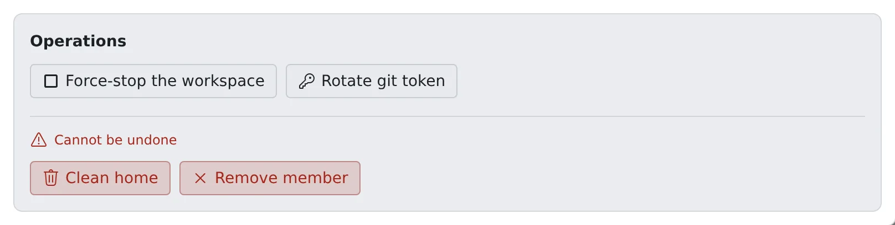

# Remove a member

English | [日本語](remove.ja.md)

When someone leaves or moves, a tenant administrator can carry the whole sequence through alone.
Take them off the roster to stop their access, erase their home and backups, and finally delete their row from the roster.

## How it works

| What you do | What Agent Fleet does |
|---|---|
| Remove the member | Stops their access from the next request, closes open connections and stops the workspace |
| Clean their home and delete its backups | Erases the home except logins and connections, and deletes the backups |
| Destroy the workspace and delete the member | Erases the home and connections and deletes the row. The audit log and cost records stay |

## The steps

Go through **Operations** in the member detail in this order. The buttons for steps 3 and 4 sit in the "Cannot be undone" box.

1. Press **Remove member**. They leave the roster and lose access from the next request. Do this first
2. If the card still says Running or Starting, press **Force-stop the workspace**
3. Press **Clean home**. **This cannot be undone**
4. If **Delete backups** is offered, press it. **This cannot be undone**

Removing a member also stops a running workspace. Step 2 is there for when it did not stop.

### 1. Remove the member

- A signed sign-in cookie cannot be revoked person by person, so this is what actually stops access
- The workspace, home and stored credentials are kept. If it was a mistake, add the same email address again ([Add a member](add.md#you-want-a-removed-member-back))
- Their schedules pause, and resume when they are added back
- Tick "Also destroy their workspace and home (irreversible)" in the confirmation and the workspace and home are destroyed together with the removal

### 3. Clean the home

Everything in the home is erased except logins and connections.

| Kept | Erased |
|---|---|
| Connections, git credentials, SSH keys, Claude and Codex logins | `~/repos` (uncommitted changes too), caches, everything else in the home |

- Logins and connections go only when the workspace is destroyed
- Some deployments do not offer **Clean home**. There, the home is erased by **Destroy workspace**, offered once the member is removed. Anything it could not delete is listed

### 4. Delete the backups

- Offered only where the deployment backs homes up and this person has backups
- Cleaning the home does not delete them. Every backup still holds the home as it was when it was taken
- Do it after cleaning the home. While the home exists, the tenant's backup schedule keeps taking new copies of it

### Deployments where it takes a while

| Deployment | Behaviour |
|---|---|
| Fargate (`ecs`) | Clean home and destroy run as a task that takes a few minutes |
| EC2 slot pool (`ecs-ec2`) | Destroy runs the same task to erase what is left on EFS |

- The button answers at once, and the outcome is written to the audit log when it finishes
- If the Control Plane restarts meanwhile, the outcome is not written. How to tell how it ended is in [Deployment targets](../../ref/deploy-targets.md)

## Delete the member from the roster

A removed member stays on the roster marked "removed", so that steps 2 to 4 remain within reach later.

1. In the removed member's **Operations**, press **Destroy workspace**. The home and whatever was created for this person's workspace are deleted. **This cannot be undone**
2. Once it is destroyed, **Delete this member** appears in the same place; press it

**Delete this member** does not appear while the workspace is still there, because the home and its cloud resources would be left with nothing pointing at them.

| Deleted | Kept |
|---|---|
| Quotas, access tokens, SSM settings, schedules, memos, notifications, session shares | Audit log, cloud cost, running time |

- There is no undo. Inviting the same person again starts a brand new member
- The audit log and cost stay so that offboarding cannot erase its own record and past months' cost does not change afterwards

## When it goes wrong

### The card still says Running after removing

The workspace has not fully stopped. Press **Force-stop the workspace** in the member detail.

### An old git token may be out there

A removed member's token can be replaced too. Do it before inviting them back ([Replace a member's Git token](git-token.md)).

## Related

- [Check on your members](roster.md)
- [Add a member](add.md)
- [See how resources are used](../resources/overview.md)
