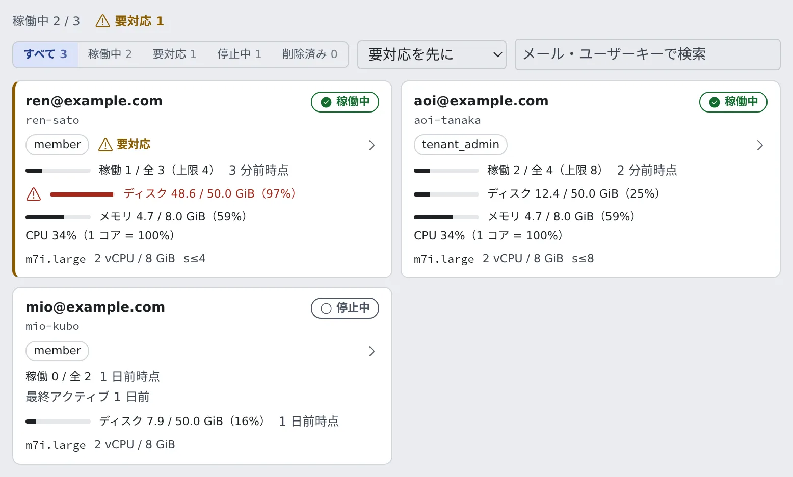

# メンバーの状況を見る

[English](roster.md) | 日本語

名簿で、メンバーのワークスペースが動いているか、ディスクやセッションに余裕があるか、対応が要る人はいないかをひと目で確かめられます。
対応が要るものは、名簿を開かなくても通知で届きます。

## 全体像

| あなたがやること | Agent Fleet がやること |
|---|---|
| 名簿を開いて、要対応のカードを見る | ワークスペースの数字を約 5 分ごとに集め、名簿に出す |
| カードからメンバー詳細を開いて手を打つ | 空きが少ない・インストールに失敗した・応答しないといった変化を、管理者に通知する |

## 名簿を開く

**テナント設定 → 運用 → メンバー** を開きます。メンバー 1 人につきカードが 1 枚並び、カードを押すとメンバー詳細に進みます。
詳細から名簿へは **戻る** か、上部のパンくず（メンバー › 対象の人）で戻ります。

カードの上には、次の操作が並びます。

| 操作 | 内容 |
|---|---|
| 件数 | 「稼働中 N / M」と「要対応 N」。起動中のワークスペースも稼働中に数えます |
| 表示 | すべて・稼働中・要対応・停止中・削除済み |
| 並べ替え | 要対応を先に（既定）・名前順・ディスク使用量順・最終アクティブ順 |
| 検索 | 「メール・ユーザーキーで検索」。照合するのはメールアドレスとユーザーキーだけです |

## カードを読む

| 項目 | 内容 |
|---|---|
| メールアドレスとユーザーキー | ユーザーキー（`user_key`）は、メールアドレスから作られる内部の識別子です。監査ログやセッションの一覧にも出ます |
| ロール | `member` か `tenant_admin`。外したメンバーは「外れています（名簿から削除済み）」 |
| 状態 | 稼働中・起動中・停止中・未起動・自動で停止・削除済み |
| セッション数 | 「稼働 3 / 全 5」。上限があるメンバーは上限と細いバーも出ます |
| ディスク | ホームディレクトリ の使用量（例:「ディスク 19.0 / 20.0 GiB（95%）」） |
| 自動停止の見通し・マシンのサイズ | いつ自動で止まるか、どのサイズで動いているか |
| 最終アクティブ | 停止中のカードに出ます |
| メモリと CPU | 稼働中のカードが画面に見えているときだけ出ます |

- **自動で停止** は、Control Plane が止めたワークスペースです
- 外したメンバーのワークスペースがまだ動いていれば、状態は稼働中か起動中のままです。止めるのが、外したあとの次の手順だからです（[メンバーを外す](remove.ja.md)）

## 要対応のカードに手を打つ

対応が要るカードには、左端に警告色の線と **要対応** の印が付きます。印にマウスを載せると理由が出ます。

| 理由 | 意味 |
|---|---|
| Control Plane がワークスペースを停止しました | プラットフォームが自分で止めました |
| 期限を過ぎてもセッションが停止を止めています | あるセッションが、期限を過ぎても自動停止を止めたままです |
| ホームディスクの空きが少なくなっています | 使用率が 90 % を超えています（95 % 未満で、空きは 2 GiB 以上） |
| ホームディスクが満杯、または空きがほとんどありません | 使用率が 95 % 以上か、空きが 2 GiB 未満です |
| 直近の起動で CLI のインストールに失敗しました | 原因は ホームディレクトリ の満杯が多いです。CLI ごとの理由はメンバー詳細に出ます |

- 既定の並び順では、ホームディレクトリ が満杯に近いカードが先頭、ほかの理由のカードが次、それ以外が最後です。それぞれの中は名前順です
- 空きが足りずに CLI のアップグレードだけを見送った場合は、古いバージョンで動くので印は付きません。メンバー詳細に注記が出ます

## 通知で知る

次の 3 つは、名簿を開かなくても Console の通知（ベル）で届きます。

| 通知 | 届くとき |
|---|---|
| 「◯◯ さんのホームの空きが少なくなっています」 | メンバー専用の ホームディレクトリのボリュームで、使用率が 90 % を超えたか空きが 2 GiB 未満になったとき |
| 「◯◯ さんのワークスペースでツールのインストールに失敗しました」 | 直近に観測した起動で、CLI のインストールに失敗したとき |
| 「◯◯ さんのワークスペースが応答していません」 | 起動中のワークスペースの Agent が、数分間応答しないとき |

- 通知を押すと、そのメンバーの詳細が開きます
- 届くのは、そのメンバーと同じテナントの管理者だけです。メールは送りません
- 状態が変わるたびに 1 回だけ届きます。回復するか ホームディレクトリ を掃除すると、次にまた同じ状態になったときにもう一度届きます
- ホームディレクトリ の通知は、空きが 3 GiB を超えて使用率が 85 % 未満に戻るまで解除されません
- ホームディレクトリ を共有のホストやファイルシステムに置く配備では、ホームディレクトリ の通知は届きません。数字がそのメンバーのものではないためです
- 停止中や到達できないワークスペースからは、通知は届きません
- 応答しないワークスペースは、メンバー詳細から強制停止します（[ワークスペースを強制停止する](../resources/idle-stop.ja.md#ワークスペースを強制停止する)）

## 数字の新しさ

名簿を開いても、ワークスペースへの問い合わせは起きません。メモリと CPU 以外は Control Plane が記録した値なので、メンバー本人の画面より少し遅れることがあります。

| 数字 | 新しさ |
|---|---|
| セッション数 | 稼働中のワークスペースについて約 5 分ごとに更新します |
| ディスク | 稼働中に約 5 分ごとに読んだ最後の値です。停止中のカードには、いつの値かも出ます |
| インストール失敗の印 | ディスクと同時に読みます。停止中のカードは、最後に観測した起動の結果を保ちます |
| メモリと CPU | 稼働中のカードが画面に見えているあいだ、約 15 秒ごとに読みます |

**ディスクの表示** は配備によって違います。

| 配備 | 表示 |
|---|---|
| ホームディレクトリ がメンバー専用のボリューム（ECS on EC2・Kubernetes） | 使用量と上限のゲージ |
| ホームディレクトリのサイズを読める（ローカル・ネイティブ） | 使用量だけ（例:「ディスク 3.2 GiB 使用」） |
| ECS Fargate | ゲージはなく、設定したサイズだけ。作業ディスクは停止のたびに消えます |

**メモリと CPU** は、最初の値が届くまで「リアルタイム使用量: 取得中…」と出ます。

- CPU は、実行環境が CPU の上限を効かせるときは「CPU 上限（4 vCPU）の 25%」、それ以外は「CPU 200%（1 コア = 100%）」のように出ます
- 一度に読むのは 3 件までです。画面外のカード、絞り込みで隠れたカード、停止中のカード、ブラウザのタブが裏にあるときは読みません

## メンバー詳細を見る

メンバー詳細には、そのメンバーのワークスペースのリソース、稼働中のセッション、操作がまとまっています。

- **サイズと上限** のカードには、直近の起動でインストールに失敗した CLI が理由とともに出ます
- ホームディレクトリ がメンバー専用のボリュームの配備では、空きが少ないときの注意も同じカードに出ます。条件は名簿の印と同じで、稼働中のワークスペースにだけ出ます
- ローカル・ネイティブの配備では、ディスクの欄は直近の測定値を「3 分前時点」のように出し、約 1 分ごとに測り直します。とても大きな ホームディレクトリ では、最初の測定が終わるまで「計測中…」と出ます

リソース・セッション数の上限・強制停止は [リソースの使われかたを見る](../resources/overview.ja.md) から辿れます。

## 関連

- [メンバーを追加する](add.ja.md)
- [メンバーを外す](remove.ja.md)
- [チーム管理者の仕事](../overview.ja.md)
