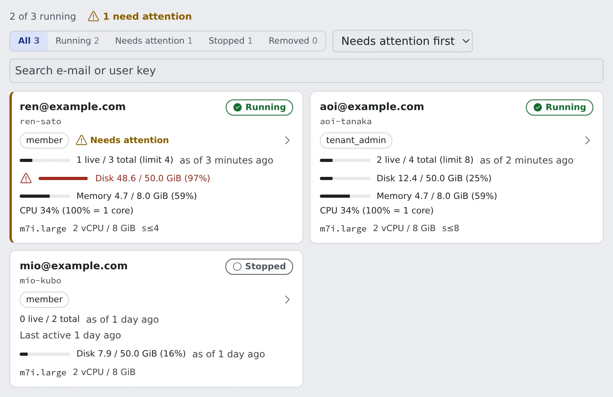

# Check on your members

English | [日本語](roster.ja.md)

The roster shows at a glance whether members' workspaces are running, whether disks and sessions have room, and who needs a hand.
What needs you also arrives as a notification, without opening the roster.

## How it works

| What you do | What Agent Fleet does |
|---|---|
| Open the roster and look at the cards that need attention | Collects each workspace's figures about every five minutes and shows them on the roster |
| Open a member's detail from their card and act | Notifies administrators when a home runs low, an install fails or a workspace stops answering |

## Open the roster

Open **Tenant settings → Operations → Members**. There is one card per member; press a card to go to the member detail.
To go back from the detail, use **Back** or the breadcrumb at the top (Members › the person).

Above the cards:

| Control | What it does |
|---|---|
| Counts | "N of M running" and "N need attention". Starting workspaces count as running |
| Filter | All, Running, Needs attention, Stopped, Removed |
| Sort | Needs attention first (the default), Name, Disk usage, Last active |
| Search | "Search e-mail or user key". It matches the email address and the user key only |

## Read a card

| Item | What it shows |
|---|---|
| Email address and user key | The user key (`user_key`) is an internal identifier made from the email address. It also appears in the audit log and session lists |
| Role | `member` or `tenant_admin`; "removed" for someone you removed |
| State | Running, Starting, Stopped, Never started, Stopped automatically, Removed |
| Sessions | "3 live / 5 total". A member with a session limit also gets the limit and a thin bar |
| Disk | Home usage, for example "Disk 19.0 / 20.0 GiB (95%)" |
| Idle-stop outlook and machine size | When it will stop on its own, and the size it runs at |
| Last active | Shown on a stopped card |
| Memory and CPU | Shown only while a running card is on screen |

- **Stopped automatically** is a workspace the Control Plane stopped
- A removed member whose workspace is still up stays Running or Starting, because stopping it is the next step after removing them ([Remove a member](remove.md))

## Act on cards that need attention

A card that needs you has a warning edge on the left and a **Needs attention** mark. Hover the mark for the reasons.

| Reason | What it means |
|---|---|
| The Control Plane stopped this workspace | The platform stopped it itself |
| A session is still holding it past its deadline | A session is still holding off idle-stop after its deadline |
| The home disk is nearly full | Over 90 % used (under 95 %, with 2 GiB or more free) |
| The home disk is full or almost out of space | 95 % or more used, or less than 2 GiB free |
| A CLI failed to install at the last start | A full home is the usual cause. The reason per CLI is in the member detail |

- In the default order, cards whose home is almost full come first, then cards with any other reason, then everyone else; each group by name
- When only a CLI's upgrade was skipped for lack of space, the old version keeps working and no mark appears. The member detail notes it

## Hear about it by notification

These three arrive as Console notifications (the bell) without opening the roster.

| Notification | Sent when |
|---|---|
| "{name}'s home is nearly full" | A member's own home volume is over 90 % used or has less than 2 GiB free |
| "{name}'s workspace failed to install a tool" | The last start observed failed to install a CLI |
| "{name}'s workspace is not responding" | A running workspace's Agent has not answered for several minutes |

- Clicking one opens that member's detail
- Only administrators of the member's own tenant receive them; no email is sent
- Each one arrives once per change of state. After it recovers, or the home is cleaned, the next time it happens notifies again
- The home notice clears only once more than 3 GiB is free and usage is under 85 %
- On a deployment whose homes sit on a shared host or filesystem, no home notice is sent, because the figure is not the member's
- A stopped or unreachable workspace sends none
- A workspace that does not respond is force-stopped from the member detail ([Force-stopping a workspace](../resources/idle-stop.md#force-stop-a-workspace))

## How fresh the figures are

Opening the roster asks no workspace anything. Apart from memory and CPU, the figures are what the Control Plane recorded, so they can lag what the member sees.

| Figure | Freshness |
|---|---|
| Sessions | Refreshed about every five minutes for running workspaces |
| Disk | The last reading taken about every five minutes while running. A stopped card says how old it is |
| Install failure mark | Read together with the disk. A stopped card keeps the result of the last start observed |
| Memory and CPU | Read about every 15 seconds while a running card is on screen |

**The disk figure** depends on the deployment.

| Deployment | Shown as |
|---|---|
| The home is the member's own volume (ECS on EC2, Kubernetes) | A gauge of used against the limit |
| The home folder's size can be read (local, native) | Used only, for example "Disk 3.2 GiB used" |
| ECS Fargate | No gauge, only the configured size. The working disk is wiped on every stop |

**Memory and CPU** show "Live usage: reading…" until the first reading arrives.

- CPU reads "CPU 25% of 4 vCPU limit" where the platform enforces a CPU limit, otherwise like "CPU 200% (100% = 1 core)"
- At most three are read at a time. Cards off screen, hidden by the filter or stopped are not read, nor is anything while the browser tab is in the background

## Look at the member detail

The member detail gathers that member's workspace resources, running sessions and operations.

- The **Size and limits** card names each CLI that failed to install at the last start, with the reason
- Where the home is the member's own volume, the same card also warns when the home is running low. The rule is the roster mark's, and it appears for a running workspace only
- On local and native deployments the disk tile shows the last measurement with its age ("as of 3 minutes ago") and measures again about once a minute. On a very large home it shows "measuring…" until the first measurement finishes

Resources, session limits and force-stopping start at [See how resources are used](../resources/overview.md).

## Related

- [Add a member](add.md)
- [Remove a member](remove.md)
- [What a tenant administrator does](../overview.md)
