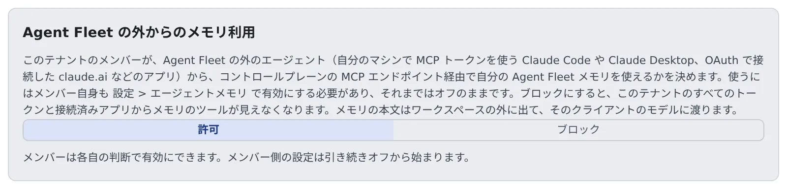

# 外部からのメモリの利用を許可する

[English](memory-outside.md) | 日本語

メンバーが、手元の Claude Code や claude.ai など Agent Fleet の外のエージェントから、自分の Agent Fleet のメモリを使ってよいかを、テナント全体で決めます。
ブロックすると、メンバー自身の設定にかかわらず、外からはメモリのツールが見えなくなります。

## 全体像

| あなたがやること | メンバーの側で起きること |
|---|---|
| 「許可」のままにする（初期状態） | メンバーは自分の設定で、外からの読み取り、または読み書きを選べる |
| 「ブロック」にする | どのメンバーのトークンや接続済みアプリにも、メモリのツールが出なくなる |
| 「許可」に戻す | メンバーが選んでいた状態に戻る |

メンバー自身の設定は「オフ」から始まります。許可のままでも、メンバーが選ぶまで誰にも変化はありません。

外から使うと、メモリの本文はワークスペースの外に出て、そのクライアントのモデルに渡ります。
シークレットのスキャンは認証情報を止めますが、顧客名や社内の事情までは止められません。これを避けたいテナントはブロックにします。

## 切り替える

1. テナント設定の **運用** →「**外部からのメモリ利用**」を開きます
2. 「**許可**」か「**ブロック**」を押します。押したときに保存されます

切り替えは監査ログに `tenant.external_memory` として、`enabled=true` か `enabled=false` つきで残ります（[監査ログを見る](audit.ja.md)）。
切り替えられるのは、テナント管理者と配備管理者だけです。

## ブロック中に起きること

- `/mcp` と `/mcp/memory` は、テナントの誰にもメモリのツール（`memory_projects`・`memory_index`・`memory_search`・`memory_read`・`memory_save`・`memory_patch`・`memory_feedback`・`memory_forget`）を一覧に出さず、名前を指定した呼び出しも断ります
- すでに発行したトークンにも、次のリクエストからすぐに効きます。再起動は要りません
- メンバーの設定は消えないので、許可に戻せば各自が選んでいた状態に戻ります
- Agent Fleet の中でのメモリ（セッションや、Console のエージェントメモリの画面）と、`/mcp` のほかのツールは変わりません
- スイッチを読めないとき（ストアが使えないなど）は、安全側に倒してツールを出しません

## メンバーが外から使える範囲

外からメモリを使えるのは、次のすべてがそろったときだけです。

| 決めるもの | 誰が決めるか |
|---|---|
| このスイッチが「許可」 | テナント管理者 |
| メンバーの **⚙設定 →「エージェントメモリ」→「設定」** で読み取りか読み書き | メンバー |
| トークンや接続済みアプリのスコープ（`read`・`write`） | メンバー |

外のアプリの OAuth 接続そのものを止めるのは、別のスイッチです（[外のアプリからの OAuth 接続を止める](mcp-distribute.ja.md#外のアプリからの-oauth-接続を止める)）。
配備全体で `/mcp` を止めるのは配備管理者です。

## トークンの有効期間の上限

メンバーが発行するトークン（PAT）の最長の有効期間は、配備管理者がテナントごとに決めます。テナント管理者の画面にはありません。

- 配備全体の上限と、テナントの上限の短いほうが効きます。新しく発行するトークンにも、すでにあるトークンにも効きます
- 上限を短くすると、それより古いトークンはすぐに使えなくなります
- トークンの作成と失効は、監査ログに `pat.create`・`pat.revoke` として残ります

テナントの上限を変えたいときは、配備管理者に頼みます。

## 関連

- [外部のエージェントからメモリを使う](../user/memory/external.ja.md)：メンバーの側の設定とつなぎ方
- [MCP サーバーを全員に配る](mcp-distribute.ja.md)
