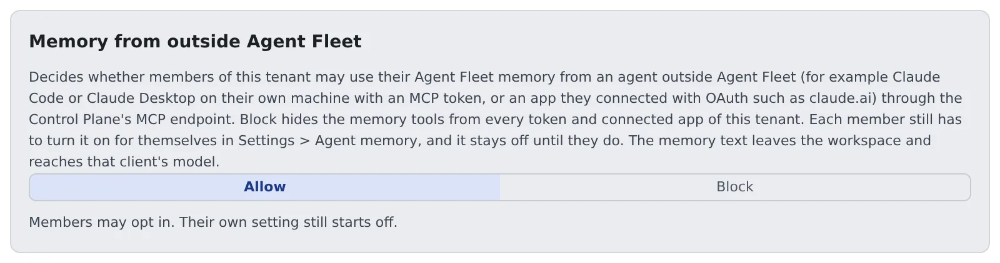

# Allow memory use from outside

English | [日本語](memory-outside.ja.md)

Decide, for the whole tenant, whether members may use their Agent Fleet memory from agents outside Agent Fleet, such as Claude Code on their own machine or claude.ai.
When you block it, the memory tools disappear from outside, whatever the members' own settings say.

## How it works

| What you do | What happens on the members' side |
|---|---|
| Leave it on "Allow" (the initial state) | Members can choose read-only or read-write access from outside in their own settings |
| Switch to "Block" | No member's tokens or connected apps see the memory tools |
| Switch back to "Allow" | Each member's earlier choice applies again |

Members' own setting starts at "Off". Even with Allow, nothing changes for anyone until a member chooses.

Used from outside, the memory text leaves the workspace and reaches that client's model.
The secret scan stops credentials, but not customer names or internal matters. A tenant that wants to avoid that blocks it.

## Switch it

1. Open **Operations** → "**External memory access**" in Tenant settings
2. Press "**Allow**" or "**Block**". It is saved when you press it

Each switch is recorded in the audit log as `tenant.external_memory`, with `enabled=true` or `enabled=false` ([Read the audit log](audit.md)).
Only tenant administrators and the deployment administrator can switch it.

## What happens while it is blocked

- `/mcp` and `/mcp/memory` list no memory tools (`memory_projects`, `memory_index`, `memory_search`, `memory_read`, `memory_save`, `memory_patch`, `memory_feedback`, `memory_forget`) for anyone in the tenant, and refuse a call that names one
- It applies to tokens already issued, from the next request. Nothing needs restarting
- Members' settings are kept, so switching back to Allow restores each member's choice
- Memory inside Agent Fleet (sessions, the Console's agent memory screen) and the other `/mcp` tools are unchanged
- When the switch cannot be read (the store is unavailable, say), it falls back to offering no tools

## What a member can use from outside

Memory is usable from outside only when all of these line up.

| What decides it | Who decides |
|---|---|
| This switch is "Allow" | Tenant administrator |
| Read-only or read-write in the member's **⚙ Settings → Agent memory → Settings** | The member |
| The scope (`read`, `write`) of the token or connected app | The member |

Stopping outside apps' OAuth connections altogether is a separate switch ([Stop outside apps from connecting with OAuth](mcp-distribute.md#stop-outside-apps-from-connecting-with-oauth)).
Turning `/mcp` off for the whole deployment is the deployment administrator's.

## The longest a token may live

The longest lifetime of the tokens (PATs) members issue is set per tenant by the deployment administrator. It is not on a tenant administrator's screens.

- The shorter of the deployment-wide cap and the tenant's cap applies, to newly issued tokens and to existing ones alike
- Shortening the cap makes older tokens unusable at once
- Token creation and revocation are recorded in the audit log as `pat.create` and `pat.revoke`

To change the tenant's cap, ask the deployment administrator.

## Related

- [Use memory from an external agent](../user/memory/external.md): the member's setting and how to connect
- [Distribute an MCP server to everyone](mcp-distribute.md)
