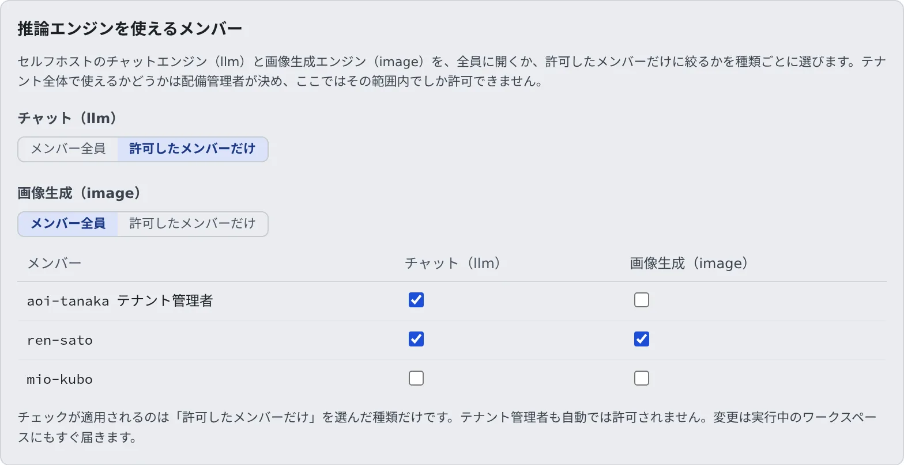

# 推論エンジンを使える人とモデルを決める

[English](engines.md) | 日本語

配備のセルフホストのチャットエンジン（llm）と画像生成エンジン（image）を、メンバー全員に開くか、許可したメンバーだけに絞るかを決められます。
配備管理者に許可されていれば、エンジンのモデルを取り込むこともできます。

## 全体像

| あなたがやること | 起きること |
|---|---|
| 「推論エンジンの利用者」で、役割ごとに使える人を選ぶ | 外されたメンバーの起動メニューとカタログから、その役割が消える |
| 許可されていれば、「推論エンジンのモデル」でモデルを取り込む | 配備のカタログにモデルが入る。メンバーが選べるようにするのは配備管理者 |

使えるかどうかは 2 段で決まります。

| 段 | 決める人 | 決めること |
|---|---|---|
| テナント | 配備管理者 | このテナントが、役割（llm / image）ごとにエンジンを使えるか。既定はどちらも使えます |
| メンバー | **あなた** | テナントに許された役割を、メンバー全員に開くか、許可したメンバーだけにするか |

GPU のインスタンスは時間で課金されるので、これは費用の判断です。どちらの段も役割単位で、モデル単位ではありません。

## 使えるメンバーを決める

**テナント設定 →「運用 › 推論エンジンの利用者」** を開きます。

1. 役割（「**チャット（llm）**」「**画像生成（image）**」）ごとに、「**メンバー全員**」か「**許可したメンバーだけ**」を選びます
2. 「**許可したメンバーだけ**」にした役割は、表でチェックを入れたメンバーだけが使えます

- **テナント管理者も自動では許可されません。** 自分も使うなら、自分の行にもチェックを入れてください
- 変更は、動いているワークスペースにもすぐ届きます。外されたメンバーの起動メニューとカタログからその役割が消え、動いているセッションも次の要求から断られます
- 「メンバー全員」に戻してもチェックは残ります。もう一度絞ると、同じ顔ぶれに戻ります
- 先にチェックを付けてから「許可したメンバーだけ」にすれば、誰も途中で使えなくなりません

同じチェックはメンバー詳細にもあり、そのメンバーがいま使えるかどうかも出ます。どちらで変えても同じ設定です。
「メンバー全員／許可したメンバーだけ」の切り替えは、この画面でだけできます。

### 「配備管理者が利用を止めています」と出る

配備管理者がテナント全体でその役割を止めています。表示はされますが、ここでは変えられません。チェックを入れても使えるようにはなりません。
使いたいときは、配備管理者に相談してください。

## モデルを取り込む

モデルを配備のカタログに取り込むのは、ふつうは配備管理者の仕事です。配備管理者があなたのテナントに取り込みを許可していると、
テナント設定に「**運用 › 推論エンジンのモデル**」が出て、あなたも取り込めます。この項目がなければ、許可は出ていません。

1. 「**運用 › 推論エンジンのモデル**」を開きます
2. Hugging Face・Civitai・URL からモデルを検索します
3. カードに出る取り込みの計画を読み、「**取り込む**」を押します

検索と計画のカードは、配備管理者の画面と同じに動きます。詳しくは [計画を読んで取り込む](../../operate/engines/models.ja.md#計画を読んで取り込む) にあります。

| あなたにできること | 配備管理者だけができること |
|---|---|
| モデルの検索と取り込み | モデルを有効にする（メンバーが選べるようにする） |
| 取り込んだ行の一覧を見る（id・名前・ファミリー・ライセンス・有効か無効か） | image の選択中チェックポイントを変える |
| 自分のテナントのジョブが作った S3 Bucket の項目を見る | 行を削除する |
| | 配備の Hugging Face と Civitai のトークンを登録する |
| | エンジンのモード・GPU のクラス・インスタンスの起動と停止 |

- **カタログは配備に 1 つです。** 取り込んだモデルの id は、どのテナントからも見えます
- 誰がどのライセンスに同意したかは、行に残ります（どのテナントの・誰が・いつ・どのライセンスに）。監査ログにも同じ組で残ります
- 配備管理者が取り込んだ行は、テナントが空欄です。配備全体に対して配備管理者が同意した、という意味です

## 関連

- [画像を生成する](../../user/images/generate.ja.md)
- [自前の GPU で推論エンジンを動かす（配備管理者向け）](../../operate/engines/gpu.ja.md)
- [セッション数の上限を決める](session-limits.ja.md)
