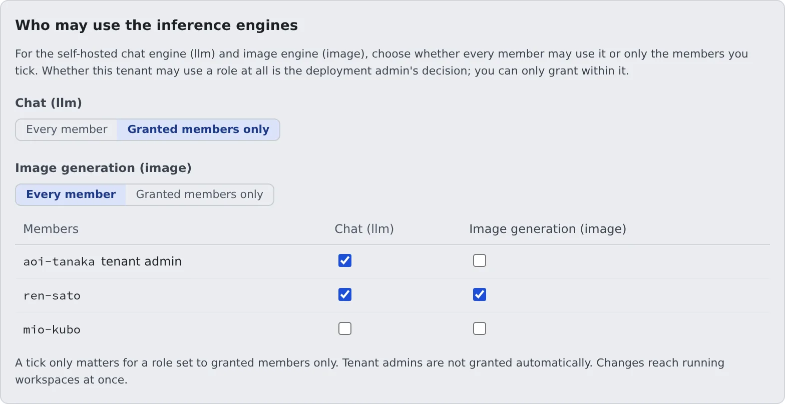

# Choose who may use the inference engines and which models

English | [日本語](engines.ja.md)

Decide whether the deployment's self-hosted chat engine (llm) and image engine (image) are open to every member or only to the members you grant.
If the deployment administrator allows it, you can also take engine models in.

## How it works

| What you do | What happens |
|---|---|
| Under **Engine access**, choose who may use each role | The role disappears from the launch menu and the catalogue of members who lose it |
| If allowed, take models in under **Inference engine models** | The model enters the deployment's catalogue. Making it selectable for members is the deployment administrator's job |

Whether someone may use an engine is decided in two layers.

| Layer | Who decides | What |
|---|---|---|
| Tenant | Deployment administrator | Whether this tenant may use each role (llm / image). Both are allowed by default |
| Member | **You** | Whether a role the tenant may use is open to every member or to granted members only |

GPU instances are billed by the hour, so this is a cost decision. Both layers work per role, not per model.

## Choose the members who may use them

Open **Tenant settings → Operations › Engine access**.

1. For each role (**Chat (llm)**, **Image generation (image)**), choose **Every member** or **Granted members only**
2. For a role set to **Granted members only**, only the members ticked in the table may use it

- **Tenant admins are not granted automatically.** If you use it yourself, tick your own row too
- Changes reach running workspaces at once. The role disappears from the launch menu and the catalogue of members who lose it, and their running sessions are refused from the next request
- Going back to **Every member** keeps the ticks. Restricting again brings back the same people
- Tick first and then switch to **Granted members only**, and nobody loses access in between

The same ticks are on the member detail too, with whether that member may use the role right now. Either place changes the same setting.
Switching between every member and granted members only is done on this screen only.

### "The deployment admin has turned this off" appears

The deployment administrator has turned the role off for the whole tenant. It is shown but cannot be changed here, and a tick does not make it usable.
To use it, talk to the deployment administrator.

## Take models in

Taking a model into the deployment's catalogue is normally the deployment administrator's job. When they have allowed your tenant to take models in,
**Operations › Inference engine models** appears in Tenant settings, and you can do it too. Without that item, the permission has not been given.

1. Open **Operations › Inference engine models**
2. Search for a model on Hugging Face, Civitai or by URL
3. Read the plan on the card and press **Take it in**

Search and the plan card work as on the deployment administrator's screen. Details are in [Taking models in](../../operate/07-engines.md#taking-models-in-and-what-that-has-to-do-with-tenants).

| What you can do | What only the deployment administrator can do |
|---|---|
| Search for and take models in | Enable a model (make it selectable for members) |
| See the list of rows taken in (id, name, family, licence, enabled or not) | Change the selected image checkpoint |
| See the S3 Bucket entries created by your own tenant's jobs | Delete a row |
| | Register the deployment's Hugging Face and Civitai tokens |
| | The engine mode, the GPU class, starting and stopping instances |

- **There is one catalogue per deployment.** The id of a model you take in is visible to every tenant
- Who accepted which licence is kept on the row (which tenant, who, when, which licence). The audit log records the same set
- A row the deployment administrator took in has an empty tenant. That means the deployment administrator accepted it for the whole deployment

## Related

- [Generate images](../../user/images/generate.md)
- [Inference engines and read aloud (for deployment administrators)](../../operate/07-engines.md#inference-engines-self-hosted-gpus-superadmin-only)
- [Set session limits](session-limits.md)
