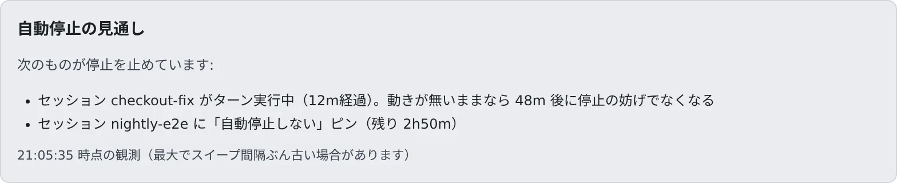
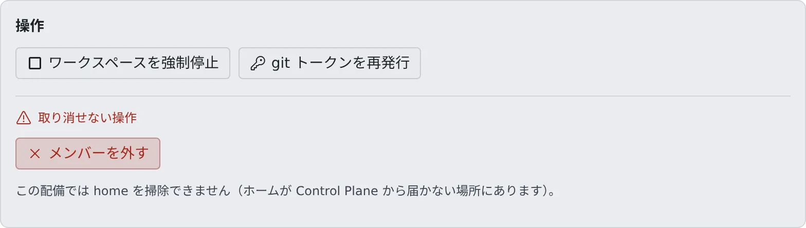

# 放置されたワークスペースを止める

[English](idle-stop.md) | 日本語

誰も使っていないワークスペースは、アイドル自動停止で止まります。いつ止まるか、何が止まるのを妨げているかを確かめられ、
暴走しているワークスペースはあなたが強制停止できます。

## 全体像

| あなたがやること | 起きること |
|---|---|
| メンバー詳細の「自動停止の見通し」を見る | あと何分で止まるか、何が止めずにいるかが出る |
| 「ワークスペースを強制停止」を押す | ワークスペースが止まる。ホームディレクトリ は残り、メンバーは起動し直せる |
| 止まるまでの時間を変えたいときは、配備管理者に頼む | 配備管理者がテナントのアイドル自動停止を変える |

止めても、ホームディレクトリ の中身は残ります。メンバーは次に使うとき、Console から起動し直すだけです。

## アイドル自動停止のしくみ

アイドル自動停止は、テナントごとに配備管理者が決めます。あなたの画面には値が出ないので、知りたいときは配備管理者に聞いてください。

| 設定 | 止まるもの | 配備の既定 |
|---|---|---|
| **セッション停止まで** | 開かれずに放置されたセッション。「停止中（再開可）」になり、会話は残ります | 1 時間 |
| **判断待ちの halt まで** | 誰も開いていない、人の判断を待っているセッション（質問・計画の承認待ち・許可待ち・利用上限メニュー・認証切れ）。止めても対話は失われず、再開後にカードから答えると届きます | 空欄なら「セッション停止まで」と同じ |
| **バックグラウンド作業で保持する上限** | アイドルのセッションが起動したバックグラウンド作業（開発サーバーや `run_in_background` のタスク）が、ワークスペースを止めずにおける時間の上限 | 2 時間 |
| **ワークスペース停止まで** | 誰も接続しておらず、動いているセッションもないワークスペース。コンテナごと止まります | 2 時間 |

- 時間は `30m`（分）・`2h`（時間）・`90s`（秒）のように書きます。空欄なら配備の既定に従い、`0` なら止めません（保持の上限は無制限）
- 配備の既定は配備ごとに変えられます。正確な値は [上限と既定値](../../ref/limits.ja.md#配備が決めるもの) にあります
- 判断待ちのセッションがあっても、「ワークスペース停止まで」はそのまま効きます
- 止まったセッションは、7 日たつとアーカイブへ移ります。削除はされず、作業コピーも残ります。期間はメンバーが自分の設定で変えられます

メンバーが長い作業を止めずにおきたいときは、セッションに「自動停止しない」ピンを付けます（[終わったら止める・動かしたままにする](../../user/sessions/auto-stop.ja.md)）。

## 自動停止の見通しを見る

メンバー詳細の「**自動停止の見通し**」に、そのワークスペースがいつ止まるかが出ます。ワークスペースが動いているときだけ出ます。

| 表示 | 意味 |
|---|---|
| 「あと 25m で停止」 | 何も妨げていない。このままならその時刻に止まります |
| 「まもなく停止します（次のスイープ）。」 | 次の見回りで止まります |
| 「次のものが停止を止めています:」 | 下に並ぶものが止めずにいます |
| 「このテナントではワークスペースの自動停止が無効です」 | 「ワークスペース停止まで」が `0` です |

止めずにいるものには、ターン実行中のセッション、バックグラウンド作業、「自動停止しない」ピン、リポジトリの取り込み、画像生成のジョブ、ターミナルや Console での操作があります。
名簿のカードにも、同じ見通しが 1 行で出ます。

値は見回りのときの観測なので、見回りの間隔ぶん古いことがあります。

## ワークスペースを強制停止する

暴走したセッションや、放置されたままリソースを使っているワークスペースは、あなたが止められます。

1. メンバー詳細の「**操作**」で「**ワークスペースを強制停止**」を押します

   

2. 確認のダイアログで「**停止する**」を押します

- ワークスペースが稼働中か起動中のときに押せます。いつまでも終わらない起動も、これで取りやめられます
- **ホームディレクトリは消えません。** メンバーは次に Console から起動し直せます。いったん止めるだけの操作です

### 「応答なし」と出ているとき

動いているワークスペースの Agent が数分間応答しないと、メンバー詳細の状態の横に「**応答なし**」が出て、Console に通知が届きます。
よくある原因はメモリ不足です。対処は強制停止です。Control Plane が自分で止めることはありません（配備がこの停止を有効にしている場合を除きます）。
Agent が固まっていても、強制停止のボタンは押せます。

### 取り消せない操作

「操作」の下の「**取り消せない操作**」には、「home を掃除」「バックアップを削除」「メンバーを外す」「ワークスペースを破棄」「メンバーを完全に削除」が並びます。
どれもあなたが実行できますが、強制停止とは違って元に戻せません。押す前に、確認のダイアログが何を残して何を消すかを読んでください。
使いかたは [メンバーを外す](../members/remove.ja.md) にあります。

コンテナが壊れて起動し直しても直らないなど、ホスト側の対処が要るときは配備管理者に頼んでください。

## 新しいイメージへ自動で再起動する

Agent Fleet を更新しても、動いているワークスペースは古いイメージのままです。メンバーが自分の設定でオンにしていれば、使われていないときに新しいイメージへ自動で再起動します。

| 設定 | 場所 | 決める人 |
|---|---|---|
| **イメージの自動更新**（「使われていないとき、新しいイメージへ自動で再起動する」） | 設定 →「ツールチェーン」 | メンバー。既定はオフです |
| **イメージ自動更新までの静止時間** | テナントのアイドル自動停止 | 配備管理者。空欄なら配備の既定に従い、配備が変えていなければ 15 分です。`0` なら行いません |

- 静止時間のあいだ、次のどれも起きなかったときに再起動します
  - ターンやバックグラウンド作業を実行したセッションがある、または「**自動停止しない**」のセッションがある
  - リポジトリの取り込みや画像の生成ジョブが動いた
  - 最近（配備が変えていなければ 30 分以内に）ターミナルへの入力やブラウザペインの操作があった
  - Console やプレビューからリクエストが届いた
- 人の判断を待っているセッションや、入力せずに開いたままのターミナルは、再起動を止めません。「**ワークスペース停止まで**」のほうが先に来るときはワークスペースが停止し、次の起動で新しいイメージになります
- 再作成はしないので、ファイルは残ります。セッションは再開でき、メンバーには通知が 1 回届きます
- 同じイメージにつき、自動で試すのは 1 回だけです。起動に失敗したときは、停止したままになります

## 関連

- [サインインしたらワークスペースを起動する](start-at-signin.ja.md)
- [リソースの使われかたを見る](overview.ja.md)
- [終わったら止める・動かしたままにする](../../user/sessions/auto-stop.ja.md)
- [上限と既定値](../../ref/limits.ja.md)
