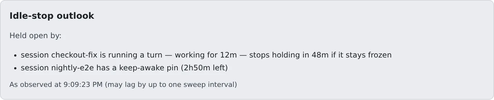
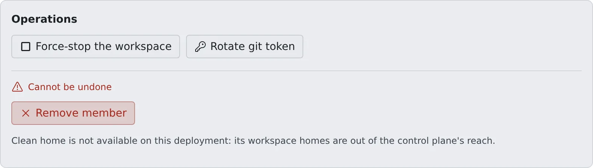

# Stop workspaces left idle

English | [日本語](idle-stop.ja.md)

A workspace nobody is using is stopped by idle auto-stop. You can see when it will stop and what is keeping it up,
and you can force-stop a workspace that is running away.

## How it works

| What you do | What happens |
|---|---|
| Read **Idle-stop outlook** in the member detail | When it will stop, or what is holding it open |
| Press **Force-stop the workspace** | The workspace stops. The home is kept and the member can start it again |
| To change how long until it stops, ask the deployment administrator | The deployment administrator changes the tenant's idle auto-stop |

Stopping keeps everything in the home. The member just starts it again from the Console next time.

## How idle auto-stop works

The deployment administrator sets idle auto-stop per tenant. The values do not appear on your screen, so ask the deployment administrator if you need them.

| Setting | What it stops | Deployment default |
|---|---|---|
| **Session halt after** | A session left unopened. It becomes "stopped (resumable)" and keeps its conversation | 1 hour |
| **Halt when awaiting a decision** | A session nobody has open that waits on a person (a question, a plan awaiting approval, a permission prompt, the usage-limit menu, an expired login). Nothing is lost: answering from the card after resuming delivers it | Empty means the same as **Session halt after** |
| **Max hold by background work** | How long background work started by an idle session (a dev server, a `run_in_background` task) may keep the workspace up | 2 hours |
| **Workspace stop after** | A workspace nobody is connected to and with no running session. The whole container stops | 2 hours |

- Times are written like `30m` (minutes), `2h` (hours), `90s` (seconds). Empty follows the deployment default; `0` never stops (the hold is unbounded)
- Each deployment can change its defaults. The exact values are in [Limits and defaults](../../ref/limits.md#set-by-the-deployment)
- A session awaiting a decision does not hold off **Workspace stop after**
- A stopped session moves to the archive after 7 days. It is not deleted, and its working copy stays. Members can change the period in their own settings

When a member wants a long job to keep running, they pin the session with "Keep awake" ([Stop when done, or keep a session awake](../../user/sessions/auto-stop.md)).

## See the idle-stop outlook

**Idle-stop outlook** in the member detail shows when the workspace will stop. It appears only while the workspace is running.

| Display | Meaning |
|---|---|
| "Stops in 25m" | Nothing is holding it. It stops then if nothing changes |
| "Stopping on the next sweep." | It stops on the next sweep |
| "Held open by:" | What is listed below keeps it up |
| "Workspace idle-stop is disabled for this tenant" | **Workspace stop after** is `0` |

Things that keep it up are a session running a turn, background work, a keep-awake pin, a repository import, an image generation job, and someone typing in a terminal or using the Console.
The roster card shows the same outlook on one line.

The values are what the last sweep observed, so they can lag by up to one sweep interval.

## Force-stop a workspace

You can stop a workspace with a runaway session, or one left using resources.

1. Under **Operations** in the member detail, press **Force-stop the workspace**

   

2. In the confirmation dialog, press **Stop**

- It can be pressed while the workspace is running or starting. A start that never finishes can be called off this way too
- **The home is kept.** The member can start it again from the Console. It only pauses things

### When it says Not responding

When a running workspace's Agent has not answered for several minutes, **Not responding** appears next to the state in the member detail, and the Console sends a notification.
The usual cause is running out of memory. Force-stop is the way out; the Control Plane does not stop it by itself (unless the deployment has turned that stop on).
The force-stop button works even when the Agent is stuck.

### Actions that cannot be undone

Under **Operations**, **Cannot be undone** holds **Clean home**, **Delete backups**, **Remove member**, **Destroy workspace** and **Delete this member**.
You can run all of them, but unlike force-stop they cannot be reversed. Before pressing one, read what the confirmation dialog says it keeps and deletes.
How to use them is in [Removing a member](../members/remove.md).

When something needs fixing on the host, such as a broken container that a restart does not fix, ask the deployment administrator.

## Restart onto a new image automatically

When Agent Fleet is updated, running workspaces keep the old image. If a member has switched it on in their own settings, their workspace restarts onto the new image while nobody is using it.

| Setting | Where | Who decides |
|---|---|---|
| **Automatic image refresh** ("Restart automatically onto a new image when idle") | Settings → Toolchains | The member. Off by default |
| **Quiet time before an automatic image refresh** | The tenant's idle auto-stop | The deployment administrator. Empty takes the deployment default, 15 minutes unless the deployment changed it; `0` never |

- It restarts once, for the quiet time, no session has run a turn or background work or been pinned with Keep awake, no repository import or image job has run, nobody has typed in a terminal or used the browser pane recently (30 minutes unless the deployment changed it), and no request (the Console, a preview) has reached the workspace
- A session waiting on a person and a terminal left open without typing do not hold it off. When **Workspace stop after** is due first, the workspace is stopped instead, and its next start takes the new image
- It is never recreated, so files stay. Sessions can be resumed, and the member gets one notification
- Each image is tried automatically only once. If the start fails, the workspace stays stopped

## Related

- [Start the workspace at sign-in](start-at-signin.md)
- [See how resources are used](overview.md)
- [Stop when done, or keep a session awake](../../user/sessions/auto-stop.md)
- [Limits and defaults](../../ref/limits.md)
