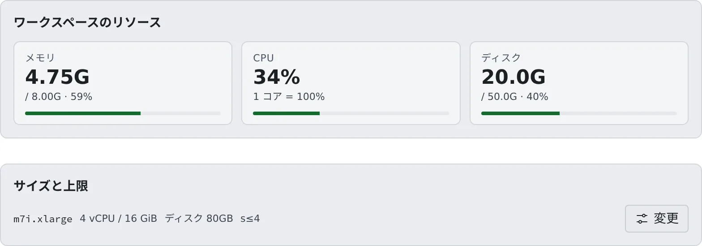

# リソースの使われかたを見る

[English](overview.md) | 日本語

メンバーのワークスペースがメモリ・CPU・ディスクをどれだけ使い、いま何が動いているかを確かめられます。
「重い」「起動できない」と言われたときに、どこから見ればよいかもこのページにまとめています。

## 全体像

| あなたがやること | 起きること |
|---|---|
| メンバー詳細を開く | そのメンバーのワークスペースの状態と、メモリ・CPU・ディスクのメーターが出る |
| 「運用 › セッション」を開く | テナントでいま動いているセッションが、メンバーをまたいで並ぶ |
| 上限を見直す・ワークスペースを止める | 次に起動するものから新しい上限が効く。止めたワークスペースはメンバーが起動し直せる |

すべて **テナント設定**（画面右上のアカウントメニュー）の中にあります。

## メンバーのリソースを見る

**テナント設定 →「メンバー」** でメンバーを選ぶと、メンバー詳細が開きます。上に「**稼働中**」か「**停止中**」が出て、
その下の「**ワークスペースのリソース**」に 3 つのメーターが並びます。

| メーター | 出るもの |
|---|---|
| メモリ | 使用量と上限、使用率 |
| CPU | 使用率。「1 コア = 100%」なので、200% なら 2 コア分を使っています |
| ディスク | home の使用量と割り当て |

- 値は数秒ごとに変わります。使用率が高くなると、メーターの色が警告、危険の順に変わります
- **「–」は「いま測れない」という意味で、0 ではありません。** CPU は 2 回分の計測が要るので、起動の直後は数秒「–」のままです
- 停止中は、ディスクの使用量だけが出ます。AWS の配備では値をワークスペースの中から読むので、停止中はディスクも含めてメーターが出ません

### Agent Fleet が自分で止めたとき

ワークスペースを Agent Fleet が自分で止めることがあります。そのときは名簿のカードに「**自動で停止**」のバッジと、理由のチップが出ます。

| チップ | 何があったか |
|---|---|
| **ワークスペースの起動を自動で止めました** | 起動が配備の上限時間までに終わらなかった（[上限と既定値](../../ref/limits.ja.md#配備が決めるもの)） |
| **ワークスペースを自動で止めました（応答なし）** | Agent が応答しないまま、配備の決めた時間が過ぎた。配備がこの停止を有効にしているときだけ起きます |

- チップにマウスを載せると理由が出ます。メンバー詳細には、同じ見出しで上限・起動がたどり着いた最後の段階・止めた時刻が出ます
- AWS の配備では、ワークスペースを載せられるマシンがない理由がよく書かれています。たいていそれが直すべき点です
- メンバーにも同じ内容の通知が届いています。表示は、次にワークスペースを起動するまで残ります

名簿の見かたは [メンバーの状況を見る](../members/roster.ja.md#名簿を開く) にあります。

## いま動いているセッションを見る

テナント全体を見るときは、**テナント設定 →「運用 › セッション」** を開きます。

- テナントで **いま動いているセッションだけ** が、メンバーをまたいで並びます
- 「ユーザー / ラベル / リポジトリ」で絞り込めます。右上に稼働中の数が出ます
- 停止中のセッションは、メンバー詳細の「**セッション**」で見ます。ここにはそのメンバーのセッションが、種類・作業対象・状態・開始時刻とともに並びます

どちらも見るだけの画面で、セッションを 1 つずつ止めるボタンはありません。ワークスペースごと止めるときは
[ワークスペースを強制停止する](idle-stop.ja.md#ワークスペースを強制停止する) を使います。

## 上限に達したとき、メンバーに見えるもの

上限は、メンバーが新しく何かを起動しようとしたときに効きます。すでに動いているものが止められることはありません。

| 上限 | メンバーに起きること |
|---|---|
| セッション数 | 新しいセッションを作れず、「同時に稼働できるセッション数の上限に達しています。稼働中のセッションをどれか停止してから作成してください。」と出ます |
| ワークスペース数（テナント全体） | ワークスペースを起動できません |
| 内部リポジトリ数・LFS 容量 | 上限を超えるリポジトリの作成やアップロードが断られます |

メンバーは、いま動いているものを片付ければ続けられます。いつも上限に当たるようなら、
[セッション数の上限](session-limits.ja.md) を見直すか、テナント全体の上限を上げてもらうよう配備管理者に相談してください。

## 「重い」「遅い」と言われたら

1. **「運用 › セッション」で全体を見ます。** 何がいくつ動いているか、特定の人やリポジトリに偏っていないかを確かめます
2. **当てはまりそうなメンバーの詳細を開き、メーターを見ます。** メモリやディスクの色が変わっていれば、その人のワークスペースが原因です。CPU は一瞬だけ跳ねることがあるので、高いままかどうかで判断します
3. **手を打ちます。** 一時的な暴走なら、本人にセッションを止めてもらうのが基本です。連絡がつかないときや明らかに暴走しているときだけ、[ワークスペースを強制停止](idle-stop.ja.md#ワークスペースを強制停止する) します
4. **いつものことなら、上限で調整します。** 特定の人が走らせすぎているなら [セッション数の上限](session-limits.ja.md) や [ワークスペースの大きさ](workspace-size.ja.md) を、テナント全体が重いならテナントの上限や [アイドル自動停止](idle-stop.ja.md) の見直しを配備管理者に相談します

ほかのテナントを含むホスト全体の状況は、配備管理者にしか見えません。テナントをまたいで重いようなら、配備管理者に伝えてください。

## 関連

- [セッション数の上限を決める](session-limits.ja.md)
- [ワークスペースの大きさを決める](workspace-size.ja.md)
- [放置されたワークスペースを止める](idle-stop.ja.md)
- [メンバーの状況を見る](../01-members.ja.md)
- [上限と既定値](../../ref/limits.ja.md)
