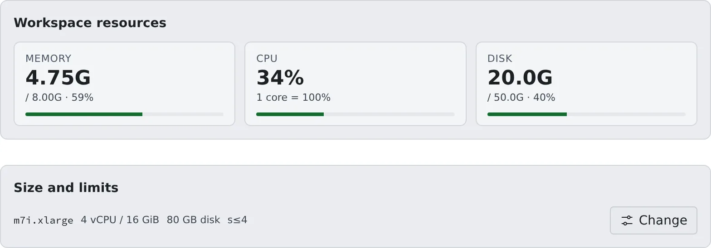

# See how resources are used

English | [日本語](overview.ja.md)

See how much memory, CPU and disk your members' workspaces use, and what is running right now.
This page also says where to look first when someone says things are slow or will not start.

## How it works

| What you do | What happens |
|---|---|
| Open a member's detail | That member's workspace state and the memory, CPU and disk meters appear |
| Open **Operations › Sessions** | The sessions running in the tenant right now, across members |
| Revisit a limit or stop a workspace | A new limit applies to whatever starts next. A stopped workspace can be started again by the member |

All of it is in **Tenant settings** (the account menu at the top right).

## See a member's resources

Pick a member under **Tenant settings → Members** to open the member detail. It shows **Running** or **Stopped** at the top,
and three meters under **Workspace resources**.

| Meter | What it shows |
|---|---|
| Memory | Use, the limit and the percentage |
| CPU | Utilisation. "1 core = 100%", so 200% means two cores' worth |
| Disk | Home use and the allocation |

- The values change every few seconds. As usage rises a meter turns to a warning colour, then to a danger colour
- **"–" means "cannot be measured right now", not zero.** CPU needs two readings, so it stays "–" for a few seconds after a start
- A stopped workspace shows disk use only. On AWS the values are read from inside the workspace, so a stopped one shows no meters at all, disk included

### When Agent Fleet stopped it itself

Agent Fleet sometimes stops a workspace on its own. The roster card then shows the **Stopped automatically** badge and a chip with the reason.

| Chip | What happened |
|---|---|
| **Workspace start stopped automatically** | The start did not finish within the deployment's time limit ([Limits and defaults](../../ref/limits.md#set-by-the-deployment)) |
| **Workspace stopped automatically (not responding)** | The Agent stayed silent past the time the deployment set. This happens only where the deployment has turned this stop on |

- Hover over the chip for the reason. The member detail shows the same heading with the limit, the last stage the start reached and when it was stopped
- On AWS the reason often names why no machine could take the workspace. That is usually the thing to fix
- The member was sent a notification with the same content. The display stays until the workspace is next started

How to read the roster is in [Finding your way around](../members/roster.md#open-the-roster).

## See the sessions running now

For the whole tenant, open **Tenant settings → Operations › Sessions**.

- It lists **only the sessions running now** in the tenant, across members
- Filter by "User / label / repository". The number running is at the top right
- Stopped sessions are in the member detail under **Sessions**, with each session's kind, what it works on, its state and when it started

Both are read-only: there is no button to stop one session. To stop the whole workspace, use
[Force-stop a workspace](idle-stop.md#force-stop-a-workspace).

## What members see when a limit is hit

A limit applies when a member tries to start something new. Nothing already running is stopped.

| Limit | What happens to the member |
|---|---|
| Sessions | They cannot create a new session and see "You've reached the limit on concurrently running sessions. Stop one of the running sessions before creating another." |
| Workspaces (tenant-wide) | Their workspace cannot start |
| Internal repositories, LFS size | Creating a repository or uploading beyond the limit is refused |

Members can carry on once they tidy up what is running. If someone hits a limit all the time, revisit
[their session limit](session-limits.md), or ask the deployment administrator to raise the tenant-wide limit.

## When someone says it is heavy or slow

1. **Look at the whole picture in Operations › Sessions.** How many things are running, and is one person or repository dominating?
2. **Open the likely member's detail and read the meters.** If memory or disk has changed colour, that workspace is the cause. CPU spikes briefly, so judge by whether it stays high
3. **Act.** For a one-off runaway, ask the member to stop the session. Only when they cannot be reached, or it is clearly running away, [force-stop the workspace](idle-stop.md#force-stop-a-workspace)
4. **If it keeps happening, adjust a limit.** For one person, [the session limit](session-limits.md) or [the workspace size](workspace-size.md). For the whole tenant, ask the deployment administrator to revisit the tenant limits or [idle auto-stop](idle-stop.md)

Only the deployment administrator sees the host as a whole, other tenants included. If it is slow across tenants, tell them.

## Related

- [Set session limits](session-limits.md)
- [Set the workspace size](workspace-size.md)
- [Stop workspaces left idle](idle-stop.md)
- [Check on your members](../members/roster.md)
- [Limits and defaults](../../ref/limits.md)
