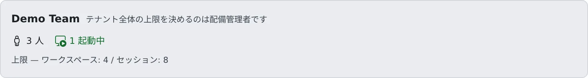

# セッション数の上限を決める

[English](session-limits.md) | 日本語

メンバーごとに、同時に動かせるセッションの数を決められます。テナント全体の上限は配備管理者が決め、あなたはその値を確かめられます。

## 全体像

| あなたがやること | 起きること |
|---|---|
| メンバー詳細で「最大セッション数」を決める | そのメンバーが新しいセッションを作るときから効く |
| 「上限・自動停止」でテナント全体の上限を確かめる | いま効いている値が出る。変えるのは配備管理者 |
| 利用枠ボードを使うか決める | メンバーが利用上限の状況を見せ合えるかどうかが決まる |

上限には **テナント全体の上限** と **メンバーごとの上限** の 2 種類があります。

| 上限 | 決める人 | 数えるもの |
|---|---|---|
| 最大ワークスペース数 | 配備管理者 | テナントで同時に動いているワークスペース |
| 最大セッション数（テナント） | 配備管理者 | 1 人のメンバーが同時に動かすセッション。メンバーごとの上限がない人に効きます |
| 最大セッション数（メンバー） | **あなた** | そのメンバーが同時に動かすセッション |

## メンバーの上限を決める

1. **テナント設定 →「メンバー」** でメンバーを選び、メンバー詳細を開きます
2. 「**サイズと上限**」のカード（リソースのメーターのすぐ下）で「**変更**」を押します
3. 下の「**セッション上限**」の「**最大セッション数**」に数を入れて、「**保存**」を押します

フォームの全体は [ワークスペースの大きさを決める](workspace-size.ja.md#大きさを変える) にあります。

- 上限を決めたメンバーは、名簿のカードに `s≤4` のように出ます
- 数えるのは動いているエージェントのセッションです。ターミナル（shell）と SSM のセッションは数えず、上限に達していても開けます
- メンバーごとの上限を決めると、テナント全体の最大セッション数ではなく、その値が効きます。テナントより大きい数も入れられます
- `0` を保存すると、メンバーごとの上限はなくなり、テナント全体の最大セッション数が効きます。テナントの値も `0` なら無制限です

上限に達したときにメンバーに見えるものは [リソースの使われかたを見る](overview.ja.md#上限に達したときメンバーに見えるもの) にあります。

## テナント全体の上限を確かめる

**テナント設定 →「テナント › 上限・自動停止」** を開きます。

- 「**上限 — ワークスペース: X / セッション: Y**」が、いま効いている値です。`∞` は無制限です
- 値を変えたいときは、配備管理者に頼んでください。この画面からは変えられません
- 配備がマシンの種類を選ばせているときは、同じ画面にテナントの「**既定のマシン種別**」も出ます（[マシンの種類を選ぶ](workspace-size.ja.md#マシンの種類を選ぶ)）

配備管理者は、ほかにも次のことをテナントごとに決めています。あなたの画面には値が出ないので、知りたいときは配備管理者に聞いてください。

| 設定 | 説明しているページ |
|---|---|
| 最大 内部リポジトリ・最大 LFS 容量 | 上限を超える作成やアップロードが断られます |
| ワークスペースごとのメモリ上限 | [ワークスペースの大きさを決める](workspace-size.ja.md) |
| アイドル自動停止 | [放置されたワークスペースを止める](idle-stop.ja.md) |
| サインイン時の自動起動 | [サインインしたらワークスペースを起動する](start-at-signin.ja.md) |
| 推論エンジンの利用可否・モデル取り込み | [推論エンジンを使える人とモデルを決める](engines.ja.md) |

## 利用枠ボードを使うか決める

利用枠ボードは、メンバーがエージェントの利用上限の状況をお互いに見せ合う画面です。
**テナント設定 →「テナント › 利用枠ボード」** の「**このテナントで利用枠ボードを使う**」で、テナントで使うかどうかを決めます。

- 既定はオンです。オンでも、各メンバーは自分で公開を選ぶまで非公開です
- オフにすると値を集めるのをやめ、全員のボードが空になります。残りの量をそもそも見せたくない組織はオフにします
- この画面から、管理者がメンバーの値を見ることはできません
- 切り替えは監査ログに残ります

Agent Fleet はメンバーがどの契約を持っているかを尋ねず、上限をまとめて使うこともしません。
その契約で見せ合いが許されるかは、テナントで判断してください。メンバー側の使いかたは [使用量の上限の状況を見せ合う](../../user/team/usage-limits.ja.md) にあります。

## 関連

- [リソースの使われかたを見る](overview.ja.md)
- [ワークスペースの大きさを決める](workspace-size.ja.md)
- [上限と既定値](../../ref/limits.ja.md#テナントが決めるもの)
- [ロール — 誰が何をできるか](../../ref/roles.ja.md)
