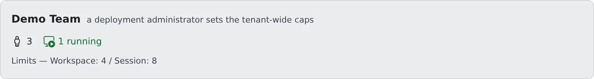

# Set session limits

English | [日本語](session-limits.ja.md)

Decide, per member, how many sessions they may run at once. The deployment administrator sets the tenant-wide limits, and you can check them.

## How it works

| What you do | What happens |
|---|---|
| Set **Max sessions** in a member's detail | It applies from that member's next new session |
| Check the tenant-wide limits under **Limits & idle** | The values in force appear. The deployment administrator changes them |
| Decide whether to use the limit board | Whether members may show each other where they stand on usage limits |

There are two kinds of limit: **tenant-wide** and **per member**.

| Limit | Who sets it | What it counts |
|---|---|---|
| Max workspaces | Deployment administrator | Workspaces running at once in the tenant |
| Max sessions (tenant) | Deployment administrator | Sessions one member runs at once. Applies to members with no limit of their own |
| Max sessions (member) | **You** | Sessions that member runs at once |

## Set a member's limit

1. Pick a member under **Tenant settings → Members** to open the member detail
2. On the **Size and limits** card (just below the resource meters), press **Change**
3. Enter a number in **Max sessions** under **Session limit**, and press **Save**

The whole form is shown in [Set the workspace size](workspace-size.md#change-the-size).

- A member with a limit shows it on their roster card, like `s≤4`
- What counts is running agent sessions. Terminal (shell) and SSM sessions are not counted and still open when the limit is reached
- A member's own limit replaces the tenant-wide max sessions for them. It may be higher than the tenant's
- Saving `0` removes the member's own limit, and the tenant-wide max sessions applies. If that is `0` too, there is no limit

What a member sees at the limit is in [See how resources are used](overview.md#what-members-see-when-a-limit-is-hit).

## Check the tenant-wide limits

Open **Tenant settings → Tenant › Limits & idle**.

- **Limits — Workspace: X / Session: Y** are the values in force. `∞` means no limit
- To change them, ask the deployment administrator. They cannot be changed from this screen
- Where the deployment offers a choice of machine, the tenant's **Default machine** is on the same screen ([Choose the machine](workspace-size.md#choose-the-machine))

The deployment administrator also sets the following per tenant. Their values do not appear on your screen, so ask the deployment administrator when you need them.

| Setting | Where it is explained |
|---|---|
| Max internal repositories, max LFS size | Creating or uploading beyond them is refused |
| Per-workspace memory cap | [Set the workspace size](workspace-size.md) |
| Idle auto-stop | [Stop workspaces left idle](idle-stop.md) |
| Start at sign-in | [Start the workspace at sign-in](start-at-signin.md) |
| Inference engine use and model ingest | [Choose who may use the inference engines and which models](engines.md) |

## Decide whether to use the limit board

The limit board is where members show each other where they stand on their agents' usage limits.
Under **Tenant settings → Tenant › Limit board**, **Use the limit board in this tenant** decides whether the tenant uses it.

- It is on by default. Even when it is on, each member stays hidden until they choose to publish
- Turning it off stops collection and empties everyone's board. Organisations that do not want remaining quota shown at all turn it off
- This screen does not show an administrator any member's values
- Switching it is recorded in the audit log

Agent Fleet does not ask which subscription a member has, and never pools limits.
Whether those subscriptions allow sharing this is the tenant's call. The member's side is in [Show each other where you stand on usage limits](../../user/team/usage-limits.md).

## Related

- [See how resources are used](overview.md)
- [Set the workspace size](workspace-size.md)
- [Limits and defaults](../../ref/limits.md#set-per-tenant)
- [Roles — who may do what](../../ref/roles.md)
