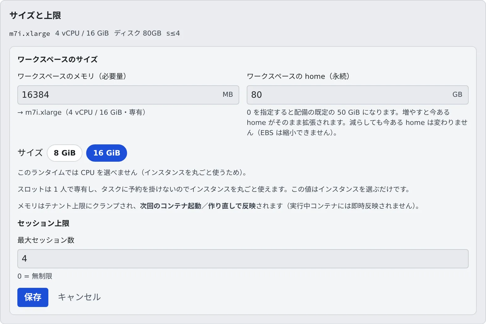

# ワークスペースの大きさを決める

[English](workspace-size.md) | 日本語

メンバーごとに、ワークスペースのメモリ・CPU・ディスクと、配備によってはマシンの種類を決められます。
「home がいっぱい」と言われたときも、配備によってはその場で広げられます。

## 全体像

| あなたがやること | 起きること |
|---|---|
| メンバー詳細の「サイズと上限」で大きさを決める | 次にワークスペースを起動したときから、その大きさになる |
| home のディスクを大きくする | 配備によっては、動いたままの home がその場で広がる |
| マシンの種類を選ぶ | 次の起動から、その種類のインスタンスに載る |

## 大きさを変える

1. **テナント設定 →「メンバー」** でメンバーを選び、メンバー詳細を開きます
2. 「**サイズと上限**」のカードで「**変更**」を押します
3. 「**ワークスペースのサイズ**」に値を入れて、「**保存**」を押します

| 欄 | 単位 | 0 のとき |
|---|---|---|
| メモリ | MB | 配備の既定 |
| CPU | 1024 = 1 vCPU | 配備の既定 |
| ディスク | GB | 配備の既定 |

- 3 つは別々に決められます。「**サイズ**」のボタン（S / M / L / XL / 2XL）は、3 つをまとめて埋める近道です
- インスタンスを丸ごと使う配備では CPU の欄は出ず、メモリの欄が「**ワークスペースのメモリ（必要量）**」になります。サイズのボタンはメモリの段だけになり、入れた量で載るインスタンスが決まります
- AWS の Fargate では、メモリと CPU は決まった組み合わせしか使えません。合わない組み合わせは、起動のときにそれを収められるいちばん小さい有効な大きさへ切り上げられます。CPU を上げるとメモリも上がることがあるのはこのためです
- 配備やテナントの上限より大きい値は、上限で止まります。配備の上限を超える CPU やディスクは、保存のときに断られます
- 同じフォームの「**セッション上限**」は [セッション数の上限を決める](session-limits.ja.md#メンバーの上限を決める) にあります

### いつ効くか

メモリ・CPU・マシンの種類は、**次にワークスペースを起動したときから** 効きます。動いているワークスペースの大きさは変わりません。
メンバーには「設定が変更されています。次に起動すると…」と出るので、停止して起動し直してもらいます。

ディスクだけは、home を広げられる配備では保存したときに広げ始めます（[home を広げる](#home-を広げる)）。

### ディスクの欄が指すもの

ディスクの欄が何を指すかは、配備によって違います。欄の名前と、その下の 1 行に書かれています。

| 欄の名前 | 指すもの |
|---|---|
| **ワークスペースの作業ディスク** | ビルドの中間生成物やキャッシュを置く作業用のディスク。**ワークスペースを止めると中身は消えます** |
| **ワークスペースの home（永続）** | home（`~`）そのもの。増やすと、いまある home がそのまま広がります |
| ワークスペースの作業ディスク（「表示用の目安で、強制はされません」と出る） | 目安の数字だけで、ディスクの大きさは変わりません |

作業ディスクのある配備では、作り直せる生成物をワークスペースが自分でそこに置きます。

| もの | タイミング |
|---|---|
| Go のビルドキャッシュ、Go のモジュールキャッシュ、uv のキャッシュ | 起動のたび。作業ディスクが 30 GiB 以上あり、書き込めるとき |
| 作業コピーのプロジェクトのファイルの隣にある `target`（Rust、Maven）と `build`（Gradle） | 作業コピーをクローンまたは作成したとき。ディスクの大きさは問いません |

安全にできないときは、どちらも移しません。たとえば git が追跡している `target` や `build`、すでにシンボリックリンクに
なっているものです。`node_modules` と npm のキャッシュはホームに残ります。`.venv` や
ほかのビルドの生成物は、メンバーが [af-scratch](../../ref/cli/af-scratch.ja.md) で移したときだけ移ります。
home がネットワークストレージの AWS では、ビルドがこれで速くなります。

`target` と `build` へのリンクは停止してもホームに残りますが、作業ディスクは空に戻ります。ワークスペースは起動のたびに、
セッションが動き出す前にリンク先のディレクトリを空で作り直すので、ビルドはそのまま動きます。停止前にビルドしたものは
なくなっているので、次のビルドは最初からになります。作り直せない場合（リンクがとても多いとき、この仕組みより前に
張られたリンクなど）は [af-scratch](../../ref/cli/af-scratch.ja.md#移し先) にあります。

## home を広げる

「home の容量を増やしてほしい」と言われたら、ディスクの欄が「**ワークスペースの home（永続）**」の配備では、その場で広げられます。配備管理者に頼む必要はありません。

1. メンバー詳細の「**サイズと上限**」→「**変更**」を開きます
2. 「**ワークスペースの home（永続）**」に、いまより大きい数（GB）を入れて保存します
3. カードの下に「**home を 50 → 80 GiB へ拡張しています。ワークスペースは止まりません。**」のように出れば受け付けられています

広がった容量がメンバーの画面に出るまで、数十秒かかります。中身は消えません。

| カードの下に出るもの | 意味 |
|---|---|
| 「home を N → M GiB へ拡張しています」 | 広げています |
| 「今ある home は N GiB のままです」 | 小さい数を保存した。いまの home は縮みません。その数は、次に home を作り直したときに使われます |
| 「home を拡張できませんでした」 | 同じディスクは 6 時間に 1 度しか変えられません。設定は保存されているので、時間をおいてもう一度保存します |
| 「home はまだありません」 | まだ一度も起動していない。次に作られるときにその大きさになります |

- 小さくしたいときは home を捨てることになります。配備管理者に相談してください
- home の空きが少ないメンバーや、直近の起動で CLI をインストールできなかったメンバーは、名簿の「**要対応**」に入ります（[要対応](../members/roster.ja.md#要対応のカードに手を打つ)）
- メンバーが自分で空きを作る方法は [マシンと使用状況を見る](../../user/workspace/machine.ja.md#home-ディスクの空きを作る) にあります

## マシンの種類を選ぶ

配備によっては、「**ワークスペースのサイズ**」のいちばん上に「**マシンの種類**」が並びます。大きさではなく、どの種類のインスタンスに載るかを選びます。
種類ごとに値段と速さが違い、並ぶ名前と中身は配備管理者が決めています。迷ったら既定のままでかまいません。

| 選ぶ場所 | 効く範囲 |
|---|---|
| **テナント設定 →「上限・自動停止」** の「**既定のマシン種別**」 | 自分で種類を選んでいないメンバー全員 |
| メンバー詳細の「**マシンの種類**」 | そのメンバーだけ。「**テナントの既定**」を選ぶと、テナントの既定に従います |

- メンバーごとの指定は、テナントの既定より優先されます。テナントの既定を変えても、自分の種類を持つメンバーは変わりません
- 名簿のカードには、そのメンバーが次に起動したときに載るインスタンスの種類が出ます。マウスを載せると種類の名前が出ます
- メモリの数は、種類を変えても同じ意味です。種類が段の並びを選び、メモリがその中の段を選びます

**時間あたりが安い種類が、安く済むとは限りません。** 課金はインスタンスが動いている時間なので、遅い種類は同じ作業に長くかかります。

| そのメンバーの時間の使いかた | 向く種類 |
|---|---|
| ビルドやテストを回し続ける | 速い種類。安い種類は、遅くなった分で差が消えます |
| 大半は読む・考える・エージェントの返事を待つ | 安い種類。その分だけ安くなります |
| どちらとも言えない | 両方で有利な種類があればそれ。なければ既定 |

### CPU の系統が変わるとき

Intel と Arm のように CPU の系統が変わる種類を選ぶと、フォームに警告が出て、次の起動が数分長くなります。

- home は残ります。中にある系統ごとのものは、起動のときに自動で入れ直します。エージェントの CLI・Chromium・選択中の JDK と node・メンバーが入れたもののうち見つかったもの（`pip install --user`・`uv tool`・`npm i -g`）が対象で、ふつうはバージョンも変わりません
- 自動で戻らないのは、`~/repos` の `node_modules` / `target` / `.venv`（消えませんが、`npm ci` などで入れ直します）と、`~/.local/bin` に直接置いたバイナリです。見つかったものは通知で名前が出ます。見つけかたには限界があり、入れ直しの失敗では通知は出ません（[af-arch-repair](../../ref/cli/af-arch-repair.ja.md)）
- 選択していない JDK や node のバージョンも戻りません。要るときはメンバーが [ツールチェーン](../../user/workspace/toolchains.ja.md) から入れ直します

## 関連

- [マシンと使用状況を見る](../../user/workspace/machine.ja.md)（メンバーの画面）
- [セッション数の上限を決める](session-limits.ja.md)
- [リソースの使われかたを見る](overview.ja.md)
- [上限と既定値](../../ref/limits.ja.md#配備が決めるもの)
