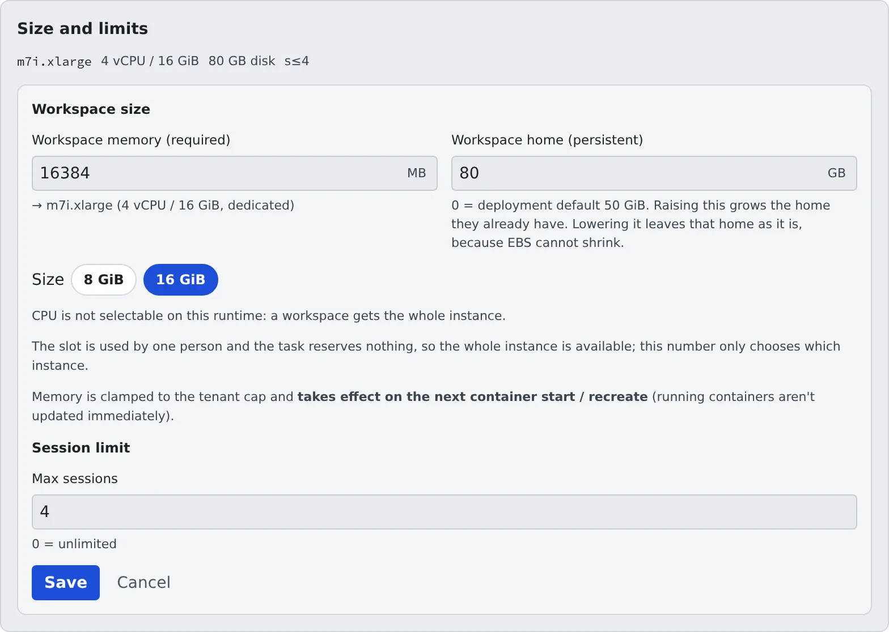

# Set the workspace size

English | [日本語](workspace-size.ja.md)

Decide, per member, the workspace's memory, CPU and disk, and on some deployments the kind of machine.
When someone says their home is full, some deployments let you grow it on the spot.

## How it works

| What you do | What happens |
|---|---|
| Set the size under **Size and limits** in the member detail | The workspace has that size from its next start |
| Make the home disk bigger | On some deployments the home grows on the spot, while it runs |
| Choose the machine | From the next start, the workspace lands on that kind of instance |

## Change the size

1. Pick a member under **Tenant settings → Members** to open the member detail
2. On the **Size and limits** card, press **Change**
3. Enter the values under **Workspace size** and press **Save**

| Field | Unit | When 0 |
|---|---|---|
| Memory | MB | Deployment default |
| CPU | 1024 = 1 vCPU | Deployment default |
| Disk | GB | Deployment default |

- The three are set independently. The **Size** buttons (S / M / L / XL / 2XL) are a shortcut that fills all three at once
- On a deployment where a workspace gets a whole instance, there is no CPU field and the memory field reads **Workspace memory (required)**. The size buttons become the memory steps, and the amount you enter picks the instance
- On AWS Fargate only certain memory and CPU pairs exist. A pair that does not fit is raised, at start, to the smallest valid size that holds it. That is why raising CPU can raise memory too
- A value above the deployment's or the tenant's ceiling stops at the ceiling. CPU or disk above the deployment's ceiling is refused when you save
- **Session limit** on the same form is in [Set session limits](session-limits.md#set-a-members-limit)

### When it takes effect

Memory, CPU and the machine apply **from the next start of the workspace**. A running workspace keeps its size.
The member sees "The settings have changed. The next start will use…", so ask them to stop and start it again.

Disk is the exception: on a deployment that can grow a home, growing starts when you save ([Grow the home](#grow-the-home)).

### What the disk field means

What the disk field refers to depends on the deployment. The field's name and the line under it say which.

| Field name | What it is |
|---|---|
| **Workspace working disk** | A working disk for build intermediates and caches. **Its contents are wiped when the workspace stops** |
| **Workspace home (persistent)** | The home (`~`) itself. Raising it grows the home they already have |
| Workspace working disk (with "Reported for reference only; nothing enforces it.") | A figure for reference only. The disk size does not change |

On a deployment with a working disk, the workspace puts regenerable output there by itself:

| What | When |
|---|---|
| The Go build cache, the Go module cache and uv's cache | At every start, when the working disk is 30 GiB or more and can be written |
| `target` (Rust, Maven) and `build` (Gradle) next to the project file of a working copy | When the working copy is cloned or created, at any disk size |

Either move is skipped when it cannot be done safely, for example a `target` or `build` that git tracks or that is
already a symlink. `node_modules` and npm's cache stay in the home;
`.venv` and other build output move only when a member moves them with [af-scratch](../../ref/cli/af-scratch.md). On AWS, where the home is network storage, this is what makes builds faster.

## Grow the home

When someone asks for more home space, a deployment whose disk field reads **Workspace home (persistent)** lets you grow it on the spot. There is no need to ask the deployment administrator.

1. Open **Size and limits → Change** in the member detail
2. Enter a bigger number (GB) than now in **Workspace home (persistent)** and save
3. When the card shows something like **Growing the home from 50 to 80 GiB. The workspace keeps running.**, it has been accepted

The bigger size reaches the member's screen within a few tens of seconds. Nothing in the home is lost.

| What the card shows | Meaning |
|---|---|
| "Growing the home from N to M GiB" | It is growing |
| "The existing home stays at N GiB" | You saved a smaller number. The home does not shrink; the number is used the next time the home is created |
| "The home could not be grown" | One disk can only be changed once every 6 hours. The setting is saved, so save again later |
| "There is no home yet" | It has never started. The home is created at that size |

- Making it smaller means throwing the home away. Talk to the deployment administrator
- A member whose home is nearly full, or whose last start could not install a CLI, appears under **Needs attention** in the roster ([Needs attention](../members/roster.md#act-on-cards-that-need-attention))
- How members free up space themselves is in [See your machine and its usage](../../user/workspace/machine.md#free-up-the-home-disk)

## Choose the machine

On some deployments, **Machine** appears at the top of **Workspace size**. It picks the kind of instance, not a size.
Each kind has its own price and speed, and the names and what they mean are the deployment administrator's. When unsure, the default is fine.

| Where you choose | What it affects |
|---|---|
| **Default machine** under **Tenant settings → Limits & idle** | Every member who has not chosen a machine |
| **Machine** in the member detail | That member only. **Tenant default** follows the tenant's default |

- A member's own choice wins over the tenant default. Changing the tenant default does not affect members with their own machine
- The roster card shows the instance type the member lands on at their next start. Hover for the machine's name
- The memory number means the same whatever the machine. The machine picks the set of steps, and memory picks the step within it

**A machine that is cheaper per hour is not necessarily cheaper.** You pay for the time the instance runs, so a slower machine takes longer for the same work.

| How the member spends their time | Machine that suits |
|---|---|
| Running builds and tests all the time | A fast one. A cheap one loses the saving to the extra time |
| Mostly reading, thinking, waiting for the agent | A cheap one. It really is cheaper by that much |
| Hard to say | One that wins on both, if there is one. Otherwise the default |

### When the CPU family changes

Choosing a machine of a different CPU family, such as Intel and Arm, shows a warning on the form and makes the next start a few minutes longer.

- The home is kept. What in it was built for one family is reinstalled automatically at start: the agent CLIs, Chromium, the selected JDK and node, and what the member installed (`pip install --user`, `uv tool`, `npm i -g`) as far as it is detected, normally at the same versions
- Not restored automatically: `node_modules` / `target` / `.venv` under `~/repos` (kept, but reinstall them with `npm ci` and the like) and binaries placed straight in `~/.local/bin`. A notification names the ones it detects; detection has limits. A failed reinstall is retried at up to 3 later starts and named in the notification only after that ([af-arch-repair](../../ref/cli/af-arch-repair.md))
- JDK and node versions that are not selected are not restored either. The member reinstalls them from [Toolchains](../../user/workspace/toolchains.md) if needed

## Related

- [See your machine and its usage](../../user/workspace/machine.md) (the member's screen)
- [Set session limits](session-limits.md)
- [See how resources are used](overview.md)
- [Limits and defaults](../../ref/limits.md#set-by-the-deployment)
