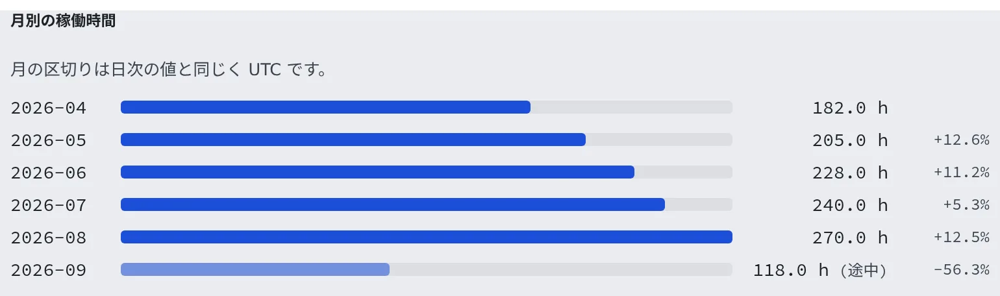

# 稼働時間とクラウド費用を見る

[English](usage.md) | 日本語

メンバーごとのワークスペースの稼働時間と、それにひも付くクラウド費用を、期間と月ごとに確かめられます。
CSV に書き出して、社内での費用の按分や報告に使えます。

## 全体像

| あなたがやること | 起きること |
|---|---|
| テナント設定の「稼働時間」を開き、期間を選ぶ | メンバーごとの稼働時間と、月ごとの推移が出る |
| 「CSV」を押す | 表示中の期間のデータを書き出す |
| 「クラウド費用」を開く（AWS の配備だけ） | メンバーにひも付く費用が、同じ形で出る |

どちらの画面も、自分のテナントの範囲だけです。

## 稼働時間を見る

テナント設定の **運用** →「**稼働時間**」を開きます。

数えているのは、ワークスペースが起動していた時間です。Claude などのエージェントの利用料は、各メンバーが自分の契約で払うので入りません。
約 5 分ごとのサンプリングなので、多少の誤差を含む概算です。

1. **期間** で「**今月**」「**先月**」「**直近30日**」から選びます。ほかの期間は「**開始**」「**終了**」に日付を入れて「**適用**」を押します
2. 上に「**合計稼働**」と「**メンバー**」の数、その下にメンバーごとの稼働時間が棒グラフで並びます
3. 「CSV」を押すと、表示中の期間のデータを書き出します

月・日付の区切りは UTC です。

## 月ごとの推移を見る

期間の選択とは別に、直近 6 か月の推移が出ます。

- 「**月別の稼働時間**」：月ごとの合計と **前月比**。今月には「途中」と付きます
- 「**メンバー別・月別の稼働時間**」：メンバーごとの 6 か月分の表です。**並び順** を「**合計**」「**最新月**」「**前月比**」「**名前**」から選べます
- メンバーが多いときは上位 50 人だけが出て、「上位 50 人を表示（全 N 人）」と書かれます

## クラウド費用を見る

テナント設定の **運用** →「**クラウド費用**」を開きます。AWS の請求をコスト配分タグでメンバーごとに割り当てたもので、AWS で動く配備にだけあります。

期間の選び方と月ごとの推移（「**月別のクラウドコスト**」「**メンバー別・月別のクラウドコスト**」）は、稼働時間と同じです。
メンバー詳細にも、同じ数字が 1 人分、日ごとの推移と使い道の内訳つきで出ます。

数字を読むときは、次の点に気をつけてください。

| 画面の表示 | 意味 |
|---|---|
| 「**メンバーにひも付く費用**」 | スロットの稼働時間・永続ホームのボリューム・そのスナップショットだけ。共有インフラ（NAT・DNS・ロードバランサ・データベース・空きスロット）は頭割りしないので、チームを動かす費用の全額ではなく、請求書でもない |
| 「Cost Explorer は約 24 時間遅れです。」 | 直近の日はまだ確定しておらず、あとから変わる |
| 「… より前は取得できません。」 | コスト配分を有効にする前の分。遡って埋めることはできない |
| 月の行の「データなし」 | 費用が 0 なのではなく、コスト配分の前で分からない |
| 月の行の「概算」 | まだ確定していない月 |

金額は請求の通貨のままで、換算はしません。

## よくある質問

**Q. 稼働時間に Claude の利用料は入りますか？**
入りません。ここで数えるのはワークスペースが起動していた時間です。エージェントの利用料は、各メンバーが自分の契約で払います。

**Q. クラウド費用の画面がありません。**
AWS で動く配備にだけあります。ほかの配備には、読み取れる請求がありません。

## 関連

- [監査ログを見る](audit.ja.md)：誰が何を変えたか
