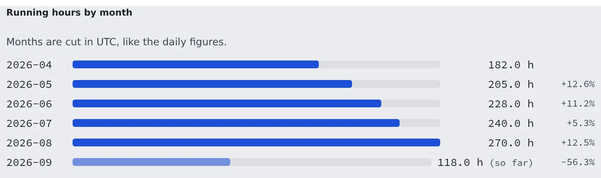

# Read running time and cloud cost

English | [日本語](usage.ja.md)

See each member's workspace running time, and the cloud cost attributed to it, for a period and month by month.
Export it as CSV for internal chargeback or reporting.

## How it works

| What you do | What happens |
|---|---|
| Open "Running time" in Tenant settings and pick a period | Running time per member, and the trend by month, appear |
| Press "CSV" | The data for the period shown is downloaded |
| Open "Cloud cost" (AWS deployments only) | The cost attributed to members appears, in the same shape |

Both screens cover your own tenant only.

## Read running time

Open **Operations** → "**Running time**" in Tenant settings.

What it counts is the time a workspace was running. Agent fees such as Claude's are paid by each member on their own plan, so they are not in it.
It is sampled about every five minutes, so it is an estimate with some error.

1. Under **Period**, pick "**This month**", "**Last month**" or "**Last 30 days**". For any other period, enter dates in "**From**" and "**To**" and press "**Apply**"
2. "**Total running**" and the number of "**Members**" appear at the top, and each member's running time as a bar below
3. Press "CSV" to download the data for the period shown

Months and days are cut in UTC.

## Read the trend by month

Separately from the period you picked, the last six months are shown.

- "**Running hours by month**": each month's total and the change **vs previous month**. The current month is marked "so far"
- "**Running hours by member and month**": a table of six months per member. Choose the order under **Sort by**: "**Total**", "**Latest month**", "**Change vs previous month**" or "**Name**"
- With many members only the top 50 appear, with "Showing the top 50 of N members."

## Read cloud cost

Open **Operations** → "**Cloud cost**" in Tenant settings. It is the AWS bill, assigned to members through cost allocation tags, and it exists on deployments that run on AWS only.

Choosing a period and the trend by month ("**Cloud cost by month**", "**Cloud cost by member and month**") work as for running time.
A member's detail shows the same figures for that one person, with a daily trend and a breakdown of what it was spent on.

Keep these in mind when you read the numbers.

| On screen | What it means |
|---|---|
| "**Attributable to members**" | Slot hours, the persistent home volume and its snapshots only. Shared infrastructure (NAT, DNS, load balancer, database, idle slots) is not split per head, so this is not the full cost of running the team, and it is not an invoice |
| "Cost Explorer runs about 24 hours behind." | The most recent days are not final yet and will still change |
| "Nothing is available before …" | The time before cost allocation was switched on. It cannot be backfilled |
| "no data" on a month | Not a zero cost: the month is before cost allocation, so it is unknown |
| "est." on a month | A month that is not final yet |

Amounts are in the bill's currency, with no conversion.

## FAQ

**Q. Does running time include the Claude fee?**
No. What it counts is the time a workspace was running. Agent fees are on each member's own plan.

**Q. There is no Cloud cost screen.**
It exists on deployments that run on AWS only. Other deployments have no bill to read.

## Related

- [Read the audit log](audit.md): who changed what
