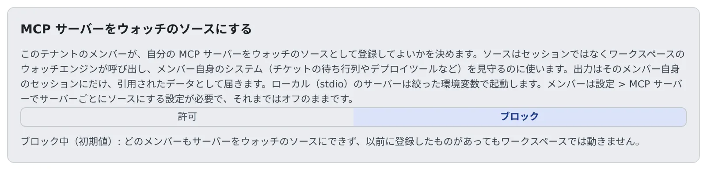

# MCP サーバーをウォッチのソースに許可する

[English](watch-sources.md) | 日本語

メンバーが自分の MCP サーバーを `watch` ツールの情報源（ウォッチのソース）にしてよいかを、テナント全体で決めます。
許可すると、チケットのキューや社内のデプロイツールなど、Agent Fleet が標準ではウォッチしないシステムの変化を、セッションが知らせとして受け取れるようになります。

## 全体像

| あなたがやること | メンバーの側で起きること |
|---|---|
| 「ブロック」のままにする（初期状態） | どのメンバーもサーバーをウォッチのソースにできない。登録済みのソースも動かない |
| 「許可」にする | メンバーがサーバーごとに「ウォッチのソース」をオンにできる |
| 「ブロック」に戻す | 5 分以内に、テナントのすべてのソースが止まる。メンバーの登録は残る |

許可すると、メンバーが選んだサーバーをワークスペースのウォッチエンジンが一定の間隔で呼び出します。
メンバーが選んだコードをウォッチエンジンが呼び出すことになるので、許可するまではどのテナントでもオフです。

## 切り替える

1. テナント設定の **運用** →「**ウォッチのソース**」を開きます
2. 「**許可**」か「**ブロック**」を押します。押したときに保存されます

許可しても、メンバーが選ぶまで誰にも変化はありません。メンバーは **⚙設定 → 接続 →「MCP サーバー（セッションで使う）」** のサーバーごとに、**詳細設定** →「**利用先**」で「**ウォッチのソース**」をオンにします。

切り替えは監査ログに `tenant.watch_sources` として、`enabled=true` か `enabled=false` つきで残ります（[監査ログを見る](audit.ja.md)）。
切り替えられるのは、テナント管理者と配備管理者だけです。

## 許可しても変わらないこと

- ソースにできるのは、メンバー自身が登録したサーバーだけです。テナントに配ったサーバーはソースになりません
- ソースからの知らせは、そのメンバー自身のセッション（またはそのメンバー）にだけ、引用されたデータとして届きます。ほかのメンバー、ほかのワークスペース、Control Plane には送られません
- ワークスペースがソースを呼ぶのは、1 回に 20 件の対象まで、各対象は 1 分に 1 回まで、1 回あたり 10 秒までです
- 5 回続けて失敗するか、不正な応答が 20 回続くと、そのソースは一時停止します。メンバーがサーバーを編集するか有効にし直すと再開します
- ローカル（stdio）のサーバーは、Agent の環境ではなく、絞った環境（`PATH`・`HOME`・`LANG`・`TMPDIR` と、そのサーバー自身の変数）で起動します

## ブロックに戻したとき

- 各ワークスペースには、配布する MCP サーバーと同じ 5 分ごとの取得で届きます
- ソースにしていたサーバーは、印が付いたまま一時停止します。許可に戻すと再開します
- スイッチを読めないとき、ワークスペースは最後に受け取った答えを使い続けます。一度も受け取っていなければ、何も動かしません

## 関連

- [セッションに MCP サーバーを追加する](../user/integrations/mcp-servers.ja.md#サーバーをウォッチのソースにする)：メンバーの側の設定
- [PR のレビューをセッションに伝える](../user/fleet/pr-feedback.ja.md#セッションが自分で-pr-を見張る)：`watch` ツールの使われかた
- [MCP サーバーを全員に配る](mcp-distribute.ja.md)
