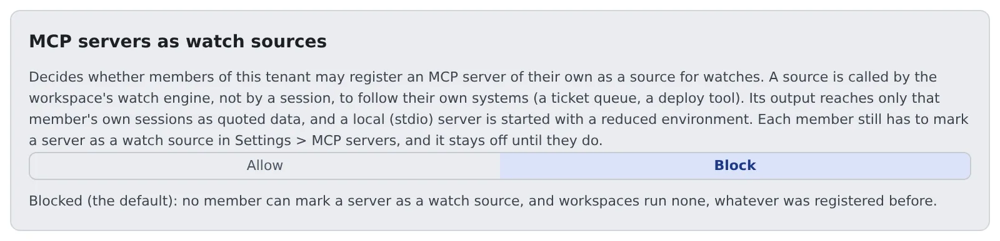

# Allow MCP servers as watch sources

English | [日本語](watch-sources.ja.md)

Decide, for the whole tenant, whether members may make their own MCP servers a source for the `watch` tool (a watch source).
Once allowed, sessions can be told about changes in systems Agent Fleet does not watch out of the box, such as a ticket queue or an in-house deploy tool.

## How it works

| What you do | What happens on the members' side |
|---|---|
| Leave it on "Block" (the initial state) | No member can make a server a watch source, and registered sources do not run |
| Switch to "Allow" | Members can turn "Watch source" on server by server |
| Switch back to "Block" | Within five minutes every source in the tenant stops. Members' registrations are kept |

Once allowed, the workspace's watch engine calls the servers members chose, at intervals.
That puts code a member chose on the engine's path, so it is off in every tenant until you allow it.

## Switch it

1. Open **Operations** → "**Watch sources**" in Tenant settings
2. Press "**Allow**" or "**Block**". It is saved when you press it

Allowing it changes nothing for anyone until a member chooses. Members turn on "**Watch source**" under **Advanced** → "**Used by**" for each server in **⚙ Settings → Connections → "MCP servers (used by sessions)"**.

Each switch is recorded in the audit log as `tenant.watch_sources`, with `enabled=true` or `enabled=false` ([Read the audit log](audit.md)).
Only tenant administrators and the deployment administrator can switch it.

## What allowing it does not change

- Only servers a member registered themselves can be sources. Servers you distribute to the tenant cannot
- A source's events reach only that member's own sessions (or the member), as quoted data. They are not sent to other members, other workspaces or the Control Plane
- The workspace calls a source with at most 20 subjects at a time, each subject at most once a minute, and at most 10 seconds per call
- After five failures in a row, or 20 malformed replies in a row, the source pauses. It resumes when the member edits the server or enables it again
- A local (stdio) server starts not in the Agent's environment but in a reduced one (`PATH`, `HOME`, `LANG`, `TMPDIR` and the server's own variables)

## When you switch back to Block

- It reaches each workspace with the same five-minute fetch that distributed MCP servers use
- A server marked as a source keeps its mark and pauses. It resumes when you allow it again
- When the switch cannot be read, the workspace keeps the last answer it got. If it never got one, it runs nothing

## Related

- [Add an MCP server to your sessions](../user/integrations/mcp-servers.md#use-a-server-as-a-watch-source): the member's setting
- [Tell a session about its pull request's review](../user/fleet/pr-feedback.md#a-session-watches-a-pull-request-itself): how the `watch` tool is used
- [Distribute an MCP server to everyone](mcp-distribute.md)
