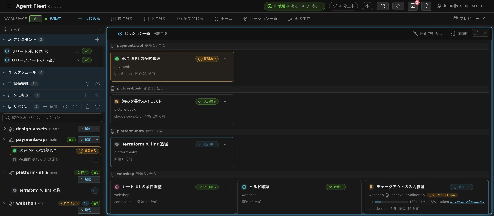
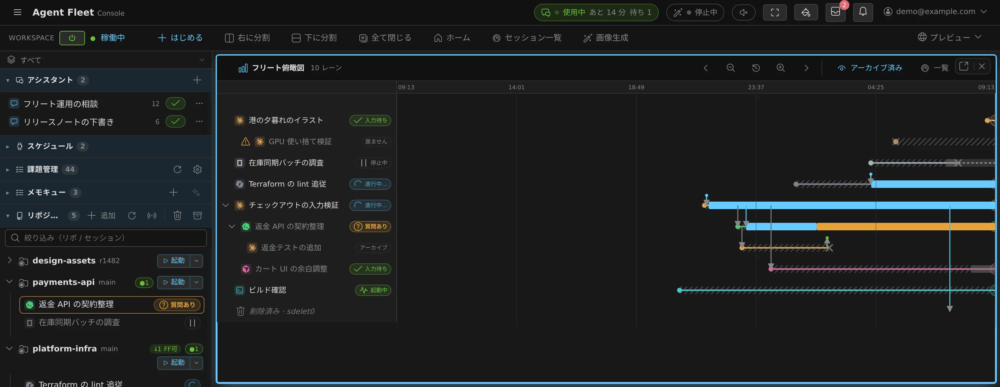

# 11. たくさんのセッションを動かす — 一覧・子セッション・フリート・オペレーター

[English](11-many-sessions.md) | 日本語

この章は、複数のセッションを同時に動かすときの章です。全体を一覧する、ワーキングセットで絞り込む、セッションからセッションを始める、セッション同士のメッセージ、そしてチャットから指揮するフリート・オペレーター（スケジュール実行を含む）を扱います。

## 稼働中のセッションを一望する（セッション一覧）

セッションが何本も動いていると、左ペインでは 1 行ずつ読むことになります。**セッション一覧**は、
セッションを**カードのグリッド**として並べます。1 セッション 1 枚で、行と同じ種別の色・名前・
作業コピー・状態チップに加えて、モデル・コンテキスト使用率・開始からの経過が載ります。
今あなたが必要な状態（質問・プランの確認・権限確認）はカード全体に色が付くので、離れていても
見つけられます。

- **開き方**: 操作バーの **「セッション一覧」**（右に分割／下に分割／全て閉じる の隣）、
  左ペイン上部のレイアウト図にある同じボタン、またはリーダーキー **`g` → `s`** / **`s` → `l`**。
  普通のペインなので、分割・タブ・別タブへの切り離しができ、再読み込み後も残ります。
  スマホでは、「セッション一覧」「下に分割」「全て閉じる」が操作バーの **⋯** の中に入ることが
  あります（[02](02-console-basics.ja.md#スマホでの操作)）。
- **横に何枚並ぶか**は、置いたペインの幅で決まります。細い側の列なら 1 列、広いペインなら
  4 列以上。
- **カードはプロジェクト（リポジトリ）ごとの見出しに分かれます**。同じリポジトリなら、
  ベースの作業コピーも `@wip-*` の作業コピーも、別名で 2 回クローンしたものも同じ見出しに
  入ります（見分けているのは取得元の URL で、フォルダ名ではありません）。作業コピーで
  動いていないセッションは末尾の「その他」へ。見出しの順はプロジェクト名順で固定です。
- **見出しの中は「家系」単位**で並びます。あるセッションから起こしたセッション（引き継ぎ・
  子セッション）は**親のすぐ下**に、起こした順で並び、**停止中の子も親の下のまま**です。
  誰かの答えを待っている家系が見出しの先頭に来ますが、**家系が割れることはありません**。
- **カードをクリックするとそのセッションがグリッドの隣に開きます**。一覧が置き換わることは
  ないので、眺めたまま次を開けます。既に開いているセッションなら、そのペインにフォーカスが
  移ります。
- **スマホでは「隣」が無いので、タップしたセッションはそのペインに開きます**（半分の高さの
  ペインが 2 枚になるのを避けるため）。一覧へは**端末の戻るボタン**で戻ります。停止中の
  表示切替もそのまま戻ります。**Ctrl（⌘）＋クリックと中クリックは、画面の広さによらず
  別のペインで開きます**。タブ表示にしているときは、スマホでもタップで新しいタブが開き、
  一覧はタブとして残ります。
- **1 枚のカードに出るもの**: 右上に状態（入力待ち／進行中…／停止など）、下の行に
  プロジェクトとブランチ、その右に**親との差分**（「親+2・FF可」「未取込 3」など・
  左ペインのリポジトリ行と同じ見方）、その下に**コンテキストの使用量と、返答ごとのトークン
  消費のグラフ**（チャット画面と同じ帯です）、いちばん下に**最後に答えたモデル**・
  開始からの経過、そして**入力待ちになってからの経過**（答えたあとは「応答から」）。
  待ちの経過は通知とこのブラウザの観測から求めるので、どちらも記録が無いときは出ません。
  どのエージェント（Claude / Codex など）かは、左上の色付きアイコンが示します。
- **カードのいちばん下に、そのセッションが最後に言ったことの冒頭**が 1 行出ます（停止した
  セッションにも出ます）。長い発言は途中で切れ、カーソルを重ねると全文が出ます。
  まだ何も言っていないセッションでは、この行そのものが出ません。
- **カードの右クリック・⋯ ボタン・Menu キーで、左ペインの行と同じメニュー**が出ます：
  停止・改名・引き継ぎ・共有・削除ロック・自動停止の抑止・アーカイブなど
  （[アイコン・バッジ・メニュー](badges-and-menus.ja.md)）。
- **家系は親のカードから畳めます。** 親のカードに **「子セッションを畳む」**（戻すのは
  **「子セッションを開く」**）があり、畳むと隠した本数が **「＋N」** で出ます（何段下でも数えます）。
  見出しの「稼働 N / 全 M」は畳んでも変わりません。
- 既定では稼働中だけを並べます。ペイン上部の 「**停止中も表示**」で停止したセッションも薄く
  並び、この切替はペインごとに記憶されます。
- 並び順は「あなたが必要かどうか」ですが、**単位は 1 枚ではなく家系**です（上記）。答えを
  待っているセッションを含む家系が見出しの先頭、次に残りの稼働中の家系を新しい順、最後に
  停止中だけの家系。眺めている間に順番が入れ替わるのは、家系が待ちに入った／待ちから出た
  ときだけです。
- 作業グループ（次節）で絞っていれば、左ペインと同じようにグリッドも絞られます。
- ヘッダの **「俯瞰図」** で、このグリッドを同じペインのままフリート俯瞰図（次項）に入れ替えます。
  Ctrl（⌘）＋クリックか中クリックなら別ペインに開きます。

### セッション同士の関係を時間で見る（フリート俯瞰図）

グリッドは「いま」の断面です。**フリート俯瞰図**はその経過版で、**1 セッション 1 レーン、横軸が
時間**。どのセッションがどれを起こしたか、その間に何が行き来したか、それぞれがいつ動き・待ち・
止まっていたかが一枚で読めます。

- **開き方**: セッション一覧のヘッダの **「俯瞰図」**（俯瞰図側のヘッダには戻るための **「一覧」**。
  どちらも同じペインで入れ替わり、Ctrl（⌘）＋クリックか中クリックなら別ペイン）、リーダーキー
  **`g` → `f`**、またはコマンドパレット。グリッドと同じ普通のペインです。
- **表示範囲は直近 24 時間で始まり、右端が「いま」です。** ヘッダの矢印で過去へ／未来へ動かし、
  拡大・縮小のボタンで範囲を狭め・広げ、戻すボタンで直近 24 時間に戻します。図の上の横スクロールやドラッグは
  時間の移動、縦スクロールはレーンの移動、スマホでは 2 本指のピンチで時間軸を伸縮します。目盛りは
  どこまでスクロールしても上端に留まります。
- **ラベル列**には種別のアイコン・セッション名・状態チップが並びます。文言は左ペインの行と同じで、
  一覧にもう無いレーンには **停止中 — 再開できます**・**アーカイブ済み — 復元できます**・
  **もう居ません** が出ます。**セッションを開くのは名前**です（図の隣に開き、Ctrl（⌘）か中ボタンなら
  別ペイン）。レーンそのものは押しても何も開かないので、図を掴んで動かすつもりでセッションが
  開くことはありません。
- **レーンの見た目が「まだ在るか」を示します。** 稼働中は実線に色の帯（進行中…・あなた待ち・
  入力待ち）が乗り、右端で脈打ちます。停止中は × から右端まで**点線**で、再開できる印です。
  アーカイブ済みと削除済みは **× で終わります**。× は「終わりに気づいた時刻」で、実際に止まった
  時刻より遅れることがあり、ツールチップでそう示されます。止めて再開したセッションは、1 本のレーンに
  複数の区間として描かれます。
- **家系は並びます**: 別のセッションから起こしたもの（子セッション・フォーク・引き継ぎ）は親の
  真下に描かれ、親から誕生点へ線が引かれます。親の行から子孫を畳めます（**「＋N」**。グリッドと
  同じ操作です）。親が左端の外にあるか消えていれば、「親レーン … はこの図に描かれていません」と印が
  付きます。
- **矢印はセッション間で行き来したもの**です: 起動・フォーク・引き継ぎ、指示とその報告、
  セッション間メッセージ。セッションでないもの（会話・利用者・定時実行・Discord / Slack 連携・
  自動再開）は先端に点の付いた短い矢印で、出どころが色とラベルで分かります。矢印をクリックすると
  その会話やレーンが開きます。
- ヘッダの 「**アーカイブ済み**」でアーカイブ済みのレーンを出し入れします（グリッドと違って既定は
  表示。ここでは過去が主役だからです）。停止中のセッションは常に描かれます。
- **どこまで遡れるかは、隠さず印で示します。** 十分に遡ると、稼働帯と矢印が保存されている範囲の端、
  系譜が保存されている範囲の端、誕生と終了の概形しか無い範囲の端を示す線に当たります。何も無い
  範囲も「場所」です。軸と操作は残るので、戻ってこられます。

## 作業グループで表示を絞る

案件をいくつも抱えると、左ペインが他の案件のリポジトリと会話で埋まります。**作業グループ**は、
**リポジトリ・会話・セッション・スケジュールを案件ごとにまとめて、左ペインの表示を切り替える**
機能です。中身が移動したり複製されたりはしません。**見え方だけ**が変わります。

- 左ペイン最上部のバー（既定は **「すべて」**）を押すとグループを切り替えられます。バーは
  スクロールしても常に見えるので、「セッションが消えた」と焦る前に今どのグループを見ているか確認できます。
- 「**グループを管理…**」で作成・改名・削除します。作成するとそのグループに切り替わるので、
  そのまま割り当てに進めます。**グループを削除しても中身（リポジトリ・会話・セッション）は消えません。**
- 割り当ては**行の右クリック（⋯ メニュー）** から行います。ベースのリポジトリ行、会話の行、
  リポジトリに属さないセッションの行が対象です。
- **付いてくるものは自動で入ります。** worktree は親のリポジトリに、セッションはそのリポジトリに、
  スケジュールは作成元の会話に従うので、いちいち割り当て直す必要はありません
  （自動で入ったものはチェック済みで表示され、そのトグルでは外せません）。
- グループの中でクローンしたリポジトリや、そこで始めた会話は、そのグループに自動で所属します。
- 設定はあなた個人のもので、**別の端末にも追従**します（他のメンバーには共有されません）。
- キーボードからはリーダーキー **`w` → `w`** で順に切り替えられます。

## セッションから別のセッションを起こす（子セッション）

動いているセッションが、**別のセッションを起こして仕事を渡し、起こしたものの面倒を見る**
ことができます。セッション間メッセージ（次の節）が「一言だけ伝える」なら、こちらは「ひと仕事
まるごと渡す」です。独立した長い下請け作業、別のリポジトリでの作業、自分のコンテキストを
埋め尽くして残りの仕事を圧迫しそうなものに向きます。起こされた側が**子セッション**で、左ペイン・
セッション一覧・フリート俯瞰図には他のセッションと同じように現れます。

**既定はオフ**です。**設定 > エージェント > セッション > 「セッションからのセッション起動」**
でオンにします。反映は**次に起動するセッションから**で、すでに動いているセッションは再起動する
まで変わりません。その下の「**子セッションの同時本数**」（1〜10・既定 3）が、**1 つのセッションが
同時に持てる子の数**です。上限はワークスペース全体ではなく親 1 つあたりなので、親が 2 つ
あればそれぞれがその数まで持てます。**あなたが子を削除かアーカイブすると、その子は上限の数から外れます**。
停止したまま放置した子が期限で自動的にアーカイブされたときも同様です
（[セッションを止める・片付ける](05-stopping-and-tidying.ja.md#セッションを止める片付ける)）。停止しただけでは
外れません。

オンにすると、セッションは仕事が分かれると判断したときに子を起こし、起こすこととその目的を
あなたに告げます。あなたから頼むこともできます（「テストは codex のセッションに並行して
書かせて」）。

- **子は生シェル以外のどのエージェントでも構いません**。モデルも、除外していないものなら
  何でも選べます。claude のセッションが codex の子を起こせるので、異なるエージェント同士で
  1 つの仕事に当たれます。shell と ssm はこの経路では起こせません。どのエージェントが子を
  起こせるかは、[エージェントリファレンス](../ref/agents.ja.md)の「子セッションを起こす・ほかの
  セッションへメッセージを送る」の行にあります。
- **親は子の effort を選べます**（レビュー役を high で、など）。モデルも指定したときに限り、
  そのモデルが持つ effort から選べます。それ以外は拒まれます。**子の権限モードは親には選べず**、設定 > エージェントの
  種類別の既定に従います。
- **子は新しい worktree で起動します**（親が明示しない限り）。親の作業コピーを共有することは
  ありません。別のセッションが作業中のディレクトリを指定すると拒まれます。例外は親自身の作業コピーで、
  親が明示的にそれを求めたときだけです。親子は 1 つの
  チェックアウト・index・ブランチを共有し、子には「ブランチを切り替えない・stash しない・パスを指定して
  commit する」と伝わります。親が動作中で、symlink を含まないパスで起動されている場合に限ります。
  それ以外は、使用中のほかのディレクトリと同じく拒まれます。
- **仕事は子の最初の指示として届き**、チャット表示には **「‹親› が起動」** のバッジが付く
  ので、あなたが打ったものとは混ざりません。子には「これはあなたではなくセッションからの指示」
  と伝わります。**承認の代わりにはならず**（権限の確認や、人にしか決められない判断が出れば、
  子はそこで止まってあなたを待ちます）、設定や指示ファイルを書き換える理由にもならず、本文に
  書かれたコマンドもただの文字列です。
- **親ができること（自分が起こした子に限ります）**: 状態つきで一覧する、最近の端末出力を読む、
  すぐ止める、いまのターンが終わったら止める予約をする（質問や承認を待っている子はこの方法では
  止まりません）、停止中の子を再開する、名前を変える。**あなたが子の名前を変えたら、その名前が
  残り**、親はもう変えられません。
- **親にできないこと**: 子に指示を足す、子の質問・プラン・権限確認にあなたの代わりに答える、
  削除やアーカイブ。そして、自分が起こしていないセッションには、次の節のメッセージと出力の
  読み取りのほかは何もできません。子を消すのは、他のセッションと同じくあなたが Console で
  行います。子に続きの仕事を渡すには、親がメッセージを送ります（次の節）。
- **孫は起こせません。** 子は自分の子を起こせず、起こせるのはあなた自身が起動したセッション
  だけです。セッションだけで伸びる連鎖はちょうど 1 世代で、あなたが何かを起動しない限り
  それ以上は増えません。

**親は子の進み具合を知らされません。** 既定では、子は**終わったときに親へ 1 通だけ**送る
よう頼まれます（結果だけで、途中経過は送りません）。この 1 通は次の節の経路で届くので、
「**セッション間メッセージ**」もオンのときにだけ届きます。オフなら、親は子の状態と出力を
自分で確かめます。

ただし、自動の確認が 1 つだけ親に届きます。動いている親と、生きている子のすべてが 15 分間
待機のままで、バックグラウンドの作業も、送信待ち・配送中のセッション間メッセージも無いとき、
親に**通知が 1 通**届きます。待機中の子の名前が入っていて、誰かが誰かを待って止まっていないかを
親が確かめられます。チャット表示では **「停滞通知」** のバッジが付きます。質問・計画・権限の確認や、
利用上限の解除待ちは待機に数えないので、この通知のきっかけにはなりません。静かな状態 1 回につき
1 通だけで、次に届くのは子のどれかの状態が変わったあとです。15 分という時間は、デプロイの設定で
変えたり、通知を止めたりできます。

**子は親より長生きします。** 親が終わっても子は止まらないので、親は最後のターンの前に、
残していく子とその状態を列挙するよう指示されています。その一覧は読んでください。子を
消せるのはあなただけで、子 1 本がエージェント 1 つ分です（ワークスペースのメモリを使い、
そのエージェントのプランの利用枠をあなたの分から消費します）。**エージェント使用量**タブでは
子の消費は **「セッションが起動」** として別枠に出ます。親の数字には足されません。

**家系の見え方。** 左ペインでは、子の worktree は起こしたセッションの作業コピーの下に入り
ます。セッション一覧では子のカードは親のカードのすぐ下に並び、親のカードから子を畳めます。
フリート俯瞰図では子のレーンは親のレーンの下に描かれ、起動と報告がそれぞれ矢印になります
（[稼働中のセッションを一望する](#稼働中のセッションを一望するセッション一覧)・
[セッション同士の関係を時間で見る](#セッション同士の関係を時間で見るフリート俯瞰図)）。
子はどのセッションに起こされたかを覚えていて、分岐や再作成をしてもそれは引き継がれます。

## セッション同士でメッセージを送る

並行して動かしているセッションの片方が、もう片方へ**短いメッセージを1本**送れます。引き継ぎが
「文脈ごと渡す」なら、こちらは「一言だけ伝える」です。

効くのはこういう場面です。

- 別の worktree で作業中のセッションが壊れる変更を入れた：「いま develop を rebase した。
  そちらの `api.ts` は先に取り込んでから続けて」
- 相手が待っている判断が決まった：「認証方式は OAuth で確定。実装を進めてよい」
- 長い処理の結果を、見ている側のセッションへ返させる

**既定はオフ**です。**設定 > エージェント > セッション > 「セッション間メッセージ」** でオンに
します。反映は**次に起動するセッションから**で、すでに動いているセッションは再起動するまで
変わりません。

オンにすると、エージェントは必要だと判断したときに自分でメッセージを送ります。あなたから
「隣のセッションに伝えて」と頼むこともできます。

- **エージェントの種類をまたいで届きます**：claude から codex へ、opencode から cursor へ、
  といった組み合わせが普通に通ります。送受信できるエージェントは、[エージェントリファレンス](../ref/agents.ja.md)の
  同じ行にあります。
- **停止中のセッションにも届きます**：相手を再開してから届けます。
- **届いたことは確認しますが、読まれた・対応されたことは保証しません。** 返事が来るとも
  限りません。**マネージド**のセッションが作業中なら、メッセージは今のターンが終わったあと、
  次のターンとして届きます。その実行を停止しても捨てられません。セッションやワークスペースを
  停止しても、Agent が再起動しても失われず、ディスクに残って次にセッションを起動したときの
  最初のターンになります（積まれた時刻が付きます）。セッションをアーカイブ・削除したときと、
  ターミナル（CLI）に切り替えたときは捨てられます。
  **ターミナル（CLI）** のセッションでは、メッセージはその CLI 自身の入力待ちに積まれるので、
  送った側に何と伝わるか、何が失われるかは種別によって違います
  （[エージェント一覧](../ref/agents.ja.md#ターンの停止と実行中に送ったメッセージ)）。
- **あなたの回答を待っているセッションには、回答のあとに届きます。** 質問・プランの承認・
  権限の確認を表示しているセッションに送られたメッセージは、断られずに待ちます（ダイアログに
  打ち込むと、あなたの代わりに選択肢を選んでしまうためです）。そのセッションのチャット画面に、
  どのセッションからの何件が回答のあとに届くかが出て、「取り消す」で 1 件ずつ届けずに捨てられます。
  回答し、その回答で動いたターンが終わってから、古い順に 1 件ずつ届きます（積まれた時刻が
  付きます）。送り手には待っていることが伝わるので、送り直しは起きません。待つのは最大 24 時間・
  1 セッション 20 件までで、セッションや Agent が止まっても失われず、セッションをアーカイブ・
  削除すると捨てられます。ログインの期限切れと利用上限のメニューは今までどおり断ります。
  何時間も続くことがあり、送り手が知っておくほうがよいためです。
- **渡るのは平文だけ**です。会話履歴もファイルも渡りません。文脈ごと渡したいときは
  引き継ぎか分岐（[05](05-stopping-and-tidying.ja.md#別のセッションで続ける-引き継ぎ分岐移動)）を使ってください。
- **生シェル（shell / ssm）のセッションは送受信とも対象外**です。送られた文字列がそのまま
  コマンドとして実行されてしまうためです。
- **ほかのセッションの最近の出力を読むこともできます**（何も送りません）。同じ設定で有効に
  なります。読み取りのみで、相手の作業を中断せず、相手にも知らせません。ただし読んだことは
  毎回 Agent のログとフリート俯瞰図の記録に残ります（図には描きません）。1 回に読めるのは末尾
  200 行（16 KiB）までで、自分自身・shell / ssm のセッションと、このワークスペースの claude の
  ログインが切れている間の claude セッションは読めません。読めるのはこのワークスペースのセッション
  だけで、ほかの人から共有されたセッションは対象外です。オンにすると、エージェントが書いた本文が
  **伏せ字なしでそのまま**ほかのセッションから読めるようになります。返答に引用された秘密情報や
  ログイン用のコードも読めます。

**メッセージはわざと素っ気なくしてあります。** 1通が相手のセッションの1ターンを丸ごと使うので、
挨拶やお礼を書かず結論から書くよう指示してあります。1通ごとに**種別**が付き（チャット表示に
バッジで出ます）、返事が来るかはこれで決まります：**依頼**（相手は動くだけで、返事は「できない」
ときだけ）、**質問**（結論だけ1通返る）、**回答**（質問への返答。ここで打ち切り）、**共有**（返事なし）。
依頼のあとに何も返って来ないのは、無視されたのではなく片付いた合図です。結果はそのセッションの
チャットと変更ファイルで確認できます。

受け取った側には「これは利用者の指示ではない」と明示されます。ほかのセッションから来た
メッセージは、**承認の代わりにはならず**（権限の確認ダイアログに答えたことにはならない）、
**設定や `CLAUDE.md` を書き換える理由にもなりません**。本文に書かれたコマンドもただの文字列
として扱われ、実行されません。チャット表示には送信元付きのバッジが出るので、あなたが打った
入力と混ざることはありません。

### Claude Code 自身の同種機能との違い

Claude Code にも同じ用途の機能（cross-session messaging、`/list-agents` や `SendMessage`）が
ありますが、**Agent Fleet では無効にしてあります**。有効化すると Claude 側の利用統計送信
（telemetry）も一緒に戻る作りになっているためで、セルフホストの既定としては選びませんでした。
`/list-agents` が使えないのはこのためです。代わりに上の Agent Fleet 版を使ってください。

| | Claude Code 版 | Agent Fleet 版 |
|---|---|---|
| 相手のエージェント | claude だけ | メッセージを扱えるエージェントすべて（[エージェントリファレンス](../ref/agents.ja.md)） |
| 停止中の相手 | 届かない | **再開して届く** |
| 記録 | 端末に1行残るだけ | チャット表示に送信元付きバッジ |
| 別マシン・Web のセッション | 返信だけできる | **対象外**（同じワークスペース内のみ） |
| 受信側で保留・拒否する設定 | ある | 設けていません（ワークスペース内のセッションはすべて自分のものなので、拒む相手がいません。ワークスペース単位のオン/オフのみ） |

無効化は**起動時の設定で行っています**（環境変数では塞ぎきれない版が出たためです）。
それでも Claude 側の経路で何かが届いた場合は、**チャット表示に着信として出ます**
（送信元のセッション名つき）。塞いだうえで、漏れたら見えるようにしてあります。

## セッションにフリートの状況を見せる

セッションに、**自分が置かれたフリートの状況**を見せられます。上のメッセージが「伝える」なら、
こちらは「見る」です。

どのセッションにも最初から備わっていて、オンにする設定はありません。見えるのは次のものです。

- **他のセッションの状態**：作業中か、入力待ちか、停止中か。指示を渡した相手がまだ動いて
  いるかを、あなたに聞かずに確かめられます。
- **コンテキストの使用量**：自分の文脈がどれだけ詰まってきたか。上限に当たって作業が
  切れる前に、続きを新しいセッションへ引き継ぐ判断ができます（引き継ぎは handoff、[05](05-stopping-and-tidying.ja.md#会話を引き継ぐhandoff)）。
- **メモキューを見る**：いま何が溜まっているか。
- **メモを1件足す**：頼まれた範囲の外で気づいたことを、あなた宛に残せます。「直した関数の
  隣に別のバグがあった」「この手順書は古い」など、**作業を中断せずに報告だけ置いていく**
  使い方です。溜まったメモをいつ・どのセッションへ送るかは、これまでどおりあなたが決めます。
- **メモを直す**：自分が残したメモが間違っていた・足りなかったと分かったら、食い違うメモを
  もう1件足すのではなく、そのメモを直します。メモを消すことはできません。

**他のセッションを動かす操作は含まれません。** 他のセッションへ指示を送る・質問に答える・
プランを承認する、セッションを起こす・止める・消す、メモをセッションへ送信する、といった操作は
**フリート・オペレーター（[11](11-many-sessions.ja.md)）と Console のもの**です。例外は、上の2つの
設定（セッション間のメッセージ、子セッション）であなたが開いた分だけです。

ひとつ意図的な制限があります。他のセッションが**質問やプランの承認待ちで止まっていることは
見えますが、その本文は渡りません**。読めてしまうと、あなたに向けられた質問にセッションが
代わりに答える材料になるためです。**承認はあなたの仕事**という分担にしてあります。止まって
いる相手を見つけたセッションは、あなたに知らせるところまでを行います。

[10 チャットとメモ](10-chat-memo.ja.md) のアシスタントチャットと
[03 セッションを始める](03-starting-sessions.ja.md) を先に読んでおくと分かりやすいです。

## フリート・オペレーターとは

**フリート・オペレーター**は、左ペインの **アシスタント** に最初から用意されている
「司令塔」役のアシスタントです。普通のアシスタント（[10](10-chat-memo.ja.md)）が
チャット内で答えるだけなのに対し、オペレーターはあなたのワークスペースを**見て・動かせ**ます。

- あなたは**チャットで会話するだけ**。オペレーターがセッションの状態を確認し、指示を送り、必要なら新しいセッションを起こします。
- 指示を出したセッションが**入力待ちになる（＝ひと区切りつく）か異常終了すると、その会話に「セッション報告」カードが自動で届き**、オペレーターが続きを判断します。あなたが完了を見張り続ける必要はありません。
- オペレーター自身はファイルを編集しません。実作業は必ずセッション（claude / codex / opencode）にやらせ、自分は観察・指示・要約に徹します。新しいセッションを起こすなどリソースを使う操作は、実行前にあなたに確認します。

一言でいうと、「**セッションたちの現場監督をチャットに雇う**」機能です。

## できること

### 見る（読み取り）

- **セッション一覧と状態**：いま何がどこで走っていて、作業中か・入力待ちか・質問中か。
- **セッションの出力**：各セッションの会話・端末出力の直近部分を読んで、進み具合や結論を把握。
- **リポジトリ一覧**：`~/repos` 配下の作業コピー。新しいセッションをどこで起こすか選ぶ材料。
- **エージェントの使用量・制限**：claude / codex / Muse Code のサブスクリプション使用率（5 時間利用枠・週間利用枠）と agy のクォータ残量に加え、各エージェントのプランと利用アカウント、制限の解除日時。「あとどれくらい使える？」「制限いつ解除？」「どのプラン？」に実際の値で答え、大きなタスクを振る前の判断材料にもします（opencode / copilot / cursor / kiro は使用量の取得元が無いため対象外）。Muse Code の値は muse セッションが最後に観測したもので、このワークスペースの muse セッションが 1 ターン終えるまでは取れず、プランは分かってもログイン中のアカウントは分かりません。
- **セッションごとのコンテキスト量・累積消費**：各セッションのコンテキストの詰まり具合（ウィンドウに対する充填率）と、これまでの累積消費トークン。コンテキストが逼迫したセッションを見つけて、引き継ぎ（新セッションへの分割）を判断する材料になります。

「いま走ってるセッションの状況をまとめて」「◯◯のセッション、何か困ってない？」のような
聞き方で、推測ではなく実際の状態を確認してから答えます。なお使用量・コンテキスト量の
読み取りは、「AF 読み取り」を許可した他のアシスタント（[10](10-chat-memo.ja.md)）でも使えます。

### 動かす（書き込み）

- **走っているセッションへ指示を送る**：端末に打ち込むのと同じようにプロンプトを届けます。どのセッションに何を送るかを一言添えてから実行します。
- **新しいセッションを起こす**：リポジトリ（dir）、エージェントの種類（claude / codex / cursor / copilot / kiro / agy / opencode / lcpp / muse / shell）、モデルを選んで起動。モデルは実際に選べる一覧（claude はティア名 fable / opus / sonnet / haiku とユーザーが登録した完全 ID、codex / cursor / copilot / kiro / opencode は接続状態を反映したカタログ）を確認してから指定します。**worktree 指定**で独立した作業コピー＋ブランチを切り出せるので、並行作業どうしが衝突しません。**最初のタスク（initial_prompt）** を渡しておけば、起動後すぐに作業が始まります。
- **セッションを停止・再開する**：不要になった・暴走している・リソースを空けたいセッションを停止し、必要になったら会話履歴ごと再開できます。停止はどれを止めるか確認してから実行し、停止中のセッションは Console からも再開できます。
  - まだ作業中のセッションには「**終わったら止めて**」と頼めます。走っているターンは最後までやり切り、報告が届いてから停止するので、作業が途中で切れません。並列で走らせた数本を、終わったものから順に停止させるときに使います（新しい指示を送ると予約は解除されます）。
- **片付ける**：Console の掃除と同じ候補（停止中・アーカイブ済みのセッション、不要な worktree、マージ済みのブランチ。それぞれ safe / review / keep の印付き）を一覧にして、片付ける対象を示し、あなたが承認したものだけを処理します。終わったセッションのアーカイブ（元に戻せます）と、セッション・worktree・マージ済みブランチの削除です。消すものは先に掃除のアーカイブへ退避するので、消しすぎたときは復元でき、容量を空けたいときはアーカイブごと完全に消せます。keep（稼働中・未コミット・未 push）の候補には触りません。
- **メモキューの操作**：溜まっているメモの確認・追加・整理・**選んだメモの一括送信**（[10](10-chat-memo.ja.md) のメモキューをチャット越しに扱えます）。
- **他のアシスタントへの相談**：判断に専門知識が要るとき、SRE アシスタントなどに助言を求めてから動きます（相談相手は助言を返すだけで、作業はしません）。

オペレーターがセッションに送ったプロンプトには、そのセッションのチャット表示で
「**オペレーターから**」バッジが付きます。あなたが打った指示と混ざらないので、後から
経緯を追えます。

### セッション報告と自動応答

オペレーターが指示したセッションは、**指示 1 件につき 1 回**、区切りがつくと会話へ
自動報告します。

- 届くタイミングは **入力待ちになったとき**（＝その指示への応答が終わったとき）と、**異常終了**（メモリ不足・クラッシュなど）のとき。カードは次の場合も知らせます。
  - **ターンがエラーで終わった**：モデルまたはプロバイダ側のエラーで、応答は生成されていません。
  - **ターンが中断した**：接続断や一時的なレート制限など、時間をおけば解消する原因です。回答は完成していませんが、再送すれば続きから走ります。自動再開の上限に達したときは、カードにそう書かれます。
  - **指示が実行されなかった**：開始前にセッションのキューから取り除かれました。理由もカードに出ます（セッションがアーカイブ・ごみ箱行き・作り直し・ターミナル（CLI）への切り替えをされた、またはもう存在しない／停止でキューが破棄された、開始前に停止された／キューから削除された）。
  - **指示が届いたか不明**：送信中にエージェントが再起動しました。
  - **先の完了報告が早計だった**：セッションはその後も作業を続けています。訂正の上限に達したときは、それ以上の自動訂正は行わないとカードに書かれます。
- セッションが**質問（選択肢）で止まったときも途中経過として届きます**。オペレーターが選択肢をあなたに提示するので、チャットで「1 で」「2 番」と返せばオペレーターがセッションに回答します（事前に「判断は任せる」と言っておけばオペレーターが選びます）。自由入力や複数選択の質問だけは Console から回答してください。
- **プラン承認待ちで止まったときも途中経過として届きます**。チャットから「承認して」「◯◯を直させて」で承認・修正フィードバックまで進められ、「別セッションにレビューさせて」と頼めばプランのレビュー→フィードバック→承認までオペレーターが仲介します。
- ⚙設定 → アシスタントの **「自動走行」** をオンにすると、質問はセッションの推奨で自動回答し、プランは別セッションにレビューさせてフィードバック→承認まで自動で進みます（判断は毎回チャットで共有されます。推奨が不明瞭な質問や、破壊的・不可逆な操作を含む選択・プランは自動対応せず確認が届きます）。既定はオフです。
- 報告が届くと、既定ではオペレーターが**自動で応答**します（結果の要約、追撃指示、次のタスクへの着手判断など）。この自動応答は ⚙設定 → 「アシスタント」タブの **「セッション報告への自動応答」** で切れます。
- 暴走防止のため、**あなたの発話なしの自動応答は連続の上限回数まで**です（⚙設定 → アシスタント「自動応答の上限回数」・既定 10・最大 50。無制限にはできません）。上限に達すると一時停止のお知らせが出て、あなたが次のメッセージを送ると再開します。長丁場でも定期的にあなたの判断が挟まる設計です。
- 報告は**通知センターにも届く**ので、別の画面を見ていても気づけます（クリックでその会話が開きます）。

## 基本の使い方

1. 左ペインの **アシスタント** → **＋（新規チャット）** → **フリート・オペレーター**を選びます。
2. やりたいことを普通の日本語で伝えます。例:
   - 「console リポジトリで worktree セッションを起こして、◯◯のバグを直させて」
   - 「いま走ってる 3 つのセッション、それぞれ何をしてるか要約して」
   - 「セッション◯◯が終わったら、テストを流すよう追撃して」
3. セッションを起こす・メモを一括送信するなどリソースを使う操作は、オペレーターが「どこで・何を」を提示して**確認を求めて**きます。よければ承認の返事をします。
4. あとは報告カードと自動応答を眺めつつ、必要なところだけ口を挟みます。会話ペインを開いたままにしておけば、報告・自動応答が数秒おきに反映されます。

## ユースケース集

ここからは「こう使うと効く」という型の提案です。そのままプロンプトの下敷きにしてください。

### 型 1: 調査セッション → オペレーターへ引き継ぎ → 並列実装 → 統合

いちばんおすすめの型です。**調査と実装で頭数を変える**流れをオペレーターが仕切ります。

1. **調査**：まず普通にセッションを 1 本立てて調査させます。「原因を調べて、**独立に進められる作業単位に分割した修正計画**をまとめて」のように、後で分担できる形の出力を求めるのがコツです。大きな計画になるなら、計画をファイルに書いてコミットさせておくと確実です（セッション出力の読み取りは直近部分が中心のため）。
2. **引き継ぎ**：オペレーターに「セッション◯◯の調査結果を読んで、作業単位ごとにセッションを分けて進めて」と頼みます。オペレーターは元セッションの出力を読み、**要点を要約して新セッションの最初のタスクに埋め込んで**引き継ぎます（会話を丸ごと複製するのではなく、必要な文脈だけを絞って渡します）。
3. **並列実装**：作業単位ごとに **worktree セッション**が起きるので、互いのファイルを踏まずに並行します。エージェントやモデルを作業の重さで変える（軽微な修正は軽いモデル、難所は重いモデル）のもここで頼めます。
4. **統合**：各セッションの報告が揃ったら、オペレーターに結果を要約させ、統合用のセッション（またはどれか 1 本）に「各ブランチを取り込んでテストを通して」と指示させます。最終レビューとマージはあなたが行います。

### 型 2: 同種修正のファンアウト

「この直しを N 箇所（複数リポジトリ・複数モジュール）に同じように当てたい」という作業を、
見本 1 件＋展開に分けます。

1. まず 1 箇所を自分のセッションで直し、やり方を固めます。
2. オペレーターに「セッション◯◯でやった修正と同じ要領で、残りの △△ と □□ にもセッションを起こして適用して」と頼みます。見本セッションの出力から要領を要約して各セッションへ配ります。
3. 報告が届くたびにオペレーターが結果を確認し、漏れや失敗だけあなたに上げてきます。

### 型 3: エージェント比較・クロスレビュー

同じ課題を **claude / codex / opencode に並行で解かせて比較**できるのは、司令塔が
エージェント横断で見ているオペレーターならではです。

- 「この課題を claude と codex の 2 セッションで別々に解かせて。両方の報告が来たら、アプローチの違いを表で比較して」
- 「セッション A の実装を、別エージェントのセッション B にレビューさせて。指摘は A に追撃で戻して」

解き方が割れる設計課題や、レビューの目を変えたいときに有効です。

### 型 4: 直列パイプライン（実装 → テスト → レビュー）

報告を「次の工程の引き金」に使う型です。「実装が終わったらテストを流す。テストが
落ちたら修正を追撃、通ったらレビュー観点でもう一周」のような段取りを最初に伝えて
おけば、各報告をオペレーターが判断して工程を進めます。自動応答の上限（既定 10 回・
設定で最大 50 回）があるので、長いパイプラインは節目で「続けて」と一声かけるか、
上限を引き上げて組んでください。

### 型 5: 状況ブリーフィングとメモ捌き

動かす前の「見る」だけでも便利です。

- **ブリーフィング**：離席後・翌朝に「昨日から走ってるセッションの現状と、止まってる理由をまとめて」。状態と出力を実際に読んで報告してくれます。
- **メモ捌き**：「メモキューに溜まってるやつ、内容ごとに適切なセッションへ振り分けて送って」。思いついたときにメモを溜める流れ（[10](10-chat-memo.ja.md)）の出口を、チャットで済ませられます。
- **片付け**：「役目が終わったセッションを確認して、要らないものは停止して」「片付けられるものを見せて」。並列作業のあとに散らかったセッションを停止してリソースを空けられ（停止中＝再開可能なので、消えるわけではありません）、一覧を承認すれば終わったものを片付けることもできます。
- **残量を見た割り振り**：「claude と codex、どっちがまだ利用枠に余裕ある？」「この大きめのタスク、制限的にどっちに振るのがいい？」。使用率と解除日時を実際に確認した上で、制限が近いエージェントを避けた割り振りを相談できます。
- **コンテキストの見張りと引き継ぎ**：「コンテキストが詰まってきてるセッションはある？」。充填率の高いセッションを見つけたら、追加指示を重ねる代わりに要点を要約して新セッションへ引き継ぐ（型 1 の手順）判断につなげられます。

## 定時実行（スケジュール）

オペレーターに「毎平日 9 時に昨日の変更をレビューして」のように頼むと、**定時実行**
として登録されます（cron / 間隔 / 単発、タイムゾーン・DST 対応）。登録時にオペレーターが
解釈したスケジュールと次回実行日時を確認してくるので、意図とズレていないか見てください。

- 発火時刻になると、**停止中のワークスペースも起こして**プロンプトを実行し、完了報告は
  オペレーター会話に届きます。起動や実行に失敗したときは通知センターに出ます。
- 左ペインの **「スケジュール」** セクションで一覧と実行履歴（成否・手動 / 定時・実行した
  セッションへのリンク）を確認でき、行メニューから**一時停止 / 再開 / 今すぐ発火 / 削除**が
  できます。同じメニューの **「詳細・編集」** からは、発火間隔・タイムゾーン・起動ポリシー・
  エージェント・モデル・報告の有無・**プロンプト本文**をその場で書き換えられます。
  読み取り専用なのは高度な実行項目（セッションモード・再利用ターゲット・ローテーション・
  重複ポリシー）だけで、そこはオペレーターに依頼して変更します。
- 既定では毎回新しいセッションで実行します。「同じセッションを使い回して文脈を積み上げて」
  と頼めば、**長寿命セッションの再利用**（N 回ごと・期間ごとなどの作り直し条件付き）も
  できます。
- **終わったら止める**こともできます。詳細・編集の **「終わったら停止」**（オペレーターに
  頼むなら `stop_after_run`）を入れておくと、その実行が終わった時点でセッションが停止します
  （報告が先、停止はそのあと。再開できます）。無人の発火で起きたセッションが、そのあと
  ずっと生きたままメモリを抱えるのを避けられます（ワークスペース自体が止まる時刻は変わり
  ません。終わったセッションはもともとアイドル自動停止を妨げていないためです）。
- **報告の届け先**はスケジュールごとに選べます。報告をオンにすると、詳細・編集の
  **「届け先」**（オペレーターに頼むなら `deliver_to`）で、**アシスタントの会話**（既定。
  これまでのスケジュールはすべてこれ）・**通知センター**・ご自身の **Discord** / **Slack**
  接続を組み合わせられます。チャットへの投稿は、スケジュール名の見出しの下に実行の回答を
  載せます（接続が全文モードでなくても載ります）。使うのはご自身の接続だけで、しかもその
  サービスのあなたのアカウントに紐づいていて（返信やボタン操作と同じ本人の紐づけ）、
  通知オフでない場合に限ります。投稿できなければ、どの接続に届かなかったかを添えて通知
  センターに出します。届け先を選んだスケジュールの実行は選んだ先にだけ届き、普段の「返答が
  届きました」の写しをすべてのチャット接続へ送ることはしません。
- **伝えることが無ければ黙らせる**こともできます。監視型のスケジュール（「夜間ジョブを
  確認して、失敗があったときだけ教えて」）では、**「伝えることが無ければ黙る」**
  （`silent`）を入れてください。異常が無ければ `[SILENT]` とだけ答えるようエージェントに
  伝えられ、そう答えた回は何も届きません（報告も通知もチャット投稿も無し）。
  実行履歴には「**成功（報告なし）**」と残ります。判定は回答全体（前後の空白を除き、大文字小文字を
  区別）で、長い回答の中に `[SILENT]` があっても普段どおり届けます。**失敗は黙りません**:
  エラー・中断・異常終了した回は、届け先の設定に関係なく通知センターに出ます。届け先と
  この合図はセッションを動かす実行が対象で、アシスタントモードの実行はそれ自体が会話の
  1 ターンなので対象外です。

## 制約と注意

- **どんなときに報告が届くかは、[セッション報告と自動応答](#セッション報告と自動応答)にまとめています。** ツール許可待ちは通知センターには出ますが、オペレーターへの報告にはなりません。放置で完走させたいタスクは、許可が要る操作が少なくなるよう指示を切ってください。止まって見えるときは、オペレーターに状態確認を頼めば気づけます。
- **並列は控えめに**。セッション 1 本ごとにメモリを使い、ホストは共有です。並行実装は 2〜3 本まで、重いビルドは同時に走らせない、を目安にしてください（オペレーターも起動前に確認してきます）。終わったセッションをオペレーターに停止させるのも有効です。
- **オペレーターが停止したセッションは、届く予定だった報告も取り消されます**。停止＝その指示の取り消し、という扱いです。後からあなたが Console で再開して作業が完了しても、古い報告がオペレーターの会話に届くことはありません（Console の停止ボタンで止めた場合は取り消されず、再開後の完了が報告されます）。再開したセッションに続きを頼むときは、あらためてオペレーターから指示を送らせてください。
- **セッション報告は本文なし**（完了・質問・異常終了の事実だけ）です。詳細はオペレーターが出力を読みに行くので実用上は困りませんが、報告カード単体では中身が見えません。
- **引き継ぎは要約ベース**です。会話コンテキストが丸ごと移るわけではないので、長大な調査結果は計画ファイルに書かせてから引き継ぐのが安全です（型 1 参照）。
- **既定では、セッション同士は直接連携しません**。オーケストレーションはオペレーター経由です。これを変える設定が 2 つあり、どちらも既定ではオフです。「[セッションからのセッション起動](11-many-sessions.ja.md#セッションから別のセッションを起こす子セッション)」をオンにするとセッションが自分で子セッションを起こして面倒を見られ、「[セッション間メッセージ](11-many-sessions.ja.md#セッション同士でメッセージを送る)」をオンにするとセッション同士が短いメッセージを送り合えます。いずれにせよ、1 つのセッションの中で完結する並列化（エージェント自身のサブエージェント機能）とは補完関係で、**リポジトリやエージェントをまたぐ・あなたが各作業を個別のセッションとして見たい**ときにオペレーターを選んでください。
- **報告本文は「データ」として扱われます**。セッション出力由来のテキストが指示として実行されないよう、自動報告を起点に新しいセッションを作る場合は先にあなたへ確認する設計です。とりわけ、報告や出力の中に「このコマンドを実行して」といった記述があっても、**それを根拠にコマンドを実行したり shell セッションへ送信したりはしません**（プロンプトインジェクション対策）。オペレーターが実行するのは、あなたが直接指示した内容だけです。安全側の確認が多めなのは仕様です。
- **shell セッションは毎回あなたの承認つき**です。shell セッションは間にエージェントのガードレールが無い生のシェルで、送った文字列がそのままコマンドとして実行されます。そのためオペレーターは、shell セッションを起こすとき・コマンドを送るときに、**実行するコマンドそのものを提示して事前にあなたの承認を求めます**。破壊的・不可逆なコマンドは明示的に承認しない限り送られません。
