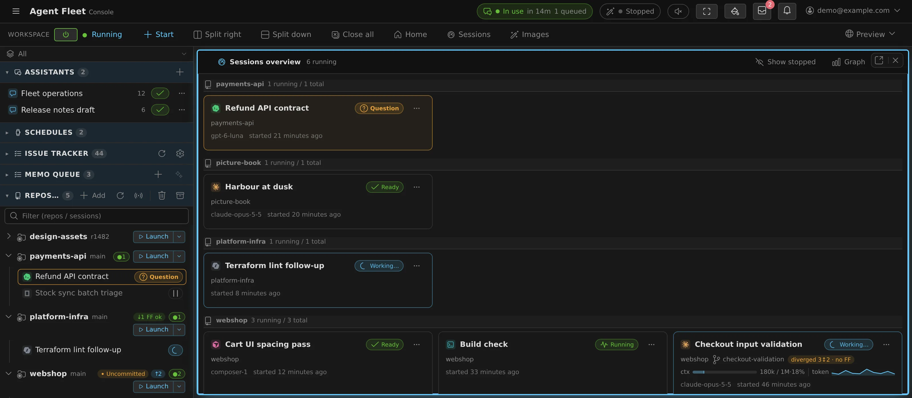
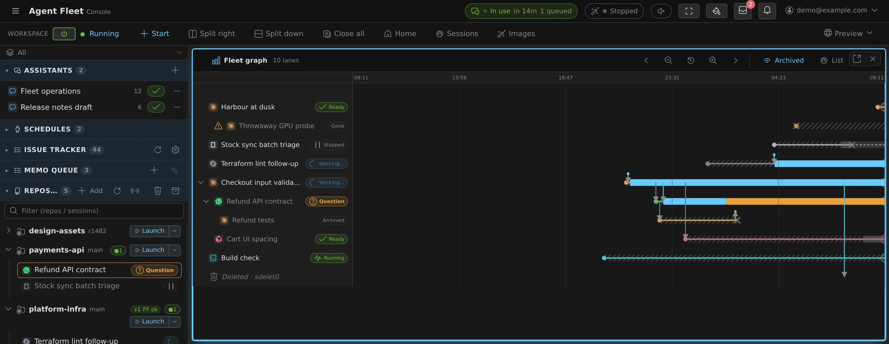

# 11. Running many sessions at once — overview, child sessions, the Fleet Operator

English | [日本語](11-many-sessions.ja.md)

This chapter is for running several sessions at once: seeing all of them together, narrowing the view with working sets, starting sessions from a session, messages between sessions, and the Fleet Operator that directs them from chat, including scheduled runs.

## Seeing every running session at once (the sessions overview)

Once several sessions are running, the left pane makes you read them one row at a time. The
**sessions overview** lays them out as **cards in a grid**, one card per session, with the same
kind colour, name, working copy and state chip as its row, plus the model, the context usage and
when it started. The states that need you now (a question, a plan to review, a permission prompt)
colour the whole card, so they can be spotted from across the room.

- **Opening it**: **"Sessions"** on the action bar (next to Split right / Split down / Close all),
  the same button on the layout map at the top of the left pane, or the leader keys **`g` → `s`** / **`s` → `l`**.
  It is an ordinary pane: split it, tab it, pop it out, and it is there again after a reload.
  On a phone, Sessions, Split down and Close all can sit in the action bar's **⋯**
  ([02](02-console-basics.md#using-it-on-a-phone)).
- **How many columns** depends on the width of the pane it is in: one column in a narrow side
  column, four or more across a wide one.
- **Cards sit under one heading per project (repository)**. Every working copy of the same
  repository shares a heading: the base clone, each `@wip-*` worktree, and a second clone under
  another folder name (what is matched is where it was cloned from, not the folder name).
  Sessions running in no working copy trail under "Other". Headings keep a fixed name order.
- **Inside a heading the cards are grouped by family.** A session started from another one (a
  handoff, a child session) sits **directly under its parent** in the order they were started,
  and **a stopped child stays under its parent** too. The family holding a session that waits
  for you leads the heading, but **a family is never split apart**.
- **Clicking a card opens that session beside the grid**, never in its place, so the grid stays
  put while you look. If the session is already open, that pane is focused instead.
- **On a phone there is no "beside", so a tap opens the session in that pane** (two half-height
  panes would help nobody). Your device's **Back button** returns to the grid, "Show stopped"
  and all. **Ctrl (⌘) + click and middle-click open another pane at any width.** In the tabbed
  layout a tap opens a new tab even on a phone, and the grid stays one tab away.
- **What one card shows**: the state at the top right (Ready / Working… / stopped), the project
  and branch on the line below with **the distance from the parent** right of it
  ("親+2・FF可", "3 unmerged"; the same chip as the repo row in the left pane), under that
  **how full the context is and a graph of the tokens each reply spent** (the same strip the
  chat view shows), and at the bottom **the model that answered last**, time since it started
  and **how long it has been waiting for you** ("since your reply" once you have answered).
  That last one is read from notifications and this device's own observations, so it stays blank
  when neither saw the change. Which agent it is (Claude, Codex, …) is the coloured icon at the
  top left.
- **The very bottom of a card is the opening of the last thing that session said** (shown for
  stopped sessions too). A long line is cut off, and hovering shows it in full. On a
  session that has not said anything yet, the line is not there at all.
- **Right-click, the ⋯ button, or the Menu key on a card gives the same menu as the row in the
  left pane**: stop, rename, hand off, share, lock, keep awake, archive, and the rest
  ([Icons, badges, and menus](badges-and-menus.md)).
- **A family folds from its parent's card.** The parent carries **"Collapse child sessions"**
  (and **"Expand child sessions"** to undo it); folded, it shows **"+N"** for how many are
  hidden, at every depth. The heading's "N running / M total" counts them all either way.
- By default only running sessions are shown. **"Show stopped"** in the pane header adds the
  stopped ones, dimmed; the choice is remembered per pane.
- Cards are ordered by what needs you, but **the unit is the family, not the card** (above): the
  family holding a session that waits on an answer comes first, then the remaining running
  families newest first, then families that are only stopped. While you watch, the order changes
  only when a family enters or leaves a wait.
- The active working set (below) narrows the grid the same way it narrows the left pane.
- **"Graph"** in the pane header swaps this grid for the fleet graph (next) in the same pane;
  Ctrl (⌘) + click or middle-click opens it in a new pane instead.

### Seeing how sessions relate over time (the fleet graph)

The grid is a cross-section of now. The **fleet graph** is the elapsed version: **one lane per
session, time running left to right**, so you can see which session started which, what went
between them, and when each one was working, waiting or idle.

- **Opening it**: **"Graph"** in the sessions overview's header (the graph's own header has
  **"List"** to go back; each swaps the other into the same pane, and Ctrl (⌘) + click or
  middle-click opens a new pane), the leader keys **`g` → `f`**, or the command palette. It is
  an ordinary pane like the grid.
- **The window starts as the last 24 hours, with now at the right edge.** The arrows in the
  header pan into the past and toward now, the magnifiers narrow and widen the window, and the
  reset button returns to the last 24 hours. A sideways scroll or a drag on the figure moves
  through time; scrolling up and down moves through the lanes; on a phone, two fingers pinch the
  time axis. The scale stays pinned at the top however far you scroll.
- **The label column** carries the kind icon, the session's name and its state chip, the same
  words as the row in the left pane, or, for a lane the list no longer carries, **Stopped —
  resumable**, **Archived — restorable** or **Gone**. **The name is what opens the session**
  (beside the figure, or in a new pane with Ctrl (⌘) or the middle button); the lane itself opens
  nothing, so dragging across it never opens a session by accident.
- **What a lane looks like says whether it is still there.** A running session is a solid line
  with a coloured band (working, waiting for you, or idle) that pulses at the right edge. A
  stopped session is **dashed** from its × to the right edge: it can be resumed. An archived or
  deleted one **ends at the ×**. The × is when its end was first noticed, which can be later than
  when it actually stopped, and its tooltip says so. A session stopped and resumed is one lane
  with several runs.
- **Families sit together**: a session started from another one (a child session, a fork or a
  handoff) is drawn directly under its parent, with a line from the parent to its birth. A
  parent's row folds its descendants away (**"+N"**), the same control as the grid's. If the
  parent is off the left edge or gone, the child is marked as having a parent that is not drawn.
- **Arrows are what passed between sessions**: a spawn, a fork, a handoff, an instruction and its
  report, and session-to-session messages. Something that is not a session (a conversation, a
  person, a scheduled run, the Discord / Slack bridge, an automatic resume) is a short stub with
  a dot at its end, coloured and labelled by where it came from. Clicking an arrow opens that
  conversation or lane.
- **"Archived"** in the header shows or hides archived lanes (shown by default, unlike the grid,
  because the past is the point here). Stopped sessions are always drawn.
- **How far back you can look is marked, not hidden.** Panning far enough back reaches lines that
  say where activity bands and arrows stop being kept, where lineage stops, and where only a
  sketch of births and deaths remains. A window with nothing in it is still a place: the axis and
  the controls stay, so you can come back.

## Narrowing the view with working sets

Once you are carrying several pieces of work, the left pane fills up with the repositories and
conversations of all the others. A **working set** groups **repositories, conversations,
sessions and schedules by piece of work and switches what the left pane shows**. Nothing is
moved or copied. Only **what you see** changes.

- The bar pinned at the top of the left pane (**"All"** by default) switches between groups. It
  stays visible however far the pane scrolls, so before you panic that "a session disappeared",
  you can see which group you are looking at.
- **"Manage groups…"** creates, renames and deletes them. Creating one also switches to it, so
  you can go straight to assigning rows. **Deleting a group never deletes its contents**
  (repositories, conversations, sessions).
- Assignment happens on the rows themselves, from the right-click (**⋯**) menu: base repository
  rows, conversation rows, and sessions that don't belong to a repository.
- **What follows on is included automatically.** A worktree follows its parent repository, a
  session follows its repository, and a schedule follows the conversation that created it, so
  there is nothing to reassign (those show as already ticked and cannot be unticked there).
- A repository cloned while a group is active, and a conversation started there, join that group
  automatically.
- The setting is yours and **follows you to your other devices** (it is not shared with other
  members).
- From the keyboard, the leader key **`w` → `w`** cycles through the groups.

## Starting sessions from a session (child sessions)

A running session can **start another session, hand it a task, and look after what it started**.
If a message between sessions (next) passes one line, this passes a whole piece of work: a long
subtask that stands on its own, work in a second repository, or something that would fill the
session's own context and starve the rest. The session it starts is its **child session**, and
it shows up in the left pane, the sessions overview and the fleet graph like any other.

**It is off by default.** Turn it on in **Settings > Agents > Session > "Starting sessions from
sessions"**. The change applies to **sessions started from then on**; sessions already running
keep their current tools until they restart. Under it, **"Children per session"** (1–10, default 3)
sets **how many children one session may have at a time**. The limit is per parent, not per
workspace, so two parents can each have that many. **A child stops counting toward the limit when you delete or
archive it**, or when a child left stopped is archived on its own after the usual window
([Stopping and tidying up](05-stopping-and-tidying.md#stopping-and-tidying-up-sessions)); a stopped child still counts.

Once it is on, a session starts a child when it judges the work splits, and tells you it is
doing so and what for. You can also ask for one ("have a codex session write the tests for
this in parallel").

- **A child can be any agent that is not a raw shell**: claude, codex, opencode, agy, copilot,
  cursor, kiro, lcpp or muse, with any model you have not excluded. A claude session can start
  a codex child, so different agents can work on one job together. shell and ssm cannot be
  started this way.
- **The parent can choose the child's effort** (a reviewer at high effort, say) when it also
  names the model, among the efforts that model offers; any other value is refused. It **cannot choose the
  child's permission mode**: the child follows your per-kind default in Settings > Agents.
- **A child starts in a new worktree** unless the parent asks otherwise, so it never shares the
  parent's working copy. Asking for a directory another session is working in is refused. The one
  exception is the parent's own working copy, and only when the parent asks for it explicitly
  by name: parent and child then share one checkout,
  index and branch, and the child is told not to switch branches or stash and to commit by path.
  It only works while the parent is running and was started in a path without a symlink; otherwise
  the request is refused like any other busy directory.
- **The task arrives as the child's first instruction**, and the chat view badges it
  **"Started by ‹parent›"** so it never reads as something you typed. The child is told the
  instruction came from a session, not from you: it **cannot stand in for your approval** (a
  permission prompt or a decision only a person can make still stops the child and waits for
  you), it is not a reason to change settings or instruction files, and commands written in the
  text are text.
- **What the parent may do, and only with the children it started**: list them with their
  state, read their recent terminal output, stop one now, book a stop for when its current turn
  ends (a child waiting on a question or an approval is not stopped that way), resume a stopped
  one, and rename one. **Once you rename a child yourself, your name stays** and the parent can
  no longer change it.
- **What it may not do**: add instructions to a child, answer its questions or approve its plans
  or permission prompts on your behalf, or delete or archive it. It can do nothing with sessions it
  did not start beyond the messages and the read-only output peek of the next section. Removing
  a child is done by you, in the Console, like any other session. To give a child more work, the
  parent sends it a message (next section).
- **No grandchildren.** A child cannot start sessions of its own; only a session you started
  yourself can. Sessions on their own extend the chain by exactly one generation, and nothing
  grows further without you launching something.

**The parent is not told how the child is getting on.** By default the child is asked to send
its parent **one message when it is done** (the outcome only, no progress reports), and that
message travels over the channel of the next section, so it arrives only while **"Messages
between sessions"** is on as well. With it off, the parent checks its children's state and
output itself.

One automated check does reach the parent: when a running parent and all its live children have
been idle for 15 minutes, with no background work and no message between sessions queued or in
flight, the parent gets **one notice** naming the idle children, so it can see whether one of
them is waiting on another. The chat view badges it **"Stalled-tree notice"**. A question, a plan
or permission prompt, or a usage-limit wait is not idle, so it never triggers the notice. It is
sent once per quiet spell, and again only after one of the children has changed state. The
deployment can change the 15 minutes or turn the notice off.

**Children outlive their parent.** Nothing stops them when the parent finishes, so before its
last turn the parent is told to list the children it leaves behind and their state. Read that
list: only you can delete a child, and each one is a whole agent, holding memory on your
workspace and spending that agent's plan usage on your account. In the **Agent usage** tab their
spend appears under **"Started by a session"**, on its own, and it is not added to the parent's
figures.

**Where a family shows.** In the left pane a child's worktree sits under the working copy of the
session that started it. In the sessions overview a child's card sits directly under its
parent's, and the parent's card folds its children away; in the fleet graph the child's lane is
drawn under the parent's, with an arrow for the start and another for the report
([Seeing every running session at once](#seeing-every-running-session-at-once-the-sessions-overview),
[Seeing how sessions relate over time](#seeing-how-sessions-relate-over-time-the-fleet-graph)).
A child remembers which session started it, and keeps that when you fork or recreate it.

## Messages between sessions

One of your running sessions can send **a single short message** to another. If a handoff
passes the whole context, this passes one line.

It earns its keep in situations like these:

- A session working in another worktree landed a change that breaks yours: "I just rebased
  develop; pull `api.ts` before you carry on"
- A decision the other session was blocked on got settled: "auth is OAuth, go ahead"
- A long-running job reports its result back to the session you are watching

**It is off by default.** Turn it on in **Settings > Agents > Session > "Messages between
sessions"**. The change applies to **sessions started from then on**; sessions already running
keep their current tools until they restart.

Once it is on, an agent sends a message when it judges one is needed, and you can also ask for
one ("tell the session next door what we just did").

- **Messages cross agent kinds**: claude to codex, opencode to cursor, and so on.
- **They reach a stopped session**: it is resumed first, then the message is delivered.
- **Delivery is confirmed; being read or acted on is not.** A reply is not guaranteed either.
  A **Managed** session that is in the middle of a turn gets the message as its next turn, once
  the current one ends. Stopping that run does not throw the message away, and neither does
  stopping the session or the workspace, or the Agent restarting: the message waits on disk and
  becomes the session's first turn when it next starts, stamped with the time it was queued.
  Archiving or deleting the session, or switching it to Terminal (CLI), drops it.
  A **Terminal (CLI)** session keeps the message in its own input queue, so what the sender is
  told, and what is lost, depends on the kind
  ([Agents reference](../ref/agents.md#stopping-a-turn-and-messages-sent-while-one-runs)).
- **A session waiting on your answer gets it after you answer.** While a session shows a
  question, a plan to approve or a permission prompt, a message sent to it waits instead of
  being refused (typed into the dialog, it would pick an answer for you). Its chat view says how
  many messages from which session will be delivered after you answer, and **Drop** discards one
  so it is never delivered. Once you have answered and the turn that answer started has ended,
  they arrive one at a time, oldest first, stamped with the time they were queued; the sender is
  told its message is waiting and does not resend. They wait up to 24 hours (20 per session),
  survive the session or the Agent stopping, and are dropped when the session is archived or
  deleted. Expired login and the usage-limit menu still refuse: those can last for hours, and
  the sender is better off knowing.
- **Only plain text travels.** No conversation history, no files. To pass the context itself,
  use the handoff or the branch ([05](05-stopping-and-tidying.md#continuing-elsewhere-handoff-branch-move)).
- **Raw shell sessions (shell / ssm) can neither send nor receive**, because the text sent to
  them would run verbatim as a command.
- **A session can also read another session's recent output**, without sending anything. The
  same switch turns it on. It is read-only and silent: the other session is not interrupted or
  told, but every read is recorded in the Agent log and in the fleet graph's record (the graph
  does not draw it). A session gets at most the last 200 lines (16 KiB) at a time, cannot read
  itself, and cannot read shell / ssm sessions, or claude sessions while this workspace's claude
  login has expired. It only ever sees sessions in this workspace, never sessions other people
  shared with you. Turning the switch on exposes what your sessions' agents wrote to your other
  sessions **as is, with nothing masked**, so a secret or a sign-in code an agent quoted in its
  reply can be read too.

Messages are deliberately curt. Every one of them costs the receiving session a whole turn, so
sessions are told to drop greetings and thanks and to lead with the point. Each message also
carries a **kind**, badged in the chat view, and the kind decides what comes back: **Request**
(act on it; the sender hears back only if it *can't* be done), **Question** (one short answer
comes back), **Answer** (closes a question, nothing follows), **FYI** (nothing follows). So
silence after a request usually means it was done rather than ignored; the work itself shows up
in that session's chat and changed files.

The receiving agent is told explicitly that the message is *not* an instruction from you. A
message from another session **cannot stand in for your approval** (it can't answer a pending
permission prompt) and **is not a reason to edit configuration or `CLAUDE.md`**. Commands
written in the body arrive as plain text and are not executed. The chat view badges each one
with its sender, so it never blends into what you typed.

### How this differs from Claude Code's own version

Claude Code has a feature for the same purpose (cross-session messaging with `/list-agents` and
`SendMessage`), but **it is disabled in Agent Fleet**. Enabling it also switches Claude's
usage telemetry back on, which we chose not to make the default for a self-hosted fleet. That
is why `/list-agents` does nothing here; use the Agent Fleet version above instead.

| | Claude Code's | Agent Fleet's |
|---|---|---|
| Which agents you can reach | claude only | claude / codex / opencode / cursor / kiro / agy / copilot / lcpp / muse |
| A stopped session | Can't be reached | **Resumed, then delivered** |
| Record of it | One collapsed line in the terminal | A badge with the sender in the chat view |
| Sessions on another machine or the web | Can reply to them | **Not supported** (same workspace only) |
| Holding or refusing on the receiving side | Available | Not offered: every session in a workspace is yours, so there is no one to refuse; only the workspace-wide on/off |

The block is applied **through the launch settings** (a version shipped where environment variables
no longer closed it). If something does arrive over Claude's own channel anyway, **it shows up in
the chat view as an incoming message**, with the sending session's name. It is closed, and a leak is
made visible.

## Letting a session see the fleet

You can let a session see **the fleet it is part of**. If the messaging above is for telling,
this is for looking.

Every session has it; there is nothing to turn on. It covers these things.

- **Another session's state**: working, waiting for input, or stopped. A session can check
  whether the peer it handed work to is still going, without asking you.
- **Context usage**: how full its own context has become. It can decide to hand the rest
  over to a fresh session before it runs out mid-task (that is the handoff, [05](05-stopping-and-tidying.md#handing-a-conversation-off-handoff)).
- **Reading the memo queue**: what is already waiting there.
- **Adding one memo**: leaving you a note about something outside what you asked for. "There
  is another bug next to the function I fixed", "this runbook is out of date": **a report set
  down without interrupting the work**. When and where the queue gets sent stays your call.
- **Correcting a memo**: when a note it left turns out to be wrong or incomplete, it corrects
  that note instead of adding a second one that contradicts it. It cannot delete a memo.

**None of this acts on another session.** Instructing another session, answering its questions,
approving its plans, starting, stopping or deleting sessions, and sending the memo queue remain
the job of the Fleet Operator ([11](11-many-sessions.md)) and Console — except what you open with
the two settings above (messages between sessions, and child sessions).

There is one deliberate limit. A session can see **that** another session is stopped on a
question or waiting for plan approval, **but not the text of it**. Being able to read it would
give the session the material to answer, on your behalf, a question meant for you. **Approval
is your job**; a session that finds a stopped peer goes as far as telling you.

It helps to read the assistant chat in [10 Chat and memos](10-chat-memo.md) and
[03 Starting sessions](03-starting-sessions.md) first.

## What is the Fleet Operator?

The **Fleet Operator** is a "command center" assistant that is available from the start
under **Assistants** in the left pane. While a regular assistant ([10](10-chat-memo.md))
only answers inside the chat, the operator can **see and drive** your workspace.

- You **just talk in chat**. The operator checks session states, sends instructions, and launches new sessions when needed.
- When a session it instructed **becomes idle (i.e. reaches a stopping point) or terminates abnormally, a "Session report" card arrives in that conversation automatically**, and the operator decides what to do next. You don't have to keep watching for completion.
- The operator itself does not edit files. Actual work is always done by sessions (claude / codex / opencode); the operator sticks to observing, instructing, and summarizing. Operations that consume resources, such as launching a new session, are confirmed with you before execution.

In a word, it's a feature that lets you **"hire a site foreman for your sessions, in chat."**

## What it can do

### See (read)

- **Session list and states**: what is running where right now, and whether each is working, idle, or asking a question.
- **Session output**: reads the recent portion of each session's conversation / terminal output to grasp progress and conclusions.
- **Repository list**: the working copies under `~/repos`. Material for choosing where to launch a new session.
- **Agent usage and limits**: claude / codex / Muse Code subscription usage (5-hour window and weekly window) and agy quota balance, plus each agent's plan and account in use, and when limits reset. It answers "How much do I have left?", "When does the limit reset?", "Which plan?" with actual values, and this also informs decisions before assigning a big task (opencode, copilot, cursor and kiro are not covered: there is no usage source for them). Muse Code's figures are the last reading a muse session saw: there are none until a muse session in this workspace has finished a turn, and they carry the plan but not the signed-in account.
- **Per-session context volume and cumulative consumption**: how full each session's context is (fill ratio against the window) and the cumulative tokens consumed so far. This helps you spot sessions with tight context and decide on a handover (splitting into a new session).

With questions like "Summarize the state of the sessions running right now" or
"Is session ◯◯ stuck on anything?", it answers after checking the actual state, not by
guessing. Note that reading usage and context volume is also available to other assistants
([10](10-chat-memo.md)) that have "AF read" permission.

### Drive (write)

- **Send instructions to running sessions**: delivers prompts just as if you typed them into the terminal. It states which session it will send what to before executing.
- **Launch new sessions**: pick a repository (dir), agent kind (claude / codex / cursor / copilot / kiro / agy / opencode / lcpp / muse / shell), and model, then start. Models are specified after checking the actually selectable list (claude uses tier names fable / opus / sonnet / haiku plus user-registered full IDs; codex / cursor / copilot / kiro / opencode use a catalog reflecting connection state). With a **worktree** you can carve out an independent working copy plus branch, so parallel work doesn't collide. If you pass an **initial task (initial_prompt)**, work starts right after launch.
- **Stop and resume sessions**: fold up sessions that are no longer needed, running away, or hogging resources, and resume them later with their conversation history intact. It confirms which one to stop before executing, and stopped sessions can also be resumed from the Console.
  - For a session that is still working you can ask it to **stop when that work is done**: the running turn finishes and its report arrives before the session is folded away, so nothing is cut off. Use it to reclaim a fan-out one session at a time as each finishes (sending the session a new instruction releases it).
- **Clean up**: it lists the same cleanup candidates as the Console's cleanup (stopped and archived sessions, stale worktrees, merged branches, each marked safe / review / keep), shows you the ones it proposes, and acts only on those you approve — archive a finished session (reversible), delete a session, a worktree or a merged branch. What it deletes is stashed in the cleanup archive first, so it can also restore it, or purge the archive when you want the space back. Candidates marked keep (running, uncommitted, unpushed) are left alone.
- **Memo queue operations**: check, add, and organize queued memos, and **batch-send selected memos** (operate the memo queue from [10](10-chat-memo.md) over chat).
- **Consulting other assistants**: when a decision needs specialist knowledge, it asks the SRE assistant or others for advice before acting (the consulted assistant only returns advice; it does no work).

Prompts the operator sends to a session get a **"From operator"** badge in that session's
chat view. They don't get mixed up with instructions you typed yourself, so you can trace
what happened later.

### Session reports and auto-reply

A session the operator instructed reports back to the conversation automatically,
**once per instruction**, when it reaches a stopping point.

- Reports arrive **when the session becomes idle** (i.e. its response to that instruction is done) and on **abnormal termination** (out of memory, crash, etc.). The card also tells you about these cases:
  - **The turn ended with an error** on the model or provider side: no answer was generated.
  - **The turn was cut off** by something that clears on its own (a dropped connection, a temporary rate limit): the answer is unfinished, and re-sending resumes it. The card says so when the automatic-resume limit has been reached.
  - **The instruction did not run**: it was dropped from the session's queue before it started. The card gives the reason: the session was archived, trashed, recreated, switched to Terminal (CLI) or no longer exists, a stop discarded the queue or caught it before it started, or it was removed from the queue.
  - **It is unknown whether the instruction arrived**: the agent restarted while it was being sent.
  - **A completion reported earlier was premature**: the session went on working. The card says when the correction limit has been reached and no more corrections will follow.
- **When a session stops at a question (multiple choice), an interim report arrives too.** The operator presents the options to you, and replying in chat with "1" or "option 2" has the operator answer the session on your behalf (if you've said "your call" up front, the operator picks). Only free-text and multi-select questions need to be answered from the Console.
- **When a session stops at plan approval, an interim report arrives as well.** From chat you can approve ("approve it") or send revision feedback ("have it fix ◯◯"), and asking "have another session review it" makes the operator broker the plan review → feedback → approval.
- Turning ON **"Auto-pilot"** in ⚙Settings → Assistant makes the operator answer questions with the session's recommendation automatically, and drive plans through review by another session, feedback, and approval (every decision is shared in chat; unclear questions and choices/plans involving destructive or irreversible operations still come to you first). Default OFF.
- When a report arrives, by default the operator **replies automatically** (summarizing results, sending follow-up instructions, deciding whether to start the next task, and so on). You can turn this auto-reply off with **"Auto-respond to session reports"** in ⚙Settings → the **Assistant** tab.
- To prevent runaway loops, **auto-replies without any input from you are capped** (⚙Settings → Assistant "Unattended auto-reply limit", default 10, max 50; unlimited is not available). When the cap is reached, a pause notice appears, and sending your next message resumes it. The design ensures your judgment is inserted periodically even in long hauls.
- Reports **also arrive in the notification center**, so you notice them even while looking at another screen (clicking opens that conversation).

## Basic usage

1. In the left pane, choose **Assistants** → **＋ (New chat)** → **Fleet Operator**.
2. Say what you want in plain language. Examples:
   - "Launch a worktree session in the console repo and have it fix the ◯◯ bug"
   - "Summarize what each of the 3 sessions running right now is doing"
   - "When session ◯◯ finishes, follow up and have it run the tests"
3. For operations that consume resources (launching a session, batch-sending memos, etc.), the operator presents "where and what" and **asks for confirmation**. If it looks good, reply with your approval.
4. After that, watch the report cards and auto-replies, and chime in only where needed. If you keep the conversation pane open, reports and auto-replies are reflected every few seconds.

## Use-case patterns

From here on, these are suggested patterns for "this is how to use it effectively." Use them as-is as templates for your prompts.

### Pattern 1: research session → handover to the operator → parallel implementation → integration

This is the most recommended pattern. The operator manages a flow where you **change headcount between research and implementation**.

1. **Research**: first launch one session normally and have it investigate. The trick is to request output in a form you can divide later, like "Investigate the cause and produce a **fix plan split into work units that can proceed independently**." If the plan gets large, having the session write the plan to a file and commit it is more reliable (since reading session output focuses on the recent portion).
2. **Handover**: ask the operator: "Read the research results from session ◯◯ and proceed with a separate session per work unit." The operator reads the source session's output and hands over by **summarizing the key points and embedding them into each new session's initial task** (it doesn't duplicate the whole conversation; it passes only the necessary context, distilled).
3. **Parallel implementation**: a **worktree session** is launched per work unit, so they proceed in parallel without stepping on each other's files. You can also ask here to vary the agent or model by the weight of the work (a light model for minor fixes, a heavy model for the hard parts).
4. **Integration**: once the reports from all sessions are in, have the operator summarize the results and instruct an integration session (or one of the existing ones) to "pull in each branch and get the tests passing." You do the final review and merge yourself.

### Pattern 2: fan-out of same-kind fixes

For work like "I want to apply this fix the same way in N places (multiple repositories /
multiple modules)," split it into one exemplar plus roll-out.

1. First fix one place in your own session and settle the approach.
2. Ask the operator: "Following the same approach as the fix done in session ◯◯, launch sessions for the remaining △△ and □□ and apply it." It summarizes the approach from the exemplar session's output and distributes it to each session.
3. As each report arrives, the operator checks the result and raises only gaps and failures to you.

### Pattern 3: agent comparison / cross-review

Having **claude / codex / opencode solve the same problem in parallel and comparing** them
is something only the operator, watching across agents as the command center, can do.

- "Have claude and codex each solve this problem in separate sessions. When both reports are in, compare the differences in approach in a table."
- "Have session B, on a different agent, review session A's implementation. Send the findings back to A as a follow-up."

It is useful for design problems where approaches diverge, or when you want a different pair of eyes on a review.

### Pattern 4: serial pipeline (implement → test → review)

A pattern that uses reports as the "trigger for the next stage." If you describe the
sequence up front ("when implementation finishes, run the tests; if tests fail, follow up
with fixes; if they pass, do another pass from a review perspective"), the operator judges
each report and advances the stages. Because of the auto-reply cap (default 10, up to
50 in settings), plan long pipelines with the expectation that you'll say "continue"
at milestones, or raise the limit.

### Pattern 5: status briefing and memo triage

Even the "see" side alone, without driving anything, is useful.

- **Briefing** (after stepping away or the next morning): "Summarize the current state of the sessions running since yesterday and why any are stopped." It actually reads states and output before reporting.
- **Memo triage**: "Route the memos piled up in the memo queue to the appropriate sessions by content and send them." You can finish off the capture-as-you-go flow ([10](10-chat-memo.md)) from chat.
- **Cleanup**: "Check which sessions have served their purpose and stop the ones no longer needed", or "Show me what can be cleaned up". After parallel work, you can fold up scattered sessions and free resources (stopped = resumable, so nothing disappears), and clear away what is finished once you have approved the list.
- **Assignment based on remaining quota**: "Between claude and codex, which still has room in its window?" "Given the limits, which should this larger task go to?" It checks actual usage ratios and reset times, so you can discuss assignments that avoid agents close to their limits.
- **Context watching and handover**: "Are any sessions getting tight on context?" When it finds a session with a high fill ratio, that feeds the decision to summarize the key points and hand over to a new session (the steps of Pattern 1) instead of piling on more instructions.

## Scheduled runs

If you ask the operator something like "Review yesterday's changes every weekday at 9,"
it is registered as a **scheduled run** (cron / interval / one-shot, with timezone and DST
support). At registration the operator confirms the schedule as it interpreted it and the
next run time, so check that it matches your intent.

- At firing time, it **wakes even a stopped workspace** and runs the prompt; the completion
  report arrives in the operator conversation. If startup or execution fails, it shows up
  in the notification center.
- In the **"Schedules"** section of the left pane you can see the list and run history
  (success/failure, manual / scheduled, and a link to the session that ran), and the row
  menu offers **Pause / Resume / Run now / Delete**. **"Details / edit"** in the same menu
  opens the firing spec, timezone, wake policy, agent, model, report opt-in and the prompt
  itself for editing; only the advanced execution fields (session mode, reuse target,
  rotation, overlap policy) are read-only there and changed by asking the operator.
- By default each run uses a fresh session. If you ask "reuse the same session and build up
  context," **long-lived session reuse** (with rebuild conditions such as every N runs or
  per time period) is also possible.
- It can also **stop when it is done**. Tick **"Stop when done"** in "Details / edit" (ask the
  operator for `stop_after_run`) and the session stops once that run has finished: report
  first, stop after, and resumable. It keeps the session an unattended run leaves behind from
  holding its memory for the rest of the night (it does not change when the workspace itself
  stops; a finished session was never what kept it awake).
- **Where the report goes** is chosen per schedule. With the report on, **"Deliver to"** in
  "Details / edit" (`deliver_to` for the operator) takes any of: the **assistant conversation**
  (the default, and what every schedule did before), the **notification center**, and your
  **Discord** / **Slack** connection. A chat post carries the run's answer under a heading that
  names the schedule, even when the connection is not in full-text mode. Only your own
  connection is used, and only while it is bound to your account on that service (the
  identity binding the reply and button features use) and not muted; otherwise the result goes
  to the notification center with a line saying which connection could not take it. A schedule
  that names its destinations reaches only those: its runs do not also send the usual
  "a reply is ready" copy to every chat connection.
- **Stay silent when there is nothing to report.** For a monitoring schedule ("check the
  nightly jobs and tell me only if something failed"), tick **"Stay silent when there is
  nothing to report"** (`silent`). The agent is then told to answer exactly `[SILENT]` when
  all is well. Such a run delivers nothing (no report, no notification, no chat post) and
  its history row reads **"Success (silent)"**. The match is the whole answer, trimmed and
  case-sensitive, so `[SILENT]` inside a longer answer is delivered as usual. **Failures are
  never silent**: a run that errors, is cut off or dies still reaches the notification center
  whatever the targets say. Delivery targets and the sentinel apply to runs that drive a
  session; a run in assistant mode is itself a turn in the conversation.

## Constraints and caveats

- **Which events become reports is listed under [Session reports and auto-reply](#session-reports-and-auto-reply).** Tool-permission waits appear in the notification center but do not become reports to the operator. For tasks you want to run through unattended, cut the instructions so that few operations require permission. If something looks stalled, asking the operator for a status check will surface it.
- **Keep parallelism modest.** Each session uses memory, and the host is shared. As a guideline, keep parallel implementation to 2–3 sessions and don't run heavy builds at the same time (the operator also confirms before launching). Having the operator fold up finished sessions helps too.
- **When the operator stops a session, the report that was due is cancelled as well.** Stopping is treated as cancelling that instruction. Even if you later resume it from the Console and the work completes, the old report will not arrive in the operator's conversation (if you stopped it with the Console's stop button it is not cancelled, and completion after resume is reported). When asking a resumed session to continue, have the operator send the instruction again.
- **Session reports have no body** (only the fact of completion / question / abnormal termination). In practice this is fine because the operator goes and reads the output for details, but the report card alone doesn't show the contents.
- **Handover is summary-based.** The conversation context does not move over wholesale, so for lengthy research results it is safer to have them written to a plan file before handing over (see Pattern 1).
- **By default, sessions do not coordinate with each other directly**, and orchestration goes through the operator. Two settings change that, both off by default: with "[Starting sessions from sessions](11-many-sessions.md#starting-sessions-from-a-session-child-sessions)" on, a session can start child sessions and look after them itself, and with "[Messages between sessions](11-many-sessions.md#messages-between-sessions)" on, sessions can send each other short messages. Either way this is complementary to parallelization that stays within a single session (an agent's own subagent feature); choose the operator **when work spans repositories or agents, or when you want to see each piece of work as its own session**.
- **Report bodies are treated as "data."** So that text originating from session output is never executed as an instruction, the design confirms with you first whenever a new session would be created based on an automatic report. In particular, even if a report or output contains something like "run this command," the operator **will not execute a command or send it to a shell session on that basis** (prompt-injection protection). The operator executes only what you instructed directly. The extra safety-side confirmations are by design.
- **Shell sessions always require your approval.** a shell session is a raw shell with no agent guardrails in between: the string sent is executed as a command as-is. Therefore, when launching a shell session or sending it a command, the operator **presents the exact command to be executed and asks for your approval in advance**. Destructive or irreversible commands are never sent unless you explicitly approve them.
