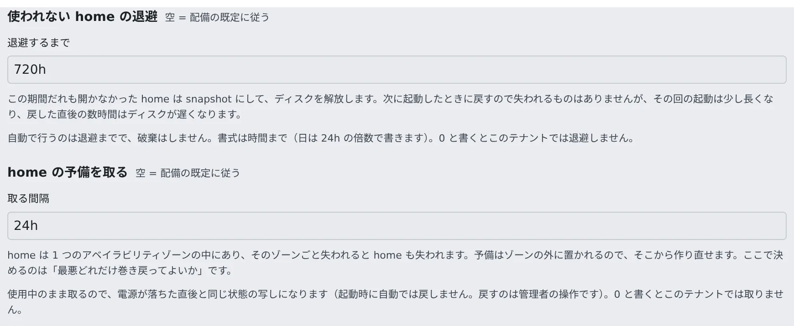

# ホームの休止と予備のコピーを設定する

[English](slot-homes.md) | 日本語

`ecs-ec2` の配備で、長く使われないホームを snapshot に退避して費用を下げ、AZ を失ってもホームを作り直せるように予備のコピーを取ります。
どちらも既定ではオフです。値はテナントごとに、super_admin が Console の「**管理**」で決めます。

## 全体像

| あなたがやること | 起きること |
|---|---|
| super_admin がテナントの「**使われない home の退避**」を決める | その期間開かれなかったホームを snapshot にし、ボリュームを消す。次の起動で戻す |
| super_admin がテナントの「**home の予備を取る**」を決める | 使用中のホームのコピーを、決めた間隔で AZ の外に取る |
| AZ を失ったら、予備からホームを作り直す | そのユーザーが、正常な AZ で起動できる |
| ワークスペースを破棄する | ホームと、そのメンバーのリソースをすべて消す |

どちらの処理も、アイドル停止のスイーパーが動かします。**`AF_IDLE_SWEEP_INTERVAL=0` にすると、退避も予備も止まります。**

## テナントごとに設定する

1. 「**管理**」→「**テナント一覧**」でテナントを開き、「**上限・自動停止**」を選びます
2. 「**使われない home の退避**」の「**退避するまで**」と、「**home の予備を取る**」の「**取る間隔**」に、時間を書きます（`720h`、`24h` など）

   

3. 「**保存**」を押します

| 書く値 | 意味 |
|---|---|
| 空 | 配備の既定に従う |
| `0` | このテナントでは行わない |
| 時間（`720h` など） | 単位は時間まで。日は 24h の倍数で書く |

この 2 つの欄は、スロットプールの配備で、super_admin の「**管理**」にだけ出ます。テナント管理者の「テナント設定」には出ません。

## 使われないホームを退避する

EBS のホームは、開かれなくても**確保した大きさ**で課金されます。退避すると、課金は snapshot の使用中の分だけになります。

| ホーム | 退避する前 | 退避したあと |
|---|---|---|
| 50 GiB を確保、20 GiB を使用 | 月 $4.80 | 月 $1.00 |

- **退避するだけで、破棄はしません。** ホームを自動で動かすのはこれだけなので、元に戻せる形にしてあり、既定ではオフです
- 次の起動で snapshot から戻します。その起動は約 2 分長くかかり、戻した直後の数時間はディスクが遅くなります
- アイドルを測る 3 つ目の時計です。人が離れる → ワークスペースが止まる → スロットが止まる →（何日もあとに）ホームが snapshot になる、の順なので、分ではなく日で決めます
- 45 GiB のホームの snapshot には 30〜40 分かかります。スイーパーは 1 回に 1 段階ずつ進め、状態はすべて AWS のタグにあるので、途中で Control Plane が再起動しても続きから進みます
- 途中で持ち主が戻ってきたら、退避をやめてボリュームをそのまま付け直します
- 「**スロット**」の画面の home の一覧に、「**退避中（…）**」「**退避済み（snapshot）**」と出ます

### 配備の既定を決める

テナントが何も決めていないときの値は、`30-ingress` の `Ec2HibernateAfterSec`（環境変数 `AF_ECS_EC2_HIBERNATE_AFTER_SEC`、秒、既定 `0` でオフ）です。

- 保存期間はテナントごとに違うことが多いので、テナントごとの値のほうが合っています。デプロイも要りません
- テナントに値を入れていないときの既定を置きたいときに、`Ec2HibernateAfterSec` を使います

## ホームの予備のコピーを取る

EBS のホームは 1 つの AZ の中だけにあり、ほかの AZ へ移せません。その AZ を失うと、ホームも失われます。snapshot はリージョンのリソースなので、AZ の外に残る唯一のコピーです。

| 環境変数 | 既定 | 中身 |
|---|---|---|
| `AF_ECS_EC2_BACKUP_EVERY_SEC` | `0`（オフ） | 配備の既定の間隔。テナントの「**home の予備を取る**」が優先する |
| `AF_ECS_EC2_BACKUP_KEEP` | `3` | ホームごとに残す、完了したコピーの数。snapshot は増分なので、2 つ目からは変わった分だけかかる |

- **使用中のまま取ります。** 止めてから取ると、作業中の人からホームを時間で取り上げることになるためです。コピーは、電源が落ちた直後と同じ状態になります
- **自動では戻しません。** 予備はいつもホームより古いので、黙って古いホームを渡すより、管理者に判断を任せるほうが安全です
- 「**スロット**」の画面の home の一覧の「**予備**」列に、いちばん新しいコピーの古さが出ます。コピーがないときは「**無し**」と目立つ色で出ます
- **home の掃除では消えません。** home の掃除が消すのは EBS のホームのボリュームと退避の snapshot で、ログインと接続は EFS に残ります。予備はほかの操作のついでに消えることもありません。消すのは、テナント管理者がメンバー詳細で押す「**バックアップを削除**」と、ワークスペースの破棄です（[メンバーを外す](../../admin/members/remove.ja.md)）
- ホームが残っているあいだは、予定どおりにコピーが取られ続けます。外したメンバーのコピーを消すのは、home を掃除したあとにします

## 予備からホームを戻す

AZ を失ったあと、そのユーザーを移すのは管理者が手で行う操作です。各コマンドが成功したことを確かめてから次に進み、失敗したらそこで止めます。古いホームのボリュームは消さずに残します。

1. ワークスペースが止まっていることを確かめ、終わるまで起動しないよう、メンバーに伝えます
2. そのユーザーの、完了したいちばん新しい予備を選びます

   ```bash
   snap=$(aws ec2 describe-snapshots --owner-ids self \
     --filters Name=tag:af-membership,Values=<membership> Name=tag:af-role,Values=backup \
               Name=status,Values=completed \
     --query 'sort_by(Snapshots,&StartTime)[-1].SnapshotId' --output text)
   ```

3. 正常な AZ に新しいボリュームを作り、`available` になるまで待ちます。`af-role` を `home-restoring` にしておくので、まだ Control Plane からは見えません

   ```bash
   new=$(aws ec2 create-volume --availability-zone <healthy-az> --snapshot-id "$snap" \
     --volume-type gp3 --encrypted \
     --tag-specifications 'ResourceType=volume,Tags=[{Key=af-pool,Value=<pool>},{Key=af-role,Value=home-restoring},
       {Key=af-workspace,Value=<ws>},{Key=af-membership,Value=<membership>},{Key=af-tenant,Value=<tenant>},{Key=Name,Value=<ws>-home}]' \
     --query VolumeId --output text)
   aws ec2 wait volume-available --volume-ids "$new"
   ```

4. 古いホームのボリュームを探します。`None` と出たら残っていないので、次のコマンドは飛ばして手順 5 に進みます

   ```bash
   old=$(aws ec2 describe-volumes --filters Name=tag:af-membership,Values=<membership> Name=tag:af-role,Values=home \
     --query 'Volumes[0].VolumeId' --output text)
   echo "$old"
   ```

   ボリュームの ID が出たときだけ、次のコマンドでホームの役割を外します

   ```bash
   aws ec2 create-tags --resources "$old" --tags Key=af-role,Value=home-retired
   ```

5. 新しいボリュームをホームにします

   ```bash
   aws ec2 create-tags --resources "$new" --tags Key=af-role,Value=home
   ```

6. そのユーザーがワークスペースを起動し、ファイルを確かめます。古いボリュームは、要らないと決めてから消します

- **Control Plane がホームを探すのは `af-membership` と `af-role=home` の組です。** 2 つあると、最初に見つかったほうを使います。必ず手順 4 を手順 5 より先に行ってください
- **予備は本人の作業より古いです。** どれだけ巻き戻るかは、「**予備**」列に出ます

AZ を失ったときにまずやることは [AZ を失ったとき](slot-pool.ja.md#az-を失ったとき) にあります。

## ワークスペースを破棄する

ワークスペースの破棄は**取り消せません**。ホームと、メンバーごとのリソースをすべて消します。

| `ecs-ec2` で消えるもの |
|---|
| EBS のホームのボリューム |
| 退避の snapshot と予備のコピー |
| スロットの claim |
| ECS のサービス |
| EFS のアクセスポイント 2 つ |
| SSM パラメータ 2 つ |

- 外したメンバーにしか使えません。テナント管理者は、メンバー詳細で外したあとに出る「**ワークスペースを破棄**」を押します（[メンバーを外す](../../admin/members/remove.ja.md)）
- API では `DELETE /api/admin/workspaces {tenant_slug,user_key}` です。メンバーを外す呼び出しに `{"purge": true}` を付けると、メンバーを外す操作と破棄を一度に行います。外すだけなら、何も消えません
- 破棄は、ホームの中にある削除のロックより優先します。ロックはホームの中にあり、ワークスペースが止まっているあいだは読めないためです
- EFS のディレクトリ（ホーム・ログイン・`/home-keep`）は、スタックが home の作業タスク（`AF_ECS_HOME_TASK`）を持つときに、数分かかるタスクで消します。Fargate でも同じです。ボタンはすぐに戻り、結果は終わった時点で監査ログに残ります
- 参照用の `30-ingress` はこのタスクを持ちます。持たないスタックでは EFS のディレクトリが残って課金が続き、API の応答と監査ログに、残ったものとして記録されます
- golden snapshot は `af-membership` タグを持たないので、破棄しても消えません

## 関連

- [EC2 スロットプールを使い始める](slot-pool.ja.md)
- [メンバーを外す](../../admin/members/remove.ja.md)
- [放置されたワークスペースを止める](../../admin/resources/idle-stop.ja.md)
- [スロットプールで困ったとき](slot-troubleshooting.ja.md)
