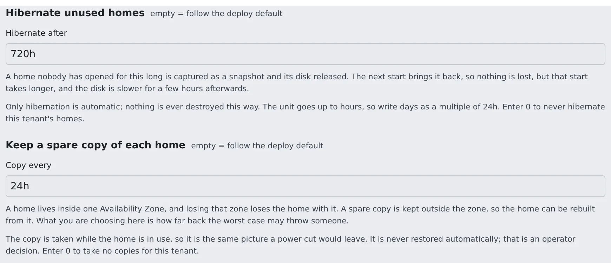

# Set up home hibernation and spare copies

English | [日本語](slot-homes.ja.md)

On an `ecs-ec2` deployment, hibernate homes nobody uses to snapshots to cut their cost, and keep spare copies so a home can be rebuilt after losing an AZ.
Both are off by default. A super_admin sets them per tenant under **Admin** in the Console.

## How it works

| What you do | What happens |
|---|---|
| A super_admin sets the tenant's **Hibernate unused homes** | A home nobody opened for that long becomes a snapshot and its volume is deleted. The next start brings it back |
| A super_admin sets the tenant's **Keep a spare copy of each home** | A copy of each home is taken while in use, outside its AZ, at that interval |
| Rebuild a home from a spare copy after losing an AZ | That user can start in an AZ that is alive |
| Destroy a workspace | The home and every resource of that member are deleted |

Both are triggered by the idle-stop sweeper. **`AF_IDLE_SWEEP_INTERVAL=0` turns off hibernation and spare copies too.**

## Set them per tenant

1. Under **Admin** → **Tenants**, open the tenant and pick **Limits & idle**
2. Write a duration in **Hibernate after** under **Hibernate unused homes**, and in **Copy every** under **Keep a spare copy of each home** (`720h`, `24h` and so on)

   

3. Press **Save**

| Value | Meaning |
|---|---|
| empty | Follow the deploy default |
| `0` | Never, for this tenant |
| A duration (`720h` and so on) | The unit goes up to hours, so write days as a multiple of 24h |

These two fields appear only on a slot-pool deployment, and only under a super_admin's **Admin**. A tenant administrator's Tenant settings do not show them.

## Hibernate unused homes

An EBS home bills for the size it is **provisioned** at, whether or not anyone opens it. Hibernated, it costs only the snapshot's used blocks.

| Home | Before hibernation | After |
|---|---|---|
| 50 GiB provisioned, 20 GiB used | $4.80 a month | $1.00 a month |

- **It hibernates; it never destroys.** This is the only automatic path that moves someone's home, so it stays reversible, and off by default
- The next start restores it from the snapshot. That start takes about 2 minutes longer, and the disk is slower for a few hours afterwards
- It is a third idle timer: the person goes idle → the workspace stops → the slot sleeps → (days later) the home becomes a snapshot. Set it in days, not minutes
- A snapshot of a 45 GiB home takes 30–40 minutes. The sweeper advances one step per pass and keeps its state entirely in AWS tags, so a Control Plane restart midway resumes rather than strands
- If the owner comes back first, the hibernation is abandoned and the volume is simply reattached
- The homes list on the **Slots** page shows **hibernating (…)** and **hibernated (snapshot)**

### Set the deployment default

The value for a tenant that has not chosen is `Ec2HibernateAfterSec` on `30-ingress` (environment variable `AF_ECS_EC2_HIBERNATE_AFTER_SEC`, in seconds, default `0` = off).

- Retention usually differs between tenants, so a per-tenant value fits better. It needs no deploy
- Use `Ec2HibernateAfterSec` when you want a default for tenants with no value of their own

## Keep a spare copy of each home

An EBS home lives in exactly one AZ and cannot be evacuated, so losing that AZ loses the home with it. Snapshots are regional, which makes them the only copy outside the AZ.

| Environment variable | Default | What it does |
|---|---|---|
| `AF_ECS_EC2_BACKUP_EVERY_SEC` | `0` (off) | The deployment default interval. The tenant's **Keep a spare copy of each home** wins over it |
| `AF_ECS_EC2_BACKUP_KEEP` | `3` | How many completed copies to keep per home. Snapshots are incremental, so the second copy costs only what changed |

- **Copies are taken while the home is in use.** A copy is the same picture a power cut leaves. Quiescing would mean taking a working person's home away on a timer
- **They are never restored automatically.** A copy is always older than the home, and handing somebody a silently older home is worse than leaving the decision to an operator
- The **Spare copy** column of the homes list on the **Slots** page shows how old each home's newest copy is, and shows **none** in a warning colour when there is none
- **Clean home does not delete them.** Clean home deletes the EBS home volume and its hibernation snapshots, and the logins and connections stay on EFS. Nothing else deletes the copies as a side effect either. They go with **Delete backups**, which a tenant administrator presses in the member detail, and with destroying the workspace ([Remove a member](../../admin/members/remove.md))
- While the home exists, the schedule keeps taking copies of it. For a removed member, delete the copies after cleaning the home

## Restore a home from a spare copy

After losing an AZ, moving that user is an operator's action. Check that each command succeeded before the next, and stop at the first failure. Keep the old home volume; do not delete it.

1. Check that the workspace is stopped, and ask the member not to start it until you are done
2. Pick that user's newest completed copy

   ```bash
   snap=$(aws ec2 describe-snapshots --owner-ids self \
     --filters Name=tag:af-membership,Values=<membership> Name=tag:af-role,Values=backup \
               Name=status,Values=completed \
     --query 'sort_by(Snapshots,&StartTime)[-1].SnapshotId' --output text)
   ```

3. Create a new volume in a healthy AZ and wait until it is `available`. Its `af-role` is `home-restoring`, so the Control Plane cannot see it yet

   ```bash
   new=$(aws ec2 create-volume --availability-zone <healthy-az> --snapshot-id "$snap" \
     --volume-type gp3 --encrypted \
     --tag-specifications 'ResourceType=volume,Tags=[{Key=af-pool,Value=<pool>},{Key=af-role,Value=home-restoring},
       {Key=af-workspace,Value=<ws>},{Key=af-membership,Value=<membership>},{Key=af-tenant,Value=<tenant>},{Key=Name,Value=<ws>-home}]' \
     --query VolumeId --output text)
   aws ec2 wait volume-available --volume-ids "$new"
   ```

4. If the old home volume still exists, take the home role off it (`None` means there is none)

   ```bash
   old=$(aws ec2 describe-volumes --filters Name=tag:af-membership,Values=<membership> Name=tag:af-role,Values=home \
     --query 'Volumes[0].VolumeId' --output text)
   aws ec2 create-tags --resources "$old" --tags Key=af-role,Value=home-retired
   ```

5. Make the new volume the home

   ```bash
   aws ec2 create-tags --resources "$new" --tags Key=af-role,Value=home
   ```

6. The user starts the workspace and checks their files. Delete the old volume only once you have decided it is not needed

- **The Control Plane finds a home by `af-membership` and `af-role=home`.** With two, it uses whichever it finds first. Do step 4 before step 5
- **A spare copy is older than the person's work.** How far back it goes is in the **Spare copy** column

What to do first when you lose an AZ is in [When you lose an AZ](slot-pool.md#when-you-lose-an-az).

## Destroy a workspace

Destroying a workspace **cannot be undone**. It deletes the home and every per-member resource.

| What goes on `ecs-ec2` |
|---|
| The EBS home volume |
| Hibernation snapshots and spare copies |
| The slot claim |
| The ECS service |
| Both EFS access points |
| Both SSM parameters |

- It accepts only a member who has been removed. A tenant administrator presses **Destroy workspace**, offered in the member detail after the removal ([Remove a member](../../admin/members/remove.md))
- The API is `DELETE /api/admin/workspaces {tenant_slug,user_key}`. `{"purge": true}` on the call that removes the member does both at once. Removing alone deletes nothing
- It overrides the deletion locks inside the home: those live inside the home, which cannot be read while the workspace is stopped
- The EFS directories (home, logins, `/home-keep`) are removed by a task that takes a few minutes, when the stack declares the home task (`AF_ECS_HOME_TASK`). The same holds on Fargate. The button returns at once and the outcome goes into the audit log when it finishes
- The reference `30-ingress` declares that task. On a stack without it the EFS directories stay and keep billing, and they are reported as leftovers in the response and the audit log
- The golden snapshot carries no `af-membership` tag, so destroying a workspace never touches it

## Related

- [Start using the EC2 slot pool](slot-pool.md)
- [Remove a member](../../admin/members/remove.md)
- [Stop workspaces left idle](../../admin/resources/idle-stop.md)
- [Troubleshoot the slot pool](slot-troubleshooting.md)
