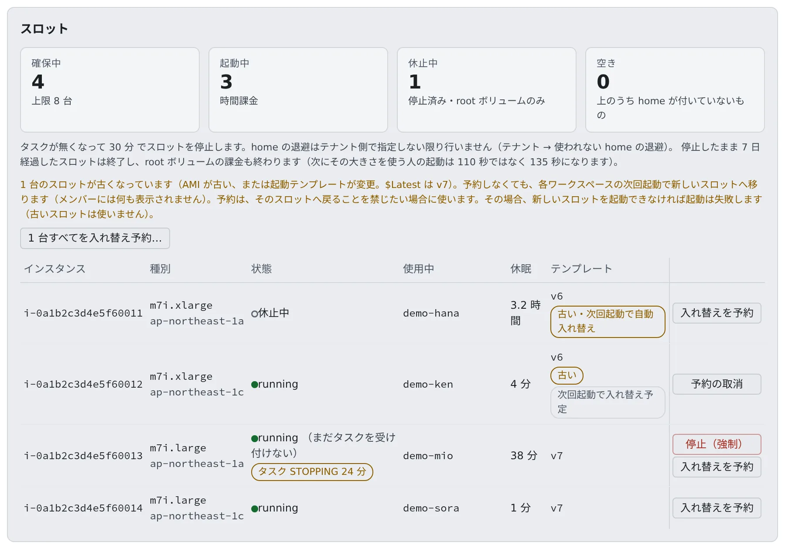

# スロットを入れ替える・止める

[English](slot-maintenance.md) | 日本語

AWS の `ecs-ec2` の配備だけの作業です。古くなったスロットを新しいスロットに入れ替え、応答しなくなったスロットを止めます。
`ecs-ec2` では、ワークスペースはプールから取った EC2 スロットの上で動き、ホームは停止中もそのスロットに付いた EBS ボリュームです。プールの建てかたとパラメータは [EC2 スロットプールを使い始める](slot-pool.ja.md) にあります。

## 全体像

| あなたがやること | 起きること |
|---|---|
| 何もしない | 古いスロットは、そこにホームがあるワークスペースの次の起動で新しいスロットに移る。空きの古いスロットはスイーパーが終了する |
| 「**入れ替えを予約**」を押す | そのスロットのワークスペースは、次の起動で必ず新しいスロットに移る。古いスロットには戻らない |
| 「**停止（強制）**」を押す | 応答しないスロットのコマンドを取り消し、インスタンスを止める。ホームはそのまま残る |
| 監査ログの `pool.slot_dark_detected` を見る | 誰かが起動する前に、応答しないスロットに気づける |

スロットの画面は「**管理**」→「**スロット**」にあり、super_admin だけが使えます。



## 古いスロット

スロットはユーザーデータを起動時にしか読みません。止めたワークスペースは、次の起動で同じスロットに戻ります。そのため、起動テンプレートの変更（リリースのセキュリティの設定など）は、今あるスロットには届きません。インスタンスを手で終了せず、ここで入れ替えます。

スロットが「**古い**」になるのは、次のどちらかのときです。ツールチップに理由が出ます。

| 理由 | 中身 |
|---|---|
| AMI が古い | AMI が、そのアーキテクチャの Amazon の現行の ECS 最適化 AMI でない |
| テンプレートが変更 | 起動テンプレートが、AMI 以外も変更された |

- Control Plane は Amazon の公開 SSM パラメータを約 1 時間ごとに読み、x86_64 と arm64 のどちらのスロットも現行の AMI で起動します。スタックをデプロイしなくても、Amazon の更新に追随します
- 起動テンプレートのバージョン番号だけでは判定しません。AMI だけが変わったバージョンでは、arm64 のスロットは古くなりません
- SSM を読めないときは最後に読めた値、それもなければ CloudFormation の値で起動します。Control Plane が知らない AMI のスロットは、古いとみなしません
- 猶予はありません。新しい AMI が出ると、最初のスイープですべてのスロットが一斉に古くなります
- 動いているワークスペースには、起動のとき以外は何も起きません

### 自動の入れ替え

既定では、古いスロットは自動で入れ替わります。画面には「**古い・次回起動で自動入れ替え**」と出ます。

- ワークスペースの起動時にホームが古いスロットにあると、その起動で新しいスロットへ移ります。メンバーのワークスペースのバーには何も出ません
- 空きの古いスロットは、スイーパーが終了します
- 新しいスロットを起動できないとき（容量・クォータ）は、起動は古いスロットで成功します。その後 10 分以内の起動は、やり直さずに古いスロットのまま動きます
- 自動の入れ替えは、監査ログに `pool.slot_replace_auto` として残ります
- 止めるには、Control Plane に `AF_ECS_EC2_AUTO_REPLACE_OUTDATED_SLOTS=false` を設定します

### 自分で予約する

古いスロットへ戻ることを禁じたいときは、自分で予約します。その場合、新しいスロットを起動できなければ起動は失敗します。

1. 「**管理**」→「**スロット**」を開きます。「**テンプレート**」列に、各スロットを起動した起動テンプレートのバージョンが出ます
2. 予約します
   - まとめて予約するときは「**N 台すべてを入れ替え予約…**」を押します。古いスロットと、それぞれに載っているワークスペースが出るので、確かめて予約します
   - 1 台だけのときは、行の「**入れ替えを予約**」を押します。予約した行には「**次回起動で入れ替え予定**」と出ます。「**予約の取消**」で戻せます
3. 動いているワークスペースには何も起きません。メンバーのワークスペースのバーに「**新しいスロットへ移動**」が出ます
4. メンバーが次に停止して起動すると、現行の AMI と `$Latest` で新しいスロットを起動し、ホームを移して古いスロットを終了します。その起動はいつもより 25 秒ほど長くかかります。ファイル・リポジトリ・ログインはそのままで、ホームを消すことはありません

予約と取り消しは、監査ログに `pool.slot_replace_reserve` / `pool.slot_replace_cancel` として、移るワークスペースの名前つきで残ります。

| 症状 | 原因と対処 |
|---|---|
| 予約したワークスペースの起動が、理由つきで失敗する | 新しいスロットを起動できませんでした（容量・クォータ）。予約は残り、古いスロットには戻りません。時間をおいてやり直してください |
| 予約したスロットが消えた | ワークスペースが載っていない予約済みのスロットは、スイーパーが終了します |

結果の確かめかたは、[新しいユーザーデータに移す](#新しいユーザーデータに移す) にあります。

## 新しいユーザーデータに移す

ワークスペースのタスクは、Chromium の setuid の `chrome-sandbox` が名前空間を作れるように `SYS_ADMIN` を足します。ユーザーデータにある次のスロットの設定がこれと組になり、**どれもテンプレートに入ったあとに起動したスロットにしか効きません**。それより前のスロットは、新しい起動テンプレートのバージョンを作ったうえで、下の手順で入れ替えるまで守られません。

| 設定 | 効果 | 古いスロットでは |
|---|---|---|
| `user.max_user_namespaces=0` | 特権のないユーザー名前空間を作れなくし、`SYS_ADMIN` に届く道を setuid のヘルパーだけにする。`/etc/sysctl.d/99-af-userns.conf` に残し、ECS エージェントの設定より前に当てる。失敗するとユーザーデータは止まり、`ecs.service` のドロップインが、値が 0 でなければ再起動後も ECS エージェントを起動させない | タスクは既定の上限のままで、ユーザー名前空間を作れる |
| ホームのボリュームを `af-mount` が `nosuid,nodev` でマウント | ホームの setuid とデバイスファイルを無効にする | マウント済みのホームは、アンマウントしてマウントし直すまで前のオプションのまま（スロットの移動でそうなる） |
| スロットの `ecs.config` の `ECS_AWSVPC_BLOCK_IMDS=true` | ワークスペースのタスクが、IMDS を通してスロットのインスタンスプロファイル（`SlotRole`）に届かないようにする。起動テンプレートのホップ数の上限では防げない。`awsvpc` のタスクの ENI は IMDS に直接届くため | 入れ替えるまで開いたまま |

- `kernel.unprivileged_bpf_disabled`（1）と `kernel.perf_event_paranoid`（2）は、AL2023 ですでに厳しい値だったので設定しません
- タスク定義は、ワークスペースの次の起動で（新しいリビジョンとして）この権限を得ます。そこにスロットの変更は要りません
- ECS エージェントは、スロットの起動時に `ecs.config` を読みます。スロットが自分で入れ替わることはなく、ワークスペースを**止めて起動しても同じスロットに戻ります**（停止中もホームが付いたままのため）
- 入れ替えるまでも、エージェント自身の隔離は、`AWS_EC2_METADATA_DISABLED` に従う SDK には効きます。IMDS を直接呼ぶツールには効きません

移す手順:

1. **プールのスタックを更新します。** `update.sh` がやります。手でやるときは次のとおりです（パラメータは前の値のままです）。Control Plane はテンプレートの `$Latest` でスロットを起動するので、変わるのは新しいスロットだけです

   ```bash
   aws cloudformation deploy --stack-name <pool stack> --template-file cfn/40-ec2-pool.yaml \
     --capabilities CAPABILITY_NAMED_IAM
   ```

2. **ほとんどのスロットは、何もしなくても入れ替わります**（[自動の入れ替え](#自動の入れ替え)）。古いスロットに戻すことを禁じたいときは予約します（[自分で予約する](#自分で予約する)）
   - 自動の入れ替えは、監査ログに `pool.slot_replace_auto`（実行者 `slot-auto-replace`）として、ワークスペース・古いバージョン・`$Latest`・新しいスロットの名前つきで残ります。バージョンを読めないスロットは触りません
   - 新しいテンプレートを確かめているあいだなどに止めたいときは、`AF_ECS_EC2_AUTO_REPLACE_OUTDATED_SLOTS=false` にします。予約はそのまま使えます
   - 予約はインスタンスのタグ（`af-slot-replace`）です。それだけでは誰も動かさず、動いているセッションにも触りません
3. **メンバーが、都合のよいときにワークスペースを止めて起動します。** 起動は、ワークスペースのクラスの新しいスロットを `$Latest` から先に起動し、スイーパーと同じ解放（外す前にアンマウント。タスクが動いていれば拒否）でホームを移し、古いインスタンスを終了します
   - ホームのボリュームを消すことはありません
   - ホームが付いたまま、スロットのインスタンスを手で終了しないでください
   - `Ec2SlotTerminateAfterSec` は移すためのものではありません。費用のための常設の設定です（[3 つの上限](slot-pool.ja.md#3-つの上限)）
4. **新しいスロットのワークスペースのシェルで確かめます**
   - IMDSv2 のトークンの要求が `200` を返さないこと（タイムアウトして `000` になる）。環境を空にした（`env -i`）ときも同じ

     ```bash
     curl -s -o /dev/null -m 3 -w '%{http_code}' -X PUT -H 'X-aws-ec2-metadata-token-ttl-seconds: 60' http://169.254.169.254/latest/api/token
     ```

   - `aws sts get-caller-identity` が「Unable to locate credentials」で失敗すること
   - スロットがクラスターに参加し、SSM が届くこと（「**スロット**」の画面、ワークスペースの起動、ホームのマウント）。ワークスペースのログが届いていること

## 管理用のエージェントをメモリ不足から守る

メモリを使い切るワークスペースがあっても、EC2 は正常なのにエージェントだけが応答しなくなる、ということが起きにくいように、スロットのユーザーデータが管理用のプロセスにメモリの下限を与えます。

| 対象 | 下限 |
|---|---|
| SSM エージェント | systemd の `MemoryMin` で 192 MiB |
| docker | systemd の `MemoryMin` で 256 MiB |
| containerd | systemd の `MemoryMin` で 128 MiB |
| ECS エージェント | 補助サービス `af-protect-mgmt` が、そのスコープに `memory.min` で 192 MiB |
| `system.slice` | 合計 832 MiB。子の下限が効くようにするため |

- ECS エージェントは `ecs.service` の子ではなく docker コンテナとして動くので、`af-protect-mgmt` がそのスコープを探します。30 秒ごとに設定し直すので、エージェントの再起動にも追従します
- `af-protect-mgmt` は、ECS と SSM のエージェントの OOM スコアも下げます。初回起動時にすでに動いている SSM エージェントにも効きます
- メモリが足りなくなると、カーネルは先にワークスペースのコンテナのページを回収します
- 合計はホストの予約（`AF_ECS_EC2_HOST_RESERVE_MB`、既定の `auto` では 2 GiB）に収まります。予約を 832 MiB より小さくすると、守る量が予約を上回ります
- cgroup v2（Amazon Linux 2023 の既定）が前提です

これは起動テンプレートの変更です。今あるスロットには、[古いスロット](#古いスロット) の入れ替えを通して届きます。

## 応答しないスロットを止める

スロットが応答しなくなることがあります。EC2 インスタンスは起動中でステータスチェックも `ok` なのに、ECS エージェントがつながらず、SSM も応答せず、メンバーのホームが載ったままの状態です。そのメンバーの起動は待たされるか、失敗し続けます。

画面ではその行が「**（まだタスクを受け付けない）**」と出て、「**停止（強制）**」が使えます。

**先に `20-platform` スタックを更新してください。** Control Plane のロールに `ssm:ListCommands` / `ssm:CancelCommand` / `ssm:DescribeInstanceInformation`（`20-platform` の `SsmSlotForceStop`）が必要です。古いままだと健全性の確認が AccessDenied になり、操作できません。

1. 行の「**停止（強制）**」を押します。確認の画面に、載っているワークスペースが出ます。確かめて停止します
2. Control Plane が、そのスロットでのメンバーの起動を打ち切り（ワークスペースは停止に見えます）、積んでいたコマンドを取り消し、インスタンスを止めます。ホームのロックを握り続ける未実行の umount / mount がこのコマンドです
3. 結果（取り消したコマンドの数、Force を使ったか）が画面に出ます。監査ログにも `pool.slot_force_stop` として、ワークスペース・2 つの健全性・件数つきで残ります
4. 行が「**休止中**」になるのを待ちます。メンバーの次の起動が、ふつうの経路で同じスロットを起こします。再起動で詰まりが解け、ECS エージェントがつながり直します

**スロットは隔離せず、ホームも載ったままです。** 証拠としてインスタンスを残すのは隔離の役目で、応答しないスロットを自動で隔離することはありません。

### 停止の進みかた

- まず通常のシャットダウンを送り、カーネルがホームをアンマウントできるようにします。3 分たっても止まらなければ、Control Plane が Force 付きで送り直します。停止中にもう一度押すと、すぐ Force で送ります。そのあと起動し直されたインスタンスには、タイマーは何もしません
- スロットに ECS のタスク用ネットワークインターフェース（ENI）が残っているときは、停止の前にコンテナインスタンスを強制的に登録解除し、ENI が消えるのを待ちます。コンテナインスタンスは、再起動時に登録し直されます
- タスク ENI が付いたまま止めたインスタンスは、ENI が 2 本の状態で戻り、自動割り当てのパブリック IPv4 を持ちません。パブリックサブネットでは外へ出られず、エージェントもつながり直せないので、先に ENI を外します。タスク ENI のないスロットは登録解除しません
- 操作全体は約 50 秒に収まります（ingress の 60 秒のタイムアウトより前に応答するため）。ENI を待つのはその中の最大 30 秒です

### 拒否されたとき

| コード | 意味と対処 |
|---|---|
| `slot_healthy` | ECS エージェントがつながっていて、**かつ** SSM がオンラインです。この操作は応答しないスロット向けです。Console は、エージェントがつながっている起動中のスロットにも「**停止（強制）**」を出します。確認の画面で「エージェントがまだ応答していることを理解した上で…」にチェックを入れたときだけ、明示的な上書き（`override_healthy`）を送ります。その場合、スロットで動いているワークスペースも止まります |
| `slot_not_running` | すでに止まっています |
| `slot_quarantined` | 隔離されています |
| `slot_task_eni_held` | 時間内にタスク ENI が消えませんでした。インスタンスは動いたままです。少し待ってからもう一度押します |
| `slot_started_again` | 途中でメンバーがワークスペースをもう一度起動しました。スロットはメンバーのものなので、以後は何もしません |

### 止めたあとに困ったとき

| 症状 | 原因と対処 |
|---|---|
| ワークスペースが「起動中」のまま進まない | インスタンスがまだ停止中のうちに起動すると、約 2 分で待ちきれず、claim が切れるまで「起動中」のままになります。ワークスペースを停止してから、もう一度起動します |
| 行に「**タスク STOPPING N 分**」と出る | エージェントが停止を報告できず、ECS が前のタスクを `STOPPING` のまま持っています。サービスは同時に 1 タスクしか許さないので、次の起動がこれを待ちます。インスタンスが動けばエージェントが停止を報告します。強制停止のあとのメンバーの次の起動がそれに当たります。EC2 コンソールでインスタンスを起動しても構いません。Control Plane は自動ではやりません |

## 応答しないスロットに気づく

Control Plane のスイーパーは、誰かがワークスペースを起動する前に、応答しないスロットを探します。見つけても**報告するだけ**で、スロットの停止・登録解除・隔離はしません。止めるのは「**停止（強制）**」です。

次のすべてに当てはまるスロットを、dark とみなします。

- ホームが付いていて、起動が進行中でない
- EC2 は `running` なのに、ECS エージェントが切れている（またはインスタンスが登録されていない）
- SSM が `Online` を返さない
- 起動から `AF_ECS_EC2_DARK_BOOT_GRACE_SEC`（既定は 300 秒）以上たっている

| 段階 | 起きること |
|---|---|
| 最初に dark と見たスイープ | インスタンスに `af-dark-since` タグを付ける |
| どちらかのエージェントが健全なスイープ | タグを外す。インスタンスの停止と起動でも無効になる |
| `AF_ECS_EC2_DARK_AFTER_SEC`（既定は 600 秒）のあいだ dark が続いた | ログに 1 行と、監査ログに `pool.slot_dark_detected` を 1 件残す |

- `AF_ECS_EC2_DARK_AFTER_SEC` は、起動の猶予と、`AF_ECS_EC2_SLOT_LOST_AFTER_SEC` にスイープの間隔を足した値の大きいほうまで引き上げられます。`0` を指定すると、探すのをやめます
- `AF_ECS_EC2_DARK_SLOT_ACTION` は `detect`（既定）か `off` です。`rescue` と `quarantine` は今後のために予約されていて、今は `detect` として動きます
- dark と記録されたのに実際は健全だったスロット（エージェントの再起動や長い停滞）が監査ログに出ないか見ておくと、しきい値が安全かどうか判断できます
- スロットの一覧では、現在の起動に対する `af-dark-since` があるスロットの状態欄に「**最後の観測: 応答なし N 分・観測中**」というバッジが出ます。N は最初に dark と見たときからの経過で、ツールチップに時刻が出ます。これは最後に観測した状態で、今の確認ではありません。エージェントが戻ったあとも、そのスロットの次のスキャンが成功してタグが外れるまでは残ることがあります（スキャンが off、home が外れている、起動が進行中、AWS の読み取りが失敗した、など）。インスタンスの停止と起動をすると、すぐに消えます。プールの API では `dark_since` と `rung` として返ります。`rung` は今は `observing` だけで、`rescuing`・`blocked`・`rescued`・`quarantined` は後の段階のために予約されています。バッジは `pool.slot_dark_detected` の監査記録より先に出ることがあります
- 監査ログでは、`pool.slot_dark_detected` と、予約済みの `pool.slot_dark_rescued`・`pool.slot_dark_blocked`・`pool.slot_dark_quarantined` に、ツールチップで 1 行の説明が出ます

## 関連

- [アップグレードする](../run/upgrade.ja.md)
- [アイドル停止と強制停止を使う](../run/idle-stop.ja.md)
- [EC2 スロットプールを使い始める](slot-pool.ja.md)
- [スロットプールで困ったとき](slot-troubleshooting.ja.md)
