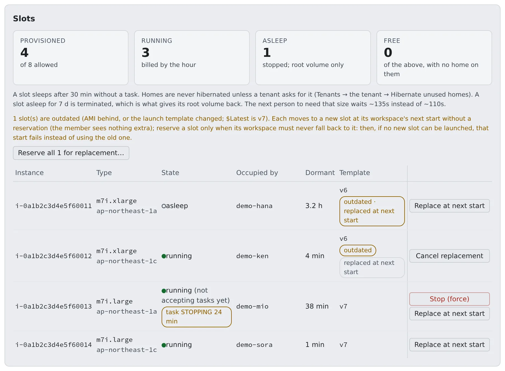

# Replace and stop slots

English | [日本語](slot-maintenance.ja.md)

This is for AWS `ecs-ec2` deployments only. Move workspaces off outdated slots onto new ones, and stop a slot that no longer answers.
On `ecs-ec2` a workspace runs on an EC2 slot taken from a pool, and its home is an EBS volume that stays attached to that slot while it is stopped. How to build the pool, and its parameters, are in [Start using the EC2 slot pool](slot-pool.md).

## How it works

| What you do | What happens |
|---|---|
| Nothing | An outdated slot moves to a new slot at the next start of the workspace whose home is on it. A free outdated slot is terminated by the sweeper |
| Press "**Replace at next start**" | The workspace on that slot always moves to a new slot at its next start, and never goes back to the old one |
| Press "**Stop (force)**" | The commands queued on a slot that does not answer are cancelled and the instance stops. The home stays on it |
| Watch the audit log for `pool.slot_dark_detected` | You notice a slot that does not answer before anyone starts on it |

The slots page is "**Admin**" → "**Slots**", and only super_admin can use it.



## Outdated slots

A slot reads its user data only when it is launched, and a stopped workspace goes back to the same slot on its next start. A change to the slot launch template (a release's security setting, for example) therefore does not reach the slots you already have. Replace them here instead of terminating instances by hand.

A slot is "**outdated**" in either of these cases. The tooltip gives the reason.

| Reason | Detail |
|---|---|
| AMI behind | Its AMI is not Amazon's current ECS-optimized AMI for its architecture |
| Template changed | The slot launch template changed in something other than its AMI |

- The Control Plane reads Amazon's public SSM parameters about every hour and launches every slot, x86_64 and arm64, with the current AMI. Slots follow Amazon's updates without a stack deploy
- The launch template version number alone does not decide. A version that only moved the AMI does not make an arm64 slot outdated
- If SSM cannot be read, launches use the last value read, or else the CloudFormation values. No slot is called outdated on an AMI the Control Plane does not know
- There is no grace period. The first new AMI makes every slot outdated at the first sweep
- A running workspace is never touched outside a start

### Automatic replacement

By default outdated slots are replaced automatically. The page shows "**outdated · replaced at next start**".

- When a workspace starts and its home is on an outdated slot, that start moves it to a new slot. The member's workspace bar shows nothing
- A free outdated slot is terminated by the sweeper
- If no new slot can be launched (capacity, quota), the start still succeeds on the old slot, and starts within the next 10 minutes stay on it without trying again
- Each automatic move is in the audit log as `pool.slot_replace_auto`
- To turn it off, set `AF_ECS_EC2_AUTO_REPLACE_OUTDATED_SLOTS=false` on the Control Plane

### Reserve slots yourself

Reserve a slot yourself when its workspace must never go back to it. A start that cannot launch a new slot then fails instead.

1. Open "**Admin**" → "**Slots**". The "**Template**" column shows the launch template version each slot was launched from
2. Reserve
   - To reserve them all, press "**Reserve all N for replacement…**". It lists the outdated slots and the workspace on each; check them and reserve
   - To reserve one, press "**Replace at next start**" on its row. A reserved row shows "**replaced at next start**"; "**Cancel replacement**" takes it back
3. Nothing happens to a running workspace. Its member sees "**Moves to a new slot**" in the workspace bar
4. The member's next stop and start launches a new slot with the current AMI and `$Latest`, moves the home onto it and terminates the old one. That start takes about 25 seconds longer than usual. Files, repositories and logins come along; the home is never deleted

Reservations and cancellations are in the audit log as `pool.slot_replace_reserve` / `pool.slot_replace_cancel`, with the workspace that moves.

| Symptom | Cause and fix |
|---|---|
| A reserved workspace's start fails with a reason | No new slot could be launched (capacity, quota). The reservation stays, and the workspace is never put back on the old slot. Retry later |
| A reserved slot is gone | The sweeper terminates a reserved slot with no workspace on it |

How to verify the result is in [Move slots onto new user data](#move-slots-onto-new-user-data).

## Move slots onto new user data

The workspace task adds `SYS_ADMIN` so Chromium's setuid `chrome-sandbox` can create its namespaces. The slot settings below go with it, and **each applies only to slots launched after the template carries it**. A slot launched earlier is not protected until it is replaced: a new launch template version, then the steps below.

| Setting | What it does | On an older slot |
|---|---|---|
| `user.max_user_namespaces=0` | No unprivileged user namespaces, so `SYS_ADMIN` stays reachable only through the setuid helper. Persisted in `/etc/sysctl.d/99-af-userns.conf` and applied before the ECS agent configures; the user data stops on failure, and an `ecs.service` drop-in refuses to start the ECS agent unless the value is 0, also after a reboot | The task keeps the default limit and can create user namespaces |
| The home volume mounted `nosuid,nodev` by `af-mount` | Setuid binaries and device files on the home do nothing | An already mounted home keeps its old options until it is unmounted and mounted again (a slot move does that) |
| `ECS_AWSVPC_BLOCK_IMDS=true` in the slot's `ecs.config` | Keeps a workspace task off the slot's instance profile (`SlotRole`) through IMDS. The launch template's hop limit does not, because an `awsvpc` task's ENI reaches IMDS directly | Stays open until the slot is replaced |

- `kernel.unprivileged_bpf_disabled` (1) and `kernel.perf_event_paranoid` (2) were already strict on AL2023 and are not set
- The task definition gains the capability on a workspace's next start (a new revision); no slot change is needed for that part
- The ECS agent reads `ecs.config` when the slot is launched. Nothing replaces a slot by itself, and a workspace **stop and start goes back to the same slot** (its home stays attached while stopped)
- Until then the Agent's own isolation still holds for every SDK that honours `AWS_EC2_METADATA_DISABLED`, but not for a tool that calls IMDS directly

To finish the move:

1. **Update the pool stack.** `update.sh` does it. By hand (parameters keep their previous values) it is the command below. The Control Plane launches slots from the template's `$Latest`, so only new slots change

   ```bash
   aws cloudformation deploy --stack-name <pool stack> --template-file cfn/40-ec2-pool.yaml \
     --capabilities CAPABILITY_NAMED_IAM
   ```

2. **Most slots need nothing: they are replaced by themselves** ([Automatic replacement](#automatic-replacement)). Reserve them when a workspace must never go back to its old slot ([Reserve slots yourself](#reserve-slots-yourself))
   - Each automatic move is in the audit log as `pool.slot_replace_auto` (actor `slot-auto-replace`), naming the workspace, the old version, `$Latest` and the new slot. A slot whose version cannot be read is left alone
   - To switch it off, for example while a new template is being validated, set `AF_ECS_EC2_AUTO_REPLACE_OUTDATED_SLOTS=false`. Reservations still work
   - A reservation is a tag on the instance (`af-slot-replace`). It moves nobody by itself and touches no running session
3. **Members stop and start their workspaces** when it suits them. The start launches a new slot of the workspace's class from `$Latest` first, moves the home off the old slot through the same release the sweeper uses (unmount before detach; refused while a task runs) and terminates the old instance
   - The home volume is never deleted
   - Do not terminate slot instances by hand while a home is attached
   - `Ec2SlotTerminateAfterSec` is not for this; it is a standing cost trade-off ([Three limits](slot-pool.md#three-limits))
4. **Verify from a shell in a workspace on a new slot**
   - The IMDSv2 token request must not answer `200` (it times out: `000`), also with a clean environment (`env -i`)

     ```bash
     curl -s -o /dev/null -m 3 -w '%{http_code}' -X PUT -H 'X-aws-ec2-metadata-token-ttl-seconds: 60' http://169.254.169.254/latest/api/token
     ```

   - `aws sts get-caller-identity` must fail with "Unable to locate credentials"
   - Slots still join the cluster and SSM still reaches them (the "**Slots**" page, a workspace start, the home mount), and the workspace's logs still arrive

## Protect the management agents from running out of memory

So that a workspace that eats all the memory does not leave a slot whose EC2 is healthy but whose agents no longer answer, the slot's user data gives the management processes a memory floor.

| Target | Floor |
|---|---|
| SSM agent | 192 MiB, systemd `MemoryMin` |
| docker | 256 MiB, systemd `MemoryMin` |
| containerd | 128 MiB, systemd `MemoryMin` |
| ECS agent | 192 MiB, `memory.min` on its scope, set by the helper service `af-protect-mgmt` |
| `system.slice` | 832 MiB in total, so the children's floors take effect |

- The ECS agent runs as a docker container, not as a child of `ecs.service`, so `af-protect-mgmt` looks for its scope. It re-applies every 30 seconds, so it follows an agent restart
- `af-protect-mgmt` also lowers the OOM score of the ECS and SSM agents, including an SSM agent already running at first boot
- When memory runs short, the kernel reclaims the workspace containers' pages first
- The total fits inside the host reserve (`AF_ECS_EC2_HOST_RESERVE_MB`, 2 GiB under the default `auto`). A reserve below 832 MiB makes the protected amount exceed the reserve
- It assumes cgroup v2 (the Amazon Linux 2023 default)

This is a launch template change. It reaches existing slots only through the replacement in [Outdated slots](#outdated-slots).

## Stop a slot that does not answer

A slot can stop answering: the EC2 instance is running and its status checks are `ok`, but its ECS agent is not connected, SSM does not answer, and a member's home is still attached. That member's starts then wait or keep failing.

The page shows such a row with "**(not accepting tasks yet)**" and offers "**Stop (force)**".

**Update the `20-platform` stack first.** The Control Plane role needs `ssm:ListCommands`, `ssm:CancelCommand` and `ssm:DescribeInstanceInformation` (statement `SsmSlotForceStop` in `20-platform`). Without them the health check fails with AccessDenied and the action cannot run.

1. Press "**Stop (force)**" on the row. The confirmation names the workspace on the slot; check it and stop
2. The Control Plane ends the member's start on that slot (their workspace reads as stopped), cancels the commands it queued and stops the instance. A pending umount or mount is what holds the home's lock
3. The result (commands cancelled, whether Force was used) appears on the page. The audit log records `pool.slot_force_stop` with the workspace, both health signals and the counts
4. Wait for the row to show "**asleep**". The member's next start wakes this same slot through the ordinary path. The reboot clears what was stuck, and the ECS agent reconnects

**The slot is not quarantined, and the home stays on it.** Keeping an instance as evidence is what quarantine is for, and a slot that does not answer is never quarantined automatically.

### How the stop proceeds

- It sends a normal shutdown first, so the kernel can unmount the home. If the instance has not stopped after 3 minutes, the Control Plane sends it again with Force. Pressing the button again while it is stopping forces it at once. A timer never acts on an instance started again since
- If ECS still has a task network interface (ENI) on the slot, the Control Plane first force-deregisters the slot's container instance and waits for the interface to go. The container instance registers again when the instance restarts
- An instance stopped with a task ENI attached comes back with two interfaces and no automatically assigned public IPv4. On a public subnet it has no egress and its agent cannot reconnect, so the ENI goes first. A slot with no task ENI is not deregistered
- The whole action is held to about 50 seconds, so the reply arrives before the 60-second ingress timeout. The ENI wait gets at most 30 of them

### When it is refused

| Code | Meaning and fix |
|---|---|
| `slot_healthy` | The ECS agent is connected **and** SSM is online. The action is for slots that do not answer. The API has an explicit override for stopping a healthy slot, which the Console never sends; it also stops a workspace running on that slot |
| `slot_not_running` | The slot is already stopped |
| `slot_quarantined` | The slot is quarantined |
| `slot_task_eni_held` | The task ENI did not go in time. The instance keeps running. Wait a minute and press again |
| `slot_started_again` | The member started the workspace again meanwhile. The slot is theirs, so nothing more is done to it |

### After the stop

| Symptom | Cause and fix |
|---|---|
| The workspace stays on "starting" | A start made while the instance is still stopping gives up waiting after about two minutes and stays on "starting" until its claim expires. Stop the workspace and start it again |
| The row shows "**task STOPPING N min**" | The agent could not report a stop, so ECS keeps the previous task as `STOPPING`. The service allows one task at a time, so the next start waits for it. Once the instance runs again its agent reports the stop; the member's next start after a force-stop does that, or you can start the instance from the EC2 console. The Control Plane does not do it on its own |

## Notice a slot that does not answer

The Control Plane's sweeper looks for slots that do not answer before anyone starts a workspace on them. It **only reports**: it never stops, deregisters or quarantines the slot. Stopping it is "**Stop (force)**".

A slot is considered dark when all of these hold:

- It holds a home, and no start is in flight
- EC2 says `running`, but its ECS agent is disconnected (or the instance is not registered)
- SSM does not report it `Online`
- It was launched or started more than `AF_ECS_EC2_DARK_BOOT_GRACE_SEC` (300 seconds by default) ago

| Stage | What happens |
|---|---|
| The first sweep that sees it dark | Tags the instance `af-dark-since` |
| A sweep that finds either agent healthy | Removes the tag. A stop and start of the instance voids it too |
| Dark for `AF_ECS_EC2_DARK_AFTER_SEC` (600 seconds by default) | Writes one log line and one `pool.slot_dark_detected` audit row |

- `AF_ECS_EC2_DARK_AFTER_SEC` is raised to at least the larger of the boot grace and `AF_ECS_EC2_SLOT_LOST_AFTER_SEC` plus the sweep interval. `0` turns the scan off
- `AF_ECS_EC2_DARK_SLOT_ACTION` is `detect` (the default) or `off`. `rescue` and `quarantine` are reserved for later and currently behave as `detect`
- Watch the audit log for a slot recorded as dark that was in fact healthy (an agent restart, a long stall). That tells you whether the thresholds are safe
- The Slots table shows a badge "**dark N min · observing**" on the state cell of a running slot with an `af-dark-since` stamp for its current launch. N counts from the first dark observation, the tooltip gives the time, and an agent coming back or a stop and start removes it. The pool API carries it as `dark_since` and `rung`. `rung` is `observing` today; `rescuing`, `blocked`, `rescued` and `quarantined` are reserved for the later rungs. The badge can appear sooner than `pool.slot_dark_detected`, which is written only after `AF_ECS_EC2_DARK_AFTER_SEC`
- The audit log shows `pool.slot_dark_detected` and the reserved `pool.slot_dark_rescued`, `pool.slot_dark_blocked` and `pool.slot_dark_quarantined` with a one-line explanation as a tooltip

## Related

- [Upgrade](../run/upgrade.md)
- [Use idle stop and force-stop](../run/idle-stop.md)
- [Start using the EC2 slot pool](slot-pool.md)
- [Troubleshoot the slot pool](slot-troubleshooting.md)
