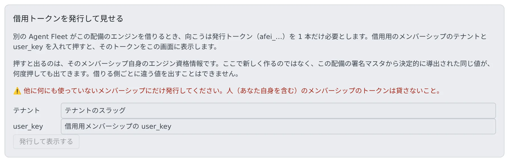

# 別のデプロイのエンジンを借りる

[English](borrow.md) | 日本語

自分のホストで動く配備（`compose` / `native` / `docker`）から、AWS で動く別の Agent Fleet の GPU エンジン（チャットの `llm`、画像の `image`）を使わせます。
借りたモデルは、この配備のモデルと同じ場所に出ます。セッションからは区別がつきません。

## 全体像

| あなたがやること | 起きること |
|---|---|
| 貸す側で、借用専用のメンバーシップを作り、そのトークンを発行する | 推論エンジンの 2 つの経路だけを開くトークン（`afei_…`）が出る |
| 借りる側で、`AF_REMOTE_ENGINE_URL` と `AF_REMOTE_ENGINE_TOKEN` を設定して Control Plane を再起動する | 借りる側が貸す側のカタログを 2 分ごとに読み、エンジンの行を作る |
| モデルの登録や有効化は、貸す側の管理画面で行う | 変更は約 2 分で借りる側に届く。セッションの再起動はいらない |
| 借用をやめるときは、貸す側でそのメンバーシップを削除する | 次の要求から 401 で断られる |

GPU が必要だと判断し、インスタンスを買い、手放すのは貸す側です。借りる側は中継するだけです。
貸す側に新しいコードを置く必要も、ポートを開ける必要も、VPN もいりません。

できないこと:

- 借りる側から、貸す側のエンジンを起動・停止したり、モデルの一覧を変えたりすること
- 音声（VOICEVOX）を借りること
- 逆向き（AWS の配備が自宅のエンジンを借りる）

> 実在する 2 つの配備の組では確かめていません。コードは貸す側の代役に対して試験したものです。

## 貸す側でトークンを発行する

貸す側の配備管理者が行います。

1. 貸す側の配備に、**借用のためだけのメンバーシップ**を 1 つ招きます。ワークスペースはいりません。
2. 管理 → 「**推論エンジン**」のいちばん下にある「**借用トークンを発行して見せる**」を開きます。
3. 「**テナント**」と、借用用のメンバーシップの「**user_key**」を入れ、「**発行して表示する**」を押します。

画面には、トークン、借りる側で設定する環境変数、そのトークンが開ける経路、失効のしかたが出ます。「**AF_REMOTE_ENGINE_TOKEN= の形でコピー**」で、借りる側に貼る形のままコピーできます。
値は数分で画面から消えます。同じ値は、もう一度押せばまた出ます。

**人のメンバーシップのトークンを貸さないでください。自分のものも含みます。**

- トークンは署名マスタから決まる値で、何度押しても同じです。1 本だけ無効にする方法はありません
- ほかの失効の方法は署名マスタの回転だけです。git・メモ・スケジュールのトークンも同じマスタから作られているので、回すと配備の全員がログアウトします
- ワークスペースのあるメンバーシップを選ぶと、画面に警告が出ます

トークンが開くのは、「セッション用のエンジントークンを受け取る」経路と「どのエンジンがあるかを読む」経路の 2 つだけです。git・MCP・メモ・API は開きません。

| 応答 | 意味 |
|---|---|
| `404` | テナントか user_key が違う。古い版の配備で、この経路自体がないこともある |
| `409` | そのメンバーシップが有効でない |

古い版の配備でこの画面がないときは、借用用のメンバーとして 1 度サインインし、そのワークスペースのコンテナの環境から `AF_ENGINE_ISSUE_TOKEN` を読み、ワークスペースを停止します。
メンバーは、貸す側のサインイン方式で実際に認証できるアドレスで招きます。

## 借りる側で設定する

Control Plane が起動のときに 1 回だけ読みます。変えたら Control Plane を再起動します。

| 変数 | 意味 |
|---|---|
| `AF_REMOTE_ENGINE_URL` | 貸す側のベース URL。パスは付けません（例: `https://af.example.com`）。設定すると借用が始まります |
| `AF_REMOTE_ENGINE_TOKEN` | 貸す側で発行した `afei_…` のトークン |
| `AF_REMOTE_ENGINE_KEYS` | 任意。借りる役をカンマ区切りで書きます（例: `image`）。空なら、貸す側が出している役をすべて借ります |

URL とトークンは両方そろったときだけ借ります。片方だけなら何も借りず、起動時のログにどちらが欠けているかが出ます。

| 形態 | 置き場所 |
|---|---|
| compose / docker | compose ファイルの隣の `.env`（[compose の手順書](../../../deploy/compose/README.md)） |
| native | `af start` の環境、または systemd unit の `Environment=`（[native の手順書](../../../deploy/native/README.md#borrowing-another-deployments-engines--optional)） |

トークンはほかの `AF_*` の秘密と同じ場所に置きます。シェルの履歴やチケットには書かないでください。

**`AF_COMFY_URL` を貸す側の画像の経路（`https://…/engine/image/v1`）に向けないでください。**
その行は借りる側からヘルスチェックされ、その検査が貸す側で GPU のインスタンスを買わせます。検査は 5 秒で諦め、冷間起動は分の単位なので、毎回お金がかかったうえで失敗します。

### 行が現れるタイミング

どのエンジンがあり、どの API を話し、どのモデルを出すかは、すべて貸す側のカタログから読みます。借りる側では宣言しません。

- カタログは起動のときと、その後 2 分ごとに読みます。借りた役は、最初に読めたときに現れます
- 起動のときに貸す側へ届かないと、そのモデルは起動メニューに出ません。次の読み込みで自然に戻ります
- 読み込みに失敗したときは、前回の答えを使い続けます
- この配備がすでに持っている役は借りません。ローカルの `image` 行があれば、貸す側の `image` は無視されます

## 借りた役でできること・できないこと

推論エンジンの画面では、借りた役は「**（借用: 別のフリートが起動します）**」として、「**借用元**」の URL と一緒に出ます。
モデルの情報は、貸す側のカタログを写した読み取り専用のものです。

| 操作 | 借りる側 |
|---|---|
| オン / オフ | できます。オフはこの配備の経路を閉じるだけで、貸す側のインスタンスには何もしません |
| オンデマンド | できません。手放すインスタンスがないためです |
| モデルの有効・無効、既定の指定、登録、削除、取り込み | できません。`400 engine_not_ours` で断られます。貸す側の管理画面で行います |
| 「全画像から除外する語」の編集 | できません。貸す側で行います |

### 貸す側が役をオフにしたとき

貸す側がその役をオフにするか、有効なモデルをすべて外すと、借りる側にはモデルが 0 の役として届きます。

- 行はパネルに残り、モデルがない状態で出ます
- 要求は `503 engine_unavailable`（有効なモデルがない）で断られます
- 起動メニューからそのモデルが消えます

貸す側が戻せば、約 2 分で使えるようになります。

## 最初の要求が待つ時間

借りたエンジンは、たいてい止まっています。貸す側は要求が来てから GPU のインスタンスを買うので、最初の 1 本が冷間起動をまるごと待ちます。
貸す側が自分の要求で測った冷間起動は、`llm` が約 527 秒、`image` が約 165 秒でした（1 回の観測）。借りた場合はこれより長くなるので、分の単位を見込んでください。

| 要求 | 待ち方 |
|---|---|
| チャット（ストリーミング） | 接続を保ったまま、10 秒ごとに heartbeat を送ります。上限は `AF_ENGINE_WAKE_TIMEOUT`（既定 900 秒） |
| それ以外（非ストリーミング） | 貸す側が約 45 秒待ってから `503 engine_waking` を `Retry-After` 付きで返し、借りる側はそれをそのまま中継します。借りる側は借りた行を 75 秒まで待ちます |

- 借りる側が先に待ちきれなくなっても、答えは `engine_waking` です。画像のツールは `engine_waking` なら最長 16 分まで問い合わせ続けます。`engine_unavailable` は再試行しません
- `AF_ENGINE_PLAIN_HOLD` で待つ時間を変えられますが、この配備のすべての行に効きます。`ecs-ec2` では、上げるとロードバランサで 504 が返るようになります。理由がない限り変えないでください

## パネルに出るもの・出ないもの

| 項目 | 表示 |
|---|---|
| warm | 貸す側が自分のエンジンについて最後に見たものを、カタログのまま出します。借りる側は借りたエンジンを確かめに行きません。確かめに行くと、貸す側でインスタンスを買わせてしまうからです |
| 状態・希望台数・インスタンス・いつ止まるか・アイドル時間 | 出ません |
| 稼働の履歴 | 出ません |
| 次の冷間起動の見積もり | 0 と出ます |
| 費用 | 借りる側のクラウド費用には出ません。インスタンスの費用は貸す側が払います |

## 使用量がどこに記録されるか

| 役 | 借りる側 | 貸す側 |
|---|---|---|
| チャット（`llm`） | 頼んだメンバーの使用量に書きます | 届け先のワークスペースがないので、運用者向けに保管します（下記） |
| 画像（`image`） | トークン数がないので、エンジンの使用量には出ません。画像のツールが枚数で記録します | エンジンの使用量には出ません |

### 貸す側で、誰が使ったかを見る

貸す側の配備管理者は、`GET /api/admin/engines/<key>/attribution`（`from` と `to` の日付で絞れます）で読みます。Console の画面はまだありません。

| 項目 | 内容 |
|---|---|
| `memberships` | メンバーシップごと・時間ごとの要求数・成功数・ミリ秒・トークン数。両方の役について出ます。要求は受け付けた時点で数えるので、GPU を買ったうえで失敗した要求も入ります（失敗数は `requests` − `ok_requests`） |
| `undelivered` | 届けられなかったチャットの使用量の行。借りたセッションの名前（借りる側の申告）と理由が付きます。借用では `no_workspace` がふつうです |

- 保管した行は、あとから誰かの使用量に移ることはありません。使用量のグラフにも出ません
- どちらも 92 日で消えます
- インスタンスの費用は、貸す側の監査ログの `engine.<key>.offer`（買うたびに 1 行、実際のインスタンスの型と時間単価）にあります

## 困ったとき

まず借りる側の Control Plane のログを見ます。現れなかった借用の行は、ほかのどこにも見えません。

| ログの行 | 意味 |
|---|---|
| `borrowing is declared but … is unset` | URL とトークンの片方しか設定されていない。何も借りていない |
| `is borrowed from …` | 役を借りられた |
| `reading the borrowed catalogue from … failed` | 貸す側に届かないか、断られた。状態コードが同じ行にある |
| `is already served by a … row` | ローカルの行がその役を持っているので、借りていない |
| `declares lifecycle "remote" but AF_REMOTE_ENGINE_URL / AF_REMOTE_ENGINE_TOKEN are unset` | 手で書いた表の行に借りる先がない。その役は出ない |

| 症状 | 意味 |
|---|---|
| カタログのログ行に `401` | 貸す側でメンバーシップが削除されたか、トークンが違う |
| `400 engine_not_ours` | 借りた役を借りる側の画面で変えようとした。貸す側で行う |
| `503 engine_unavailable`（有効なモデルがない） | 貸す側がその役をオフにしたか、有効なモデルがない |
| `503 engine_waking` | 冷間起動中。正常です。`Retry-After` があり、画像のツールは問い合わせ続けます |

## 関連

- [自前の ComfyUI で画像を生成する](comfyui.ja.md)
- [LAN の llama.cpp でチャットする](llama-cpp.ja.md)：借りていた `llm` を LAN の llama.cpp に切り替える
- [自前の GPU で推論エンジンを動かす](gpu.ja.md)：貸す側の推論エンジンの画面
- [配備形態](../../ref/deploy-targets.ja.md)
