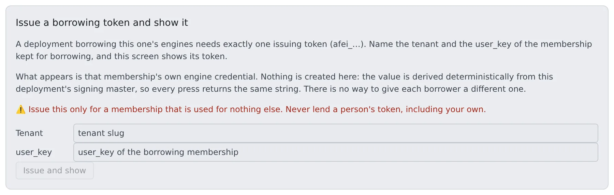

# Borrow another deployment's engines

English | [日本語](borrow.ja.md)

Let a deployment on your own host (`compose` / `native` / `docker`) use the GPU engines of another Agent Fleet on AWS: chat (`llm`) and images (`image`).
Borrowed models appear where this deployment's own models do. Sessions cannot tell the difference.

## How it works

| What you do | What happens |
|---|---|
| On the lending side, create a membership for borrowing only and issue its token | A token (`afei_…`) appears that opens just two engine routes |
| On the borrowing side, set `AF_REMOTE_ENGINE_URL` and `AF_REMOTE_ENGINE_TOKEN` and restart the Control Plane | The borrowing side reads the lender's catalogue every 2 minutes and makes engine rows from it |
| Register and enable models on the lending side's Admin screen | The change reaches the borrowing side in about 2 minutes. Sessions need no restart |
| To stop borrowing, delete that membership on the lending side | The next request is refused with 401 |

The lending side decides a GPU is needed, buys the instance and lets it go. The borrowing side only relays.
Nothing new is installed on the lending side, and no port, VPN or workspace change is needed.

What you cannot do:

- Start or stop the lender's engines, or change its model list, from the borrowing side
- Borrow speech (VOICEVOX)
- The reverse (an AWS deployment borrowing an engine at home)

> This has not been run between two real deployments. The code was tested against a stand-in for the lending side.

## Issue the token on the lending side

The lending side's deployment administrator does this.

1. Invite one membership **used for borrowing only** to the lending deployment. It needs no workspace.
2. Open "**Issue a borrowing token and show it**" at the bottom of Admin → "**Inference engines**".
3. Enter the "**Tenant**" and the "**user_key**" of the borrowing membership, and press "**Issue and show**".



The screen shows the token, the variable to set on the borrowing side, the routes the token opens and how to revoke it. "**Copy as AF_REMOTE_ENGINE_TOKEN=**" copies it ready to paste on the borrowing side.
The value leaves the screen after a few minutes. Pressing again shows the same value.

**Never lend a person's membership token, including your own.**

- The token is derived from the signing master, so every press returns the same one. There is no way to revoke just one
- The only other way to revoke it is to rotate the signing master. The git, memo and schedule tokens come from the same master, so rotating it logs out everyone on the deployment
- Choosing a membership that has a workspace shows a warning

The token opens two routes only: "receive an engine token for a session" and "read which engines exist". It opens no git, MCP, memo or API.

| Answer | Meaning |
|---|---|
| `404` | The tenant or user_key is wrong. On an older deployment, the route itself may be missing |
| `409` | That membership is not active |

On an older deployment without this screen, sign in once as the borrowing member, read `AF_ENGINE_ISSUE_TOKEN` from that workspace container's environment, and stop the workspace.
Invite the member at an address the lending side's sign-in method can actually authenticate.

## Set up the borrowing side

The Control Plane reads these once at start. Restart the Control Plane after changing them.

| Variable | Meaning |
|---|---|
| `AF_REMOTE_ENGINE_URL` | The lending side's base URL, without a path (for example `https://af.example.com`). Setting it starts borrowing |
| `AF_REMOTE_ENGINE_TOKEN` | The `afei_…` token issued on the lending side |
| `AF_REMOTE_ENGINE_KEYS` | Optional. The roles to borrow, comma-separated (for example `image`). Empty borrows every role the lender offers |

Borrowing happens only when both the URL and the token are set. With one of them, nothing is borrowed and the start-up log says which is missing.

| Target | Where it goes |
|---|---|
| compose / docker | `.env` next to the compose file ([Deploy with Docker Compose](../compose/install.md)) |
| native | The environment of `af start`, or `Environment=` in the systemd unit ([Run it as a systemd service](../native/service.md)) |

On native, for example, start it like this. All three are read once at startup, so changing one is a restart.

```bash
AF_REMOTE_ENGINE_URL=https://af.example.com \
AF_REMOTE_ENGINE_TOKEN=afei_... \
  af start
```

Keep the token where the other `AF_*` secrets live, never in shell history or a ticket.

**Do not point `AF_COMFY_URL` at the lender's image route (`https://…/engine/image/v1`).**
That row is health-checked from the borrowing side, and the check makes the lender buy a GPU instance. The check gives up after 5 seconds while a cold start takes minutes, so every check costs money and fails.

### When the rows appear

Which engines exist, which API each speaks and which models it offers are all read from the lender's catalogue. Nothing is declared on the borrowing side.

- The catalogue is read at start and every 2 minutes after. A borrowed role appears at the first successful read
- If the lender cannot be reached at start, its models are missing from the launch menu. The next read brings them back
- When a read fails, the previous answer is kept
- A role this deployment already serves is not borrowed. With a local `image` row, the lender's `image` is ignored

## What you can and cannot do with a borrowed role

On the Inference engines screen a borrowed role appears as "**(borrowed: another fleet starts it)**", with its "**Borrowed from**" URL.
Its model information is a read-only copy of the lender's catalogue.

| Action | On the borrowing side |
|---|---|
| On / off | Yes. Off only closes this deployment's route and does nothing to the lender's instances |
| On-demand | No. There is no instance here to let go |
| Enabling or disabling, default, registering, deleting or taking in a model | No. Refused with `400 engine_not_ours`. Do it on the lending side's Admin screen |
| Editing "excluded from every image" | No. Do it on the lending side |

### When the lender switches a role off

When the lender switches the role off or disables its last model, the borrowing side receives a role with no models.

- The row stays in the panel, shown without models
- Requests are refused with `503 engine_unavailable` (no enabled model)
- Its models leave the launch menu

When the lender turns it back on, it works again within about 2 minutes.

## How long the first request waits

A borrowed engine is usually stopped. The lender buys a GPU instance only when a request comes, so the first request waits for the whole cold start.
Measured by the lender on its own requests, a cold start took about 527 seconds for `llm` and about 165 seconds for `image` (one observation). Borrowed, it is longer, so expect minutes.

| Request | How it waits |
|---|---|
| Chat (streaming) | The connection is kept open with a heartbeat every 10 seconds, up to `AF_ENGINE_WAKE_TIMEOUT` (default 900 seconds) |
| Anything else (non-streaming) | The lender waits about 45 seconds and answers `503 engine_waking` with `Retry-After`, which the borrowing side relays as is. The borrowing side waits up to 75 seconds on a borrowed row |

- Even when the borrowing side gives up first, the answer is `engine_waking`. The image tool keeps asking for up to 16 minutes on `engine_waking`, and never retries `engine_unavailable`
- `AF_ENGINE_PLAIN_HOLD` changes the wait, but for every row of this deployment. On `ecs-ec2`, raising it makes the load balancer answer 504. Leave it alone unless you have a reason

## What the panel shows and does not show

| Item | Shown |
|---|---|
| warm | What the lender last saw of its own engine, as its catalogue reports it. The borrowing side never checks a borrowed engine itself: a check would make the lender buy an instance |
| State, desired count, instance, when it stops, idle window | Not shown |
| History | Not shown |
| Next cold-start estimate | Shown as 0 |
| Cost | Nothing in the borrowing side's cloud cost. The lender pays for the instances |

## Where usage is recorded

| Role | Borrowing side | Lending side |
|---|---|---|
| Chat (`llm`) | Written to the usage of the member who asked | There is no workspace to deliver it to, so it is kept for the operator (below) |
| Image (`image`) | Not in engine usage, since there are no token counts. The image tool records it by image count | Not in engine usage |

### See who used it, on the lending side

The lending side's deployment administrator reads `GET /api/admin/engines/<key>/attribution` (filter with the dates `from` and `to`). There is no Console screen for it yet.

| Field | Contents |
|---|---|
| `memberships` | Requests, successes, milliseconds and tokens per membership per hour, for both roles. A request is counted when accepted, so requests that bought a GPU and then failed are included (failures are `requests` − `ok_requests`) |
| `undelivered` | Chat usage rows that could not be delivered, with the borrowing session's name (as the borrower reports it) and the reason. `no_workspace` is the usual one for borrowing |

- The kept rows are never moved into anyone's usage later, and do not appear in the usage charts
- Both are removed after 92 days
- The instance cost is in the lender's audit log as `engine.<key>.offer` (one row per purchase, with the actual instance type and hourly price)

## When it goes wrong

Look at the borrowing side's Control Plane log first. A borrowed row that never appeared shows nowhere else.

| Log line | Meaning |
|---|---|
| `borrowing is declared but … is unset` | Only one of URL and token is set. Nothing is borrowed |
| `is borrowed from …` | The role was borrowed |
| `reading the borrowed catalogue from … failed` | The lender could not be reached, or refused. The status code is on the same line |
| `is already served by a … row` | A local row holds the role, so it is not borrowed |
| `declares lifecycle "remote" but AF_REMOTE_ENGINE_URL / AF_REMOTE_ENGINE_TOKEN are unset` | A hand-written table row has nothing to borrow from. The role is not served |

| Symptom | Meaning |
|---|---|
| `401` on the catalogue log line | The membership was deleted on the lending side, or the token is wrong |
| `400 engine_not_ours` | Someone changed a borrowed role on the borrowing side's screen. Do it on the lending side |
| `503 engine_unavailable` (no enabled model) | The lender switched the role off, or it has no enabled model |
| `503 engine_waking` | A cold start in progress. This is normal. It carries `Retry-After`, and the image tool keeps asking |

## Related

- [Generate images on your own ComfyUI](comfyui.md)
- [Chat on a llama.cpp on your LAN](llama-cpp.md): switch a borrowed `llm` to a llama.cpp on the LAN
- [Run inference engines on your own GPUs](gpu.md): the lending side's Inference engines screen
- [Deployment targets](../../ref/deploy-targets.md)
