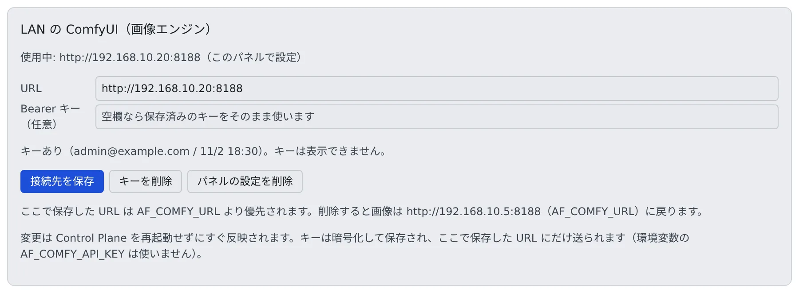

# 自前の ComfyUI で画像を生成する

[English](comfyui.md) | 日本語

自分のネットワークで動いている ComfyUI を、`compose` / `native` / `docker` の配備から画像エンジンとして使わせます。
セッションは Control Plane を通して使うので、ComfyUI の場所も鍵も知りません。

## 全体像

| あなたがやること | 起きること |
|---|---|
| GPU のあるマシンで ComfyUI を動かす（フリートと同じイメージを `comfyui-lan.sh` で起動できる） | ComfyUI がポートで待ち受ける |
| 管理 → 推論エンジンのパネル、または `AF_COMFY_URL` に URL と鍵を入れる | Control Plane が画像エンジンの行を 1 本作り、セッションの画像生成をそこへ中継する |
| 推論エンジンの画面でモデルを手で登録する | メンバーとエージェントがそのモデルで画像を生成できる |
| ComfyUI に Control Plane 以外が届かないようにする | セッションが Control Plane を迂回して ComfyUI を直接使うことを防ぐ |

ComfyUI はあなたのもののままです。Control Plane は起動も停止もせず、費用も付けません。
AWS で別の Agent Fleet を運用しているなら、そちらのエンジンを借りることもできます（[別のデプロイのエンジンを借りる](borrow.ja.md)）。

> `comfyui-lan.sh` の docker の操作は代役に対して試験したもので、実際の GPU マシンでは確かめていません。OpenAI 互換の画像サーバーの行も、試験用の偽サーバーでしか試していません。

## フリートのイメージを GPU マシンで動かす

ComfyUI がまだないなら、`deploy/comfyui-lan/comfyui-lan.sh` で、`ecs-ec2` の画像エンジンと同じ版の ComfyUI イメージ（`ghcr.io/k-k1/agent-fleet/comfyui`）を起動できます。
セッションが送るワークフローは、この版で試験されています。

マシンに必要なもの:

- x86_64 の Linux（イメージは amd64 だけ）と Docker Engine
- NVIDIA のドライバ（`nvidia-smi -L` が GPU を列挙する）と [NVIDIA Container Toolkit](https://docs.nvidia.com/datacenter/cloud-native/container-toolkit/latest/install-guide.html)
- このリポジトリの clone、または `deploy/comfyui-lan/` と `deploy/aws/ecs/cfn/60-engines.yaml`（イメージのタグをここから読みます）

欠けているものがあれば、スクリプトは何も変えずに止まり、何が足りないかを表示します。
`up` の主なオプションは次のとおりです。すべてのオプションと、対応する `AF_COMFY_LAN_*` の環境変数は `comfyui-lan.sh --help` にあります。

| オプション | 決めること |
|---|---|
| `--models <dir>` | ComfyUI の `models/` として読み取り専用でマウントするフォルダ。種類のフォルダ（`checkpoints/`・`diffusion_models/`・`clip/`・`text_encoders/`・`vae/`・`loras/`）はなければ作ります。ファイルはダウンロードしません |
| `--bind <addr>` | ポートを公開するアドレス。既定は `127.0.0.1` で、Control Plane が同じマシンにあるときだけ使えます。別のマシンなら LAN のアドレスを渡します。`0.0.0.0` は `--all-interfaces` を付けたときだけ受け付けます |
| `--port <n>` | 公開するポート。既定は `8188` です |
| `--api-key-file <file>` | bearer を確かめる proxy（Caddy）を ComfyUI の前に置き、ComfyUI 自体は公開しません。ファイルには 24 文字以上の鍵を 1 つ書き、所有者だけが読めるようにします |
| `--pull` / `--digest sha256:…` / `--build` | イメージを取り直す、digest で固定する、取る代わりにマシンの上でビルドする |

ほかのコマンド:

- `comfyui-lan.sh status`：コンテナの状態とヘルス（`/system_stats`）を見る
- `comfyui-lan.sh down`：コンテナを消す。モデルとイメージは残る

知っておくこと:

- 同じ引数の `up` は何も変えません。何度実行しても安全です。コンテナを作り直すのはイメージか設定が変わったときだけです
- 配備を上げたら、`git pull` してから同じ `up` を実行します。新しいタグを取ってコンテナを作り直します
- スクリプトは自分が作ったものにラベルを付け、ラベルのない同じ名前のコンテナやネットワークがあれば置き換えずに止まります
- ComfyUI が書き出した画像はコンテナの中にあり、作り直すと消えます
- コンテナは docker と一緒に再起動します（`--restart unless-stopped`）

自分で立てた ComfyUI を使うときは、`--listen` を付けて起動し（付けないと loopback にしか応答しません）、Control Plane のマシンからそのポートへの着信をファイアウォールで許可します。
Windows の ComfyUI Desktop で `--listen` にあたる設定は確かめていません。

## Control Plane に ComfyUI の場所を教える

方法は 2 つあり、どちらか 1 つで足ります。

### 管理画面から

再起動はいりません。

1. 配備管理者として **管理** → 「**推論エンジン**」を開きます。
2. 先頭の「**LAN の ComfyUI（画像エンジン）**」に、**URL** と「**Bearer キー（任意）**」を入れます。
3. 「**接続先を保存**」を押します。すぐに反映され、セッションにも伝わります。



- キーは暗号化して保存され、あとから読めません。パネルにはキーの有無だけが出ます。消すときは「**キーを削除**」を押します
- URL は `http://` か `https://` で、ユーザー名やパスワードを含めることはできません。Bearer はキーの欄に入れます
- パネルに保存した URL には、パネルのキーだけを送ります。キーがなければ `Authorization` ヘッダーは付けません
- 保存した URL が別のスキーム・ホスト・ポートへリダイレクトすると、Control Plane は従わずに拒否します

### 環境変数から

Control Plane が起動のときに 1 回だけ読みます。変えたら Control Plane を再起動します。

| 変数 | 意味 |
|---|---|
| `AF_COMFY_URL` | ポートまで含めた URL を、Control Plane から見た形で書きます（例: `http://192.168.1.20:8188`）。設定すると画像エンジンの行ができます |
| `AF_COMFY_API_KEY` | 任意。`Authorization: Bearer` として送ります。生成の要求にもヘルスチェックにも付きます |

| 形態 | 置き場所 |
|---|---|
| compose / docker | compose ファイルの隣の `.env` |
| native | `af start` の環境、または systemd unit の `Environment=`（[systemd でサービスとして動かす](../native/service.ja.md)）。例: `AF_COMFY_URL=http://<host>:8188 af start` |

### どの設定が使われるか

画像の役は、上にあるものほど優先です。いまどれが使われているかと、パネルの設定を削除したら何に戻るかは、パネルに出ます。

| 順 | 出どころ | パネルの表示 |
|---|---|---|
| 1 | エンジンスタックが管理する `image` の行（AWS） | 入力欄は出ません。LAN の ComfyUI を使うには、スタックからこの役割を外します |
| 2 | パネルに保存した URL | 「使用中: …（このパネルで設定）」 |
| 3 | `AF_COMFY_URL` | 「使用中: …（Control Plane の環境変数 AF_COMFY_URL）」 |
| 4 | エンジン表の外部の行、または別の Agent Fleet から借りたエンジン | 「使用中: …（この配備のエンジン表）」など |

「**パネルの設定を削除**」は、画像生成を止める操作ではありません。押すと、この順で次にあるものがすぐに引き継ぎます。
画像生成を止めるには、推論エンジンの画面でエンジンを**オフ**にします。

## 画像エンジンを複数並べる

画像エンジンはどれも、エンジン表の 1 行です。`AF_COMFY_URL` は、鍵 `image` の行を 1 本書く近道です。
それ以外の行は、`compose` / `native` / `docker` なら Control Plane が起動のときに読む `AF_ENGINES_JSON` に書きます（行の形は下の例）。

```bash
AF_ENGINES_JSON='{"engines":[
  {"key":"comfy-lan","api":"images","provider":"comfy",
   "url":"http://192.168.1.20:8188","health":"/system_stats","lifecycle":"external"},
  {"key":"oai-image","api":"images","provider":"openai-compat",
   "url":"http://192.168.1.21:8000","health":"/v1/models","lifecycle":"external"}
]}' af start
```

- 1 つの JSON の文書で、`engines` の配列を持ちます。上の変数と同じく、起動のときに 1 回だけ読みます

| やりたいこと | 書き方 |
|---|---|
| 借りた `image` の横に LAN の ComfyUI を置く | `AF_COMFY_URL` ではなく、表に `comfy-lan` のような自分の鍵で行を書く。同じ鍵の役は借りません |
| OpenAI 互換の画像サーバーを使う | `external` の行に `provider: "openai-compat"` を書く。モデルの重みはサーバー側にあり、宣言するファイルはありません |
| 行ごとの bearer を渡す | `AF_ENGINE_API_KEY_<KEY>` に書く。`<KEY>` は行の鍵を大文字にし、英数字以外を `_` にしたもの（鍵 `oai-image` なら `AF_ENGINE_API_KEY_OAI_IMAGE`） |

- どのエンジンを先に使うかはメンバーが決めます。設定 → エージェントの「**画像生成の優先順位**」に、エンジンがそれぞれの名前で並びます。失敗すると次のエンジンへ移ります（[セッションに画像を作らせる](../../user/images/from-session.ja.md)）
- `generate_image` の `provider` に行の鍵を渡すと、そのエンジンだけを使います。失敗しても次へは移りません
- Control Plane が使える provider は `comfy` と `openai-compat` です。それ以外の provider の行には、推論エンジンの画面で印が付き、名乗っている provider 名が出ます。行を向け直してください

## オンとオフ

推論エンジンの画面では、この種のエンジンは「**外部管理**」として出ます。モードはオンとオフの 2 つだけで、オンデマンドはありません。

- オフは経路を閉じるだけです。セッションにエンジンが出なくなりますが、ComfyUI は動き続けます。止めるときは、そのマシンで止めます
- 状態・希望台数・インスタンス・いつ止まるかの欄は出ません。配備はそれを知らないからです

## モデルを登録する

ファイルを取り込む仕組みはありません。モデルの一覧は、あなたが書く宣言です。推論エンジンの画面で、モデルごとに次を登録します（登録の画面は [推論エンジンにモデルを取り込む](models.ja.md)）。

| 項目 | 書くこと |
|---|---|
| id | メンバーに見せる名前 |
| `base_model`（ファミリー） | どのワークフローを使うかを決める鍵です。間違えると、生成したときにだけ失敗します |
| ファイル名 | ComfyUI の loader が列挙するとおりの綴り |

ファイル名を調べるには、外部管理の ComfyUI の行で「**このエンジンのファイルを調べる**」を押します。
ComfyUI にいまあるチェックポイント・LoRA・VAE のファイル名が出るので、「**この名前で行を足す**」で登録します。押したときに 1 回だけ問い合わせます。
ファミリーは ComfyUI からは分からないので、自分で選びます。

気をつけること:

- **ファイルは種類のフォルダの直下に置きます。** サブフォルダ（`checkpoints/sdxl/x.safetensors`）は `x.safetensors` として届き、`Value not in list` で失敗します
- 必要なファイルが欠けている行には印が付きます。見ているのは宣言だけで、ファイルがディスクにあるかは確かめません
- **VAE を同梱していないチェックポイントがあります**（配布サイトの SDXL 系に多い）。そのままでは、すべての要求が `VAE is invalid: None` で失敗します。同じ行の 2 つ目のファイルとして、フラグ `--vae` で VAE を宣言してください
- 配備がヘッダを読んで VAE の有無に印を付けるのは、取り込んだモデルだけです。手で登録した行では読めないので、印は付きません
- **Qwen-Image 2.1** の行には、ComfyUI が v0.37.0 以上である必要があります。古い版でも登録はできますが、生成はすべて失敗します

## ComfyUI に届く経路を閉じる

ComfyUI 自体には認証がなく、その API でプロンプトの投入や画像のアップロードができます。
ワークスペースのコンテナは NAT で外へ出られるので、手を打たない限り、**セッションは Control Plane を通さずに ComfyUI を直接使えます**。

| 方法 | 内容 |
|---|---|
| ComfyUI の前に reverse proxy を置く | bearer を要求し、その鍵は Control Plane にだけ渡します。`/system_stats`（ヘルスチェック）にも同じ bearer を要求します。`comfyui-lan.sh --api-key-file` がこの proxy を立てます。いま使えるのはこちらです |
| 外向き通信の統制を enforce にする | 許可リストにないプライベートアドレスへの通信を落とします。ただし、ワークスペースの通信を proxy に通すことはまだ強制していません（[外向きの通信を制御する](../secure/egress.ja.md)） |

どちらも取らないなら、この配備でセッションを使える人は誰でもその GPU を使えます。

## 困ったとき

### 画像の生成がすぐに失敗する

Control Plane は自分が持っていないエンジンを待ちません。ComfyUI が答えないと、要求はすぐに `503 engine_unavailable` で断られます。本文には試した URL と health のパスが入ります。

次の順に確かめます。

1. そのマシンで ComfyUI が動いているか（`comfyui-lan.sh status`）
2. Control Plane のマシンから、そのアドレスとポートに届くか
3. 鍵を付けた proxy なら、Control Plane に同じ鍵を渡しているか

### パネルに出るもの・出ないもの

| 項目 | 表示 |
|---|---|
| warm | パネルを開いたときの生存確認です（1 回、2 秒まで、結果は 10 秒キャッシュ）。「いま答えた」という意味で、「ずっと動いていた」ではありません |
| 稼働の履歴 | 出ません。外部管理のエンジンには、履歴を取る制御ループがありません |
| 費用 | 付きません。クラウドの費用にも出ません |

## 関連

- [別のデプロイのエンジンを借りる](borrow.ja.md)
- [LAN の llama.cpp でチャットする](llama-cpp.ja.md)
- [推論エンジンにモデルを取り込む](models.ja.md)：推論エンジンの画面とモデルの登録
- [配備形態](../../ref/deploy-targets.ja.md)：どの形態が何に対応しているか
