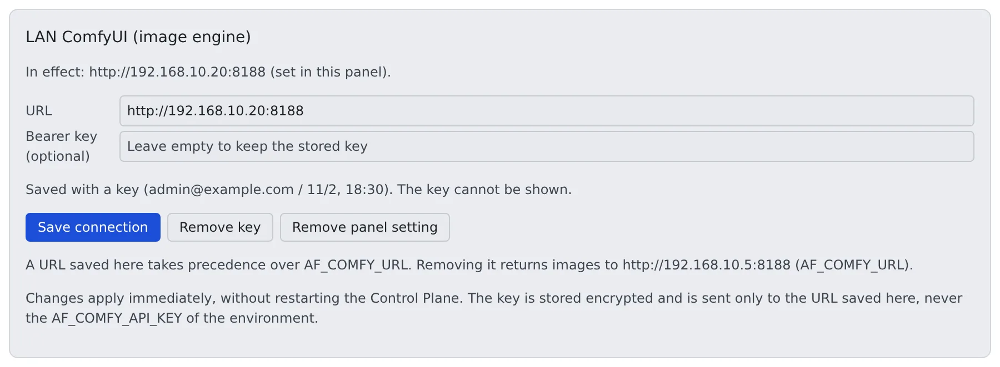

# Generate images on your own ComfyUI

English | [日本語](comfyui.ja.md)

Let a `compose` / `native` / `docker` deployment use a ComfyUI running on your own network as its image engine.
Sessions reach it through the Control Plane, so they never learn where it is or what its key is.

## How it works

| What you do | What happens |
|---|---|
| Run ComfyUI on a machine with a GPU (`comfyui-lan.sh` starts the fleet's own image) | ComfyUI listens on a port |
| Enter the URL and key in the panel under Admin → Inference engines, or in `AF_COMFY_URL` | The Control Plane makes one image engine row and relays the sessions' image requests to it |
| Register the models by hand on the Inference engines screen | Members and agents can generate images with those models |
| Make sure nothing but the Control Plane reaches ComfyUI | Sessions cannot go around the Control Plane and use ComfyUI directly |

ComfyUI stays yours. The Control Plane neither starts nor stops it, and puts no cost on it.
If you run another Agent Fleet on AWS, you can borrow its engines instead ([Borrow another deployment's engines](borrow.md)).

> What `comfyui-lan.sh` does with docker was tested against a stand-in, not on a real GPU machine. The OpenAI-compatible image server row was only tried against a test fake.

## Run the fleet's image on a GPU machine

If the machine has no ComfyUI yet, `deploy/comfyui-lan/comfyui-lan.sh` starts the same ComfyUI image the `ecs-ec2` image engine runs (`ghcr.io/k-k1/agent-fleet/comfyui`), at the same version.
The workflows sessions send are tested against that version.

What the machine needs:

- x86_64 Linux (the image is amd64 only) and Docker Engine
- An NVIDIA driver (`nvidia-smi -L` lists the GPU) and the [NVIDIA Container Toolkit](https://docs.nvidia.com/datacenter/cloud-native/container-toolkit/latest/install-guide.html)
- A clone of this repository, or `deploy/comfyui-lan/` together with `deploy/aws/ecs/cfn/60-engines.yaml` (the image tag is read from it)

If anything is missing, the script stops before changing anything and says what is missing.
The main options of `up` are below. Every option, and the `AF_COMFY_LAN_*` variable for each, is in `comfyui-lan.sh --help`.

| Option | What it decides |
|---|---|
| `--models <dir>` | The folder mounted read-only as ComfyUI's `models/`. The kind folders (`checkpoints/`, `diffusion_models/`, `clip/`, `text_encoders/`, `vae/`, `loras/`) are created when missing. Nothing is downloaded |
| `--bind <addr>` | The address the port is published on. The default `127.0.0.1` only works when the Control Plane is on the same machine; otherwise pass the LAN address. `0.0.0.0` is accepted only together with `--all-interfaces` |
| `--port <n>` | The published port. The default is `8188` |
| `--api-key-file <file>` | Puts a bearer-checking proxy (Caddy) in front of ComfyUI and publishes nothing else. The file holds one key of 24 characters or more and must be readable by its owner only |
| `--pull` / `--digest sha256:…` / `--build` | Pull the image again, pin it by digest, or build it on the machine instead of pulling |

The other commands:

- `comfyui-lan.sh status`: shows the container's state and health (`/system_stats`)
- `comfyui-lan.sh down`: removes the container. The models and the image stay

Good to know:

- `up` with the same arguments changes nothing, so it is safe to run again. The container is recreated only when the image or the settings change
- After upgrading the deployment, `git pull` and run the same `up`. It pulls the new tag and recreates the container
- The script labels what it creates, and stops instead of replacing an unlabelled container or network of the same name
- Images ComfyUI writes stay inside the container and are lost when it is recreated
- The container restarts with docker (`--restart unless-stopped`)

For a ComfyUI you set up yourself, start it with `--listen` (without it, it answers on loopback only) and allow the Control Plane's machine through the firewall on that port.
The ComfyUI Desktop setting on Windows that matches `--listen` has not been checked.

## Tell the Control Plane where ComfyUI is

There are two ways. One of them is enough.

### From the Admin screen

No restart is needed.

1. As the deployment administrator, open **Admin** → "**Inference engines**".
2. In "**LAN ComfyUI (image engine)**" at the top, enter the **URL** and the "**Bearer key (optional)**".
3. Press "**Save connection**". It takes effect at once, and sessions are told.

- The key is stored encrypted and cannot be read back. The panel shows only whether one is set. Press "**Remove key**" to remove it
- The URL must be `http://` or `https://` and must not carry a user name or password. Put the bearer in the key field
- A URL saved in the panel is sent the panel's key only. Without a key, no `Authorization` header is sent
- When the saved URL redirects to another scheme, host or port, the Control Plane refuses instead of following it

### From the environment

The Control Plane reads these once at start. Restart the Control Plane after changing them.

| Variable | Meaning |
|---|---|
| `AF_COMFY_URL` | The full URL with the port, as the Control Plane sees it (for example `http://192.168.1.20:8188`). Setting it creates the image engine row |
| `AF_COMFY_API_KEY` | Optional. Sent as `Authorization: Bearer`, on generation requests and on the health check |

| Target | Where it goes |
|---|---|
| compose / docker | `.env` next to the compose file |
| native | The environment of `af start`, or `Environment=` in the systemd unit ([the native runbook](../../../deploy/native/README.md#image-generation-on-a-comfyui-on-your-network--optional)) |

### Which setting is used

For the image role, the higher one wins. The panel shows which one is in use and what removing the panel setting returns to.

| Order | Source | What the panel shows |
|---|---|---|
| 1 | An `image` row managed by the engine stack (AWS) | No fields. To use a LAN ComfyUI, take the role out of the stack |
| 2 | The URL saved in the panel | "In effect: … (set in this panel)." |
| 3 | `AF_COMFY_URL` | "In effect: … (from AF_COMFY_URL in the Control Plane's environment)." |
| 4 | An external row of the engine table, or an engine borrowed from another Agent Fleet | "In effect: … (from this deployment's engine table)." and so on |

"**Remove panel setting**" does not stop image generation. The next source in this order takes over at once.
To stop image generation, turn the engine **off** on the Inference engines screen.

## Run more than one image engine

Every image engine is one row of the engine table. `AF_COMFY_URL` is a shortcut that writes one row with the key `image`.
On `compose` / `native` / `docker`, any other row goes in `AF_ENGINES_JSON`, which the Control Plane reads at start (row format: [the native runbook's "More than one engine row"](../../../deploy/native/README.md#more-than-one-engine-row)).

| What you want | How to write it |
|---|---|
| A LAN ComfyUI next to a borrowed `image` | A row in the table with its own key such as `comfy-lan`, not `AF_COMFY_URL`. A role whose key is already served locally is not borrowed |
| An OpenAI-compatible image server | An `external` row with `provider: "openai-compat"`. The weights live on the server, so there are no files to declare |
| A bearer per row | `AF_ENGINE_API_KEY_<KEY>`, where `<KEY>` is the row's key in upper case with every non-alphanumeric character turned into `_` (key `oai-image` reads `AF_ENGINE_API_KEY_OAI_IMAGE`) |

- Members decide which engine goes first. Each engine appears under its own name in Settings → Agents → "**Image provider order**", and a failure moves on to the next ([Have a session make images](../../user/images/from-session.md))
- Passing a row's key as `generate_image`'s `provider` uses that engine only. A failure does not move on
- The Control Plane can drive the providers `comfy` and `openai-compat`. A row naming any other provider is marked on the Inference engines screen with the provider it names. Point the row somewhere else

## On and off

On the Inference engines screen this kind of engine appears as "**External**". It has two modes, on and off. There is no on-demand.

- Off only closes the route. Sessions stop seeing the engine, but ComfyUI keeps running. Stop it on its own machine
- State, desired count, instance and when it stops are not shown. The deployment does not know them

## Register the models

Nothing takes files in. The model list is a declaration you write. On the Inference engines screen, register each model with the following (the screen is in [Inference engines and read aloud](../07-engines.md#taking-models-in-and-what-that-has-to-do-with-tenants)).

| Field | What to write |
|---|---|
| id | The name members see |
| `base_model` (family) | The key that picks the workflow. A wrong one fails only when someone generates |
| File name | Spelled exactly as ComfyUI's loader lists it |

To find the file names, press "**Look at this engine's files**" on the external ComfyUI row.
The checkpoint, LoRA and VAE file names ComfyUI has right now appear, and "**Add a row with this name**" registers one. It asks once, when pressed.
ComfyUI does not tell the family, so you choose it.

Watch for:

- **Put the files directly in the kind folders.** A file in a subfolder (`checkpoints/sdxl/x.safetensors`) arrives as `x.safetensors` and fails with `Value not in list`
- A row missing a file it needs is marked. Only the declaration is checked, not whether the file is on disk
- **Some checkpoints ship without a VAE** (many SDXL ones from model sites). As they are, every request fails with `VAE is invalid: None`. Declare a VAE as the row's second file, with the flag `--vae`
- The deployment reads the header and marks a missing VAE only on models it took in. It cannot read a row you registered by hand, so such a row is not marked
- A **Qwen-Image 2.1** row needs ComfyUI v0.37.0 or later. An older version accepts the row, but every generation fails

## Close the routes to ComfyUI

ComfyUI has no authentication of its own, and its API accepts prompts and image uploads.
Workspace containers can reach out through NAT, so unless you act, **sessions can use ComfyUI directly, without the Control Plane**.

| Way | What it does |
|---|---|
| Put a reverse proxy in front of ComfyUI | Require a bearer and give the key to the Control Plane only. Require the same bearer on `/system_stats` (the health check). `comfyui-lan.sh --api-key-file` sets up this proxy. This is the one that works today |
| Enforce egress control | Drops traffic to private addresses that are not on the allowlist. Workspace traffic is not yet forced through the proxy, though ([Security Operations](../04-secure.md#operating-egress-control)) |

With neither, anyone with a session on this deployment can use that GPU.

## When it goes wrong

### Image generation fails at once

The Control Plane does not wait for an engine it does not own. When ComfyUI does not answer, the request is refused at once with `503 engine_unavailable`. The body carries the URL it tried and the health path.

Check in this order:

1. Is ComfyUI running on that machine (`comfyui-lan.sh status`)?
2. Can the Control Plane's machine reach that address and port?
3. Behind a keyed proxy, does the Control Plane have the same key?

### What the panel shows and does not show

| Item | Shown |
|---|---|
| warm | A liveness check when the panel opens (one request, up to 2 s, cached for 10 s). It means "answered just now", not "has been up all along" |
| History | Not shown. An external engine has no control loop to record it |
| Cost | None. Nothing appears in cloud cost either |

## Related

- [Borrow another deployment's engines](borrow.md)
- [Chat on a llama.cpp on your LAN](llama-cpp.md)
- [Inference engines and read aloud](../07-engines.md): the Inference engines screen and registering models
- [Deployment targets](../../ref/deploy-targets.md): what each target supports
