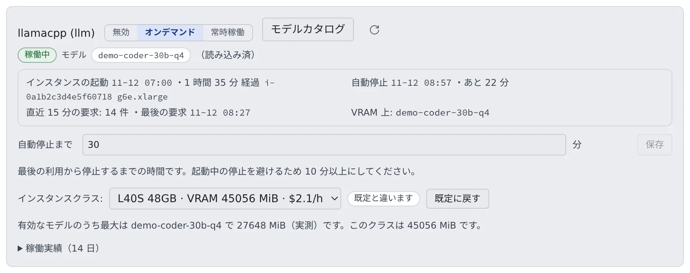

# 自前の GPU で推論エンジンを動かす

[English](gpu.md) | 日本語

配備自前の GPU で、チャットのエンジン（llm）と画像生成のエンジン（image）を動かせます。
いつ GPU のインスタンスを買い、いつ止め、どの大きさを買うかを、管理モーダルの「**推論エンジン**」で決めます。

## 全体像

| あなたがやること | 起きること |
|---|---|
| 役ごとにモードを選ぶ | Control Plane が GPU のインスタンスを買い、止める |
| 「**自動停止まで**」の時間を決める | 最後の利用からその時間がたつと、インスタンスが止まる |
| インスタンスクラスを選ぶ | 次に買うインスタンスから、GPU の大きさが変わる |
| Spot を許す | 中断されることがある代わりに安い提案も、買う候補に入る |
| 「**全画像から除外する語**」を決める | 画像エンジンが描くすべての絵に、その語が効く |

エンジンに載せるモデルは [推論エンジンにモデルを取り込む](models.ja.md)、動いているかと稼働の履歴は [推論エンジンの状態と履歴を見る](status.ja.md) にあります。
どのテナントのどのメンバーが使えるかは、テナント管理者が [推論エンジンを使える人とモデルを決める](../../admin/resources/engines.ja.md) で決めます。

## 始める前に

GPU のインスタンスを買えるのは AWS の ECS の配備で、エンジンのスタック（`60-engines`）を建てたときです。
スタックの建て方とパラメータは [ECS の runbook](../../../deploy/aws/ecs/README.md#optional-the-fleets-own-inference-engines-cfn60-enginesyaml) にあります。

GPU を持たない配備でも、ほかのエンジンを同じ画面に並べられます。

| エンジン | ページ |
|---|---|
| 自分のネットワークの中の ComfyUI | [08 自前の ComfyUI で画像を生成する](../08-image-engine.ja.md) |
| 別の配備のエンジン | [09 別の配備のエンジンを借りる](../09-borrowed-engine.ja.md) |
| 自分のネットワークの中の llama.cpp | [10 自前の llama.cpp でチャットの推論を担う](../10-llm-lan.ja.md) |

## 推論エンジンの画面を開く

アカウントメニューの「**管理**」を開き、「**配備全体**」の「**推論エンジン**」を選びます。配備管理者（super_admin）だけが開けます。

エンジンごとに 1 行が出ます。

| 行の部分 | 何をするか |
|---|---|
| 「**無効**」「**オンデマンド**」「**常時稼働**」 | モードを選ぶ |
| 「**モデルカタログ**」 | そのエンジンのモデルを探し、取り込み、有効にする（[推論エンジンにモデルを取り込む](models.ja.md)） |
| 状態のバッジと、その下の数行 | いま何が動いているか（[推論エンジンの状態と履歴を見る](status.ja.md)） |
| 「**自動停止まで**」 | オンデマンドで止まるまでの時間を決める |
| 「**インスタンスクラス:**」 | 次に買う GPU の大きさを選ぶ |
| 「**稼働実績（14 日）**」 | いつ動いていたかを見る |

- エンジンを 1 本も動かしていない配備でも、この項目は出ます。そのときは Hugging Face と Civitai のモデルを検索して眺めるだけの画面になります
- 隣の「**API トークン**」も、エンジンがなくても開けます（[トークンを登録する](models.ja.md#トークンを登録する)）
- この build が扱えない images provider を名乗る行は、消されずに残り、印が付きます。行を `comfy` か `openai-compat` に向け直すまで、その行では `generate_image` が動きません

## モードを選ぶ

役ごとに、次の 3 つから選びます。

| モード | 起きること |
|---|---|
| **無効** | そのエンジンは起動メニューからも `generate_image` からも消え、要求は 503 で断られます。インスタンスはすぐ止まります |
| **オンデマンド** | 要求が来たときだけ GPU のインスタンスを買い、しばらく誰も使わなければ自分で止まります。既定はこれです |
| **常時稼働** | インスタンスを止めません。応答は速くなりますが、使っていない間も課金され続けます |

- 状態のバッジは、選んだモードではなく、いま実際に動いているものを表します。「無効」を押した直後は「**停止処理中**」と出ます。インスタンスがすぐには消えないためで、食い違いではありません
- 止まっているエンジンへの最初の要求は、インスタンスを買ってモデルを読み込むまで、3 分前後待ってから答えが返ります。呼び出しは 1 回で完結し、やり直しは要りません
- 急ぐ作業の前に「常時稼働」で暖めておくこともできます。用が済んだら「オンデマンド」に戻します。戻し忘れると、時間単価の課金が続きます

外部管理のエンジン（自分のネットワークの ComfyUI や llama.cpp）は「無効」と「常時稼働」の 2 つだけです。「無効」は経路を閉じるだけで、向こう側のエンジンは止めません。

## 自動停止までの時間を決める

オンデマンドで動くエンジンには「**自動停止まで**」（分）の欄があります。最後の利用からその時間がたつと、インスタンスが自分で止まります。

- 下限は欄の下に出ます。起動の途中で止めないよう、起動の期限より短くはできません
- 上限は 24 時間です
- 保存した値は、コントローラの次の巡回から効きます。変更は監査ログに残ります
- 外部管理のエンジンには、この欄はありません。この配備が止めることがないからです

## GPU のインスタンスクラスを選ぶ

配備がインスタンスクラスか提案（offer）を宣言しているときだけ、モードの下に「**インスタンスクラス:**」の選択欄が出ます。
どちらも宣言していない配備では、インスタンスは配備したときのもので固定です。

VRAM を多く使うモデルを試すときに、より大きい GPU のインスタンスへ一時的に上げるための欄です。

- **選んでも、いま動いているインスタンスは変わりません。** 効くのは次に買うインスタンスからです。動いているときは「いま動いているのは … のインスタンスです。」と出て、隣に「**いま入れ替える**」が出ます
- **入れ替えには、コールドスタート 1 回ぶんかかります。** チャットで約 9 分、画像で約 3 分です。新しいインスタンスはモデルを取り直し、古いインスタンスがクラスタから消えるまで起動しません
- **止まっているエンジンなら、選ぶだけでは費用はかかりません。** 次に誰かが使ったときの起動から反映されます
- **既定と違うクラスのままにすると、高い時間単価が続きます。** そのあいだ「**既定と違います**」のバッジと「**既定に戻す**」が出続けます。用が済んだら戻してください
- **チャットのエンジンのクラスを変えると、各モデルのコンテキストの長さも合わせて書き換わります。** 詳しくは [別のサイズに替える](models.ja.md#別のサイズやバージョンに替える) にあります
- 欄の下には、有効なモデルのうち最も大きいものが要る VRAM と、選んだクラスの VRAM が並びます（[モデルが載るかを確かめる](#モデルが載るかを確かめる)）

### 提案の順に買う

配備が提案を宣言しているときは、同じ GPU の段に「**オンデマンド**」か **Spot** の買い方が付いています。Control Plane は宣言された順に上から試し、買えなければ次へ移ります。

| 画面の表示 | 意味 |
|---|---|
| 「**提案（宣言された順に、上から試します）**」 | 宣言された提案の一覧 |
| 「**いまの提案:**」 | いま動いているインスタンスの提案 |
| 「**試した順:**」 | 直近の起動で試した提案と、それぞれの結果 |

結果には「**取れた**」「**在庫なし**」「**クォータ**」「**予算切れ**」「**取り上げられた**」「**要求の設定で買えず**」が出ます。

選択欄の既定は「**自動（既定）**」です。段を選ぶとそれに固定され、「**自動ではなく固定されています**」のバッジが出ます。固定した提案は、買えなくても次へ移りません。「**自動に戻す**」で解けます。

### Spot を許す

一覧に Spot の提案があっても、それだけでは買いません。一覧の下の「**中断を許容する（Spot のインスタンスを買ってよい）**」にチェックを入れた役だけが、Spot を候補にします。
チェックを入れるまで、その行には「**中断の許容が要ります**」の印が付き、選択欄でも選べません。

チェックを入れるときに受け入れるのは、次の 2 つです。

- Spot のインスタンスが取り上げられると、そのとき処理中だった応答は失われます。チャットなら会話の途中で切れます
- 次の要求は、コールドスタート（チャットで約 9 分、画像で約 3 分）を待ちます

同じ提案が続けて 2 回取り上げられると、その回の起動ではその提案を飛ばします。最後は VRAM の足りるオンデマンドの提案に落ち着きます。
チェックを外しても、いま動いている Spot のインスタンスはそのまま動き続けます。効くのは次に買うインスタンスからです。

## モデルが載るかを確かめる

モデルを有効にするとき、そのモデルが要る VRAM が選んでいるクラスを超えていると、確認を求められます。
禁止ではありません。量子化やオフロードで載ることもあるので、承知のうえなら「**承知のうえで有効にする**」で続けられます。
ただし VRAM が足りないと、CUDA は遅くなるのではなく落ちます。

要る VRAM の出どころは、画面に書かれます。

| 表示 | 意味 |
|---|---|
| 実測 | 運用する人がそのモデルで測った値 |
| 重みだけの下限 | ファイルの大きさから出した下限。コンテキストのぶんは含まない |
| 重み＋KV キャッシュの下限 | 重みに、その行のコンテキストの長さで要る KV キャッシュを足した下限 |
| 不明 | 誰も測っていない。「収まる」という意味ではない |

実測の値は、カタログの行の「**編集**」で入れます（[行を整える](models.ja.md#登録済みの行を整える)）。

## 全画像から除外する語を決める

画像エンジンの行には「**全画像から除外する語**」の欄があります。誰の要求でも、どのチェックポイントが答えても、ここに書いた語が使われます。
「描かせないもの」を言える場所は 3 つあり、上書きではなく足し合わされます。

| 場所 | 書く人 |
|---|---|
| カタログの行の「**描かせないもの**」 | 配備管理者。そのチェックポイントの配布元が避けるよう勧めているもの |
| 画像ツールの `negative_prompt` | 要求する人。要求ごと |
| 「**全画像から除外する語**」 | 配備管理者。エンジン全体 |

- 3 つとも空のときは、固定の既定（`blurry, lowres, deformed, watermark, text`）が使われます。行が自分の語を宣言すると、その既定に足すのではなく置き換えます
- 欄にはキーワードをカンマ区切りで書きます。長すぎる値は断られます

**これはネガティブプロンプトで、コンテンツフィルタではありません。** 語は「そこから離れる向き」としてサンプラーに渡されるだけで、強い prompt には負けます。

- 蒸留系のファミリーは、語を完全に無視します。Z-Image と FLUX.2 klein は cfg 1 でサンプリングするのでネガティブ側が打ち消され、FLUX.1 にはネガティブの入力そのものがありません
- 語が届くのは誘導のあるファミリー（SD 1.5・SDXL・SD3.5・Anima・Krea 2・Qwen-Image-Edit 2509 / 2511）です。そこでも cfg 1 の行では打ち消されます。Turbo 版のチェックポイント、Krea 2、Qwen-Image 2.1 は cfg 1 から始まるので、行が上げない限りそうなります
- 語を無視するモデルが答えた要求には、ファミリーの名前つきで警告が出ます

作られる絵について保証が要る配備でも、この欄はその保証になりません。

## うまくいかないとき

| 症状 | 原因と対処 |
|---|---|
| 最初の要求が 3 分ほど返らない | 止まっていたエンジンのコールドスタートです。急ぐときは前もって「常時稼働」で暖めます |
| クラスを変えても速くならない、大きいモデルが落ちる | 変わるのは次に買うインスタンスからです。「いま入れ替える」を押すか、次の起動を待ちます |
| クラスを変えたあと、起動がいつまでも終わらない | 選んだクラスがアカウントの GPU の台数上限を超えています。「状態」の下に ECS の理由（`VcpuLimitExceeded`）が出ます。AWS に GPU の上限の引き上げを依頼します |
| 「既定と違います」が出たまま | 大きいクラスのまま課金が続いています。「既定に戻す」を押します |
| Spot の提案が買われない | 「中断を許容する」にチェックが入っていません |
| 画像の行に provider の印が付き、`generate_image` が動かない | この build が扱えない provider を名乗っています。行を `comfy` か `openai-compat` に向け直します |

## 関連

- [推論エンジンにモデルを取り込む](models.ja.md)
- [推論エンジンの状態と履歴を見る](status.ja.md)
- [読み上げエンジンを動かす](read-aloud.ja.md)
- [推論エンジンを使える人とモデルを決める](../../admin/resources/engines.ja.md)：テナント管理者の画面
- [監査ログを見る](../../admin/audit.ja.md)：モード・自動停止・クラス・Spot・除外する語の変更の記録
