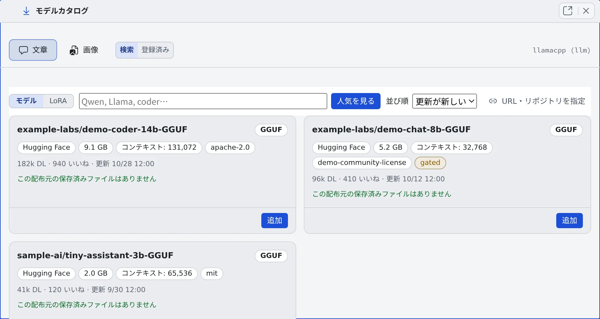

# 推論エンジンにモデルを取り込む

[English](models.md) | 日本語

Hugging Face と Civitai でモデルを探し、配備のカタログにワンクリックで取り込めます。
取り込んだモデルを有効にすると、次にエンジンが起動したときから使われます。

## 全体像

| あなたがやること | 起きること |
|---|---|
| 「**API トークン**」に Hugging Face と Civitai のトークンを登録する | gated のリポジトリや、ログインが要る資産も取り込めるようになる |
| 「**モデルカタログ**」で検索し、カードの「**追加**」を押す | そのモデルに要るファイルと費用を並べた計画のカードが開く |
| 計画を読んで「**取り込む**」を押す | 取り込みのタスクがファイルを S3 Bucket に置き、カタログに行ができる |
| 行を有効にする | 次の起動から、エンジンがそのモデルを読み込む |
| テナントに取り込みを許可する | そのテナントの管理者にも、縮小版のモデルの画面が出る |

エンジンのモードと GPU のサイズは [自前の GPU で推論エンジンを動かす](gpu.ja.md) で決めます。

## トークンを登録する

アカウントメニューの「**管理**」→「**配備全体**」→「**API トークン**」を開きます。エンジンを 1 本も登録していなくても開けます。

| トークン | ないとき |
|---|---|
| Hugging Face のトークン | gated でないリポジトリしか取り込めない |
| Civitai のトークン | ログインが要る資産を取り込めない |

- どちらも配備全体で 1 つです。暗号化して保存され、読むのは取り込みのタスクだけで、エンジンのインスタンスには渡りません
- 登録と削除は監査ログに残ります
- **Civitai Red**（Civitai が NSFW の閲覧用に分けた姉妹ドメイン）を検索の出所に加えるスイッチも、ここにあります。出るのは、配備がそれを与えられたとき（Control Plane の `AF_ENGINE_CIVITAI_RED`）だけです。標準の配備にはありません

Civitai Red のスイッチは、配備が何を提供するかの選択で、内容の絞り込みではありません。既定の Civitai の検索にも、Civitai の NSFW のレベルを持つモデルは出ます。

## モデルを探す

「**推論エンジン**」の行の「**モデルカタログ**」を押すと、カタログが別のペインで開きます。

| 切り替え | 選ぶもの |
|---|---|
| 「**文章**」「**画像**」 | どの役のエンジンのカタログか |
| 「**検索**」「**登録済み**」 | 探すか、取り込んだものを見るか |
| 「**モデル**」「**LoRA**」 | チェックポイントか LoRA か。LoRA がチェックポイントの一覧に混ざることはありません |

- チャットのモデルは Hugging Face から探します。画像のモデルは、出所のタブ（**Civitai**・**Hugging Face**、与えられた配備では **Civitai Red**）で 1 つを選んで探します
- 「**ファミリー**」で 1 つに絞れます。既定は「**すべて**」です。ComfyUI 向けの構成のリポジトリも、普通のものと同じように見つかります
- 検索結果・絞り込み・スクロールの位置は、ほかのタブを見ているあいだも保たれます

カードには、ダウンロードする前に分かる「出所が許していないこと」が印で出ます。

| 種類 | 印 |
|---|---|
| Hugging Face の gated | 「**gated（規約に同意）**」「**gated（作者の承認待ち）**」 |
| Civitai のログイン | 「**要ログイン**」（Civitai のトークンで通ります） |
| ライセンスと内容 | **商用不可**・**要クレジット表記**・**派生不可**・**同一ライセンスのみ**・**有料**・**早期アクセス（期限付き有料）**・**非公開**・**サイト内生成専用（DL 不可）**・**NSFW**（Civitai のレベルつき）・**実在人物**・**未成年**・**ウイルススキャン未通過**・**pickle 警告** |

印が 1 つもないカードは「判別できなかった」という意味で、「誰でも使える」という意味ではありません。

## 計画を読んで取り込む

1. カードの「**追加**」を押します。計画のカードが開きます
2. 計画を読みます。そのモデルに要るファイルが 1 行ずつ、押したときにかかる費用、ライセンス、出所の警告が並びます
3. 「**ファミリー**」を確かめます。取り込み元の名前（「SDXL 1.0」「Illustrious」など）が配備の知っているファミリーなら、選ばれた状態で開きます。知らない名前なら「**選んでください**」のままで、選ぶまで取り込めません
4. 「**取り込む**」を押します

計画の費用の欄には、次のどれかが出ます。

| 表示 | 意味 |
|---|---|
| MiB の数 | 出所からダウンロードする |
| 「**取得なし（配備が持っています）**」 | 同じバイト列をすでに持っているので、取り直さない |
| 「**取得なし（バケットの中で移します）**」 | S3 Bucket の中で置き場所を移すだけ |

- ファイルの置き場所と、そのファミリーに要る部品（テキストエンコーダや VAE）は、Control Plane が決めます。カードは役割もキーもファイル名も訊きません。複数ファイルに分かれたモデルも、同じワンクリックで入ります
- 作者が公表している Steps・CFG・サンプラーは、「**作者の記述から拾いました（未検証）:**」の下に、拾った一文と一緒に出ます。「**この値を入れる**」で残ります。推測はしません
- 要る部品の宛先をほかの行がすでに宣言しているとき、または終わっていない取り込みのジョブがあるときは、警告が 1 行出て、先にすること（その行を揃える、そのジョブを消す）を示します
- チャットのモデルの計画には、選んでいる GPU クラスに収まるかの判定が出ます。「**コンテキスト**」の欄は、モデルの公開上限ではなく、クラスに収まる最大の長さで開きます
- この配備で実際に測った画像のファミリーなら、その実測値が欄の隣に出ます。取り込みは実測の欄に書きません。取り込んだあと、行の「**編集**」で入れます

## 有効にして使う

取り込んだ行は、「**登録済み**」で有効にします。

- 「**有効にする**」で、そのモデルをエンジンが読み込める状態にします。選んでいる GPU クラスの VRAM を超えるときは確認が出ます（[モデルが載るかを確かめる](gpu.ja.md#モデルが載るかを確かめる)）
- 「**これで起動する**」で、エンジンが起動するときに読み込むモデルを決めます
- 有効な行は、起動のたびに全部インスタンスへ同期されます。有効な行を増やすほど、コールドスタートは長くなります

## 登録済みの行を整える

「**登録済み**」では、取り込んだ行がカードで並びます。

- 画像の行はファミリーごとにまとまり、チップで 1 つに絞れます。ファミリーを宣言していない行は、有効にできないので先頭に来ます
- チャットの行は、取り込み元のリポジトリごとにまとまります。見出しには、そのリポジトリのサイズのうち何件を配備が持っているかが出ます
- カードの見出しは配布元が付けた名前とバージョンで、行の id はその下に出ます。配布元の作例も出ます

| 操作 | すること |
|---|---|
| 「**編集**」 | 説明・ファミリー・実測 VRAM・チャットのモデルのコンテキストと最大出力・LoRA の「**起動語**」・生成の「**パラメータ**」を直す |
| 「**ファイル**」 | ファイルごとの取り込み元を見る。「**配布元を見る**」で配布元のページを開く |
| 「**揃える**」 | 足りない部品を揃える。中身は正しいのに置き場所が違うファイルは、取り直さずに S3 Bucket の中で移す |
| 「**名前と作例をまとめて取る**」 | 名前と作例のない行を、配布元のページから埋める。カード 1 枚ごとの「**配布元から名前を取る**」もある |
| 「**登録を消す**」 | カタログの行だけを消す。S3 Bucket のファイルは残り、保管費がかかり続ける |

- 生成の「**パラメータ**」は、ファミリーの既定に欄ごとに上書きされます。空欄はファミリーの既定のままです
- 名前と作例は、取り込み元が素の URL の行と、取り込み元の記録がない行では埋められません。配布元のページがないからです
- 作例の画像は配布元の場所を指しているだけで、配備は複製しません。配布元が消した画像は空の枠になり、同じ操作で直ります

### S3 Bucket を見る

登録済みの行の下の「**バケット**」には、配備が S3 Bucket に持つオブジェクトの全部が、それを宣言している行・取り込み中・失敗と一緒に並びます。

- どの行も宣言していないバイト列は、そこでモデルとして登録するか、消せます
- ファイルが揃っていない行は、行の「**揃える**」で直します。部品の側からは操作しません

## 別のサイズやバージョンに替える

| カードのボタン | 出てくるもの |
|---|---|
| 「**この配布元の他の量子化を見る**」「**別サイズ…**」（Hugging Face のチャットのモデル） | 同じリポジトリのほかのサイズ。それぞれに、サイズ・KV キャッシュ・GPU クラスに収まるか |
| 「**別バージョン…**」（Civitai の画像のモデル） | そのモデルのほかのバージョン。サイズ・収まるか・取り込み済みか |

収まるかの判定は「**収まります**」「**ぎりぎり（n%）**」「**このクラスでは入りません**」のどれかで、入らないときは入る最小のクラスも出ます。

- 判定は重みと KV キャッシュの見積もりです。llama.cpp の計算バッファーと CUDA のコンテキストは含みません
- どの行の「**追加**」も、記入済みの計画のカードを開きます。取り込むと新しい行になります
- 入れ替えるときは、新しい行で「**これで起動する**」を押してから、古い行の「**登録を消す**」を押します
- チャットのモデルの「**編集**」でも判定が出て、「**このクラスに収まる最大 n にする**」でワンクリックで入ります
- チャットのエンジンの GPU クラスを変えると、全行のコンテキストの長さが新しいクラスに合わせて書き換わります。書き換わった行と、合わせられなかった行が理由と一緒に並びます。効くのは次の起動からです

### 指示編集のファミリー

| ファミリー | できること | 参照画像 |
|---|---|---|
| Qwen-Image-Edit 2509 / 2511 | 編集と部分描き直しだけ。素の生成・strength・寸法の選択はない | 3 枚まで |
| Qwen-Image 2.1 | 生成と編集 | 10 枚まで |

Qwen-Image 2.1 は、編集のファミリーとファイルを 1 つも共有しません。オートエンコーダが別のものなので、部品は編集のファミリーのものがあっても、自分のファイルとして取り込まれます。
Qwen-Image 2.1 に要る ComfyUI のバージョンは [自前の ComfyUI で画像を生成する](comfyui.ja.md#モデルを登録する) にあります。

寸法を指定しないリクエストは、ファミリーが決めたサイズで描かれます。メガピクセル世代のファミリーは 1024×1024、SD 1.5 は 512×512 です。行に寸法の一覧があれば、そちらが優先です。

## 取り込みを断られたとき

「宛先をすでに何かが押さえている」で断られると、カードが押さえているものを示し、次の一手を 1 つだけボタンで出します。

| | 出るもの |
|---|---|
| 押さえているもの | **登録済みの行**・**取り込みジョブ**・**バケットのオブジェクト**・**実行中のタスク** |
| 次の一手 | 「**登録**」・「**揃える**」・「**置き換える**」・「**行の登録を消す**」・「**ジョブを消す**」（終わった取り込みの記録を 1 行消す） |

## テナントに取り込みを許可する

取り込みを開始できるのは、既定では配備管理者（super_admin）だけです。
「**管理**」→ テナント →「**上限・自動停止**」→「**推論エンジンのモデル取り込み**」で、テナントに許可できます。許可されたテナントの管理者には、縮小版のモデルの画面が出ます。
許可でテナント管理者に何ができるかは、[推論エンジンを使える人とモデルを決める](../../admin/resources/engines.ja.md#モデルを取り込む) にあります。

**カタログは配備に 1 つで、テナントごとには分かれません。取り込んだモデルの id は、どのテナントからも見えます。**

- GPU のインスタンスはテナントのあいだで共有していて、有効なモデルは起動のたびに全部そのインスタンスへ同期されます
- テナントごとにカタログを持たせると、1 テナント 1 モデルでも、5 テナントほどでコールドスタートが 10 分を超えます
- 分けたい境界は GPU のインスタンスで、カタログではありません。この許可を、テナントのあいだの分離として扱わないでください

## 関連

- [自前の GPU で推論エンジンを動かす](gpu.ja.md)
- [推論エンジンの状態と履歴を見る](status.ja.md)
- [推論エンジンを使える人とモデルを決める](../../admin/resources/engines.ja.md)：テナント管理者の画面
